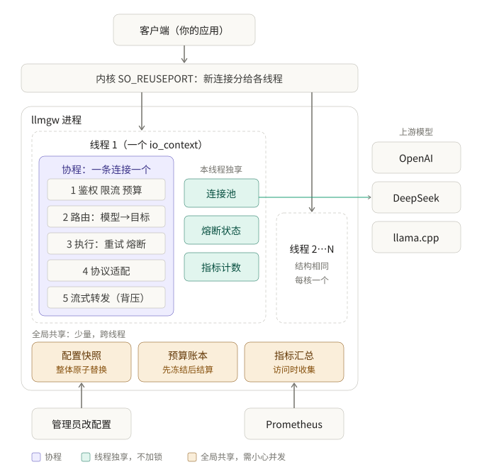

# llmgw

[](https://github.com/bluesky-rgb/llmgw/actions/workflows/ci.yml)

[中文](README.md) | **English**

> **An LLM gateway that won't make you pay twice and won't go down when one provider does.**
> Open source · self-hosted · a single binary

llmgw puts several model providers — OpenAI (GPT), MiniMax, Xiaomi MiMo, a local llama.cpp, or anything else that speaks the OpenAI API — behind one OpenAI-compatible endpoint. Applications only change their `base_url`; when one provider fails, the request moves to the next one; and the retry rules are designed so that **a retry never charges you twice**.

> **Status: v0.2 Alpha (in development, not released yet; the binary currently reports 0.1.0).** The new architecture runs ([usage guide](docs/usage.md), in Chinese): the OpenAI-compatible API, failover, billing-safe retry rules, four kinds of timeouts, connection pooling and backpressure. Client authentication with gateway keys (only their hashes are stored in the config) is available; **rate limiting and budgeting are not yet** (planned for v0.3). Without authentication enabled, `llmgw serve` refuses to listen on a non-local address unless you pass `--allow-unauthenticated`. v1.0 is planned for January ([roadmap](docs/roadmap.md)).
>
> The design documents are written in Chinese. This page, [CONTRIBUTING.md](CONTRIBUTING.md) and [SECURITY.md](SECURITY.md) are the English entry points; issues and discussions in English are welcome.

## Why

| Problem | What llmgw does | Available |
|---|---|---|
| Every provider's API is a little different | One OpenAI-compatible endpoint; per-target request rewriting (`drop_fields`, `rename_fields`, `set_fields`) and business error-code mapping handle the differences | ✅ v0.2 |
| One provider is down or rate-limited and your product is down with it | An ordered fallback chain per model; requests move to the next target automatically | ✅ v0.2 |
| Naive retries bill you twice | A request is **not** retried once the provider may already have processed (and billed) it — e.g. a timeout after the request was sent, or a 500/504 — unless you opt in; such responses carry `x-should-retry: false` so the OpenAI SDKs don't retry them either | ✅ v0.2 |
| Costs get out of hand | Per-key token and cost accounting, daily/monthly budgets, downgrade to cheaper models | v0.3 |
| Upstream API keys are scattered across applications | Applications hold a gateway key; the real provider keys live only on the gateway | v0.3 (gateway keys) |
| You can't see what's happening | Prometheus metrics (including time-to-first-token), JSON logs, a Grafana dashboard | v0.3 |

**Why C++?** Streaming responses keep a connection open for a minute or two, so the real load on a gateway is **many long-lived connections**. With C++20 coroutines a single core forwards 9,000 concurrent streams at about 28 KB per stream, with no GC pauses and no language runtime to deploy ([benchmark report #1](docs/benchmark.md)).

## Architecture



(The diagrams are labelled in Chinese.)

- **One thread per core, one coroutine per connection.** Threads use all cores; coroutines let each core look after thousands of connections
- **Threads share almost nothing.** Connection pools, breaker state and metric counters are per-thread, so the hot path takes no locks
- **Five layers per request:** authentication, rate limits, budget → routing → execution (retries, breakers) → provider adaptation → streaming with backpressure
- **Pluggable:** a small core with seven extension points assembled from configuration; adding another OpenAI-compatible provider is a configuration change

## Quick start

```bash
# Build (CMake ≥ 3.24, GCC 13 / Clang 17 or later, OpenSSL 3)
cmake -S . -B build -G Ninja -DCMAKE_BUILD_TYPE=Release
cmake --build build && ctest --test-dir build

# Configure (the example includes GPT, MiniMax China and MiMo Token Plan).
# The example does not enable authentication: listen on localhost only
# (to serve other machines, create gateway keys with `llmgw keygen`; see "鉴权" in the usage guide)
cp config/llmgw.example.json llmgw.json
sed -i 's/"host": "0.0.0.0"/"host": "127.0.0.1"/' llmgw.json
export OPENAI_API_KEY=sk-...  MINIMAX_API_KEY=...  MIMO_API_KEY=tp-...
./build/src/app/llmgw check -c llmgw.json
./build/src/app/llmgw serve -c llmgw.json

# Call it
curl http://127.0.0.1:8080/v1/chat/completions -H "Content-Type: application/json" \
  -d '{"model":"smart","stream":true,"messages":[{"role":"user","content":"Hello"}]}'
```

`smart` tries GPT first, then MiniMax, then MiMo. Provider keys are read only from environment variables; the configuration file holds the variable names. Docker: `docker build -t llmgw .` (see the Docker section of the [usage guide](docs/usage.md#docker)).

Any OpenAI client works — change `base_url` and use the gateway's model names (`smart`, `fast`, …), so you can change providers later without touching application code:

```python
from openai import OpenAI
client = OpenAI(base_url="http://127.0.0.1:8080/v1", api_key="unused")  # gateway keys arrive in v0.3
client.chat.completions.create(model="smart", messages=[{"role": "user", "content": "Hello"}])
```

## Scope

| v1.0 | Not planned | Later (v1.x) |
|---|---|---|
| OpenAI-compatible chat completions (streaming and non-streaming) | TLS termination (use a reverse proxy) | Anthropic protocol |
| OpenAI, MiniMax, Xiaomi MiMo verified first; other OpenAI-compatible upstreams (llama.cpp, vLLM, …) | Storing conversations | Multi-instance (Redis) |
| Routing, failover, circuit breakers, timeouts | User management, a web console | Embeddings, Responses API |
| Connection pooling, backpressure, overload protection | Multi-tenant SaaS billing | Exact and semantic caching |
| Authentication, rate limiting, cost accounting, budgets | Content moderation | Smart routing, HTTP/2 |
| Metrics, logs, hot reload, graceful shutdown | Production use on Windows / macOS | OpenTelemetry |

## Getting help and contributing

- **Questions and ideas:** [GitHub Discussions](https://github.com/bluesky-rgb/llmgw/discussions)
- **Bugs:** [open an issue](https://github.com/bluesky-rgb/llmgw/issues/new/choose) using the bug template
- **Security problems:** please report privately — see [SECURITY.md](SECURITY.md)
- **Contributing:** [CONTRIBUTING.md](CONTRIBUTING.md) (build, tests, the design-review process, DCO sign-off) and the [Code of Conduct](CODE_OF_CONDUCT.md)

## Project layout

```
src/          12 modules plus the app; implemented so far: core, config, server, upstream,
              stream, provider, router, executor, app
tests/        unit, integration and fuzz tests; a process-level smoke test of `llmgw serve`
prototype/    the v0.1 prototype (cpp-httplib), kept only as a performance baseline
config/       example configuration
tools/        mock upstream, benchmark scripts, the provider probe, repository checks
docs/         design documents, decision records, task designs (Chinese)
```

## License

[Apache License 2.0](LICENSE).
