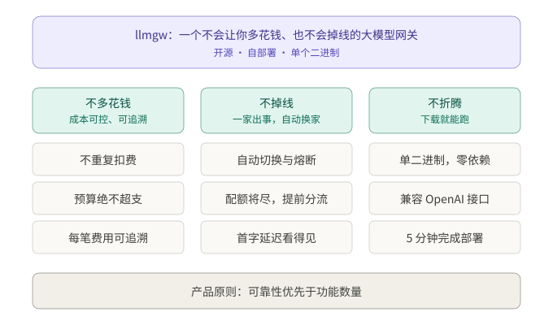
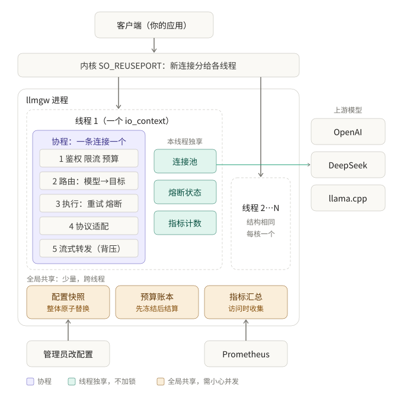
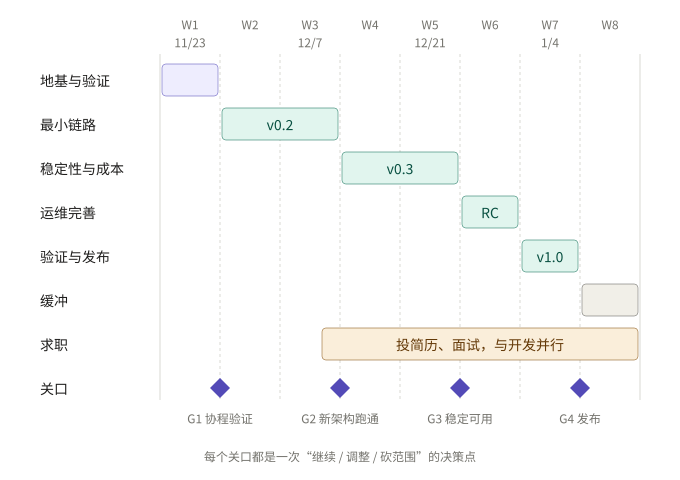

# llmgw

[](https://github.com/bluesky-rgb/llmgw/actions/workflows/ci.yml)

**中文** | [English](README.en.md)

> **一个不会让你多花钱、也不会掉线的大模型网关。**
> 开源 · 自部署 · 单个二进制

llmgw 把 OpenAI（GPT）、MiniMax、小米 MiMo 以及本地 llama.cpp 等多家模型统一到一个兼容 OpenAI 的接口后面。应用只改一下 `base_url` 就能接入；一家出问题时自动换下一家；并且从设计上保证**重试不会重复扣费、预算不会超支、每一笔费用都能查到来源**。



> **项目状态：** v0.2 Alpha（开发中，尚未发布；目前的程序版本号是 0.1.0）：新架构已经可以运行（[使用手册](docs/usage.md)）——OpenAI 兼容接口、故障切换、不会重复扣费的重试规则、四种超时、连接池、背压。客户端鉴权（网关 key，配置中只保存哈希）已经可用；**还没有限流和预算**（v0.3）。没有启用鉴权时，数据面监听非本机地址会被 `llmgw serve` 拒绝，除非显式加 `--allow-unauthenticated`。v1.0 计划 1 月发布（[落地计划](docs/roadmap.md)）。产品定位、目标用户和开源策略见 [产品定义](docs/product.md)。

## 解决什么问题

| 问题 | llmgw 的做法 | 可用 |
|---|---|---|
| 各家模型的接口不统一 | 对外只提供一个 OpenAI 兼容接口，现有 SDK 改一下 `base_url` 就能用；各家的参数差异由网关按目标处理 | ✅ v0.2 |
| 某一家宕机或限流，业务就挂了 | 按模型配置备用链路，自动切换；**按规则重试，不会重复扣费**（可能已扣费的结果不重试，并告诉 SDK 也不要重试）；连续失败的上游会被熔断（v0.3） | ✅ v0.2 |
| 费用失控 | 按 key 统计 Token 和费用，设置日、月预算，超出时拒绝或降级到便宜的模型 | v0.3 |
| 上游 key 散落在各个应用里 | 应用只拿网关的 key，上游的真实 key 只保存在网关上 | v0.3（网关 key） |
| 看不到运行情况 | Prometheus 指标（包括首字延迟 TTFT）、JSON 日志、Grafana 看板 | v0.3 |

**为什么用 C++？** 性能是我们的第二卖点。流式输出一条连接要挂一两分钟，网关真正的压力是**大量的长连接**。C++ 加协程可以让单机撑住上万条并发流，每条流只占几十 KB 内存，没有 GC 停顿，部署时也不需要任何语言运行时。详见[设计文档 1.2 节](docs/design.md#12-定位)。

## 架构



- **每核一个线程，每条连接一个协程**：线程负责用满多个 CPU 核，协程负责让每个核同时照看大量连接
- **线程之间尽量不共享数据**：连接池、熔断状态、指标计数都是每个线程一份，不需要加锁
- **请求依次经过五层**：鉴权、限流、预算 → 路由 → 执行（重试、熔断） → 协议适配 → 流式转发（带背压）
- **可插拔**：微内核 + 插件，中间件、路由策略、协议适配等 7 个扩展点由配置组装；新增 OpenAI 兼容的厂商只需改配置
- **稳定**：入口、流量、调用、资源、进程五层纵深防护，每种故障模式都有对应的应对措施和自动化测试

不熟悉这些概念的话，建议先读 [并发方案图解](docs/concurrency-explained.md)，里面用 8 张图从头讲起。

## 范围

| v1.0 支持 | 明确不做 | 以后再做（v1.x） |
|---|---|---|
| OpenAI 兼容的对话接口（流式 / 非流式） | TLS 终结（交给 Nginx 等反向代理） | Anthropic 协议适配 |
| 首批验证 OpenAI（GPT）、MiniMax、小米 MiMo；其他 OpenAI 兼容上游（llama.cpp、vLLM 等） | 存储对话内容 | 多实例部署（Redis） |
| 模型路由、故障切换、熔断、超时 | 用户体系、Web 管理后台 | Embeddings、Responses API |
| 连接池、背压、过载保护 | 多租户 SaaS 与计费 | 精确缓存与语义缓存 |
| 鉴权、限流、费用核算、预算 | 内容审核 | 智能路由、HTTP/2 |
| 指标、日志、热加载、优雅退出 | Windows / macOS 生产运行 | OpenTelemetry |

完整的范围表（以及原型的实现情况）见 [设计文档第 2 节](docs/design.md#2-范围与边界)。

## 客户端怎么接入

**不需要额外的 SDK**：OpenAI 官方 SDK、LangChain、Dify 等任何支持 OpenAI 接口的工具，把 `base_url` 换成网关地址即可（v0.3 起 `api_key` 换成网关 key）。

```python
from openai import OpenAI
client = OpenAI(base_url="http://127.0.0.1:8080/v1", api_key="unused")  # 网关 key 在 v0.3 提供
client.chat.completions.create(model="smart", messages=[{"role": "user", "content": "你好"}])
```

模型名使用网关的逻辑名（如 `smart`、`fast`），以后网关调整背后的厂商时，应用代码不用改。错误处理、重试、超时、用量查询等见 [客户端接入指南](docs/client-guide.md)。

## 快速开始

```bash
# 编译（需要 CMake ≥ 3.24、GCC 13 / Clang 17 以上、OpenSSL 3）
cmake -S . -B build -G Ninja -DCMAKE_BUILD_TYPE=Release
cmake --build build && ctest --test-dir build

# 配置（示例已包含 GPT、MiniMax 国内站、MiMo Token Plan）。示例没有启用鉴权：只监听本机
# （要给其他机器用：llmgw keygen 生成网关 key，见使用手册的“鉴权”一节）
cp config/llmgw.example.json llmgw.json
sed -i 's/"host": "0.0.0.0"/"host": "127.0.0.1"/' llmgw.json
export OPENAI_API_KEY=sk-...  MINIMAX_API_KEY=...  MIMO_API_KEY=tp-...
./build/src/app/llmgw check -c llmgw.json
./build/src/app/llmgw serve -c llmgw.json

# 调用
curl http://127.0.0.1:8080/v1/chat/completions -H "Content-Type: application/json" \
  -d '{"model":"smart","stream":true,"messages":[{"role":"user","content":"你好"}]}'
```

`smart` 会先用 GPT，失败后依次切换到 MiniMax、MiMo；**请求可能已经被上游扣费时不会重试**。配置字段、切换规则、接入本地 llama.cpp、Docker 等详见 [使用手册](docs/usage.md)。

## 提问与贡献

- **使用问题、想法**：[GitHub Discussions](https://github.com/bluesky-rgb/llmgw/discussions)
- **Bug**：[提交 Issue](https://github.com/bluesky-rgb/llmgw/issues/new/choose)（使用 Bug 模板）
- **安全问题**：请私下报告，见 [SECURITY.md](SECURITY.md)
- **贡献代码**：[CONTRIBUTING.md](CONTRIBUTING.md)（构建、测试、设计评审流程、DCO 签名）和 [行为准则](CODE_OF_CONDUCT.md)

## 文档导航

| 想了解 | 文档 |
|---|---|
| **产品为谁、解决什么问题、和同类项目有什么不同** | [产品定义](docs/product.md) |
| 项目目标、范围、架构、工程设计、各项机制 | [设计文档](docs/design.md) |
| **应用怎么接入网关**：示例、模型名、请求头、错误与重试、超时 | [客户端接入指南](docs/client-guide.md) |
| 每个任务怎么设计、评审、验证、合并 | [开发流程](docs/development-process.md) |
| 代码怎么组织、有哪些规范、怎么防止代码腐化 | [代码架构与可维护性规范](docs/code-architecture.md) |
| 怎样做到加厂商、加功能不改核心代码 | [可扩展与可插拔设计](docs/extensibility.md) |
| 会出哪些故障、怎么防护、怎么降级、怎么验证 | [稳定性设计](docs/stability.md) |
| 监控哪些指标、记录哪些日志、怎么出用量报表 | [监控、日志与统计设计](docs/observability.md) |
| GPT、MiniMax、MiMo 三家的接入方式、差异和验证清单 | [上游厂商适配说明](docs/providers.md) |
| 线程、协程、连接池、背压、预算预留是怎么回事 | [并发方案图解](docs/concurrency-explained.md) |
| 目标分解、上下文、用例、组件、类、时序、状态、部署、计划等分析图 | [分析与设计图](docs/diagrams.md) |
| 每个设计决策的背景、选择和代价 | [设计决策记录](docs/decisions.md) |
| 性能数据：并发流数、内存、延迟、和原型的对比 | [性能基准](docs/benchmark.md) |
| 怎么编译、配置和运行当前版本 | [使用手册](docs/usage.md) |
| 先做什么、怎么排期、落后了先砍什么 | [落地计划](docs/roadmap.md) |
| 上线前还要做哪些事（按优先级） | [生产就绪检查清单](docs/production-readiness.md) |
| 还有哪些问题没定、哪些文档要补 | [设计文档第 11 节](docs/design.md#11-待补充与开放问题) |

## 路线图



- [x] **M1 原型与设计**：v0.1 原型、全部设计文档
- [ ] **M2 地基与最小链路**（11/23–12/13）：协程 demo、新架构、三家上游验证、压测报告 #1 → v0.2
- [ ] **M3 稳定性与成本**（12/14–12/27）：鉴权、限流、预算、熔断、重试规则、看板 → v0.3
- [ ] **M4 运维完善**（12/28–1/3）：热加载、过载保护、优雅退出、命令行、部署方案 → RC
- [ ] **M5 验证与发布**（1/4–1/10）：长稳与混沌测试、最终压测报告 → v1.0

任务拆分、关口和范围调整规则见 [落地计划](docs/roadmap.md)。

## 当前代码结构

```
src/          12 个模块和 app；已实现 core、config、server、upstream、stream、provider、router、executor、app
tests/        单元、集成、模糊测试，llmgw serve 的进程级冒烟测试；真实上游的响应样本
prototype/    v0.1 原型（cpp-httplib），只作为性能对照组保留（prototype/README.md）
config/       配置示例
Dockerfile    新架构的镜像
cmake/        模块函数、依赖清单（dependencies.json）
tools/        mock-upstream（假上游）、压测脚本、上游探测工具，以及依赖规则、TODO、漏洞扫描、clang-tidy 等检查脚本
docs/         设计文档、图解、分析图、决策记录、使用手册
.github/      CI：Release、ASan + UBSan、TSan 三套构建，架构检查、模糊测试、镜像、依赖漏洞扫描
```

v1.0 的目标目录结构见 [设计文档 4.1 节](docs/design.md#41-目录结构v10-目标)。

## License

[Apache License 2.0](LICENSE)
