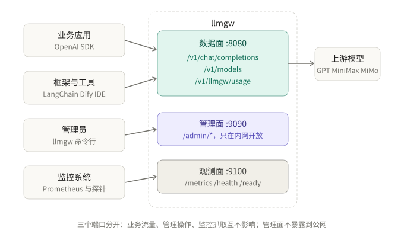

# 客户端接入指南

> 本文面向**使用网关的应用开发者**。设计层面的说明见 [design.md 3.6 节](design.md#36-客户端交互与接口契约)。



## 1. 一句话

**llmgw 对外就是一个 OpenAI 兼容的服务。** 任何支持 OpenAI 接口的 SDK、框架和工具，只要把 `base_url` 改成网关地址、`api_key` 换成网关发给你的 key，就能直接使用，不需要安装额外的 SDK。

## 2. 接入前要拿到的东西

向网关管理员申请：

| 项目 | 例子 | 说明 |
|---|---|---|
| 网关地址 | `http://llmgw.internal:8080/v1` | 数据面地址 |
| 网关 key | `sk-gw-…` | 只显示一次，请妥善保存；**不要**放进浏览器或手机 App |
| 可用的模型名 | `smart`、`fast`、`mimo` | 网关的逻辑模型名，也可以调用 `GET /v1/models` 查询 |
| 你的额度 | 每分钟 600 次、日预算 20 美元、最多 50 个并发 | 超出时会收到 429 或 402 |

## 3. 接入示例

### Python（OpenAI 官方 SDK）

```python
import httpx
from openai import OpenAI

client = OpenAI(
    base_url="http://llmgw.internal:8080/v1",
    api_key="sk-gw-...",
    max_retries=2,                                   # 保持默认即可，网关会告诉 SDK 什么时候不该重试
    timeout=httpx.Timeout(connect=5.0, read=120.0, write=30.0, pool=10.0),
)

stream = client.chat.completions.create(
    model="smart",                                   # 网关的逻辑模型名
    messages=[{"role": "user", "content": "你好"}],
    stream=True,
    user="user-42",                                  # 可选：你自己系统里的用户 ID，用于按用户统计用量
    extra_headers={"X-LLMGW-Tags": "feature=chat"},  # 可选：给这次调用打标签，用于按功能统计
)
for chunk in stream:
    print(chunk.choices[0].delta.content or "", end="")
```

### Node.js

```javascript
import OpenAI from "openai";

const client = new OpenAI({
  baseURL: "http://llmgw.internal:8080/v1",
  apiKey: "sk-gw-...",
  timeout: 300_000,
});

const resp = await client.chat.completions.create({
  model: "fast",
  messages: [{ role: "user", content: "用一句话介绍你自己" }],
});
console.log(resp.choices[0].message.content);
```

### curl

```bash
curl -i http://llmgw.internal:8080/v1/chat/completions \
  -H "Authorization: Bearer sk-gw-..." \
  -H "Content-Type: application/json" \
  -d '{"model":"smart","stream":true,"messages":[{"role":"user","content":"你好"}]}'
```

### 框架与工具

LangChain、LlamaIndex、Dify、各类 IDE 插件等，只要支持“自定义 OpenAI 兼容地址”，填入同样的 `base_url` 和 key 即可。

## 4. 选择模型名

网关提供的是**逻辑模型名**，而不是厂商的模型名。比如 `smart` 背后是“GPT 优先，失败后依次切换到 MiniMax、MiMo”。

| 模型名 | 适合 | 背后的路由 |
|---|---|---|
| `smart` | 需要最好效果的场景 | GPT → MiniMax → MiMo |
| `fast` | 对速度、成本更敏感的场景 | GPT 小模型 → MiMo |
| `gpt` / `minimax` / `mimo` | 必须固定使用某一家（比如 Agent 场景需要回传 MiMo 的 `reasoning_content`） | 只用这一家，不切换 |

**建议优先使用逻辑名**：以后网关调整背后的厂商或模型时，你的代码完全不用改。

## 5. 请求时可以带的信息

| 位置 | 字段 | 必填 | 作用 |
|---|---|---|---|
| 请求头 | `Authorization: Bearer <网关 key>` | 是 | 鉴权 |
| 请求体 | `model` | 是 | 网关的逻辑模型名 |
| 请求体 | 其他 OpenAI 标准参数 | 否 | 原样转发；各家厂商的差异由网关处理 |
| 请求体 | `user` | 否 | 你系统中的用户 ID，用于按用户统计用量（网关只保存它的哈希值） |
| 请求头 | `X-Request-Id` | 否 | 你自己的请求 ID，会出现在网关日志和响应头中；不传则由网关生成 |
| 请求头 | `X-LLMGW-Tags` | 否 | 给调用打标签，比如 `feature=summary,team=search`，用于按功能统计用量。最多 5 个，每个不超过 64 个字符 |
| 请求头 | `traceparent` | 否 | 如果你在用链路追踪，网关会把它透传给上游 |

## 6. 响应中可以拿到的信息

响应体与 OpenAI 完全一致。另外，响应头中有：

| 响应头 | 含义 |
|---|---|
| `X-Request-Id` | 这次请求的 ID。**遇到问题时请把它提供给管理员**，可以直接找到对应的日志 |
| `X-LLMGW-Provider` / `X-LLMGW-Upstream-Model` | 这次实际由哪家厂商、哪个模型处理 |
| `X-LLMGW-Attempts` | 尝试了几次上游（大于 1 表示发生了切换） |
| `x-ratelimit-limit-requests` / `x-ratelimit-remaining-requests` / `x-ratelimit-reset-requests` | 你的 key 的请求额度（字段名与 OpenAI 一致，现有工具能直接识别） |
| `x-ratelimit-remaining-tokens` 等 | 你的 key 的 token 额度 |
| `Retry-After` / `retry-after-ms` | 出现 429 或 503 时，建议多久之后再试 |
| `x-should-retry` | 网关明确告诉客户端是否应该重试（见第 7 节） |

## 7. 错误处理与重试

网关的错误格式与 OpenAI 一致：`{"error": {"message", "type", "code"}}`。

| 状态码 | `code` | 网关返回的 `x-should-retry` | 你应该怎么做 |
|---|---|---|---|
| 400 | `invalid_request` | `false` | 修正请求参数 |
| 401 | `invalid_api_key` | `false` | 检查网关 key |
| 402 | `budget_exceeded` | `false` | 预算用完了，联系管理员 |
| 404 | `model_not_found` | `false` | 检查模型名，或调用 `/v1/models` 查询 |
| 413 | `payload_too_large` | `false` | 缩小请求 |
| 429 | `rate_limited` | `true`，带 `Retry-After` | SDK 会自动等待后重试 |
| 502 | `upstream_unavailable` | `true`，带 `Retry-After`（至少 5 秒） | 网关已经尝试过所有上游；SDK 会延迟后重试 |
| 503 | `overloaded` | `true`，带 `Retry-After` | 网关繁忙，SDK 会自动等待后重试 |
| 504 | `upstream_timeout` | **`false`** | 上游可能已经在生成并计费，**不要自动重试**；由你的业务决定是否重新发起 |

**为什么 504 不让重试：** OpenAI 官方 SDK 默认会自动重试 5xx 错误。但 504 表示请求已经发给上游、只是没等到结果，上游可能已经在生成并计费。如果自动重试，就可能付两次钱。所以网关在这种情况下返回 `x-should-retry: false`，官方 SDK 会遵守这个响应头，不再重试。

**流式输出中途出错：** 网关会在流的末尾发送一条错误事件（`data: {"error": …}`），然后结束。官方 SDK 会抛出异常；已经收到的内容是否保留，由你的业务决定。

## 8. 超时设置建议

| 场景 | 建议 |
|---|---|
| 非流式请求 | 总超时不少于 300 秒（推理模型生成完整回答可能很慢，网关自己的等待上限也是 300 秒） |
| 流式请求 | 读取超时（两次收到数据之间的间隔）不少于 120 秒 |
| 连接超时 | 5 秒左右 |

客户端的超时如果比网关短，就会出现“客户端已经放弃，网关和上游还在继续工作并计费”的情况。

## 9. 查询自己的用量

```bash
curl http://llmgw.internal:8080/v1/llmgw/usage?period=today \
  -H "Authorization: Bearer sk-gw-..."
```

只能查询**当前 key 自己**的用量：请求数、token 数、费用、预算剩余、按模型和标签的拆分。

## 10. 安全注意事项

- **不要**把网关 key 放进浏览器、小程序或手机 App。前端应该调用你自己的后端，由后端调用网关
- 每个应用使用单独的 key，方便单独限流、统计和吊销
- key 泄露时，立即联系管理员吊销并更换（网关支持不停机更换 key）

## 11. 常见问题

**响应体里的 `model` 字段为什么不是我传的 `smart`？**
网关会原样返回上游实际使用的模型名（比如 `MiniMax-M3`），方便你知道这次是谁回答的。你传的逻辑名可以在日志中通过 `X-Request-Id` 查到。

**为什么同一个问题，两次的回答风格不一样？**
可能发生了故障切换，两次由不同的厂商回答。看响应头 `X-LLMGW-Provider` 就知道。如果你的场景需要固定使用某一家，请使用固定厂商的模型名。

**响应里出现了 `reasoning_content` 字段？**
这是 MiniMax 和 MiMo 返回的推理过程，网关原样透传。不需要的话忽略即可。
