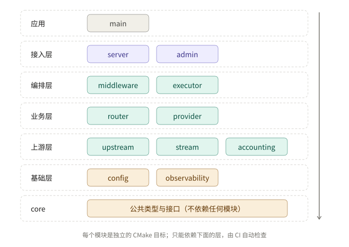

# 代码架构与可维护性规范

> [design.md](design.md) 讲的是**逻辑架构**：有哪些模块、怎么交互。本文讲的是**代码架构**：代码怎么组织、规则怎么**自动执行**，目的是让项目写到第 3 个月、第 30 个月，结构依然清楚。



## 1. 代码为什么会变成“屎山”

几乎所有失控的代码库，都是下面这几种原因慢慢积累出来的。每一种我们都有对应的约束，而且尽量**由工具强制执行**，不依赖人自觉。

| 成因 | 表现 | 对策 | 怎么保证执行 |
|---|---|---|---|
| 依赖关系混乱 | 改一处，牵动一片；模块之间循环引用 | 严格分层，每个模块只能依赖规定的下层模块 | CMake 配置时检查 + CI 脚本检查 + 头文件可见性 |
| 职责模糊 | 一个模块什么都做，新代码不知道该放哪 | 每个模块有 README，写明“负责什么”和“不负责什么” | 代码评审 |
| 全局状态 | 到处都能改，出了问题找不到是谁改的 | 禁止全局可变状态和单例；依赖通过构造函数传入 | 代码评审 + clang-tidy |
| 巨型函数和文件 | 一个函数几百行，没人敢动 | 限制函数复杂度、行数和文件行数 | clang-tidy + CI 脚本 |
| 隐式约定 | “这个函数只能在某个线程调用”只存在于某人脑子里 | 约定写进类型和接口（比如 `WorkerContext&` 参数）；协程规则用静态检查 | clang-tidy 的协程专项检查 |
| 没有测试，不敢改 | 重构全靠运气 | 每个模块必须有单元测试；修 bug 必须带回归测试 | CI 覆盖率门槛 |
| 改动没有记录 | 不知道为什么这样设计，后人随便推翻 | 改变模块边界或依赖规则时，必须写设计决策记录 | PR 模板 |
| 技术债越积越多 | “先这样，以后再改”，然后再也没改 | TODO 必须关联 Issue；每个里程碑留出重构时间 | CI 检查 TODO 格式 |

## 2. 物理结构

### 2.1 每个模块的标准结构

```
src/upstream/
├── README.md                    # 职责、不负责什么、对外接口、依赖、线程模型
├── include/llmgw/upstream/      # 公开头文件：其他模块只能看到这里
│   ├── pool.h
│   └── http_client.h
├── pool.cpp                     # 实现
├── http_client.cpp
├── internal/                    # 内部头文件：只有本模块能 #include
│   └── connection.h
└── CMakeLists.txt

tests/unit/upstream/             # 测试目录与模块一一对应
├── pool_test.cpp
└── http_client_test.cpp
```

模块 README 的模板在 [docs/templates/MODULE_README.md](templates/MODULE_README.md)。

### 2.2 每个模块是一个独立的 CMake 目标

用统一的函数创建模块（[cmake/LlmgwModule.cmake](../cmake/LlmgwModule.cmake)）：

```cmake
llmgw_add_module(upstream
  SOURCES pool.cpp http_client.cpp
  DEPS    core config observability)
```

这个函数会：
- 创建目标 `llmgw::upstream`
- 只把 `include/` 目录公开给依赖它的模块；`internal/` 和 `.cpp` 所在目录对别的模块**不可见**，想 `#include` 也找不到
- 检查 `DEPS` 是否在规则允许的范围内，**不允许就在 CMake 配置阶段直接报错**
- 打开 `-Wall -Wextra -Wpedantic -Werror`：新代码不允许有编译警告

### 2.3 依赖规则

规则只写在一个地方：[tools/module_deps.json](../tools/module_deps.json)。

| 层 | 模块 | 可以依赖 |
|---|---|---|
| 应用 | `app`（main） | 所有模块 |
| 接入层 | `server` | core、config、observability、middleware、router、executor |
| | `admin` | core、config、observability、accounting |
| 编排层 | `middleware` | core、config、observability、accounting |
| | `executor` | core、config、observability、provider |
| 业务层 | `router` | core、config |
| | `provider` | core、config、observability、upstream、stream |
| 上游层 | `upstream` | core、config、observability |
| | `stream` | core、observability |
| | `accounting` | core、config、observability |
| 基础层 | `config`、`observability` | core |
| core | `core` | 无 |

插件按照它所属的扩展点放在对应模块下（比如限流插件在 `middleware/ratelimit/`），遵守该模块的依赖规则。

### 2.4 三道防线

| 防线 | 时机 | 拦住什么 |
|---|---|---|
| CMake 配置检查 | 构建时 | 在 CMakeLists 中声明了不允许的依赖 |
| 头文件可见性 | 编译时 | 引用了其他模块的内部头文件，或者没声明依赖就引用（找不到头文件） |
| `tools/check_deps.py` | CI 中每次提交 | `#include` 了不允许依赖的模块；用 `../` 绕过目录；规则本身出现环或者向上依赖；文件超过 600 行 |

修改依赖规则需要在 PR 中说明理由，并补充一条设计决策记录。

## 3. 编码规范

### 3.1 命名

| 对象 | 风格 | 例子 |
|---|---|---|
| 类、结构体 | `CamelCase` | `UpstreamPool` |
| 函数、变量 | `lower_case` | `acquire_connection` |
| 私有成员 | 结尾加下划线 | `idle_timeout_` |
| 常量 | `k` 开头 | `kMaxBodyBytes` |
| 命名空间 | `llmgw::<模块>` | `llmgw::upstream` |
| 文件 | `lower_case.h` / `.cpp` | `http_client.cpp` |

由 clang-tidy 的 `readability-identifier-naming` 检查。

### 3.2 大小与复杂度

| 限制 | 上限 | 检查工具 |
|---|---|---|
| 函数的认知复杂度 | 25 | clang-tidy |
| 函数行数 | 80 | clang-tidy |
| 函数参数个数 | 6 | clang-tidy |
| 嵌套层数 | 4 | clang-tidy |
| 文件行数 | 600 | check_deps.py |

超过上限时，先考虑拆分；确实无法拆分的，在代码中用注释说明原因，并在评审中确认。

### 3.3 所有权与生命周期

- **默认使用值语义**；需要堆上分配时用 `std::unique_ptr`
- `std::shared_ptr` 只用于确实需要共享所有权的地方：配置快照、跨线程交接的对象
- 不使用裸指针表示所有权，不手写 `new` / `delete`
- `std::string_view` 和 `std::span` 只能作为参数使用，不能保存在可能比原数据活得更久的地方

### 3.4 协程专项规则

协程是最容易出“看起来没问题、线上偶尔崩溃”这种 bug 的地方：

| 规则 | 原因 | 检查工具 |
|---|---|---|
| 协程的参数**不要用引用** | 协程暂停期间，引用指向的对象可能已经被销毁 | clang-tidy `cppcoreguidelines-avoid-reference-coroutine-parameters` |
| 不要把有捕获的 lambda 写成协程 | lambda 对象销毁后，捕获的变量也就没了 | clang-tidy `cppcoreguidelines-avoid-capturing-lambda-coroutines` |
| 持有锁时不能 `co_await` | 协程可能在另一个时刻恢复，锁会被长时间持有甚至死锁 | clang-tidy `misc-coroutine-hostile-raii` |
| 协程里不能阻塞 | 会卡住同一线程上的所有连接 | 代码评审 + 运行时看门狗 |
| 不把一个 Worker 的对象交给另一个 Worker | 违反“线程独享、不加锁”的前提 | 接口约定：需要 `WorkerContext&` 的地方都标明了线程归属 |

### 3.5 错误处理

- 可能失败的操作返回 `std::expected<T, Error>`；`Error` 是 `core` 中定义的统一错误类型，包含错误码、HTTP 状态码和说明
- 热路径上不抛异常；异常只用于启动阶段（配置错误等）
- 不允许静默吞掉错误：要么处理，要么向上返回，要么至少记录日志和指标

### 3.6 依赖注入

- 模块之间的依赖**通过构造函数传入**，不使用全局变量和单例
- 每个 Worker 的资源打包在 `WorkerContext` 中传递
- 唯一的“全局注册表”是插件注册表，并且只在启动阶段读取

### 3.7 头文件

- 公开头文件只暴露必要的类型和函数；实现细节放在 `.cpp` 或 `internal/` 中
- 第三方库（Asio、simdjson 等）的类型**尽量不出现在公开头文件中**，必要时使用前置声明或 pimpl，减少编译依赖，也方便以后替换
- 每个头文件都能单独编译（不依赖包含顺序）

## 4. 测试规范

- 测试目录与模块一一对应：`tests/unit/<模块>/`
- 单元测试**不访问网络**；依赖的接口用测试替身（fake）实现
- 核心逻辑的覆盖率门槛：重试决策、熔断、限流、预算、SSE 解析、配置校验 ≥ 90%，其余模块 ≥ 70%
- **修 bug 必须带回归测试**：先写一个能复现问题的测试，再修复
- 测试名称描述行为：`retries_on_503_but_not_on_read_timeout`，而不是 `test1`

## 5. 自动化守护

| 检查 | 工具 | 状态 |
|---|---|---|
| 编译、单元测试、集成测试 | CMake + CTest | ✅ 已启用 |
| 内存错误、未定义行为、数据竞争 | ASan + UBSan、TSan | ✅ 已启用 |
| 模块依赖规则、文件行数 | `tools/check_deps.py` | ✅ 已启用 |
| 编译警告视为错误 | `-Werror`（`llmgw_add_module`） | ✅ 已启用（新模块和单元测试） |
| 代码格式 | clang-format 18 | ✅ 已启用（`src/`、`tests/unit/`） |
| 静态检查（命名、复杂度、协程规则、常见 bug） | clang-tidy 18（[.clang-tidy](../.clang-tidy)） | ✅ 已启用（`src/`） |
| 覆盖率门槛 | gcov / llvm-cov | M3 启用 |
| 依赖漏洞扫描 | `tools/check_vulns.py`：按提交哈希查询 OSV 数据库（[cmake/dependencies.json](../cmake/dependencies.json) 是依赖的唯一清单） | ✅ 已启用；每周定时运行 |
| TODO 必须关联 Issue | `tools/check_todos.py` | ✅ 已启用 |

## 6. 代码评审

- 每个 PR 都按 [PR 模板](../.github/pull_request_template.md) 中的检查清单自查：结构、并发与资源、错误与稳定、测试与观测、文档
- 改变模块边界、依赖规则、公开接口时，在 [decisions.md](decisions.md) 中补一条设计决策记录
- 一个 PR 只做一件事；重构和功能改动分开提交

## 7. 技术债管理

- 代码中的 TODO 必须写成 `// TODO(#123): 说明`，关联一个 Issue；没有 Issue 的 TODO 无法通过 CI
- 有意留下的技术债，在 Issue 中打上 `tech-debt` 标签，写明影响和偿还计划
- 每个里程碑留出约 20% 的时间用于重构和偿还技术债
- v0.1 原型移到 `prototype/` 目录，不受新规范约束，也不允许新代码依赖它

## 8. 从原型迁移到新结构（M2 第一步）

1. 把 `src/` 下的原型代码移到 `prototype/`，CI 继续编译和测试它（作为性能对照组）
2. 建立 `src/core/` 等模块目录，用 `llmgw_add_module` 创建目标
3. 原型中可以复用的部分（配置解析、SSE 解析、URL 解析、指标）按新规范改写后，放进对应的模块
4. 对新模块启用 clang-format、clang-tidy 和 `-Werror`
