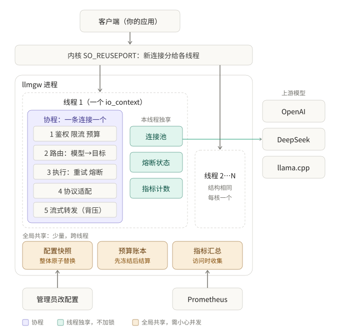
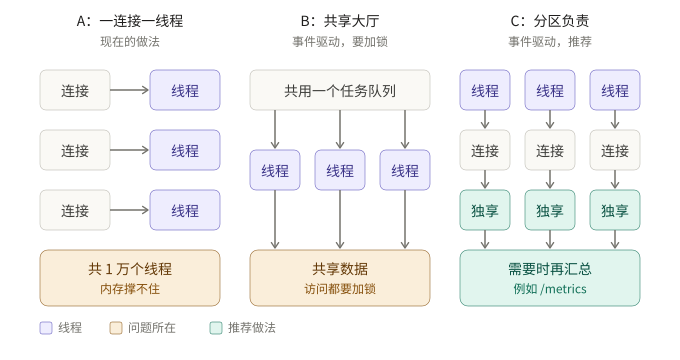
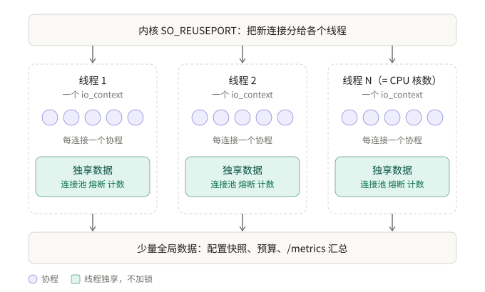
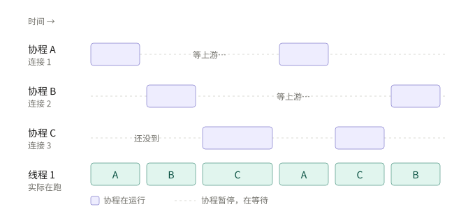
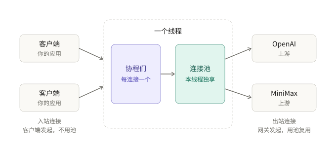
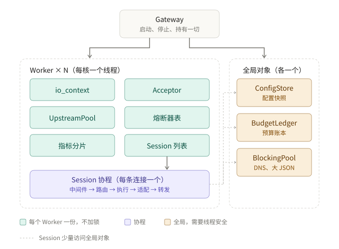
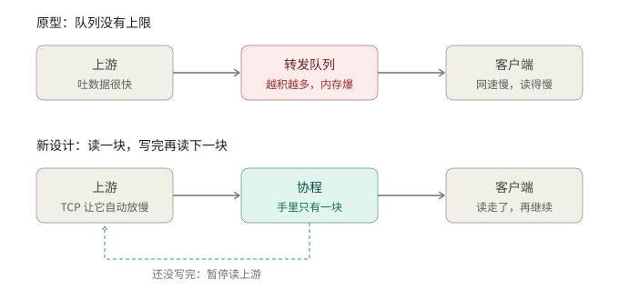
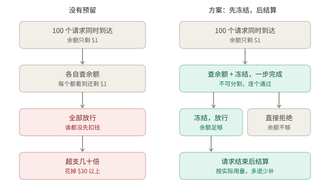

# 并发与连接方案图解

这份文档用 8 张图解释 llmgw 的并发方案：**每核一个线程 + 每连接一个协程 + 每线程一个连接池**。正式的设计规格见 [design.md 第 5.8 节](design.md#58-并发与连接设计)；这里侧重于“为什么这样设计”和“怎么理解”。

一句话总结：

> **线程负责用满多个 CPU 核（并行），协程负责让每个核同时照看大量连接（并发），连接池负责复用到上游的连接。线程之间尽量不共享数据。**

建议按顺序阅读：

| # | 图 | 回答的问题 |
|---|---|---|
| 1 | [整体架构](#1-整体架构) | 一个请求从进来到出去，会经过哪些部分？ |
| 2 | [三种线程模型](#2-三种线程模型) | 为什么选“分区负责”？ |
| 3 | [每核一个线程 + 协程](#3-每核一个线程--每连接一个协程) | 连接是怎么分配到线程和协程上的？ |
| 4 | [协程时间线](#4-协程时间线) | 一个线程怎么同时处理多条连接？ |
| 5 | [两种连接](#5-两种连接) | 连接池管的是哪种连接？ |
| 6 | [对象设计](#6-对象设计) | 代码里有哪些对象？各管什么？ |
| 7 | [背压](#7-背压) | 客户端很慢时，内存会不会被撑爆？ |
| 8 | [预算预留](#8-预算预留) | 大量请求同时进来，预算会不会超支？ |

---

## 1. 整体架构



跟着一个请求从上往下看：

1. **进门**：应用连上网关，内核把这条连接交给某个线程（比如线程 1），之后一直由它负责
2. **起协程**：线程 1 为这条连接启动一个协程（紫色），请求在协程里依次走完 5 步：
   - 第 1 步：鉴权、限流、预算检查（查预算会用到底部的“预算账本”）
   - 第 2 步：路由，决定按什么顺序尝试哪几个上游
   - 第 3 步：执行，逐个尝试上游，并查看“熔断状态”跳过已熔断的上游
   - 第 4 步：把请求转成对应厂商的格式
   - 第 5 步：从“连接池”取一条连接发给上游，把结果一块一块写回客户端
3. **出门**：连接池通过绿色箭头连到各个上游模型
4. **收尾**：在“指标计数”里记一笔，在“预算账本”里按实际用量结算

三种颜色代表三种数据：

| 颜色 | 含义 | 并发处理 |
|---|---|---|
| 紫色 | 协程，每条连接一个 | 同一线程上的协程轮流执行 |
| 绿色 | 每个线程独享的数据 | 只有本线程访问，**不加锁** |
| 橙色 | 全局共享的数据（数量很少） | 原子操作或极短的锁 |

---

## 2. 三种线程模型



可以用餐厅服务员来类比：

- **A，一个顾客配一个服务员（原型的做法）**：顾客等菜时，服务员只能站着干等。1 万个顾客就要 1 万个服务员，也就是 1 万个线程，光线程栈就要几十 GB 内存
- **B，共享大厅**：几个服务员共用一个任务队列，谁有空谁去。负载自动均衡，但连接池、熔断、指标这些数据是公用的，每次访问都要加锁，锁竞争会拖慢速度，也容易出并发 bug
- **C，分区负责（我们的选择）**：每个服务员负责固定的几桌，自己的东西自己管，不需要加锁

C 的代价是负载可能不完全均衡，而且每个线程的熔断状态是分开的：上游挂了以后，每个线程都要各自失败几次才会熔断。这个代价可以接受。

---

## 3. 每核一个线程 + 每连接一个协程



这是一个**两级划分**：

1. **第一级，连接分给线程（并行）**：CPU 有几个核就开几个线程，用 Linux 的 `SO_REUSEPORT` 让内核把新连接均匀分给各线程。一条连接从头到尾只由同一个线程处理
2. **第二级，线程内每条连接一个协程（并发）**：一个线程里有成百上千个协程，轮流执行

注意：协程不是把连接再分成几组，而是**一条连接对应一个协程**。

---

## 4. 协程时间线



协程的本质是**一个可以暂停、之后再接着执行的函数**，它会记住自己执行到了哪一步。

处理大模型请求时，绝大部分时间都在**等**：等上游生成下一个字，等客户端读走数据。所以协程在等待时（`co_await`）主动暂停，把线程让给其他协程。从图上可以看到，每个协程大部分时间都在等（虚线），而线程这一行几乎被排满了。

为什么不直接一条连接开一个线程？

| | 线程 | 协程 |
|---|---|---|
| 每个占用的内存 | 栈空间通常几 MB | 几百字节到几 KB |
| 切换方式 | 操作系统强制切换，开销大 | 在 `co_await` 处主动让出，开销很小 |
| 1 万条连接 | 1 万个线程，内存撑不住 | 1 万个协程，分布在几个线程上 |

⚠️ **由此产生一条必须遵守的规则：协程里不能阻塞。** 同一线程上的协程是轮流执行的，一个协程卡住（比如调用阻塞的 DNS 解析，或者解析一个几 MB 的 JSON），这个线程上的其他几千条连接都会跟着停住。会阻塞的操作一律交给 `BlockingPool`。

---

## 5. 两种连接



网关上有两种连接，不要混淆：

| | 入站连接 | 出站连接 |
|---|---|---|
| 方向 | 客户端 → 网关 | 网关 → 上游模型 |
| 谁发起 | 客户端 | 网关 |
| 谁管理 | 线程 + 协程 | **连接池** |

**连接池的作用**：请求结束后，到上游的连接不关闭，留给下一个请求接着用，省掉 TCP 握手和 TLS 握手的时间（跨境网络下每次可能要一两百毫秒）。

**每个线程一个连接池**，协程只会从本线程的池子里取连接，所以不需要加锁。

需要注意的两点：
1. **连接总数会被放大**：8 个线程、每个池 50 条，对同一个上游最多就是 400 条连接。所以每个池的上限要按“总上限 ÷ 线程数”来设置
2. **流式请求会长时间占用连接**：HTTP/1.1 下一条连接同时只能跑一个请求，流式输出可能持续一两分钟。所以池子主要省的是握手时间，并发流数仍然决定了连接数。以后改用 HTTP/2 多路复用可以改善这一点

---

## 6. 对象设计



把上面的思路落实到代码，一共有三类对象：

**每个 Worker 独有一份（绿色）**，Worker 数量 = CPU 核数，每个 Worker 就是一个线程：
- `io_context`：本线程的事件循环，负责调度协程
- `Acceptor`：接收新连接，每来一条就启动一个 Session 协程
- `UpstreamPool`：本线程的上游连接池
- 熔断器表、指标分片：本线程的统计数据

**Session 协程（紫色）**：每条客户端连接一个，请求在里面依次经过中间件 → 路由 → 执行 → 适配 → 转发。

**全局对象（橙色）**，各只有一个：
- `ConfigStore`：配置快照，热加载时整体原子替换
- `BudgetLedger`：预算账本，“查余额 + 冻结”在一把锁里一次完成
- `BlockingPool`：一个小线程池，专门执行会阻塞的操作

**三条规则：**
1. 协程里不能阻塞，会阻塞的操作交给 `BlockingPool`
2. 一个 Worker 的对象不能交给另一个 Worker 使用
3. 全局对象的锁里只做加减法，不做 I/O

---

## 7. 背压



用水管来类比：上游是大水龙头，客户端是细水管，网关在中间。

- **原型的问题（上一行）**：上游线程收到数据就塞进一个没有上限的队列。客户端网速慢时，数据越积越多，最后内存被撑爆
- **新设计（下一行）**：协程里的循环是“读上游一块 → 写给客户端 → 写完了再读下一块”。客户端读得慢，协程就停在“写”这一步等着，自然不会继续读上游。不读数据也不会丢数据，TCP 会让上游自动放慢发送。这样每条流同一时间只占用一块数据的内存

```cpp
for (;;) {
  auto chunk = co_await read_chunk(upstream);  // 等上游：线程先去忙别的
  if (chunk.empty()) break;
  co_await write(client, chunk);               // 客户端慢：就在这里等，不读下一块
}
```

**协程让背压变得几乎“免费”**：不需要额外设计带上限的队列。

---

## 8. 预算预留



用酒店押金来类比：入住时先冻结一笔押金，退房时再按实际消费结算。

- **没有预留（左边）**：预算只剩 1 美元时，100 个请求同时进来，每个都查到“还剩 1 美元”，于是全部放行，最后超支几十倍
- **先冻结、后结算（右边）**：
  1. 请求开始前，按输入长度加上 `max_tokens` 估一个费用上限
  2. “查余额”和“冻结”在 `BudgetLedger` 的一把锁里**一次完成**，请求只能逐个通过
  3. 余额够就冻结并放行，不够就直接拒绝
  4. 请求结束后按实际用量结算，多退少补

单机部署时，用一把临界区很短的互斥锁就够了；以后多实例部署时，换成 Redis 的 Lua 脚本，同样能保证原子性。

---

## 图的源文件

`images/` 下的 SVG 是手写的源文件，样式已经内嵌在文件里，可以直接在浏览器中打开。如果需要修改，直接编辑 SVG 即可。
