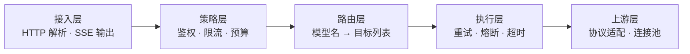

# llmgw 设计文档

| 项目 | 内容 |
|---|---|
| 文档状态 | v1.0 设计，主体已确定；未决问题见[第 11 节](#11-待补充与开放问题) |
| 当前代码 | v0.1 原型（cpp-httplib，线程池阻塞模型），用于验证功能和作为性能对照组 |
| 目标版本 | v1.0（Asio 协程，见[里程碑](#9-里程碑)） |
| 首批上游 | OpenAI（GPT）、MiniMax（国内站）、小米 MiMo（Token Plan），见 [上游厂商适配说明](providers.md) |
| 相关文档 | [上游厂商适配](providers.md) · [并发方案图解](concurrency-explained.md) · [分析与设计图](diagrams.md) · [设计决策记录](decisions.md) · [原型使用手册](usage.md) |

## 目录

1. [目标](#1-目标)
2. [范围与边界](#2-范围与边界)
3. [架构](#3-架构)
4. [工程设计](#4-工程设计)
5. [并发与连接设计](#5-并发与连接设计)
6. [关键机制](#6-关键机制)
7. [配置设计](#7-配置设计)
8. [技术选型](#8-技术选型)
9. [里程碑](#9-里程碑)
10. [风险](#10-风险)
11. [待补充与开放问题](#11-待补充与开放问题)
12. [附录：同类项目对比](#12-附录同类项目对比)

---

## 1. 目标

### 1.1 要解决的问题

团队接入大模型以后，很快会遇到这些问题：

| 问题 | 具体表现 |
|---|---|
| 接口不统一 | OpenAI、MiniMax、小米 MiMo、本地模型，各家的参数、推理内容、错误码、计费方式都有差异 |
| 不稳定 | 某一家限流（429）或宕机，业务就直接不可用 |
| 成本失控 | 不知道哪个应用、哪个 key 花了多少钱，也没法设上限 |
| 密钥分散 | 上游的真实 API key 散落在各个应用里，泄露风险高 |
| 看不见 | 首字延迟、失败率、Token 用量都没有数据 |

### 1.2 定位

> **llmgw 是一个用 C++ 写的、轻量、可自部署的大模型网关。** 一个二进制文件加一份配置文件就能运行，数据不出自己的服务器。

为什么用 C++？大模型本身的响应要几秒，网关省下 1 毫秒，用户是感觉不到的。C++ 的价值在别处：
- **单机能撑住大量长连接**：流式输出一条连接要挂一两分钟，并发连接数才是网关的真正压力
- **每条连接的内存占用低**：协程加上背压，每条流只占几 KB 到几十 KB
- **尾延迟稳定**：没有 GC 停顿
- **部署简单**：只依赖 OpenSSL，不需要语言运行时

### 1.3 目标用户与场景

- **目标用户**：5 到 50 人的技术团队，已经在使用 2 家以上的大模型服务，或者在混合使用云端模型和本地模型
- **典型场景**：
  - 内部多个应用共用一个入口，统一管理上游的 key
  - 主模型出故障时，自动切到备用模型或本地模型
  - 按应用或按人分配 key，并分别设置费用上限
  - 在 Grafana 上查看用量、费用、首字延迟

### 1.4 目标

**产品目标（v1.0）：** 小团队 10 分钟内完成部署，获得统一接口、自动容灾、成本管控和监控看板。

**个人目标：** 这是一个求职作品，需要做到：
- 体现 C++ 和后端的核心能力：高性能网络、并发、稳定性设计
- 关键特性都有**可量化的数据**（压测结果、优化前后的对比）
- 每个设计决策都有记录，能讲清楚“为什么”

### 1.5 成功标准

| 维度 | 指标 | 目标值 | 测量方式 |
|---|---|---|---|
| 并发 | 单机并发流式连接 | ≥ 10,000 条（4 核 8G） | 自写流式压测工具 + mock 上游 |
| 内存 | 每条空闲流式连接的内存 | ≤ 50 KB | 1 万条连接时的 RSS ÷ 连接数 |
| 开销 | 网关额外延迟 | P50 < 0.3 ms，P99 < 1 ms | 固定延迟的 mock 上游，对比直连和经过网关 |
| 吞吐 | 非流式请求 | ≥ 10,000 QPS（4 核） | wrk + mock 上游 |
| 容灾 | 熔断后跳过故障上游的耗时 | < 1 ms | 故障注入测试 |
| 稳定 | 连续运行 24 小时 | 内存无增长，无崩溃 | 长时间压测 |
| 质量 | 单元测试覆盖率 | ≥ 70%，CI 全部通过 ASan / UBSan / TSan | CI |

---

## 2. 范围与边界

### 2.1 v1.0 支持的功能

“原型”一列表示 v0.1 代码的现状：✅ 已实现，🟡 部分实现或有已知问题，⬜ 未实现。

| 类别 | 功能 | 说明 | 原型 |
|---|---|---|---|
| 接口 | `POST /v1/chat/completions` | 流式和非流式，兼容 OpenAI SDK | ✅ |
| 接口 | `GET /v1/models` | 列出配置的模型 | ✅ |
| 上游 | OpenAI 兼容服务 | 首批验证 **OpenAI（GPT）、MiniMax（国内站）、小米 MiMo（Token Plan）**；其他兼容服务（llama.cpp、vLLM 等）理论上可用。见 [providers.md](providers.md) | ✅ |
| 上游 | 厂商差异适配 | 每个目标可以删除、改名、强制设置请求参数；识别响应体中的业务错误码；按模型设置超时（见 [6.12](#612-厂商适配)） | ⬜ |
| 路由 | 模型路由与名称映射 | 对外模型名 → 按顺序排列的上游目标列表 | ✅ |
| 容灾 | 故障切换 | 按[重试规则](#61-重试与防重复扣费)切换，**不会造成重复扣费** | 🟡 读取超时也会重试，可能重复扣费 |
| 容灾 | 熔断 | 每个上游一个熔断器，三态模型 | ⬜ |
| 容灾 | 超时与取消 | 连接、首字节、空闲、总时长四种超时；客户端断开后立即停止读取上游 | 🟡 只有读取超时，取消不及时 |
| 性能 | 上游连接池 | 每个线程一个，复用 TCP / TLS 连接 | ⬜ |
| 性能 | 背压 | 客户端慢时自动放慢读取上游 | ⬜ 原型的队列没有上限 |
| 安全 | 网关 API key 鉴权 | 配置中只保存 key 的哈希，比较时用常量时间算法 | 🟡 明文保存，普通比较 |
| 成本 | Token 统计与费用核算 | 按价格表计算每个请求的费用 | 🟡 只统计 Token |
| 成本 | 预算 | 按 key 设置日、月预算，先冻结后结算 | ⬜ |
| 成本 | 限流 | 按 key 限制 RPM（每分钟请求数）和 TPM（每分钟 Token 数） | ⬜ |
| 运维 | 配置热加载 | `SIGHUP` 或 Admin API 触发，不中断正在进行的请求 | ⬜ |
| 运维 | 过载保护 | 连接数上限、排队超时，超出时返回 503 | ⬜ |
| 运维 | 优雅退出 | 停止接收新连接，等待进行中的请求结束（有上限时间） | ⬜ |
| 运维 | 健康检查 | `/health`（存活）和 `/ready`（可以接流量） | 🟡 只有 `/health` |
| 观测 | Prometheus 指标 | 请求、延迟、**首字延迟（TTFT）**、失败、Token、费用、熔断状态、连接池 | 🟡 没有 TTFT、费用、熔断、连接池 |
| 观测 | 结构化日志 | 每个请求一行 JSON，带 `request_id`；默认不记录请求内容 | ✅ |
| 部署 | Docker 镜像与 docker compose | 网关 + Prometheus + Grafana 一键启动 | 🟡 有 Dockerfile，未实际构建过 |
| 平台 | Linux x86_64 / arm64 | 生产环境只支持 Linux | ✅ |

### 2.2 明确不做

| 不做的事 | 原因 / 替代方案 |
|---|---|
| TLS 终结（HTTPS 入口） | 交给前面的 Nginx、Caddy 或云负载均衡；网关只监听内网 HTTP |
| 存储对话内容 | 隐私风险。只记录元数据（模型、用量、耗时） |
| 用户体系、登录、OAuth | 网关只认 API key；用户管理是上层系统的事 |
| 多租户 SaaS 与计费系统 | 定位是自部署工具 |
| Web 管理后台 | v1.0 只提供 Admin API 和 Grafana 看板 |
| 内容审核与安全过滤 | 不同业务的标准差异很大，应由业务自己处理 |
| 模型训练、微调、推理 | 推理交给 llama.cpp / vLLM，网关只做转发 |
| Windows / macOS 生产运行 | 依赖 Linux 的 `SO_REUSEPORT` 负载均衡语义；macOS 只用于开发调试 |

### 2.3 后续版本（v1.x）

按优先级排列：

1. **Anthropic 协议适配**：用 OpenAI 格式调用 Claude（需要转换请求、响应、流式事件和工具调用）
2. **多实例部署**：限流和预算状态放到 Redis
3. **`/v1/embeddings` 和 OpenAI Responses API**
4. **精确缓存与语义缓存**
5. **智能路由**：简单问题走本地小模型，复杂问题走云端
6. **HTTP/2**：上游连接多路复用，减少连接数
7. **OpenTelemetry 链路追踪**

### 2.4 系统边界与前提


系统上下文图见 [diagrams.md 第 2 节](diagrams.md#2-系统上下文图)。前提假设：
- 网关部署在内网，前面有负责 TLS 的反向代理
- 上游服务提供 OpenAI 兼容接口（v1.0 范围内）
- 客户端使用 HTTP/1.1（OpenAI 官方 SDK 默认如此）

---

## 3. 架构

### 3.1 总体结构

网关在逻辑上分成五层，在运行时则是“**每核一个线程，每条连接一个协程**”。上面那张图把两者合在了一起：协程里的 1 到 5 步就是五层的处理顺序。



**依赖规则：** 上层只依赖下层的接口，不能反过来。比如执行层不知道鉴权的存在。这样替换某一层（例如把 cpp-httplib 换成 Asio）时，影响范围只限于这一层。

### 3.2 模块划分

| 层 | 模块 | 职责 |
|---|---|---|
| 接入层 | `server` | 监听、HTTP 解析、SSE 输出、Keep-Alive、过载保护、优雅退出 |
| 接入层 | `admin` | Admin API：重新加载配置、查询用量 |
| 策略层 | `middleware` | 中间件接口与中间件链 |
| 策略层 | `auth` · `ratelimit` · `budget` | 鉴权、限流、预算 |
| 路由层 | `router` | 模型名 → 目标列表 |
| 执行层 | `executor` | 重试决策、切换、截止时间与取消 |
| 执行层 | `breaker` | 熔断器 |
| 上游层 | `provider` | 协议适配器（v1.0 只有 OpenAI 兼容这一种） |
| 上游层 | `upstream` | HTTP 客户端、连接池、DNS 缓存 |
| 上游层 | `stream` | SSE 解析、usage 提取 |
| 基础 | `core` · `config` · `accounting` · `observability` | 公共类型、配置快照、价格与费用、指标与日志 |

组件依赖关系图和类图见 [diagrams.md 第 4、5 节](diagrams.md#4-组件图)。

### 3.3 一个请求的处理流程

1. 接收连接，在所在线程上为它启动一个 Session 协程
2. 读取请求，取一份配置快照（整个请求期间都用这一份）
3. 策略层：鉴权 → 限流 → 预算冻结。任何一步不通过，直接返回 401 / 429 / 402
4. 路由层得到目标列表
5. 执行层逐个尝试：跳过已熔断的上游 → 从连接池取连接 → 发送请求 → 失败时按重试规则决定是否换下一个
6. 收到上游响应头后，确定返回给客户端的状态码；流式请求进入“读一块、写一块”的循环
7. 结束时（成功、失败或客户端中止）：连接还给池子或关闭，按实际用量结算预算，记录指标和日志

时序图见 [diagrams.md 第 6 节](diagrams.md#6-时序图)，请求状态图见[第 8.2 节](diagrams.md#82-一个请求的生命周期)。

### 3.4 部署形态

v1.0 只支持**单实例**部署：`Nginx → llmgw → 各上游`，旁边是 Prometheus 和 Grafana，用 docker compose 一键启动。多实例部署需要 Redis 共享状态，放在 v1.x。部署图见 [diagrams.md 第 10 节](diagrams.md#10-部署图)。

---

## 4. 工程设计

### 4.1 目录结构（v1.0 目标）

```
llmgw/
├── CMakeLists.txt
├── cmake/                  # 依赖获取、编译选项、sanitizer 配置
├── src/
│   ├── main.cpp
│   ├── core/               # RequestContext、错误码、时钟、ID
│   ├── config/             # 解析、校验、ConfigStore
│   ├── server/             # Worker、Acceptor、Session、HTTP 编解码
│   ├── admin/
│   ├── middleware/         # 链 + auth / ratelimit / budget
│   ├── router/
│   ├── executor/           # 重试决策、breaker
│   ├── upstream/           # 连接池、HTTP 客户端、DNS
│   ├── provider/           # 协议适配器
│   ├── stream/             # SSE
│   ├── accounting/         # 价格表、费用、BudgetLedger
│   └── observability/      # 指标分片、日志
├── tests/
│   ├── unit/               # 每个模块一个测试文件
│   ├── integration/        # mock 上游 + 真实网关
│   └── mock/               # 可配置延迟、错误率、断流的 mock 上游
├── bench/                  # 压测工具、脚本与结果
├── deploy/                 # Dockerfile、docker-compose.yml、Grafana 看板
├── prototype/              # v0.1 原型（作为性能对照组保留）
└── docs/
```

### 4.2 构建与依赖

- **语言标准**：C++20（需要协程）。编译器要求 GCC ≥ 12 或 Clang ≥ 15
- **构建**：CMake ≥ 3.24，依赖由 FetchContent 自动下载，版本固定；支持离线指定本地源码目录
- **依赖**（全部开源许可）：

| 库 | 用途 | 方式 |
|---|---|---|
| Boost.Asio / Beast（standalone 或 Boost ≥ 1.84） | 网络、协程、HTTP | FetchContent |
| OpenSSL 3 | TLS | 系统库 |
| simdjson | 热路径上的 JSON 解析 | FetchContent |
| nlohmann/json | 配置与构造 JSON | FetchContent |
| GoogleTest | 测试 | FetchContent |
| xxHash 或 BLAKE3 | API key 哈希 | FetchContent |

### 4.3 编码规范

- 格式统一使用 `.clang-format`（Google 风格，每行 100 字符），CI 中检查
- **热路径不抛异常**：用 `std::expected` 或错误码返回错误；异常只用于启动阶段（配置错误等）
- **协程里不能阻塞**：会阻塞的调用必须经过 `BlockingPool`
- **不跨线程传递 Worker 内的对象**（见[第 5 节](#5-并发与连接设计)）
- 日志里不能出现 API key 和请求内容

### 4.4 测试策略

| 层次 | 内容 | 何时运行 |
|---|---|---|
| 单元测试 | 配置校验、SSE 解析、重试决策表、熔断状态机、令牌桶、预算账本、费用计算 | 每次提交 |
| 集成测试 | mock 上游 + 真实网关：切换、熔断、限流、预算、热加载、优雅退出 | 每次提交 |
| 故障注入 | mock 上游可配置：延迟、错误率、中途断流、极慢输出、连接黑洞 | 每次提交 |
| Sanitizer | ASan + UBSan、TSan 两套构建 | 每次提交 |
| 模糊测试 | 用 libFuzzer 测试 SSE 解析器和 HTTP 解析器 | 每晚 |
| 性能测试 | 固定场景基准测试，结果写入 `docs/benchmark.md` | 每个里程碑 |
| 长时间测试 | 连续 24 小时压测，监控内存和文件描述符数量 | 发布前 |

**压测方法的要求**：使用固定延迟的 mock 上游，排除上游的波动；用开环负载（按固定速率发请求），避免“协调遗漏”问题导致尾延迟被低估；每组结果都记录机器配置和参数。

### 4.5 CI/CD 与发布

- **CI**（GitHub Actions，已配置）：Release、ASan + UBSan、TSan 三套构建都运行全部测试；v1.0 加上格式检查和覆盖率
- **版本号**：语义化版本（`v1.2.3`）。打 tag 后自动发布 GitHub Release（Linux x86_64 / arm64 二进制）和 Docker 镜像（ghcr.io）
- **提交规范**：Conventional Commits（`feat:` / `fix:` / `docs:` …），main 分支始终保持可用

### 4.6 从原型到 v1.0

| 原型的部分 | 处理方式 |
|---|---|
| `config` · `sse` · `url` · `metrics` · `logger` | 保留，按新的目录结构调整，再扩充功能 |
| `gateway.cpp`（cpp-httplib） | 移到 `prototype/`，作为性能对照组；新代码重写接入层和上游层 |
| 测试中的 mock 上游 | 扩充成独立的、可配置的 mock 服务 |

---

## 5. 并发与连接设计

> 📖 8 张配图的详细讲解见 [concurrency-explained.md](concurrency-explained.md)。

**核心思想：** 线程负责用满多个 CPU 核（并行），协程负责让每个核同时照看大量连接（并发），连接池负责复用到上游的连接。线程之间尽量不共享数据。

### 5.1 对象与职责

| 对象 | 数量 | 职责 | 线程安全 |
|---|---|---|---|
| `Gateway` | 1 | 读取配置、创建 Worker 和全局对象、启动与优雅退出 | 只在主线程使用 |
| `Worker` | N（默认 = CPU 核数） | 一个线程 + 一个 `io_context`，拥有下面这些“本线程独享”的对象 | 只被自己的线程访问 |
| `Acceptor` | 每个 Worker 一个 | 用 `SO_REUSEPORT` 监听同一个端口，接收新连接，创建 Session | 独享 |
| `Session` | 每条客户端连接一个协程 | 读请求 → 策略 → 路由 → 执行 → 转发；支持 Keep-Alive，同一条连接上可以依次处理多个请求 | 独享 |
| `UpstreamPool` | 每个 Worker 一个 | 按 `host:port` 管理到上游的空闲连接：取、还、淘汰、排队 | 独享，不加锁 |
| 熔断器表 | 每个 Worker 一份 | 每个上游一个熔断器 | 独享 |
| 指标分片 | 每个 Worker 一份 | 计数器和直方图 | 独享；访问 `/metrics` 时汇总 |
| 限流令牌桶 | 每个 Worker 一份 | 按“总额度 ÷ Worker 数”分配 | 独享（见 [6.5](#65-限流)） |
| `ConfigStore` | 1 | `atomic<shared_ptr<const Config>>`，热加载时整体替换 | 原子操作 |
| `BudgetLedger` | 1 | 预算的冻结与结算，“查余额 + 冻结”是一个原子操作 | 一把临界区极短的互斥锁 |
| `BlockingPool` | 1 | 少量线程，专门执行会阻塞的操作：DNS 解析、超大请求体的 JSON 解析 | 内部队列 |

### 5.2 必须遵守的规则

1. **协程里不能阻塞。** 同一线程上的所有协程轮流执行，一个阻塞就会卡住其他所有连接。会阻塞的操作一律交给 `BlockingPool`
2. **不把一个 Worker 的对象交给另一个 Worker 使用。** 跨线程只能通过全局对象，或用 `asio::post` 把任务投递到目标线程执行
3. **全局对象的临界区要尽量短。** 锁里只做加减法，不做 I/O

### 5.3 连接池

- **取连接**：有空闲就复用；没有且未达上限就新建；达到上限就排队，排队超时返回 503
- **还连接**：响应完整读完、且连接支持 Keep-Alive 才放回；中途出错或客户端中止则直接关闭
- **淘汰**：空闲超过 `idle_timeout`（默认 60 秒）就关闭
- **上限**：每个 Worker 的上限 = 每个上游的总上限 ÷ Worker 数，避免连接总数被放大
- **失效连接**：池里的连接可能已经被上游关闭。如果请求在发送阶段就失败，说明上游没收到，属于“可以安全重试”，自动换新连接重发一次
- **流式请求**：HTTP/1.1 下一条连接同一时间只能跑一个请求，流式输出期间连接一直被占用。池子主要省的是握手时间，并发流数仍然决定连接数。HTTP/2 多路复用留作 v1.x 的优化
- **DNS**：解析结果按 TTL 缓存（默认 60 秒），解析本身放在 `BlockingPool` 里执行

### 5.4 关键参数

| 参数 | 默认值 | 说明 |
|---|---|---|
| `server.workers` | CPU 核数 | Worker 线程数 |
| `server.max_connections` | 10000 | 入站连接总数上限，超出后直接拒绝 |
| `server.max_body_bytes` | 32 MB | 请求体上限（允许带 base64 图片） |
| `upstream.max_connections` | 每个上游 256（总数） | 按 Worker 数平均分摊 |
| `upstream.idle_timeout` | 60 秒 | 空闲连接淘汰时间 |
| `blocking_pool.threads` | 4 | 阻塞操作线程数 |

超时参数见 [6.3](#63-超时与取消)。

---

## 6. 关键机制

### 6.1 重试与防重复扣费

**原则：** 请求一旦已经送到上游，上游可能已经在生成内容并开始计费，这时盲目重试会付两次钱。

| 失败情况 | 上游是否可能已经计费 | 处理 |
|---|---|---|
| DNS 解析失败、连接失败、TLS 握手失败 | 不可能 | ✅ 换下一个目标 |
| 复用的连接在发送阶段就失败 | 不可能 | ✅ 换新连接重发 |
| HTTP 429、502、503 | 不会 | ✅ 换下一个目标 |
| 上游返回 401、403 或余额不足 | 不会 | ✅ 换下一个目标。这是网关自己的上游 key 出了问题，不能把 401 转给客户端；同时记录告警指标 |
| 读取超时、连接被重置（已发出请求，未收到响应头） | **不确定** | ❌ 默认返回 504；可以配置为允许重试 |
| HTTP 500、504 | **不确定** | ❌ 默认原样返回；可以配置为允许重试 |
| 其他 4xx | 不会，但重试也没用 | ↩️ 原样返回 |
| 流式输出开始以后中断 | 已经计费 | ❌ 不切换，在流末尾追加 `error` 事件（见 ADR-003） |

另外两个限制：**总尝试次数**不超过目标数量，**所有尝试共享同一个截止时间**。完整的决策流程见 [diagrams.md 第 7 节](diagrams.md#7-活动图重试决策)。

### 6.2 熔断

- 每个 Worker 内，每个上游一个熔断器，三种状态：
  - **Closed → Open**：最近 20 次请求中失败率超过 50%，或者连续失败 5 次
  - **Open → HalfOpen**：冷却时间到。初始 30 秒，每次探测失败后翻倍，上限 5 分钟
  - **HalfOpen**：只放行一个探测请求。成功就回到 Closed，失败就回到 Open
- 上游返回 429 并带有 `Retry-After` 时，在这段时间内直接把它当作 Open
- 计为“失败”的只有上游的问题（连接失败、5xx、429、超时），4xx 不计入
- 熔断状态是每个线程各自一份。代价是：一个上游出故障后，每个线程都要各自失败几次才会熔断。这个代价可以接受

状态图见 [diagrams.md 第 8.1 节](diagrams.md#81-熔断器)。

### 6.3 超时与取消

| 超时 | 默认值 | 含义 |
|---|---|---|
| `timeouts.connect` | 10 秒 | 建立到上游的连接（包括 TLS 握手） |
| `timeouts.first_byte` | 60 秒 | 发出请求后，等待响应头 |
| `timeouts.idle` | 60 秒 | 流式输出中，两块数据之间的最长间隔 |
| `timeouts.total` | 600 秒 | 整个请求的截止时间，包括所有重试 |

推理模型（GPT-5.6、MiniMax-M3、MiMo 默认都开启思考）的首字延迟可能长达几十秒；非流式请求更要等整个回答生成完才有响应头。所以非流式请求的 `first_byte` 默认为 300 秒，并且**所有超时都可以按目标单独覆盖**。

**实现方式：** 每个等待操作都和一个定时器“竞速”，谁先完成就用谁的结果（Asio awaitable operators 中的 `||`）。用 `cancellation_signal` 把取消信号传到所有 `co_await` 上。以下情况会立即中断正在等待的操作，不需要等超时：
- 客户端断开连接
- 总截止时间到期
- 网关正在退出

### 6.4 背压

Session 协程里的转发循环是“**读上游一块 → 写给客户端 → 写完了再读下一块**”。客户端读得慢，协程就停在写这一步，不会继续读上游；TCP 会让上游自动放慢发送。所以每条流同一时间只持有一块数据，不需要额外的缓冲队列。图解见 [concurrency-explained.md 第 7 节](concurrency-explained.md#7-背压)。

### 6.5 限流

- **算法**：令牌桶，按 key 分别限制 RPM 和 TPM
- **TPM 的预扣**：请求开始时还不知道会消耗多少 token。按“输入的估算 token 数 + `max_tokens`”预扣；请求里没有 `max_tokens` 时，使用配置中的默认值（比如 1024）。请求结束后按实际用量多退少补
- **单机实现**：每个 Worker 持有一份令牌桶，额度为“总额度 ÷ Worker 数”，不需要加锁。代价是有一定误差：某个 Worker 的额度用完时，其他 Worker 可能还有剩余。对限流来说，这个精度是够用的
- 超出限制返回 429，并带上 `Retry-After` 响应头

### 6.6 成本与预算

- **价格表**写在配置里：每个上游模型的输入单价和输出单价（单位：美元 / 百万 token）
- **费用** = 输入 token × 输入单价 + 输出 token × 输出单价
- **usage 的来源**：
  - 非流式请求：从响应体的 `usage` 字段读取
  - 流式请求：网关自动在请求里加上 `stream_options.include_usage = true`，从最后一块读取
  - 拿不到 usage 时（比如客户端中途断开），按已经转发的字符数估算，并在指标中标记为“估算值”
- **预算**（`BudgetLedger`）：按 key 设置日预算和月预算。请求开始时冻结预估费用，“查余额 + 冻结”是一个原子操作；请求结束后按实际费用结算、多退少补。超出预算的行为可以配置：
  - `reject`：返回 402
  - `downgrade`：改用配置中指定的便宜模型
- **单机持久化**：预算累计值每隔几秒写入本地文件，重启后恢复，防止重启一次预算就清零

图解见 [concurrency-explained.md 第 8 节](concurrency-explained.md#8-预算预留)，数据流图见 [diagrams.md 第 9 节](diagrams.md#9-数据流图token-与费用)。

### 6.7 配置与热加载

- 配置以不可变快照 `shared_ptr<const Config>` 的形式存在，热加载时整体原子替换
- 每个请求开始时取一份快照，整个请求期间都用这一份，所以热加载不会影响正在进行的请求
- **触发方式**：`SIGHUP` 信号，或调用 `POST /admin/reload`
- 新配置校验失败时，继续使用旧配置，并记录错误日志
- **状态迁移**：熔断器、连接池和限流计数以“上游名称 + 地址”为键。热加载后，键不变的保留原有状态；键变了的重新创建；被删掉的上游，等它上面的请求结束后再清理

### 6.8 过载保护

- 入站连接数超过 `server.max_connections` 时，新连接直接返回 503 并关闭
- 从连接池取连接时排队超时，返回 503
- 读取请求头和请求体设置超时（默认 10 秒），防止慢速攻击（slowloris）长期占住连接
- 请求体超过 `server.max_body_bytes` 时返回 413

### 6.9 可观测性

**指标**（Prometheus）：

| 指标 | 说明 |
|---|---|
| `llmgw_requests_total{model, provider, status, stream}` | 请求数 |
| `llmgw_request_duration_seconds{model}` | 端到端耗时（直方图） |
| `llmgw_ttft_seconds{model, provider}` | **首字延迟**：从收到请求到发出第一块数据（直方图） |
| `llmgw_upstream_attempts_total{provider, result}` | 每一次上游尝试的结果 |
| `llmgw_tokens_total{model, provider, type}` | Token 用量 |
| `llmgw_cost_usd_total{model, provider, key_id}` | 费用 |
| `llmgw_breaker_state{provider}` | 熔断器状态 |
| `llmgw_pool_connections{provider, state}` | 连接池中空闲 / 占用的连接数 |
| `llmgw_active_connections` | 当前入站连接数 |

**日志：** 每个请求结束时输出一行 JSON，包括 `request_id`、key 标识（不是 key 本身）、模型、上游、状态码、尝试次数、耗时、TTFT、Token、费用、终态（completed / failed / aborted）。**默认不记录请求和响应的内容。**

**健康检查：**
- `/health`：进程活着就返回 200（存活探针）
- `/ready`：配置已加载、Worker 都在运行时才返回 200；正在退出时返回 503（就绪探针）

### 6.10 安全

- **网关 key**：配置中只保存 key 的哈希值，校验时用常量时间比较，防止时序攻击。提供 `llmgw keygen` 命令生成 key 和对应的哈希
- **上游 key**：只从环境变量读取，不写进配置文件，不出现在日志、指标和错误信息里
- **错误信息**：返回给客户端的错误不包含上游的名称和地址等内部信息，这些只写进日志
- **请求头**：配置中的额外请求头在加载时校验，禁止包含换行等非法字符，防止请求头注入
- **请求头透传**：客户端的 `Authorization` 绝不转发给上游；只透传白名单中的请求头

### 6.11 错误处理

返回给客户端的错误都使用 OpenAI 的格式：`{"error": {"message", "type", "code"}}`，现有的 SDK 可以直接识别。

| 状态码 | `code` | 场景 |
|---|---|---|
| 400 | `invalid_request` / `invalid_json` | 请求格式错误 |
| 401 | `invalid_api_key` | 鉴权失败 |
| 402 | `budget_exceeded` | 超出预算 |
| 404 | `model_not_found` | 模型未配置 |
| 413 | `payload_too_large` | 请求体过大 |
| 429 | `rate_limited` | 超出限流 |
| 502 | `upstream_unavailable` | 所有上游都失败了 |
| 503 | `overloaded` | 网关过载 |
| 504 | `upstream_timeout` | 上游超时，并且按规则不能重试 |

上游返回的 4xx 原样转发给客户端（401、403 和余额不足除外，见 6.1）。

### 6.12 厂商适配

三家首批上游都兼容 OpenAI 格式，但在参数、推理内容、错误格式和计费方式上有差异。网关在**每个路由目标**上提供以下配置，细节和验证清单见 [providers.md](providers.md)：

| 配置 | 作用 | 典型用法 |
|---|---|---|
| `drop_fields` | 转发前删除字段，支持消息里的字段 | 切换到 OpenAI 时删除 MiMo 要求回传的 `messages[].reasoning_content` |
| `rename_fields` | 字段改名 | `max_tokens` → `max_completion_tokens` |
| `set_fields` | 强制设置参数 | 给 MiniMax 设置 `reasoning_effort: medium`，降低首字延迟和费用 |
| `timeouts` | 覆盖全局超时 | 推理模型的 `first_byte` 设得更长 |
| `error_mapping`（厂商级） | 把响应体中的业务错误码映射成 HTTP 状态码 | MiniMax 的 `base_resp.status_code`：1002 → 429 |

其他约定：
- 推理内容（`reasoning_content`）等非标准字段**原样透传**，网关不解析、不改动
- 费用核算支持订阅套餐（`billing: subscription`），用于 MiMo Token Plan：费用记为 0，照常统计 token，并可设置套餐额度提醒
- 不做参数取值之间的自动映射（比如不同厂商的 `reasoning_effort`），用 `drop_fields` / `set_fields` 显式处理

---

## 7. 配置设计

v1.0 的配置格式（JSON），和原型相比增加了 `server`、`timeouts`、`pricing`、`keys` 等部分：

```json
{
  "server": { "host": "0.0.0.0", "port": 8080, "workers": 0, "max_connections": 10000 },
  "timeouts": { "connect": 10, "first_byte": 60, "idle": 60, "total": 600 },

  "keys": [
    { "id": "app-chatbot", "hash": "blake3:9f2c…", "budget": { "daily_usd": 20, "on_exceed": "reject" },
      "limits": { "rpm": 600, "tpm": 200000 } }
  ],

  "providers": [
    { "name": "openai",  "base_url": "https://api.openai.com/v1",              "api_key_env": "OPENAI_API_KEY",
      "max_connections": 256 },
    { "name": "minimax", "base_url": "https://api.minimaxi.com/v1",            "api_key_env": "MINIMAX_API_KEY",
      "error_mapping": { "field": "base_resp.status_code", "codes": { "1002": 429, "1004": 401, "1008": 402 } } },
    { "name": "mimo",    "base_url": "https://token-plan-cn.xiaomimimo.com/v1", "api_key_env": "MIMO_API_KEY" }
  ],

  "models": [
    { "name": "smart", "targets": [
        { "provider": "openai",  "model": "gpt-5.6-sol", "drop_fields": ["messages[].reasoning_content"] },
        { "provider": "minimax", "model": "MiniMax-M3",  "set_fields": { "reasoning_effort": "medium" } },
        { "provider": "mimo",    "model": "mimo-v2.6-pro" } ] }
  ],

  "pricing": [
    { "provider": "openai",  "model": "gpt-5.6-sol",   "input_per_1m": 0, "output_per_1m": 0 },
    { "provider": "minimax", "model": "MiniMax-M3",    "input_per_1m": 0, "output_per_1m": 0 },
    { "provider": "mimo",    "model": "mimo-v2.6-pro", "billing": "subscription" }
  ],

  "retry": { "retry_on_ambiguous": false }
}
```

- `workers` 为 0 表示等于 CPU 核数
- `pricing` 中的单价请按各家官方价格填写（示例中写 0 是占位）；没有配置价格的模型只统计 Token，不计算费用
- MiMo Token Plan 是订阅套餐，使用 `"billing": "subscription"`
- 三家厂商的具体差异和推荐配置见 [providers.md](providers.md)
- 完整的字段说明在 v1.0 实现时写入 `docs/configuration.md`

---

## 8. 技术选型

| 用途 | 选择 | 备选 | 理由 |
|---|---|---|---|
| 语言 | C++20 | C++17 | 需要协程 |
| 网络与 HTTP | Boost.Asio + Beast | Drogon、cpp-httplib | 性能和可控性最好，协程支持成熟；cpp-httplib 用于原型 |
| JSON 解析 | simdjson | RapidJSON | 热路径需要快 |
| JSON 构造 | nlohmann/json | — | 写起来方便，用于配置和非热路径 |
| TLS | OpenSSL 3 | BoringSSL | 系统自带，生态最广 |
| 测试 | GoogleTest | 自写框架（原型） | 业界标准，方便别人参与 |
| 构建 | CMake + FetchContent | vcpkg、Conan | 克隆下来就能编译 |
| 压测 | wrk、自写流式压测工具 | k6 | wrk 不擅长测 SSE 长连接 |
| 监控 | Prometheus + Grafana | — | 业界标准 |

---

## 9. 里程碑

| 里程碑 | 时间 | 交付内容 | 验收标准 |
|---|---|---|---|
| **M1 原型与设计** | 第 1–2 周 | v0.1 原型；设计文档与分析图 | ✅ 已完成 |
| **M2 性能底座** | 第 3–4 周 | 协程 demo → 接入层与上游层重写、连接池、背压、四种超时；第一份压测报告 | 达到 1.5 中的并发和内存指标；有和原型的对比数据 |
| **M3 稳定性与成本** | 第 5–6 周 | 重试规则、熔断、限流、费用核算、预算、TTFT 指标、Grafana 看板 | 故障注入测试全部通过 |
| **M4 运维完善** | 第 7 周 | 热加载、过载保护、优雅退出、key 哈希、docker compose | 10 分钟内从零完成部署 |
| **M5 发布** | 第 8 周 | v1.0 发布、压测报告、技术文章 | GitHub Release + Docker 镜像 |

甘特图见 [diagrams.md 第 11 节](diagrams.md#11-甘特图)。

---

## 10. 风险

| 风险 | 影响 | 应对 |
|---|---|---|
| Asio 协程的学习成本超出预期 | M2 延期 | 先写独立的小 demo 验证，再改主干代码；必要时退回 Drogon |
| 范围蔓延 | 8 周做不完 | 严格按照第 2 节的范围；v1.x 的内容一律不提前做 |
| 测试真实 API 产生费用 | 花钱 | 日常开发全部用 mock 上游和本地 llama.cpp，只在发布前用真实 API 验证 |
| 各厂商的流式格式有细微差异 | 兼容性问题 | 为每个厂商录制真实的响应样本，作为回归测试数据 |
| 单线程独享状态带来的误差（熔断、限流） | 行为不够精确 | 在文档中写明；如果实测问题明显，再把熔断状态改为跨线程共享的原子变量 |

---

## 11. 待补充与开放问题

### 11.1 需要做决定的问题

| # | 问题 | 影响 | 建议 |
|---|---|---|---|
| 1 | ~~优先适配哪些厂商？~~ | — | ✅ 已决定：以作者已有的 OpenAI（GPT）、MiniMax（国内站）、小米 MiMo（Token Plan）为首批，见 [providers.md](providers.md) |
| 2 | 超出预算时默认是拒绝还是降级？ | 用户体验 | 默认拒绝（402），降级作为可选项 |
| 3 | 读取超时类的“不确定失败”是否允许用户配置为重试？ | 可用性和费用之间的取舍 | 允许，默认关闭 |
| 4 | v1.0 是否需要 Admin API 的鉴权？ | 安全 | 需要：单独的 admin key，并且默认只监听 127.0.0.1 |

### 11.2 需要补充的文档

| 文档 | 内容 | 何时写 |
|---|---|---|
| `docs/configuration.md` | 所有配置字段的完整说明 | M2–M4 随实现补充 |
| `docs/benchmark.md` | 压测方法、环境、结果、和原型及同类项目的对比 | M2 起每个里程碑更新 |
| `docs/admin-api.md` | Admin API 的接口说明 | M4 |
| `docs/deployment.md` | 生产部署指南：Nginx 配置、systemd、资源规划 | M4 |
| `docs/decisions.md` | 继续补充设计决策记录（并发模型、重试规则、背压方式、预算预留等） | 持续 |
| `CONTRIBUTING.md` | 开发环境、编码规范、提交规范 | M5 |
| `README.en.md` | 英文版 README | M5 |

### 11.3 需要验证的假设

- 每条流式连接的内存能否真正控制在 50 KB 以内（需要压测确认）
- `SO_REUSEPORT` 在实际负载下能否把连接分配得足够均匀
- 三家首批上游的实际行为：流式用量、错误状态码、限流与 `Retry-After`、跨厂商字段兼容、空闲连接超时等，共 10 项，见 [providers.md 第 5 节](providers.md#5-验证清单)
- 每个线程独立熔断，在线程数较多（16 核以上）时，故障发现的延迟是否可以接受

---

## 12. 附录：同类项目对比

| 项目 | 语言 / 形态 | 特点 | llmgw 的差异 |
|---|---|---|---|
| LiteLLM | Python 库 + 代理服务 | 支持的厂商最多，功能全面 | 更轻量，单二进制部署；单机并发能力和内存占用更有优势 |
| One API / New API | Go，带 Web 后台 | 国内很流行，侧重 key 分发和额度管理 | 侧重容灾、流式性能和可观测性；没有 Web 后台 |
| OpenRouter | SaaS | 开箱即用，不需要部署 | 自部署，数据不经过第三方；支持本地模型 |
| Higress、Envoy AI Gateway、Kong AI Gateway | 基于通用 API 网关扩展 | 功能强大，适合已经在用这些网关的大团队 | 不需要先部署一整套通用网关；配置简单 |

> 这张表只是定性对比，各项目的功能变化很快，具体以官方文档为准。v1.0 发布前需要补充和这些项目的实际压测对比。
