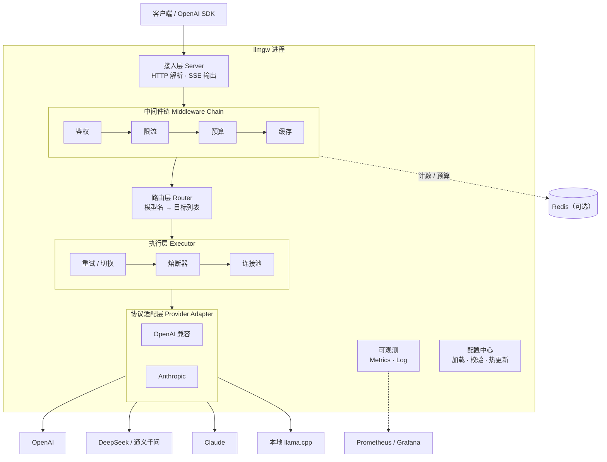
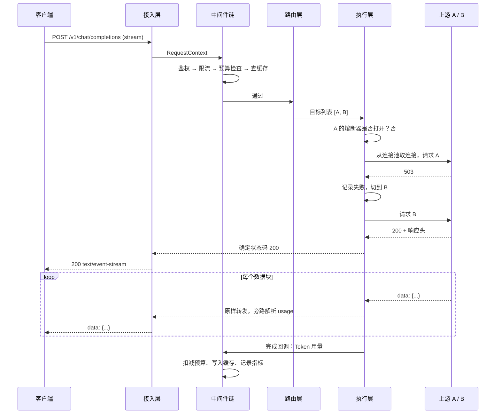
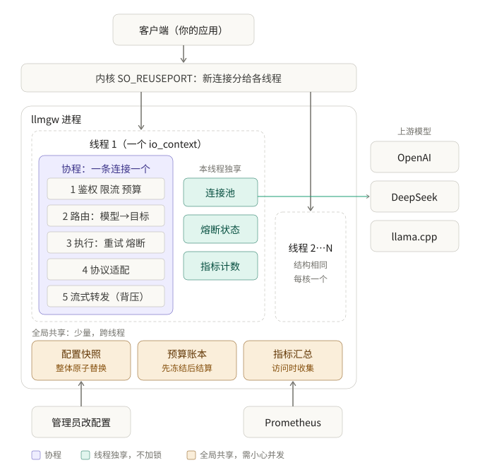

# llmgw 设计文档

> 状态：草案 v0.1，待讨论。标有 **【待决定】** 的地方需要拍板。
> 本文是项目的总设计；单个技术点的取舍记录在 [decisions.md](decisions.md)。

---

## 1. 背景与目标

### 1.1 要解决的问题

接入大模型的团队很快会遇到这几个问题：

| 问题 | 具体表现 |
|---|---|
| 多家模型，接口各不相同 | OpenAI、Claude、DeepSeek、通义千问、本地模型，每家的 SDK、鉴权和错误码都不一样 |
| 稳定性 | 单家服务限流（429）或宕机时，业务直接不可用 |
| 成本失控 | 不知道哪个应用、哪个人花了多少钱，也没法设上限 |
| 密钥管理 | 真实的 API key 散落在各个应用的配置里，泄露风险高 |
| 不可观测 | 延迟、失败率、Token 用量，全都看不到 |

### 1.2 项目定位

**一个用 C++ 写的、轻量、可自部署的大模型网关。** 一个二进制文件加一份配置文件就能跑起来，数据不出公司。

和同类产品的区别：

| | LiteLLM | OpenRouter | **llmgw** |
|---|---|---|---|
| 形态 | Python 服务 | SaaS（数据经过第三方） | **C++ 单文件，自部署** |
| 网关额外开销 | 较高 | 不可控 | **目标：P99 < 1ms** |
| 部署依赖 | Python 环境、数据库 | 无需部署 | **只依赖 OpenSSL** |
| 本地模型 | 支持 | 不支持 | **一等公民，可以和云端混合路由** |

### 1.3 目标

**产品目标（v1.0）：** 小团队 10 分钟内部署完成，获得统一接口、自动容灾、成本管控和监控看板。

**个人目标：** 这是一个求职作品，需要做到：
- 能体现 C++ 和后端的核心能力：高性能网络、并发、稳定性设计
- 每个关键特性都有**可量化的数据**（压测结果、优化前后对比）
- 每个设计决策都有记录，面试时能讲清楚“为什么”

### 1.4 成功标准

| 指标 | 目标值 | 测量方式 |
|---|---|---|
| 网关额外延迟 | P50 < 0.3ms，P99 < 1ms | 用固定延迟的 mock 上游，对比直连和经过网关的差值 |
| 吞吐（非流式） | 单机 ≥ 10,000 QPS（4 核） | wrk + mock 上游 |
| 并发流式连接 | 单机 ≥ 10,000 条 | 自写压测客户端，统计首 token 延迟 |
| 故障切换耗时 | 上游宕机后，首个请求 < 连接超时；熔断后 < 1ms | 故障注入测试 |
| 内存 | 空载 < 20MB；1 万并发流 < 500MB | /proc 采样 |
| 质量 | 单元测试覆盖率 ≥ 70%，CI 含 ASan/TSan | CI |

### 1.5 非目标（明确不做）

- 不做模型训练和微调
- 不做多租户 SaaS 和计费系统
- 不做复杂的 Web 管理后台（v1.0 只提供 Admin API 和 Grafana 看板）
- 不追求兼容所有厂商：先支持 OpenAI 兼容协议、Anthropic 协议和本地 llama.cpp

---

## 2. 需求

### 2.1 功能需求

**P0（必须有，v0.x 完成）**
- F1 兼容 OpenAI 的 `/v1/chat/completions`（流式与非流式）和 `/v1/models`
- F2 模型路由：对外模型名 → 有序的上游目标列表，支持模型名映射
- F3 故障切换：连接失败、超时、5xx、429 时自动切到下一个目标
- F4 网关鉴权：客户端使用网关自己的 key
- F5 可观测：Prometheus 指标、结构化日志、请求 ID 透传

**P1（v1.0 完成）**
- F6 上游连接池（Keep-Alive 复用）
- F7 熔断：上游连续失败时暂时跳过，并定期探测是否恢复
- F8 限流：按 key 限制 RPM（每分钟请求数）和 TPM（每分钟 Token 数）
- F9 成本核算与预算：根据价格表计算费用，按 key 设每日/每月预算，超出时拒绝或降级
- F10 配置热加载：修改配置后不重启，正在进行的请求不受影响
- F11 Anthropic 协议适配：用 OpenAI 格式调用 Claude（请求和响应的双向转换）

**P2（加分项，视进度决定）**
- F12 精确缓存：完全相同的请求直接返回缓存
- F13 语义缓存：语义相似的问题命中缓存（需要 embedding 和向量检索）
- F14 智能路由：按请求长度、复杂度选择本地小模型或云端大模型
- F15 `/v1/embeddings` 接口

### 2.2 非功能需求

| 类别 | 要求 |
|---|---|
| 性能 | 见 1.4；热路径上避免多余的内存分配和 JSON 完整解析 |
| 可靠性 | 网关自身不能成为单点：无状态，可以水平扩展；限流和预算的状态放在 Redis 中共享 |
| 安全 | 上游 key 只从环境变量读取；日志中不打印 key 和请求内容（可选择开启内容日志） |
| 可运维 | 单二进制 + Docker 镜像；`--check` 校验配置；优雅退出（等待进行中的流结束） |
| 可扩展 | 新增一个厂商 = 实现一个 Provider 适配器；新增一个能力 = 增加一个中间件 |

---

## 3. 总体架构

### 3.1 分层架构



**设计原则：**
1. **分层单向依赖**：上层依赖下层的接口，不反向依赖。比如执行层不知道鉴权的存在。
2. **中间件可插拔**：鉴权、限流、预算、缓存都实现同一个接口，按配置组装，可以单独测试。
3. **协议适配隔离**：网关内部统一使用 OpenAI 格式，厂商差异全部收敛在适配层。
4. **无状态**：需要跨实例共享的状态（限流计数、预算）放进 Redis；单机部署时退化为内存实现。

### 3.2 一个流式请求的完整流程



要点：**先拿到上游的状态码再给客户端回响应头**。这样在第一个字节发出之前都能透明切换，上游的 4xx 也能如实转发（见 ADR-002）。

---

## 4. 模块设计

### 4.1 模块一览

| 模块 | 目录 | 职责 | 阶段 |
|---|---|---|---|
| core | `src/core/` | 公共类型：RequestContext、错误码、时钟、ID 生成 | M1 |
| config | `src/config/` | 解析、校验、热加载；对外提供不可变的配置快照 | M1，热加载 M4 |
| server | `src/server/` | HTTP 接入、路由注册、SSE 输出、优雅退出 | M1 |
| middleware | `src/middleware/` | 中间件接口与链；鉴权、限流、预算、缓存 | 鉴权 M1，其余 M3–M4 |
| router | `src/router/` | 模型名 → 目标列表；智能路由策略 | M1，策略 P2 |
| executor | `src/executor/` | 重试与切换、熔断器、超时控制 | M1，熔断 M3 |
| upstream | `src/upstream/` | HTTP 客户端连接池、请求发送、流式读取 | M2 |
| provider | `src/provider/` | 协议适配器：OpenAI 兼容、Anthropic | OpenAI M1，Anthropic M4 |
| stream | `src/stream/` | SSE 解析与重组、usage 提取、跨线程转发通道 | M1 |
| accounting | `src/accounting/` | 价格表、费用计算、预算存储（内存 / Redis） | M3 |
| observability | `src/observability/` | 指标注册表、Prometheus 输出、JSON 日志 | M1 |
| storage | `src/storage/` | 状态存储抽象：内存实现与 Redis 实现 | M3 |

### 4.2 核心接口（草案）

```cpp
// 贯穿整个请求的上下文
struct RequestContext {
  std::string request_id;
  std::string api_key_id;          // 鉴权后得到的 key 标识（不是 key 本身）
  std::string model;               // 对外模型名
  bool stream = false;
  nlohmann::json body;             // 解析后的请求体
  Clock::time_point start;
  TokenUsage usage;                // 完成后由执行层填入
  std::map<std::string, std::string> tags;  // 给中间件之间传递信息
};

// 中间件：请求前检查，请求后结算
class Middleware {
 public:
  virtual ~Middleware() = default;
  virtual std::string_view name() const = 0;
  // 返回 nullopt 表示放行；否则直接用这个响应结束请求（例如 401、429、缓存命中）
  virtual std::optional<Reply> on_request(RequestContext& ctx) = 0;
  // 请求结束后调用（流式请求在流结束时调用），用于扣预算、写缓存
  virtual void on_complete(const RequestContext& ctx, const Outcome& outcome) {}
};

// 协议适配器：把内部的 OpenAI 格式转成厂商格式，再把响应转回来
class ProviderAdapter {
 public:
  virtual ~ProviderAdapter() = default;
  virtual HttpRequest build_request(const RequestContext& ctx, const Target& target) = 0;
  virtual std::string convert_response(const std::string& body) = 0;
  // 流式：逐块转换。OpenAI 兼容的厂商直接透传
  virtual std::unique_ptr<StreamTranscoder> make_stream_transcoder() = 0;
};

// 熔断器：每个上游一个
class CircuitBreaker {
 public:
  bool allow();                 // 关闭或半开状态下允许通过
  void on_success();
  void on_failure();
  State state() const;          // Closed / Open / HalfOpen
};

// 状态存储：单机用内存，多实例用 Redis
class StateStore {
 public:
  virtual ~StateStore() = default;
  virtual int64_t incr(std::string_view key, int64_t delta, std::chrono::seconds ttl) = 0;
  virtual std::optional<int64_t> get(std::string_view key) = 0;
};
```

### 4.3 目标目录结构

```
llmgw/
├── CMakeLists.txt
├── src/
│   ├── main.cpp
│   ├── core/  config/  server/  middleware/  router/
│   ├── executor/  upstream/  provider/  stream/
│   └── accounting/  observability/  storage/
├── tests/
│   ├── unit/          # 每个模块的单元测试
│   ├── integration/   # mock 上游 + 真实网关
│   └── mock/          # 可配置延迟、错误率的 mock 上游
├── bench/             # 压测脚本与报告
├── deploy/            # Dockerfile、docker-compose（网关 + Redis + Prometheus + Grafana）
└── docs/              # design.md、decisions.md、压测报告
```

---

## 5. 关键技术方案

### 5.1 并发模型 【待决定】

这是对性能指标影响最大的决定。

| 方案 | 优点 | 缺点 |
|---|---|---|
| A. 线程池阻塞 I/O（当前原型，cpp-httplib） | 简单，代码直观 | 一条流占一个线程，上万并发流做不到 |
| B. **Boost.Asio + Beast，C++20 协程** | 性能最好，完全可控；协程让异步代码读起来像同步代码；面试价值最高 | 学习曲线较陡，开发量大 |
| C. Drogon 框架 | 自带异步 HTTP 服务端和客户端，开发快 | 框架较重，流式代理需要绕一些弯，底层细节被封装掉 |

**已决定：选 B，采用“每核一个线程 + 每连接一个协程”。** 原型（方案 A）保留作为对照组，M2 时把接入层和上游层换成 Asio 协程。分层设计保证只有 server 和 upstream 两个模块需要重写。前后的压测对比本身就是一个很好的故事。具体设计见 [5.8 并发与连接设计](#58-并发与连接设计)。

### 5.2 故障切换与熔断

- **可重试错误**：连接失败、超时、5xx、429。其他 4xx 不重试（ADR-004）
- **切换时机**：只在第一个字节发出之前（ADR-003）
- **熔断器**：每个上游一个，使用三态模型
  - Closed → Open：最近 N 次（默认 20 次）中失败率 > 50%，或连续失败 5 次
  - Open → HalfOpen：等待冷却时间（默认 30 秒，失败后指数递增，上限 5 分钟）
  - HalfOpen：只放一个探测请求，成功则回到 Closed，失败则重新进入 Open
- **429 特殊处理**：如果上游返回 `Retry-After`，在这段时间内把该上游标记为不可用

### 5.3 限流

- 算法：**令牌桶**，分别限制 RPM 和 TPM
- TPM 的难点：请求开始时不知道会用多少 token。方案是先按 `max_tokens`（或一个默认值）预扣，请求结束后按实际用量多退少补
- 存储：单机用内存（分片加锁的哈希表），多实例用 Redis Lua 脚本保证原子性

### 5.4 成本核算与预算

- 价格表写在配置中：`{model, input_price_per_1m, output_price_per_1m}`
- 每个请求结束后：费用 = 输入 token × 输入单价 + 输出 token × 输出单价
- 预算按 key 维度，分日和月两档；超出后的行为可配置：`reject`（返回 429）或 `downgrade`（改用便宜的模型）
- 流式请求的 usage：OpenAI 需要自动注入 `stream_options.include_usage=true`；拿不到 usage 时按字符数估算，并在指标中标记为“估算”

### 5.5 配置热加载

- 配置以 `std::shared_ptr<const Config>` 快照的形式存在，用原子操作替换
- 每个请求开始时取一份快照，整个生命周期都用这份，所以替换配置不会影响正在进行的请求
- 触发方式：`SIGHUP` 信号，或调用 Admin API `POST /admin/reload`
- 新配置校验失败时保留旧配置，并记录错误日志

### 5.6 缓存（P2）【待决定是否做】

- **精确缓存**：key = hash(模型名 + messages + 影响输出的参数)，只缓存 `temperature=0` 的请求
- **语义缓存**：调用 embedding 接口把问题转成向量，在向量索引中找相似度 > 0.95 的历史问题
  - 向量索引：先用内存暴力搜索（几千条以内足够），之后再考虑 HNSW
  - 风险：误命中会返回错误的答案，必须能按模型或按 key 关闭

### 5.7 性能设计要点

- 热路径上不做完整的 JSON 解析：流式数据块默认原样转发，只对可能包含 `usage` 的行做解析（原型中已实现）
- 上游连接池：按 `scheme://host:port` 分组，空闲连接定期淘汰；HTTPS 复用连接可以省去每次 TLS 握手
- 指标计数使用按线程分片的计数器，避免全局锁的竞争
- 日志异步写出，不阻塞请求线程

### 5.8 并发与连接设计

> 📖 配图讲解见 [concurrency-explained.md](concurrency-explained.md)。



**核心思想：** 线程负责用满多个 CPU 核（并行），协程负责让每个核同时照看大量连接（并发），连接池负责复用到上游的连接。线程之间尽量不共享数据。

#### 对象与职责

| 对象 | 数量 | 职责 | 线程安全 |
|---|---|---|---|
| `Gateway` | 1 | 读取配置、创建 Worker 和全局对象、启动与优雅退出 | 只在主线程使用 |
| `Worker` | N（默认 = CPU 核数） | 一个线程 + 一个 `io_context`，拥有下面这些“本线程独享”的对象 | 只被自己的线程访问 |
| `Acceptor` | 每个 Worker 一个 | 用 `SO_REUSEPORT` 监听同一个端口，接收新连接并创建 Session | 独享 |
| `Session` | 每条客户端连接一个协程 | 读请求 → 中间件 → 路由 → 执行 → 适配 → 流式转发；支持 HTTP Keep-Alive，一条连接上可以顺序处理多个请求 | 独享 |
| `UpstreamPool` | 每个 Worker 一个 | 按 `host:port` 管理到上游的空闲连接：取、还、淘汰、排队 | 独享，不加锁 |
| 熔断器表 | 每个 Worker 一份 | 每个上游一个熔断器 | 独享 |
| 指标分片 | 每个 Worker 一份 | 计数器和直方图 | 独享；`/metrics` 被访问时汇总 |
| `ConfigStore` | 1 | `atomic<shared_ptr<const Config>>`，热加载时整体替换 | 原子操作 |
| `BudgetLedger` | 1 | 预算的冻结与结算，“查余额 + 冻结”是一个原子操作 | 一把互斥锁（临界区极短）；多实例时换成 Redis |
| `BlockingPool` | 1 | 少量线程，专门执行会阻塞的操作：DNS 解析、超大请求体的 JSON 解析 | 内部队列 |

#### 一个请求在协程里的完整过程

1. `Acceptor` 接收连接，在本 Worker 的 `io_context` 上 `co_spawn` 一个 `Session` 协程
2. `Session` 读取请求，取一份配置快照，整个请求期间都使用这份快照
3. 中间件：鉴权 → 限流（本 Worker 的令牌桶）→ 预算（`BudgetLedger` 冻结预估费用）
4. 路由得到目标列表；执行器逐个尝试，先查本 Worker 的熔断器
5. 从本 Worker 的 `UpstreamPool` 取连接（必要时通过 `BlockingPool` 做 DNS 解析），发送请求
6. 循环“读上游一块 → 写客户端一块”。写没完成就不读下一块，**背压自然实现**，不需要额外的缓冲队列
7. 结束（成功 / 失败 / 客户端断开）：连接还回池子或关闭，按实际用量结算预算，记录指标

#### 超时与取消

- 每个请求有一个**截止时间**（总超时），另外“首字节超时”和“两块之间的空闲超时”分别设置
- 用 Asio 的 `cancellation_signal` 把取消信号传进所有 `co_await`：客户端断开、总超时到期、网关退出时，正在等待的操作立即结束，不需要等读取超时
- 超时的实现方式：每个等待操作都和一个定时器做“谁先完成就用谁”（awaitable operators 中的 `||`）

#### 连接池细节

- **取连接**：有空闲就复用；没有且未达上限就新建；达到上限就排队，排队超时返回 503
- **还连接**：响应完整读完、且连接支持 Keep-Alive 才放回；中途出错或客户端中止则直接关闭
- **淘汰**：空闲超过 `idle_timeout`（默认 60 秒）就关闭
- **上限**：每个 Worker 的上限 = 每个上游的总上限 ÷ Worker 数，避免连接总数被放大
- **失效连接**：池里的连接可能已被上游关闭。如果请求在发送阶段就失败，说明上游没收到，按重试规则属于“可以安全重试”，自动换新连接重发一次
- **流式请求**：HTTP/1.1 下一条连接同一时间只能跑一个请求，流式输出期间连接一直被占用。池子主要省的是握手时间，并发流数仍然决定了连接数。HTTP/2 多路复用留作后期优化

#### 必须遵守的规则

1. **协程里不能阻塞。** 同一线程上的所有协程是轮流执行的，一个阻塞就会卡住其他所有连接。会阻塞的操作一律交给 `BlockingPool`
2. **不要把一个 Worker 的对象交给另一个 Worker 使用。** 跨线程只能通过全局对象，或者用 `asio::post` 把任务投递到目标线程上执行
3. **全局对象的临界区要尽量短。** 锁里只做加减法，不做 I/O

#### 关键参数（默认值）

| 参数 | 默认值 | 说明 |
|---|---|---|
| `workers` | CPU 核数 | Worker 线程数 |
| `max_connections` | 10000 | 入站连接总数上限，超过直接拒绝（过载保护） |
| `upstream.max_connections` | 每个上游 256（总数） | 按 Worker 数平均分摊 |
| `upstream.idle_timeout` | 60 秒 | 空闲连接淘汰时间 |
| `timeouts.connect` | 10 秒 | 连接上游的超时 |
| `timeouts.first_byte` | 60 秒 | 发出请求后等第一个字节的超时 |
| `timeouts.idle` | 60 秒 | 流式输出中两块数据之间的最长间隔 |
| `timeouts.total` | 600 秒 | 整个请求的截止时间 |
| `blocking_pool.threads` | 4 | 阻塞操作线程数 |

---

## 6. 技术选型

| 用途 | 选择 | 备选 | 理由 |
|---|---|---|---|
| 语言标准 | C++20 | C++17 | 需要协程（如果选择方案 B） |
| 网络 | Boost.Asio + Beast【待决定】 | Drogon、cpp-httplib | 见 5.1 |
| JSON | simdjson（解析）+ nlohmann/json（构造） | RapidJSON | 解析走热路径，需要快；构造用 nlohmann 更方便 |
| TLS | OpenSSL 3 | BoringSSL | 系统自带，生态最广 |
| Redis | redis-plus-plus | hiredis | 接口现代，支持连接池 |
| 测试 | GoogleTest | 自写框架（原型中使用） | 业界标准，方便别人参与贡献 |
| 构建 | CMake + FetchContent | vcpkg、Conan | 零配置，clone 下来就能编译 |
| 压测 | wrk、k6，以及自写的流式压测工具 | — | wrk 不擅长测试 SSE 长连接 |
| 监控 | Prometheus + Grafana | — | 业界标准 |

---

## 7. 测试与质量

| 层次 | 内容 | 工具 |
|---|---|---|
| 单元测试 | 配置校验、SSE 解析、熔断状态机、令牌桶、费用计算、协议转换 | GoogleTest |
| 集成测试 | mock 上游 + 真实网关：切换、熔断、限流、预算、热加载 | GoogleTest + 自写 mock 服务器 |
| 故障注入 | mock 上游可配置延迟、错误率、中途断流、慢速输出 | mock 服务器参数 |
| 内存与并发 | 每次提交都跑 ASan、UBSan、TSan | GitHub Actions（已配置） |
| 性能 | 固定场景基准测试，结果写入 `docs/benchmark.md`，每个里程碑更新一次 | wrk、k6、自写工具 |

---

## 8. 里程碑（8 周）

| 里程碑 | 时间 | 交付内容 | 验收标准 |
|---|---|---|---|
| **M1 原型** | 第 1–2 周 | F1–F5：统一接口、路由、切换、鉴权、指标 | ✅ 原型已完成（cpp-httplib 版本），需按本设计调整目录结构 |
| **M2 性能底座** | 第 3–4 周 | 换成 Asio 协程、连接池、第一份压测报告 | 达到 1.4 中的延迟和并发指标；有原型与新版的对比数据 |
| **M3 稳定性与成本** | 第 5–6 周 | 熔断、限流、成本核算与预算、Redis 存储 | 故障注入测试全部通过；Grafana 看板可用 |
| **M4 完善** | 第 7 周 | 配置热加载、Anthropic 适配、docker-compose 一键部署 | 10 分钟内从零部署完成 |
| **M5 发布** | 第 8 周 | v1.0 发布、技术文章、压测报告、演示视频 | GitHub 发布 Release；文章发布到技术社区 |
| P2 | 之后 | 缓存、智能路由 | — |

每个里程碑结束时：更新压测报告，补充决策记录，写一篇简短的复盘。

---

## 9. 风险与应对

| 风险 | 影响 | 应对 |
|---|---|---|
| Asio 协程学习成本超出预期 | M2 延期 | 先在一个独立的小 demo 中验证流式代理，再动主干代码；必要时退回 Drogon |
| 范围蔓延，什么都想做 | 8 周做不完 | 严格按 P0 → P1 → P2 推进，P2 可以完全砍掉 |
| 测试用的云端 API 产生费用 | 花钱 | 日常开发全部用 mock 上游和本地 llama.cpp，只在发布前用真实 API 验证 |
| 各厂商流式格式存在细微差异 | 兼容性问题 | 为每个厂商录制真实的响应样本，作为回归测试的数据 |

---

## 10. 待决定的问题

1. ~~**并发模型**~~：✅ 已决定，每核一个线程 + 每连接一个协程（见 5.8）
2. **语义缓存**：放进 v1.0，还是留到 P2？
3. **目标用户**：优先照顾国内厂商（DeepSeek、通义千问、Kimi），还是国际厂商？这会影响适配器的优先级和 README 的语言
4. **Redis**：v1.0 就支持多实例部署，还是先只做单机？
