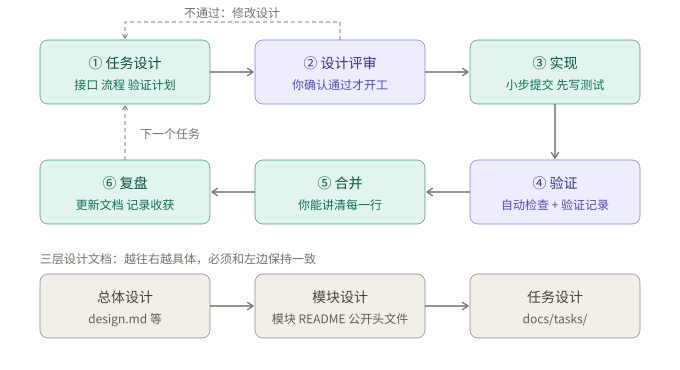

# 开发流程

> 目的：**每一步都先有设计、再有验证，代码始终在架构的约束之内。** 本文规定每个任务从开始到合并的完整流程。代码层面的规范见 [code-architecture.md](code-architecture.md)。

## 1. 三层设计文档

| 层级 | 文档 | 回答的问题 | 何时修改 |
|---|---|---|---|
| **总体设计** | [design.md](design.md) 以及各专题文档 | 系统由哪些模块组成、怎么交互、有哪些机制 | 很少修改；修改需要设计决策记录（ADR） |
| **模块设计** | 每个模块的 `README.md` 和公开头文件 | 这个模块负责什么、不负责什么、对外提供哪些接口 | 模块第一次实现时创建；接口变化时更新 |
| **任务设计** | `docs/tasks/<编号>-<名称>.md` | 这个任务具体怎么做、怎么验证 | 每个任务开工前编写 |

**一致性规则：** 下层文档必须和上层保持一致。任务设计如果需要改变模块的公开接口，就要同时更新模块设计；如果需要改变模块边界、依赖规则或总体机制，就要先写 ADR，并经过作者批准。

## 2. 每个任务的六个步骤

### ① 任务设计

开工之前，按模板 [docs/templates/TASK_DESIGN.md](templates/TASK_DESIGN.md) 编写任务设计。

- 工作量 **≥ 1 天**的任务：写成独立的文件，放在 `docs/tasks/` 下
- 工作量 **< 1 天**的任务：可以直接写在 Issue 里，但必须包含“范围、涉及的模块、验证计划”三部分
- 几个紧密相关的小任务，可以合写一份设计

任务设计必须回答：
1. **目标与范围**：做什么，**不做什么**
2. **在架构中的位置**：实现总体设计的哪几节；涉及哪些模块；新增的依赖是否符合 `tools/module_deps.json`
3. **接口设计**：新增或修改的公开头文件草案
4. **数据与状态**：数据归谁所有、属于哪个线程（请求级 / Worker 级 / 全局）
5. **关键流程**：用流程图或时序图说明
6. **失败与边界情况**：会出什么错，怎么处理
7. **验证计划**：用哪些测试、哪些数据证明它做对了；验收标准是什么
8. **风险与备选方案**

### ② 设计评审

- 设计写好后，在 Issue 中提交评审，打上 `status:review` 标签
- **作者确认“设计通过”之后才能开工**。不通过就修改设计，再次评审
- 评审时重点检查：[评审清单](#4-设计评审清单)

### ③ 实现

- 一个任务可以拆成多个小 PR，每个 PR 的改动尽量不超过 400 行
- 核心逻辑先写测试，再写实现
- 实现过程中如果发现设计需要调整：小的调整在 PR 中说明，并同步更新任务设计；大的调整（影响接口或模块边界）停下来，回到第 ② 步

### ④ 验证

分两部分，**两部分都通过才算验证完成**：

1. **自动检查**（CI，每次提交都运行）：编译、单元测试、集成测试、ASan / UBSan / TSan、模块依赖检查、clang-tidy、clang-format、覆盖率
2. **验证记录**：按照任务设计中的验证计划逐项执行，把结果写在任务设计文件末尾的“验证记录”一节。包括：执行了什么、结果是什么、关键数据（比如压测数字）、和验收标准的对比

### ⑤ 合并

- 按 [PR 模板](../.github/pull_request_template.md) 中的检查清单自查
- **作者必须能讲清楚 PR 中的每一处改动**：为什么这样写、有没有更简单的写法、出错时会怎样
- 合并后关闭 Issue

### ⑥ 复盘

- 如果实现过程中改变了设计，更新对应的模块设计和总体设计
- 在任务设计末尾写几句“收获与教训”
- 更新 [roadmap.md](roadmap.md) 中的状态

## 3. Issue 的状态

用标签标记每个任务所处的步骤：

| 标签 | 含义 |
|---|---|
| `status:design` | 正在编写任务设计 |
| `status:review` | 等待作者评审设计 |
| `status:in-progress` | 设计已通过，正在实现 |
| `status:verify` | 实现完成，正在验证 |
| （关闭） | 已合并 |

## 4. 设计评审清单

- [ ] 范围清楚：写明了“不做什么”
- [ ] 和总体设计一致；如果有偏离，说明了理由
- [ ] 新增的依赖都在 `tools/module_deps.json` 允许的范围内
- [ ] 公开接口最小化：没有暴露不必要的类型和函数
- [ ] 每份数据都有明确的所有者和线程归属，没有新增的全局可变状态
- [ ] 协程相关：没有阻塞调用，没有可能悬空的引用，持锁时没有 `co_await`
- [ ] 所有新增的资源（队列、缓存、连接、等待）都有上限和超时
- [ ] 列出了失败情况和处理方式
- [ ] 验证计划能证明功能是对的，验收标准可以量化
- [ ] 工作量和预估一致；如果明显超出，考虑拆分

## 5. 架构健康检查（每周复盘时）

每周日复盘时，检查以下指标的变化，及时发现代码开始失控的迹象：

| 指标 | 来源 | 警戒线 |
|---|---|---|
| 依赖规则违规数 | `tools/check_deps.py` | 必须为 0 |
| clang-tidy 告警数 | CI | 必须为 0 |
| 超过 400 行的文件数 | `tools/check_deps.py` | 上升时检查原因 |
| 覆盖率 | CI | 不低于门槛（核心逻辑 90%，其他 70%） |
| 没有关联 Issue 的 TODO | CI | 必须为 0 |
| 各模块公开头文件的数量 | 目录统计 | 增长过快说明接口在膨胀 |
| 任务设计与实际实现的偏差 | 验证记录 | 偏差大的任务，在复盘中分析原因 |
