# llmgw 分析与设计图

这些图用来回答从“为什么做”到“怎么做”的各个问题。建议按顺序阅读：

| # | 图 | 回答的问题 | 阶段 |
|---|---|---|---|
| 1 | [目标分解图](#1-目标分解图) | 我们到底要达成什么？ | 需求分析 |
| 2 | [系统上下文图](#2-系统上下文图) | 系统的边界在哪？跟谁打交道？ | 需求分析 |
| 3 | [用例图](#3-用例图) | 谁用这个系统？用来做什么？ | 需求分析 |
| 4 | [组件图](#4-组件图) | 系统内部分成哪几块？依赖关系是什么？ | 架构设计 |
| 5 | [类图](#5-类图) | 核心抽象和接口长什么样？ | 详细设计 |
| 6 | [时序图](#6-时序图) | 一个请求在各模块之间怎么流转？ | 详细设计 |
| 7 | [活动图：重试决策](#7-活动图重试决策) | 出错时到底重试还是不重试？ | 详细设计 |
| 8 | [状态图](#8-状态图) | 熔断器和请求有哪些状态？怎么转换？ | 详细设计 |
| 9 | [数据流图：Token 与费用](#9-数据流图token-与费用) | 钱是怎么算出来、记下来的？ | 详细设计 |
| 10 | [部署图](#10-部署图) | 实际跑起来是什么样？ | 部署设计 |
| 11 | [甘特图](#11-甘特图) | 什么时候做完什么？ | 项目计划 |

> 并发与连接方案（线程、协程、连接池、背压、预算预留）的 8 张配图讲解见 [concurrency-explained.md](concurrency-explained.md)。

> 图中的设计已经吸收了[问题分析](design.md)中发现的问题：防重复扣费的重试规则、总超时、熔断，以及“为什么用 C++”的定位。

---

## 1. 目标分解图

从一个总目标拆成产品目标和个人目标，再落到可以测量的指标上。后面所有的设计都应该能追溯到这张图上的某个节点；追溯不到的功能，说明不该做。

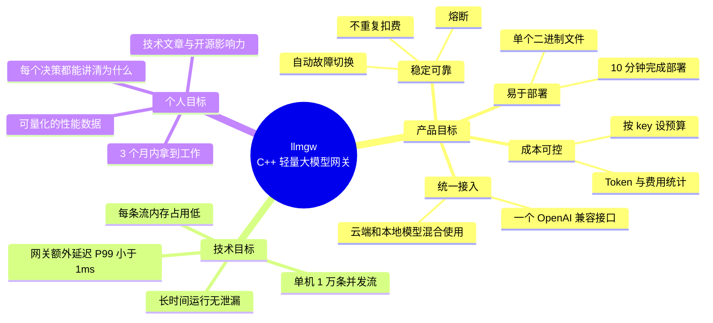

---

## 2. 系统上下文图

把 llmgw 当成一个黑盒，只看它和外部的关系。实线是请求方向，虚线是可选依赖。

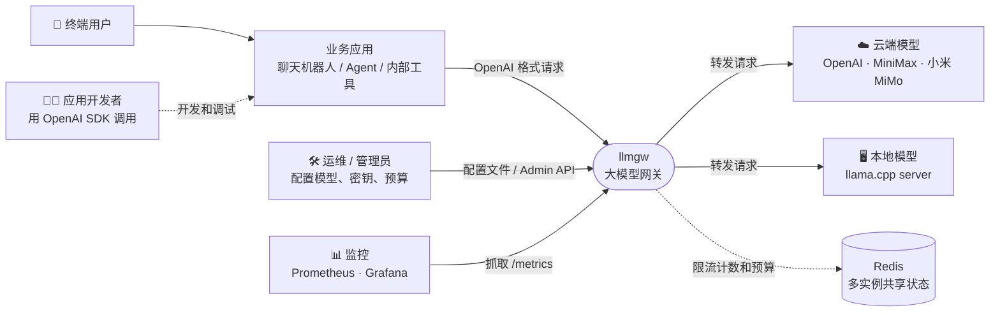

**边界说明：** 网关自身不做 TLS 终结（交给前面的 Nginx 或负载均衡），不存储对话内容，不做用户管理。

---

## 3. 用例图

Mermaid 没有标准的 UML 用例图，这里用流程图模拟：左边是参与者，圆角框是用例。

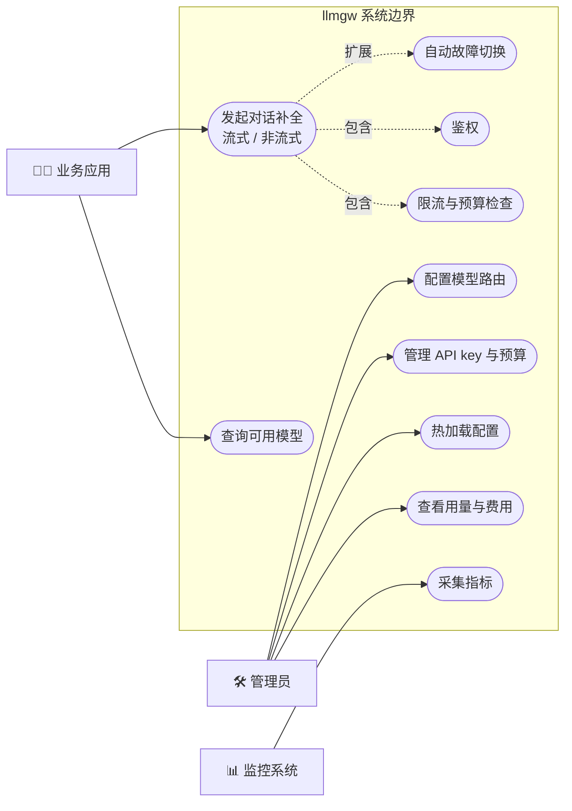

“包含”表示每次都会执行；“扩展”表示只在特定条件下发生（上游失败时才会切换）。

---

## 4. 组件图

网关内部的模块和依赖方向。依赖只能从上往下，不能反过来；这样替换某一层（比如把 cpp-httplib 换成 Asio）时影响范围最小。

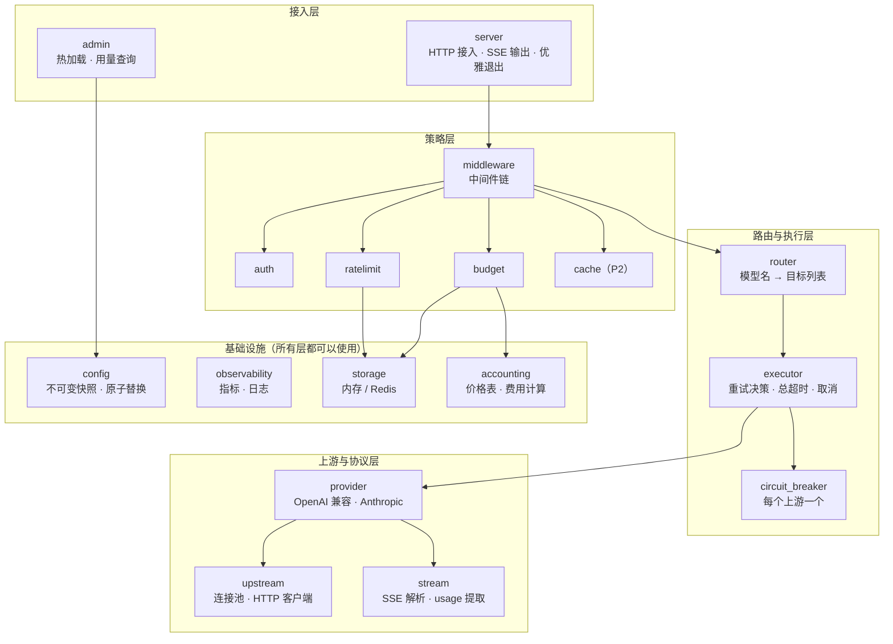

---

## 5. 类图

核心抽象。接口都设计成异步（返回 `awaitable`），这样无论底层选择协程还是回调，上层都不需要改。

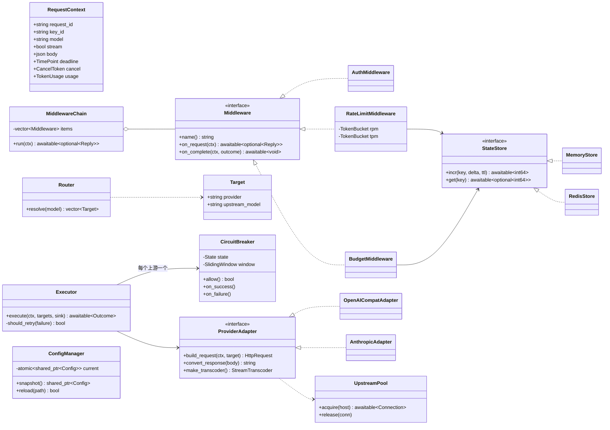

---

## 6. 时序图

### 6.1 非流式请求：第一个上游 503，切换到第二个

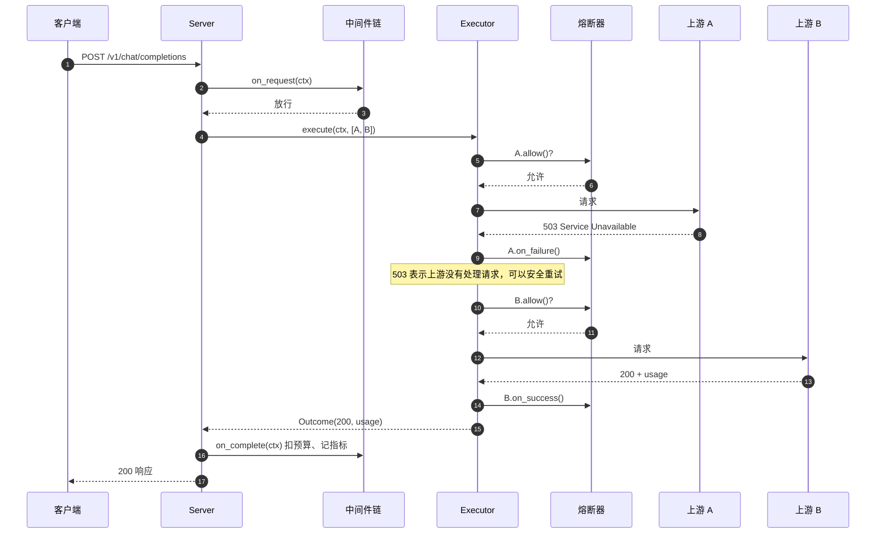

### 6.2 流式请求：客户端中途断开

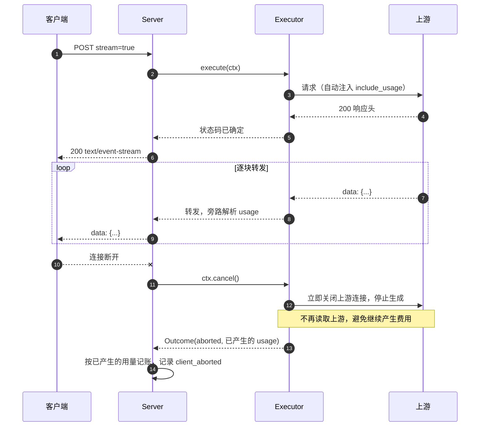

---

## 7. 活动图：重试决策

这是防止**重复扣费**的关键：请求一旦已经发给上游，上游可能已经在生成内容并计费，这时盲目重试会付两次钱。

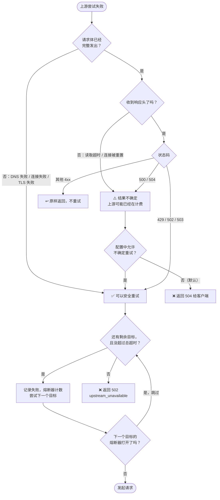

---

## 8. 状态图

### 8.1 熔断器

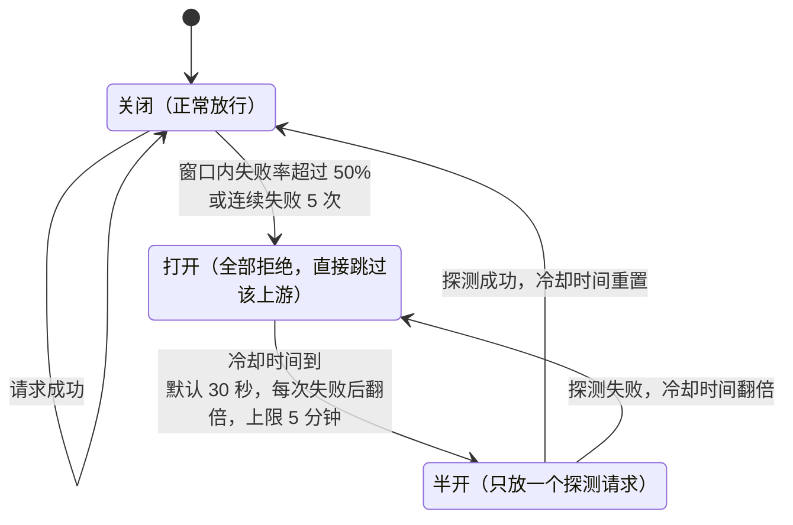

### 8.2 一个请求的生命周期

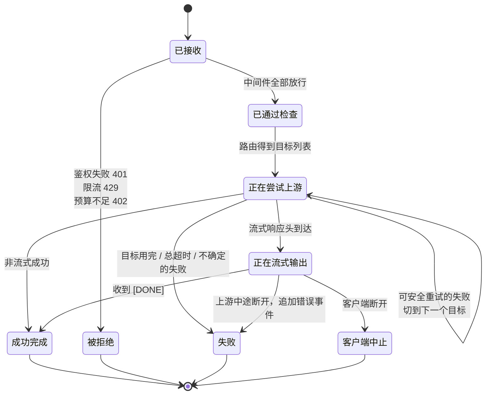

无论以哪种终态结束，都会执行 `on_complete`：按实际用量记账，并记录指标。

---

## 9. 数据流图：Token 与费用

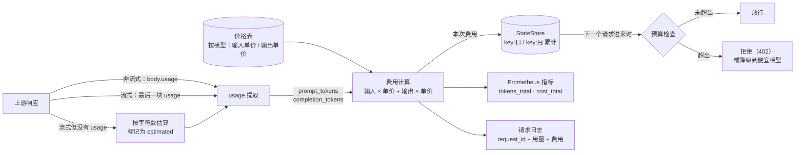

---

## 10. 部署图

### 10.1 单机部署（v1.0 的主要场景）

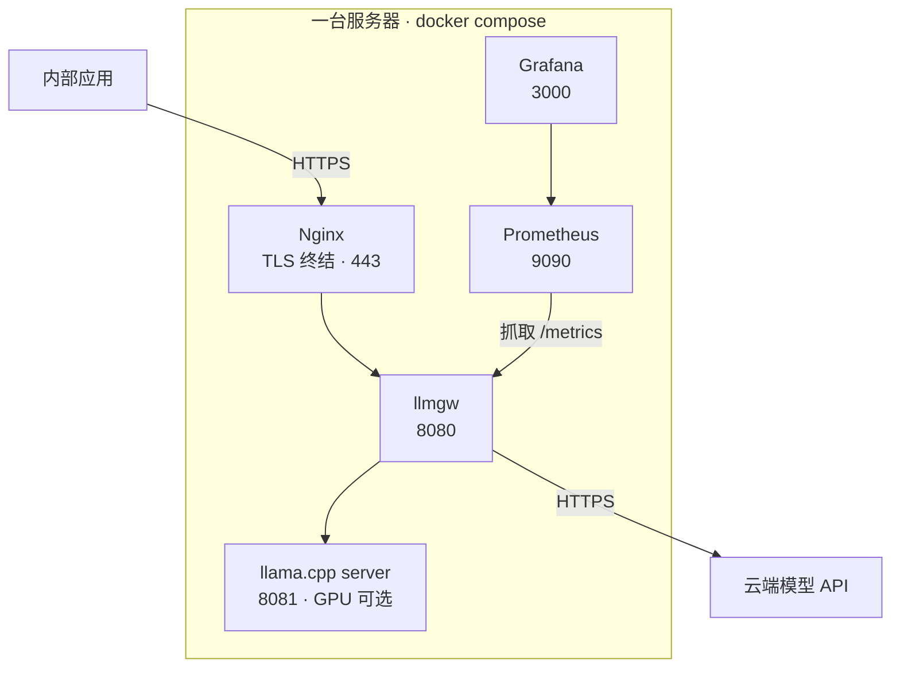

### 10.2 多实例部署（需要 Redis 共享状态）

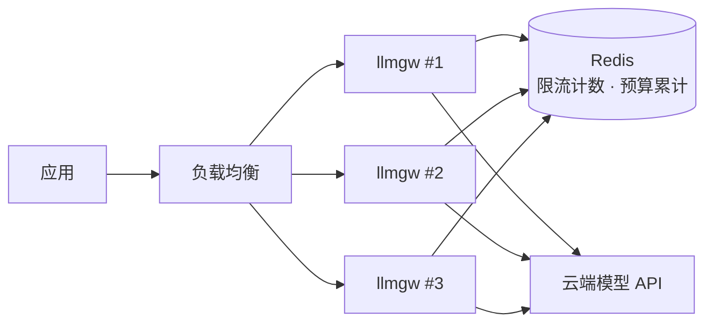

网关本身无状态，任何一个实例挂掉都不影响其他实例；熔断器状态各个实例独立维护，不需要共享。

---

## 11. 甘特图

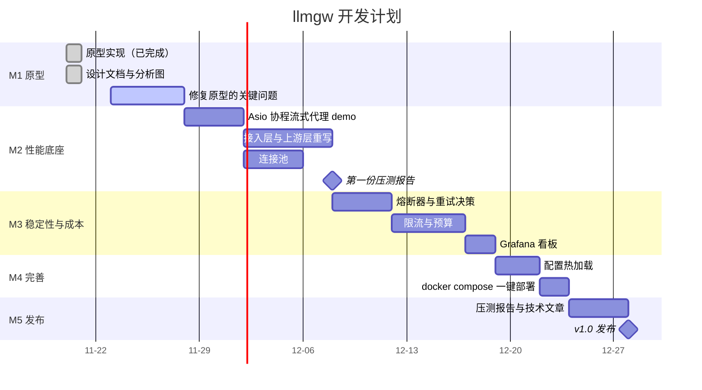

> 甘特图中已经把 Redis 多实例和 Anthropic 适配移出 v1.0，缩小了范围（见问题分析）。
