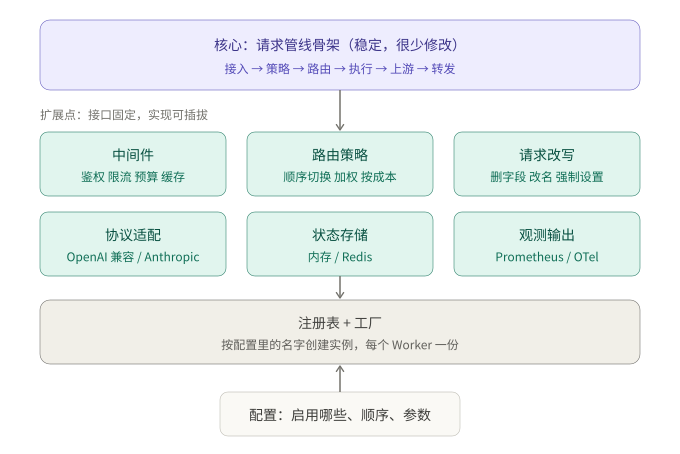

# 可扩展与可插拔设计

> 本文是 [design.md](design.md) 的补充，回答一个问题：**以后要加厂商、加功能时，怎样做到不改核心代码？**



## 1. 目标

| 目标 | 衡量标准 |
|---|---|
| 新增一家 OpenAI 兼容的厂商 | **只改配置**，不写代码 |
| 新增一种协议（比如 Anthropic） | 只新增一个协议适配插件和它的测试，核心代码不动 |
| 新增一个能力（比如缓存、审计日志） | 只新增一个中间件插件，在配置中启用 |
| 关闭某个能力 | 只改配置，不需要重新编译 |
| 插件出问题 | 只影响当前请求，不影响整个进程 |

## 2. 设计原则

1. **微内核 + 插件**：核心只负责请求管线的骨架（接入 → 策略 → 路由 → 执行 → 上游 → 转发），写好以后很少改动。容易变化的部分都做成扩展点
2. **依赖倒置**：核心只依赖扩展点的接口，不依赖任何具体实现
3. **配置驱动组装**：启用哪些插件、按什么顺序、使用什么参数，全部由配置决定
4. **开闭原则**：对扩展开放，对修改关闭。新增功能靠“加”，不靠“改”
5. **与并发模型一致**：插件实例每个 Worker 一份，插件内部不需要加锁（见 [design.md 第 5 节](design.md#5-并发与连接设计)）

## 3. 扩展点

| 扩展点 | 接口 | 内置实现（v1.0） | 以后可以加的 |
|---|---|---|---|
| **中间件** | `Middleware` | 鉴权、限流、预算 | 缓存、审计日志、内容过滤、外部鉴权 |
| **路由策略** | `RoutingStrategy` | 顺序切换（failover） | 加权轮询、最低延迟、按成本、智能路由 |
| **请求改写** | `RequestTransform` | 删除字段、字段改名、强制设置字段 | 参数取值映射、提示词模板 |
| **响应检查** | `ResponseInspector` | usage 提取、业务错误码映射 | 敏感内容检测 |
| **协议适配** | `ProviderAdapter` | OpenAI 兼容 | Anthropic、Gemini |
| **状态存储** | `StateStore` | 内存（带本地持久化） | Redis |
| **观测输出** | `MetricsSink` / `LogSink` | Prometheus、JSON 日志 | OpenTelemetry |

不做成扩展点的部分（属于核心）：HTTP 编解码、Worker 与协程调度、连接池、超时与取消、重试规则、熔断。这些是稳定性的基础，需要统一实现、统一测试，不允许被插件替换。

## 4. 插件的接口约定

所有扩展点都遵守相同的约定，以中间件为例：

```cpp
// 插件实例：每个 Worker 一份，只在该 Worker 的线程上被调用
class Middleware {
 public:
  virtual ~Middleware() = default;
  // 返回“放行”，或者直接给出响应（401、429、缓存命中……）
  virtual asio::awaitable<Decision> on_request(RequestContext& ctx) = 0;
  // 请求结束时调用（成功、失败、客户端中止都会调用）
  virtual asio::awaitable<void> on_complete(const RequestContext& ctx,
                                            const Outcome& outcome) = 0;
};

// 插件工厂：全局一个，负责校验配置、为每个 Worker 创建实例
class MiddlewareFactory {
 public:
  virtual ~MiddlewareFactory() = default;
  virtual std::string_view name() const = 0;                 // 配置里用的名字
  virtual std::expected<void, std::string> validate(const Json& cfg) const = 0;
  virtual std::unique_ptr<Middleware> create(const Json& cfg, WorkerContext& w) const = 0;
};

// 编译期注册：链接进二进制时自动登记到注册表
LLMGW_REGISTER_MIDDLEWARE(RateLimitFactory);
```

| 约定 | 说明 |
|---|---|
| **异步** | 所有可能等待的接口都返回 `awaitable`，插件可以在里面访问 Redis 等外部服务而不阻塞线程 |
| **不阻塞** | 插件里不能有阻塞调用；确实需要时，通过 `WorkerContext` 提交到 `BlockingPool` |
| **每个 Worker 一个实例** | 工厂为每个 Worker 调用一次 `create`。实例只被一个线程访问，所以不需要加锁 |
| **共享状态只能走 `StateStore`** | 需要跨 Worker 共享的数据（比如预算），必须通过 `StateStore`，不能自己用全局变量 |
| **配置先校验** | 加载或热加载配置时，先调用 `validate`；任何一个插件校验失败，整份配置都不生效 |
| **错误用返回值** | 用 `std::expected` 或 `Decision` 返回错误；热路径上不抛异常 |
| **一定会收尾** | 只要 `on_request` 被调用过，`on_complete` 就一定会被调用，插件可以放心地在这里释放资源、结算预算 |

## 5. 配置驱动组装

```json
{
  "pipeline": [
    "auth",
    { "name": "ratelimit", "config": { "default_rpm": 600 } },
    "budget"
  ],
  "routing": { "strategy": "failover" },
  "state_store": { "type": "memory", "persist_path": "/var/lib/llmgw/state.json" },
  "observability": { "metrics": ["prometheus"], "logs": ["json"] }
}
```

- `pipeline` 的顺序就是中间件的执行顺序；`on_complete` 按相反的顺序执行
- 配置中出现了没有注册的插件名，启动时直接报错，并列出所有可用的插件
- `llmgw --list-plugins` 可以列出当前二进制里注册的所有插件及其版本

## 6. 为什么不做动态加载（`.so` 插件）

v1.0 只支持**编译期注册**，插件和网关一起编译成一个二进制。不支持运行时加载 `.so` 文件，原因是：

- **C++ 没有稳定的 ABI**：编译器版本、编译选项、标准库版本不同，都可能导致插件崩溃，而且很难排查
- **安全**：加载外部的二进制代码，等于允许任意代码在网关进程里运行
- **稳定**：一个写得不好的动态插件可以拖垮整个网关，而编译期插件可以和核心一起测试

以后如果确实需要让第三方写插件，可以考虑 **WebAssembly 插件**（Envoy 的 proxy-wasm 就是这种方案）：插件运行在沙箱里，崩溃不会影响网关，也不受 ABI 问题影响。这放在 v2 再评估。

## 7. 示例：新增一家厂商

**情况一：厂商兼容 OpenAI 格式（大多数情况）**，只需要改配置：

1. 在 `providers` 中加一项：`name`、`base_url`、`api_key_env`
2. 如果有参数差异，在路由目标上配置 `drop_fields` / `rename_fields` / `set_fields`（见 [providers.md](providers.md)）
3. 如果它把错误码放在响应体里，配置 `error_mapping`
4. 用真实 key 跑一遍 [验证清单](providers.md#5-验证清单)

**情况二：厂商是新的协议**（比如 Anthropic 的 Messages API）：

1. 实现 `ProviderAdapter`：请求转换、响应转换、流式事件转换
2. 录制真实的请求和响应样本，写成单元测试
3. 用 `LLMGW_REGISTER_PROVIDER` 注册
4. 在配置中把 `providers[].protocol` 设为新协议的名字

## 8. 兼容性与版本

- **配置有版本号**：配置文件顶部带 `"version": 1`。格式发生不兼容的变化时版本号加 1，并提供迁移说明；旧格式至少兼容一个大版本
- **接口分级**：扩展点接口分为“稳定”和“实验”两级。稳定接口在同一个大版本内不做不兼容的修改；实验接口可能随时调整
- **废弃流程**：要删除的配置项或接口，先标记为废弃并在启动日志中警告，下一个大版本再删除
