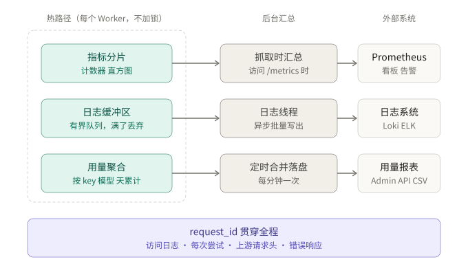

# 监控、日志与统计设计

> 本文是 [design.md](design.md) 的补充。告警规则和稳定性指标见 [stability.md 第 6 节](stability.md#6-可观测与告警)。



## 1. 目标

| 类别 | 回答的问题 | 使用者 | 数据形态 |
|---|---|---|---|
| **监控** | 系统**现在**正常吗？哪里变慢了、出错了？ | 运维、告警系统 | 指标：聚合后的数字，保留几周 |
| **日志** | 出了问题，**具体是哪个请求**、在哪一步、为什么？ | 开发、排障 | 每个请求一条结构化记录，保留几天到几周 |
| **统计** | **一段时间内**，哪个 key、哪个模型用了多少、花了多少钱？ | 管理者、财务 | 按维度聚合的精确数字，长期保留 |

三类数据的要求不同：监控要实时、允许近似；日志要详细、能按请求查；统计要**精确**、长期保存。所以它们走三条独立的链路，不能用一种工具解决所有问题。比如 Prometheus 适合监控，但它的数据有采样和过期，不适合用来对账。

## 2. 设计原则

1. **采集不能拖慢请求**：热路径上只做内存操作（计数器加一、往队列里放一条记录），不做 I/O、不加锁
2. **观测失败不影响业务**：日志写不出去、指标抓取失败、统计落盘失败，都不能让请求失败（见 [stability.md 第 5 节](stability.md#5-降级策略)）
3. **所有缓冲都有上限**：日志队列满了就丢弃，并记录丢弃的数量，而不是让内存无限增长
4. **一个请求一条宽日志**：每个请求结束时输出一条包含所有关键信息的访问日志。统计数据和指标都可以从它推导出来，排障时只需要找这一条
5. **request_id 贯穿全程**：从客户端到网关、到每次上游尝试、到错误响应，用同一个 ID 串起来
6. **默认保护隐私**：默认不记录请求和响应的内容，不记录任何 key

## 3. 监控（指标）

### 3.1 实现方式

- 每个 Worker 一份**指标分片**：计数器和直方图都是普通整数，只被本线程修改，不需要加锁或原子操作
- Prometheus 访问 `/metrics` 时，把各个 Worker 的分片汇总后输出。汇总时通过 `asio::post` 让每个 Worker 在自己的线程上拷贝一份快照，避免读到正在修改的数据
- 直方图使用**固定的分桶**，记录一次只需要几次整数比较和一次加法

### 3.2 指标清单

按三种方法组织：**RED**（请求速率、错误、耗时）用于服务，**USE**（使用率、饱和度、错误）用于资源，再加上**业务指标**。

| 类别 | 指标 | 标签 |
|---|---|---|
| **RED：入口** | `llmgw_requests_total` | `model`, `status`, `stream` |
| | `llmgw_request_duration_seconds`（直方图） | `model`, `stream` |
| | `llmgw_ttft_seconds`（直方图，首字延迟） | `model`, `provider` |
| **RED：上游** | `llmgw_upstream_attempts_total` | `provider`, `result`（ok / timeout / 5xx / 429 / conn_error …） |
| | `llmgw_upstream_duration_seconds`（直方图） | `provider` |
| | `llmgw_upstream_auth_errors_total` | `provider` |
| **USE：资源** | `llmgw_active_connections` | — |
| | `llmgw_active_requests` | `worker` |
| | `llmgw_pool_connections` | `provider`, `state`（idle / busy） |
| | `llmgw_event_loop_lag_seconds`（直方图） | `worker` |
| | `llmgw_process_resident_memory_bytes` | — |
| **保护机制** | `llmgw_breaker_state` | `provider` |
| | `llmgw_rejected_total` | `reason`（overload / rate_limit / budget / memory / too_large / headers_too_large / bad_request / slow_request） |
| | `llmgw_retry_budget_exhausted_total` | — |
| | `llmgw_bulkhead_rejected_total` | `provider` |
| | `llmgw_degraded` | `feature` |
| | `llmgw_middleware_errors_total` | `plugin`, `stage`（on_request / on_complete：抛异常；complete_timeout：on_complete 超时） |
| **业务** | `llmgw_tokens_total` | `model`, `provider`, `type`（prompt / completion / reasoning） |
| | `llmgw_cost_usd_total` | `model`, `provider` |
| | `llmgw_budget_used_ratio` | `key_id` |
| **观测自身** | `llmgw_log_dropped_total` | — |
| | `llmgw_usage_flush_errors_total` | — |

### 3.3 标签基数控制

标签的每一种取值组合，都会在 Prometheus 里产生一条时间序列。取值太多会把 Prometheus 拖垮。

- **允许**做标签的：模型名、上游名、状态码、原因分类——取值都来自配置或固定的枚举，数量有限
- `key_id` 只用在 `budget_used_ratio` 这一个指标上；按 key 的详细统计交给“统计”链路
- **禁止**做标签的：`request_id`、用户输入的任何内容、错误信息原文、URL

### 3.4 看板

v1.0 在 `deploy/grafana/` 中提供 4 个看板：

| 看板 | 内容 |
|---|---|
| 总览 | 请求速率、成功率、P50 / P95 / P99 耗时、TTFT、各模型的流量分布 |
| 上游 | 每个上游的成功率、耗时、熔断状态、429 次数、连接池使用情况 |
| 成本 | Token 用量和费用的趋势、按模型和上游拆分、预算使用比例 |
| 网关内部 | 连接数、事件循环延迟、内存、被拒绝的请求、降级状态、日志丢弃数 |

## 4. 日志

### 4.1 日志的种类

| 种类 | 什么时候输出 | 用途 |
|---|---|---|
| **访问日志** | 每个请求结束时一条（无论成功、失败还是中止） | 排障、审计、重建统计数据 |
| **事件日志** | 发生重要事件时：上游熔断或恢复、配置加载、降级、启动、退出 | 了解系统状态的变化 |
| **错误日志** | 出现异常、不变量被破坏、看门狗告警时 | 定位 bug |
| **审计日志** | 管理操作：配置重新加载、Admin API 调用 | 追溯“谁在什么时候改了什么” |

### 4.2 访问日志的字段

每个请求一行 JSON：

```json
{
  "ts": "2026-11-20T18:30:12.345Z", "type": "access", "request_id": "req_9f2c…",
  "key_id": "app-chatbot", "model": "smart", "stream": true,
  "status": 200, "outcome": "completed",
  "provider": "minimax", "upstream_model": "MiniMax-M3",
  "attempts": [
    { "provider": "openai",  "result": "429", "duration_ms": 180 },
    { "provider": "minimax", "result": "ok",  "duration_ms": 8420, "ttft_ms": 1310 }
  ],
  "duration_ms": 8612, "ttft_ms": 1490,
  "usage": { "prompt": 812, "completion": 455, "reasoning": 210, "estimated": false },
  "cost_usd": 0.00123,
  "client": { "ip": "10.0.3.7", "user_agent": "OpenAI/Python 2.1.0" },
  "worker": 3
}
```

`attempts` 记录了每一次上游尝试，所以**不需要专门的链路追踪系统**，也能看清一个请求经历了哪些切换、每一步花了多久。

### 4.3 实现方式

- 每个 Worker 有一个**有界队列**（默认 8192 条）。热路径只负责把格式化好的日志放进队列
- 一个独立的日志线程批量取出、写到 stdout 或文件。写出这一步可能很慢，但不会影响请求
- 队列满了就**丢弃新日志**，并累加 `llmgw_log_dropped_total`。宁可丢日志，也不能阻塞请求
- **日志限速**：同一类错误日志每秒最多输出 N 条，超出的只计数。防止上游大面积故障时日志刷屏
- 输出目标：默认 stdout（适合容器）；也可以写到文件，按大小或日期轮转

### 4.4 日志级别

- 支持 `error` / `warn` / `info` / `debug`，默认 `info`
- 可以通过 Admin API **在运行时调整级别**，不需要重启
- 访问日志单独控制开关和采样率（流量极大时可以只记录 10%，但出错的请求始终 100% 记录）

### 4.5 隐私与安全

- 默认**不记录**请求和响应的内容
- 排障需要时，可以针对单个请求开启调试：客户端带上 `X-LLMGW-Debug` 请求头，并且使用具有调试权限的 key。这种情况下记录内容的前 N 个字符，同时按规则脱敏（手机号、邮箱、证件号等）
- 任何日志中都不出现网关 key 和上游 key，只记录 `key_id`

## 5. 链路追踪

- **v1.0**：用 `request_id` 串起整个链路。客户端传了 `X-Request-Id` 就使用它，没传就由网关生成；转发给上游时带上同一个 ID，在错误响应中也返回它。客户端遇到问题时，拿着这个 ID 就能找到对应的访问日志
- **v1.0**：透传 W3C 的 `traceparent` 请求头。如果客户端已经在使用链路追踪，链路不会在网关处断开
- **v1.x**：接入 OpenTelemetry，把每次上游尝试输出为独立的 span

## 6. 统计（用量报表）

### 6.1 为什么需要单独的统计链路

- Prometheus 的数据会过期（通常保留 15 天到几个月），而且计数器在进程重启时会归零。它适合看趋势，**不适合对账**
- 按 key 统计会产生大量的时间序列，不适合放进 Prometheus

### 6.2 实现方式

- 每个 Worker 一个**用量聚合器**：按“日期 + key_id + 模型 + 上游”累计请求数、成功数、错误数、各类 token、费用、耗时总和
- 每分钟把各 Worker 的增量合并，**追加写入**本地文件（每天一个 JSON Lines 文件，比如 `usage/2026-11-20.jsonl`）
- 只追加、不修改，写入失败时重试，并记录 `llmgw_usage_flush_errors_total`
- 进程重启后从文件恢复当天的累计值
- 如果统计文件丢失，可以从访问日志**重新计算**出来（访问日志是最终的数据来源）

### 6.3 查询方式

| 方式 | 说明 |
|---|---|
| `GET /admin/usage` | 参数：时间范围、分组维度（key / 模型 / 上游 / 天）；返回 JSON |
| `GET /admin/usage.csv` | 同上，导出 CSV，方便用表格软件分析 |
| `llmgw usage` 命令 | 直接读取本地统计文件，在终端里输出报表 |

### 6.4 统计精度

- Token 数以上游返回的 `usage` 为准；拿不到时按字符数估算，并标记 `estimated: true`，报表中分开显示
- 费用按请求发生时的价格表计算并记录下来，以后修改价格表不影响历史数据
- MiMo Token Plan 这类订阅制上游，费用记为 0，报表中单独显示 token 用量和套餐额度的使用比例

## 7. 运行时诊断接口

都在 Admin API 下，需要 admin key，默认只监听 127.0.0.1：

| 接口 | 用途 |
|---|---|
| `GET /admin/status` | 版本、启动时间、配置版本、各 Worker 的连接数和事件循环延迟、各上游的熔断状态和连接池情况 |
| `GET /admin/requests` | 当前正在处理的请求列表（ID、模型、上游、已持续时间），用来排查卡住的请求 |
| `PUT /admin/log-level` | 运行时调整日志级别 |
| `GET /admin/usage` | 用量查询（见 6.3） |

## 8. 性能预算

| 项目 | 预算 |
|---|---|
| 可观测性占用的 CPU | 低于总 CPU 的 5%（用压测验证：开启和关闭访问日志，对比 QPS） |
| 每个请求在热路径上的额外开销 | 不超过 2 微秒（更新指标、放入日志队列、累计用量） |
| 内存 | 日志队列 + 用量聚合，每个 Worker 不超过 32 MB |

## 9. 落地计划

| 内容 | 里程碑 |
|---|---|
| 指标分片与汇总、RED 指标、访问日志（含 `attempts`）、request_id 透传 | M2 |
| TTFT、上游指标、保护机制指标、用量聚合与落盘、`/admin/usage`、Grafana 看板 | M3 |
| 日志限速与采样、运行时调整级别、诊断接口、审计日志、调试模式与脱敏 | M4 |
| 性能预算验证 | M5 |
