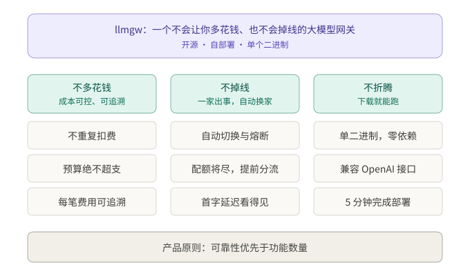

# 产品定义

> 本文回答：**这个产品为谁解决什么问题、凭什么被选择、先做什么不做什么、怎么推广、怎么判断它有没有价值。** 技术设计见 [design.md](design.md)，执行计划见 [roadmap.md](roadmap.md)。
>
> 状态：草案。标有 **【待决定】** 的地方需要作者拍板。

## 1. 一句话定位

> **llmgw：一个不会让你多花钱、也不会掉线的大模型网关。**
> 开源、自部署、单个二进制。把 GPT、MiniMax、MiMo 等多家模型统一到一个 OpenAI 兼容接口后面，自动容灾，严格控制成本。

**30 秒介绍：**
团队同时用好几家大模型以后，最头疼的是两件事：一是某一家出故障或限流，业务就跟着挂；二是钱花得不明不白，重试多扣了钱，预算也管不住。llmgw 是一个部署在你自己服务器上的网关：应用只改一下 `base_url` 就能接入；一家出问题时自动换下一家；而且从设计上保证**不会因为重试而重复扣费、预算不会超支、每一笔费用都能查到来源**。它是一个没有任何外部依赖的二进制文件，下载就能运行。

## 2. 目标用户

### 2.1 用户画像

| 画像 | 是谁 | 关心什么 | 怎么用 llmgw |
|---|---|---|---|
| **A. 技术负责人**（主要决策者） | 5–50 人团队的 CTO 或技术负责人，团队在用 2 家以上的大模型 | 稳定性、成本、别给团队增加运维负担 | 决定引入，看成本报表 |
| **B. 平台 / 运维工程师**（部署者） | 负责部署和维护基础设施的人 | 部署简单、好排障、监控齐全、出问题能快速定位 | 部署、配置、发放 key、看看板、处理告警 |
| **C. 应用开发者**（使用者） | 写业务代码、调用大模型的人 | 不改代码、不增加学习成本、出错时知道为什么 | 改 `base_url`，按接入指南处理错误 |

**首批聚焦：** 中文开发者团队。原因：首批适配的 MiniMax、MiMo 都是国内厂商；国内团队同时使用国内外多家模型的情况很普遍；作者也最熟悉这个群体。README 和文档同时提供英文版，为以后面向全球留出空间。

### 2.2 不是我们的目标用户

| 群体 | 为什么不是 | 他们更适合 |
|---|---|---|
| 运营 API 中转站、转售 key 的人 | 需要充值、计费、多用户后台等功能，与我们的定位不同 | One API / New API |
| 只用一家模型的个人开发者 | 用不到切换和多家成本管理，网关反而多了一层 | 直接调用厂商 API |
| 需要完整 API 管理平台的大型企业 | 需要多租户、SSO、审批流程等，超出当前范围 | Kong、Higress 等企业级网关 |

**明确不服务的群体，和明确服务的群体一样重要**：它决定了哪些功能请求可以果断拒绝。

## 3. 用户痛点与价值

| 痛点 | 现在的做法 | llmgw 怎么解决 | 对应的设计 |
|---|---|---|---|
| 某一家宕机或限流，业务就挂了 | 在业务代码里写重试和切换逻辑，每个应用都写一遍 | 按模型配置备用链路，自动切换；连续失败的自动熔断 | design.md 6.1、6.2 |
| SDK 和代码层层重试，**同一个请求被扣了好几次钱** | 很多团队根本没意识到这个问题 | 区分“确定没扣费”和“可能已扣费”的失败；通过 `x-should-retry` 让 SDK 不重试 | design.md 6.1、3.6 |
| 预算管不住，月底账单吓一跳 | 事后看厂商的账单 | 按 key 设预算，先冻结后结算，并发请求下也不会超支 | design.md 6.6 |
| 不知道钱花在了哪个应用、哪个功能上 | 每家厂商的控制台各看各的 | 统一的用量报表，可以按 key、模型、标签拆分 | observability.md 第 6 节 |
| 某家的额度快用完了，等到报错才发现 | — | 配额快用完时提前把流量分到其他家 | design.md 6.13 |
| 上游 key 散落在各个应用的配置里 | — | 应用只拿网关的 key，上游 key 只保存在网关上 | design.md 6.10 |
| 部署一个网关还要装数据库、Redis | — | 单个二进制，没有外部依赖 | — |

## 4. 价值主张：三大支柱

| 支柱 | 承诺 | v1.0 的关键能力 |
|---|---|---|
| **不多花钱** | 重试不会重复扣费；预算不会超支；每一笔费用都能追溯到 key、模型、请求 | 重试规则、`x-should-retry`、预算冻结与结算、用量统计、访问日志中的 `attempts` |
| **不掉线** | 只要还有一家能用，请求就能成功 | 故障切换、熔断、重试预算、舱壁隔离、配额感知、四种超时 |
| **不折腾** | 下载就能跑，应用不用改代码 | 单个二进制、OpenAI 兼容、5 分钟部署、清晰的错误信息、Grafana 看板 |

**性能是第二卖点**：C++ 和协程带来的“单机上万并发流、每条流内存很低”，作为可信度的支撑，而不是主打。原因见第 5 节。

## 5. 竞争格局与差异化

这个赛道已经很拥挤，以下是定性比较（各项目变化很快，以官方信息为准）：

| 项目 | 特点 | 我们的差异 |
|---|---|---|
| One API / New API | Go 编写，国内最流行；Web 管理后台完善，侧重 key 分发、额度和充值 | 我们不做转售和充值；专注于可靠性和成本的**正确性**（不重复扣费、预算不超支） |
| LiteLLM | Python，支持的厂商最多，功能全面 | 单二进制、零依赖；在成本正确性和容灾方面做得更深 |
| Bifrost | 以“最快的 LLM 网关”为卖点，内置 OpenTelemetry | 不和它比性能；我们主打可靠性与成本控制 |
| 以 AGPL 开源核心、企业功能商业授权的网关项目 | 功能多、有商业支持 | 更轻量，自部署门槛更低 |
| Higress、Envoy AI Gateway、Kong | 基于通用 API 网关，适合大企业 | 不需要先部署一整套通用网关 |

**我们的判断：**“性能更好”已经有人在讲，而且普通用户很难感知；但“**重试导致重复扣费**”“**预算在并发下超支**”是真实存在、很少有人认真解决、并且一讲就懂的问题。这是我们最容易被记住的切入点。

## 6. 产品原则

做取舍时，按这些原则判断：

1. **可靠性优先于功能数量**：宁可少一个功能，也不能多扣一次钱
2. **默认安全**：默认配置就是安全的（不重试可能已扣费的请求、预算出错时拒绝、管理面只监听本机），需要冒险的行为必须显式打开
3. **透明**：网关做的每一个决定（切换、重试、拒绝）都能在响应头、日志或指标中看到原因
4. **零依赖**：核心功能不依赖任何外部服务；Redis 这类依赖只能是可选的增强
5. **兼容而不绑定**：只用标准的 OpenAI 接口和可选的扩展字段，用户随时可以不用 llmgw
6. **克制**：不服务第 2.2 节列出的群体，相关的功能请求礼貌拒绝

## 7. 功能范围

### 7.1 v1.0：验证核心价值的最小产品

只包含支撑三大支柱所必需的功能，详见 [design.md 第 2.1 节](design.md#21-v10-支持的功能)。

### 7.2 v1.x：根据用户反馈决定

下面是**候选**功能。真正做哪些、按什么顺序做，由早期用户的反馈决定：

| 候选功能 | 价值假设 | 什么样的信号说明值得做 |
|---|---|---|
| Web 管理界面 | 降低使用门槛，尤其是非运维人员 | 多个用户在 Issue 或讨论区提出需求 |
| SQLite 存储与 key 管理接口 | 不用改配置文件就能增删 key、调预算 | 用户反映“改配置文件太麻烦” |
| Anthropic 协议适配 | 支持 Claude | 有用户需要接入 Claude |
| 多实例共享状态（Redis） | 精确的全局预算和限流 | 有用户在多实例部署时遇到预算误差问题 |
| 幂等键去重 | 客户端重试也不重复调用上游 | 用户反馈客户端网络不稳定时出现重复扣费 |
| 缓存（精确 / 语义） | 降低成本 | 用户的请求中有大量重复 |
| 智能路由 | 简单问题走便宜模型 | 用户主动要求按成本优化 |

### 7.3 明确不做

转售与充值、多租户 SaaS、用户体系、内容审核、存储对话内容、模型训练与推理（详见 [design.md 第 2.2 节](design.md#22-明确不做)）。

## 8. 关键用户旅程

每个旅程都有可以测量的体验目标，在 Beta 阶段请早期用户实际走一遍。

| 旅程 | 步骤 | 体验目标 |
|---|---|---|
| **首次部署** | 下载二进制或 `docker compose up` → 填写上游 key → 启动 → 发出第一个请求 | **5 分钟内**完成；任何一步出错，提示信息都能告诉用户怎么修 |
| **应用接入** | 拿到网关 key → 修改 `base_url` → 运行 | 应用代码只改两行 |
| **上游出故障时** | 某家返回 503 或超时 | 用户的请求依然成功；看板上能看到切换和熔断；告警及时发出 |
| **月底看账单** | `llmgw usage` 或看板 | 3 分钟内回答“哪个应用、哪个模型花了多少钱”；和厂商的账单能对上 |
| **发放和吊销 key** | `llmgw keygen` → 写入配置 → `llmgw reload` | 不停机；吊销立即生效 |
| **升级版本** | 替换二进制，或拉取新镜像 | 配置兼容；不中断服务；有升级说明 |

## 9. 开源策略

### 9.1 为什么先开源

- **验证价值的成本最低**：不需要销售和市场投入，用真实的使用量和反馈说话
- **信任**：网关会经手所有请求和上游 key，开源让用户可以审查代码、放心自部署
- **传播**：开发者工具主要靠口碑和社区传播
- **对作者**：公开的项目、真实的用户，本身就是最好的履历

### 9.2 许可证 ✅ 已决定：Apache 2.0

| 选项 | 优点 | 缺点 |
|---|---|---|
| **Apache 2.0（已采用）** | 对企业最友好，传播阻力最小；包含专利授权条款；以后仍然可以采用“核心开源、高级功能单独授权”的商业模式 | 别人可以直接拿去做闭源的商业服务 |
| MIT（原型阶段曾使用） | 最简单宽松 | 没有专利条款，企业法务有时更偏好 Apache 2.0 |
| AGPL v3 | 别人拿去提供服务必须开源修改，能防止被直接商用 | 不少企业会因此避开，传播阻力最大 |

11/20 决定采用 Apache 2.0，赶在有外部贡献者之前完成切换。

### 9.3 社区基础设施（Alpha 之前完成）

- `README.md`（中文）和 `README.en.md`（英文）：第一屏讲清楚定位、三大支柱和 5 分钟上手
- `CONTRIBUTING.md`：开发环境、编码规范、提交规范
- `CODE_OF_CONDUCT.md`：行为准则
- `SECURITY.md`：安全漏洞的私下报告方式和响应时间承诺
- Issue 模板（Bug、功能请求、使用问题）和 PR 模板（已有）
- 开启 GitHub Discussions：使用问题和功能讨论放在这里，Issue 只用于确认的 Bug 和已接受的需求
- 贡献者署名：采用 DCO（提交时加 `Signed-off-by`），轻量且常见

### 9.4 发布节奏与承诺

| 阶段 | 时间 | 面向谁 | 承诺 |
|---|---|---|---|
| **Alpha**（v0.2） | G2，12 月中 | 愿意尝鲜的开发者 | 核心链路可用；配置格式可能变化 |
| **Beta**（v0.3） | G3，12 月底 | 早期用户（3–5 个团队） | 功能基本完整；重大变更会提供迁移说明 |
| **v1.0** | G4，1 月中 | 所有人 | 配置格式和接口在 1.x 内保持兼容；安全问题优先修复 |
| 1.x | 之后每月一次 | — | 小版本每月发布；安全修复随时发布 |

### 9.5 推广计划

| 时间 | 内容 | 渠道 |
|---|---|---|
| Alpha | 技术文章 #1：C++20 协程流式代理 | 掘金、知乎、V2EX |
| Beta | 技术文章 #2：大模型网关如何避免重复扣费 | 掘金、知乎、V2EX、Reddit |
| v1.0 | 正式发布：文章 #3（压测）+ 演示视频 | 以上全部 + Hacker News（Show HN） |

## 10. 价值验证

### 10.1 要验证的假设

| # | 假设 | 怎么验证 |
|---|---|---|
| H1 | 团队确实在为“重复扣费”和“预算失控”头疼 | 文章 #2 的阅读和讨论量；早期用户访谈 |
| H2 | “可靠性优先”比“性能更好”更能吸引用户 | 对比不同文章、不同宣传角度带来的 Star 和访问量 |
| H3 | 单二进制、零依赖能显著降低部署门槛 | 早期用户完成首次部署的实际耗时 |
| H4 | 没有 Web 界面，用户也能接受 | 是否有大量用户因为没有界面而放弃 |

### 10.2 观察的信号

| 信号 | v1.0 发布后 3 个月的参考目标 |
|---|---|
| GitHub Star | 500 |
| 二进制下载量 + Docker 拉取量 | 2000 |
| **在生产环境中使用的团队**（主动告知或在讨论区分享） | **10 个** |
| 外部用户提交的 Issue 和讨论 | 50 条 |
| 外部贡献者 | 3 人 |

其中最重要的是**生产环境中的真实用户**：Star 数容易受宣传影响，真实使用才能证明价值。

### 10.3 早期用户计划

- Beta 之前找到 3–5 个愿意试用的团队（朋友的公司、技术社区中的联系人、在讨论区主动表示兴趣的人）
- 帮他们完成部署，每两周交流一次：遇到了什么问题、哪些功能最有用、缺什么
- 他们的反馈直接决定 7.2 节候选功能的优先级

### 10.4 之后怎么决定

v1.0 发布 3 个月后，根据信号做一次复盘：
- **信号很强**：考虑商业化方向（见第 11 节）
- **信号一般**：找出原因（定位？体验？推广？），调整后再验证一个周期
- **信号很弱**：作为个人作品和技术积累保留，不再追加大量投入

## 11. 可能的商业化方向（不在当前范围）

只作记录，在价值得到验证之前不投入：
- **企业版功能**：Web 控制台的高级功能、SSO、审计、多租户、高级报表
- **托管服务**：替用户运维网关
- **技术支持**：部署咨询、定制开发、服务等级承诺

## 12. 待决定事项

| # | 事项 | 建议 | 最晚何时决定 |
|---|---|---|---|
| 1 | ~~许可证~~ | ✅ 已采用 Apache 2.0（11/20） | — |
| 2 | 产品名称 | 暂时沿用 `llmgw`；名称已被另一个开源项目使用，正式发布前再评估 | v1.0 之前 |
| 3 | 部署位置（影响网络和合规） | 见 [production-readiness.md 第 0 节](production-readiness.md#0-待决定部署位置) | Beta 之前 |
