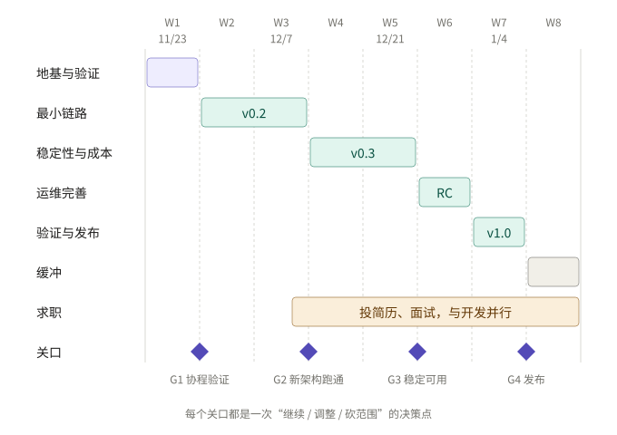

# 落地计划

> 本文是项目的**执行计划**：先做什么、按什么顺序、做到什么程度算完成、在哪里停下来做决定、落后了先砍什么。设计依据见 [design.md](design.md)，上线条件见 [production-readiness.md](production-readiness.md)。



## 1. 落地原则

1. **先打通，再做全**：第一个目标是一条“能跑通的最细链路”（请求进来 → 转发到一家上游 → 流式返回），然后在这条链路上逐个加能力。任何时候 main 分支都是能运行的
2. **先验证风险最大的部分**：协程和 Asio 是最大的技术风险，放在第 1 周用一个独立的小 demo 验证，不行就及时换方案
3. **尽早测量**：从第 3 周开始就有压测数据，而不是最后才测
4. **每个阶段都有能展示的成果**：一个版本号、一份数据、一篇文章。这既是项目进度，也是求职材料
5. **范围服从时间**：时间不够时按第 6 节的顺序砍范围，不拖延发布日期

## 2. 阶段与任务

工作量按**每天 5–6 小时、借助 AI 编程工具**估算，单位是“天”。

### 阶段 0：地基与验证（W1，11/23–11/29）

| # | 任务 | 工作量 | 依赖 | 完成标准 |
|---|---|---|---|---|
| 0.1 | 原型移到 `prototype/`，CI 继续编译和测试它 | 0.5 | — | CI 通过 |
| 0.2 | 模块骨架：`src/<模块>/` 目录、`llmgw_add_module`、模块 README；切换到 C++20；接入 GoogleTest | 0.5 | 0.1 | 空模块能编译，依赖检查生效 |
| 0.3 | CI 增加 clang-format、clang-tidy（只检查新模块）、依赖漏洞扫描 | 0.5 | 0.2 | 故意违规的代码会被 CI 拦下 |
| 0.4 | `core` 头文件：`RequestContext`、`Error`、`ResponseStream`、`Chunk`、`Target`、`MetricsRecorder` 等公共类型和接口 | 1 | 0.2 | 有文档注释；能被其他模块引用 |
| 0.5 | 可配置的 mock 上游（`tests/mock/`）：延迟、错误率、中途断流、慢速输出、配额响应头 | 1 | — | 能用命令行参数模拟 stability.md 3.1 中的各种上游故障 |
| 0.6 | **协程 demo**（`spike/`）：Asio + Beast，每核一线程、`SO_REUSEPORT`、Session 拉取循环、背压、取消、总超时 | 2 | 0.5 | 能流式代理 mock 上游；客户端断开后上游请求立即结束 |
| 0.7 | demo 压测：并发流数、每条流的内存、网关额外延迟，和原型对比 | 0.5 | 0.6 | 数据写入 `docs/benchmark.md` |
| 0.8 | ~~决定许可证~~ ✅ 已采用 Apache 2.0（11/20） | — | — | 已完成 |

**关口 G1（11/29）：协程方案是否可行**
- ✅ 继续：demo 支撑 5000 条以上的并发流，每条流内存不超过 100 KB，代码自己能读懂、能讲清楚
- ⚠️ 调整：性能达标但代码太难驾驭 → 评估改用 Drogon，写一条设计决策记录，最多花 1 天
- 无论哪种结果，demo 的过程都要记下来，作为第一篇技术文章的素材

### 阶段 1：最小链路（W2–W3，11/30–12/13）→ v0.2

| # | 任务 | 工作量 | 依赖 | 完成标准 |
|---|---|---|---|---|
| 1.1 | `config`：新配置格式的解析与校验（上游、模型、目标、超时、代理）；`llmgw check` | 1 | 0.4 | 错误配置给出明确的字段位置 |
| 1.2 | `observability` 基础：指标分片、`/metrics` 汇总、异步访问日志 | 1 | 0.4 | 热路径无锁；日志队列有上限 |
| 1.3 | `server`：Worker、Acceptor、Session、HTTP 解析、Keep-Alive、请求大小和读取超时、三个端口 | 2 | 0.6, 1.1 | 慢速攻击和超大请求被正确拒绝 |
| 1.4 | `upstream`：每个 Worker 的连接池、TLS、出站代理、DNS 缓存 | 2 | 0.6 | 连接复用率可以从指标看到；能通过代理访问 OpenAI |
| 1.5 | `stream`：SSE 解析、usage 提取、`ResponseStream` | 1 | 0.4 | 任意切块方式下解析结果都正确 |
| 1.6 | `provider`：OpenAI 兼容适配，`drop_fields` / `rename_fields` / `set_fields` | 1 | 1.4, 1.5 | 单元测试覆盖三种改写 |
| 1.7 | `router` + `executor` 基础：顺序切换、重试规则表、四种超时、取消 | 1.5 | 1.6 | design.md 6.1 的每一行都有测试 |
| 1.8 | **用真实 key 验证三家上游**（providers.md 验证清单），录制响应样本 | 1 | 1.7 | 清单 12 项填完；样本加入回归测试 |
| 1.9 | 原型的端到端测试在新架构上全部通过；压测报告 #1 | 1 | 1.1–1.7 | 新架构成为默认，原型只作对照组 |
| 1.10 | **开源基础设施**：英文 README、CONTRIBUTING、CODE_OF_CONDUCT、SECURITY、Issue 模板、开启 Discussions、DCO、自动发布二进制和镜像 | 1 | — | 陌生人能看懂项目、能提问、能贡献 |

**关口 G2（12/13）：新架构跑通**
- 打 tag `v0.2`，**作为公开的 Alpha 版发布**；压测报告 #1 发布（新架构和原型的并发数、内存、延迟对比）
- **开始投简历**（见第 5 节）
- 发布技术文章 #1：《用 C++20 协程写一个流式代理：线程模型、背压与取消》

### 阶段 2：稳定性与成本（W4–W5，12/14–12/27）→ v0.3

| # | 任务 | 工作量 | 依赖 | 完成标准 |
|---|---|---|---|---|
| 2.1 | 中间件链与插件注册表 | 1 | 1.3 | `on_complete` 在所有终态下都会执行 |
| 2.2 | `auth`：key 哈希、常量时间比较、鉴权失败限速；`llmgw keygen` | 1 | 2.1 | 配置中不出现明文 key |
| 2.3 | `ratelimit`：RPM、TPM、每个 key 的并发上限 | 1 | 2.1 | 超限返回 429 和正确的额度响应头 |
| 2.4 | `accounting`：价格表、费用、预算账本（先冻结后结算）、原子持久化、时区 | 2 | 2.1 | 并发压测下预算不超支；断电模拟后数据完整 |
| 2.5 | 熔断、重试预算、舱壁隔离 | 1.5 | 1.7 | stability.md 3.1 中对应的故障场景都有测试 |
| 2.6 | 错误码契约与 `x-should-retry`；OpenAI Python、Node、Go SDK 兼容性测试 | 1 | 1.7 | 用官方 SDK 验证 504 不会被自动重试 |
| 2.7 | 上游配额感知（动态和静态） | 1 | 1.4 | 配额快用完时流量自动转移 |
| 2.8 | TTFT 指标、用量聚合与落盘、`/v1/llmgw/usage`、Grafana 看板 | 1.5 | 1.2 | 4 个看板可以直接导入使用 |
| 2.9 | 事件循环看门狗、Session 异常隔离、故障注入测试矩阵 | 1 | 0.5 | 人为制造阻塞时能被检测到 |

**关口 G3（12/27）：稳定可用**
- 打 tag `v0.3`；stability.md 中 3.1 和 3.2 的每一行都有对应的自动化测试
- **作为 Beta 版发布**；找到 3–5 个早期用户，帮他们完成部署（见 [product.md 10.3](product.md#103-早期用户计划)）
- 自己的日常使用场景也接入，真实使用一周
- 发布技术文章 #2：《大模型网关如何避免重复扣费：重试、幂等与 x-should-retry》

### 阶段 3：运维完善（W6，12/28–1/3）→ RC

> 这一周包含元旦假期，安排的工作量较少。

| # | 任务 | 工作量 | 依赖 | 完成标准 |
|---|---|---|---|---|
| 3.1 | 配置热加载（ConfigStore + 各 Worker 的状态迁移） | 1 | 2.x | 持续压测时热加载，没有请求失败 |
| 3.2 | 过载保护、内存水位、降级 | 1 | 2.x | 超出容量时快速拒绝，压力撤掉后自动恢复 |
| 3.3 | 优雅退出、零停机升级 | 1 | 3.1 | 升级过程中没有请求失败 |
| 3.4 | 管理面与 `llmgw` 命令行（status、reload、usage、chat）、审计日志 | 1 | 2.x | 管理面默认只监听 127.0.0.1 |
| 3.5 | 部署：docker compose（网关 + Prometheus + Grafana）、systemd、Kubernetes 示例、系统参数检查；配置文档、部署文档 | 1.5 | 3.4 | 照着文档 10 分钟内完成部署 |

### 阶段 4：验证与发布（W7，1/4–1/10）→ v1.0

| # | 任务 | 工作量 | 依赖 | 完成标准 |
|---|---|---|---|---|
| 4.1 | 过载测试、24 小时长稳测试、混沌测试、升级测试 | 2 | 3.x | 结果写入测试报告 |
| 4.2 | 最终压测报告、容量规划表 | 1 | 4.1 | 达到 design.md 1.5 中的成功标准，或者如实说明差距 |
| 4.3 | 运维手册、CHANGELOG、英文 README | 1 | — | production-readiness.md 中的 P0 全部完成 |
| 4.4 | 发布：tag `v1.0.0`、GitHub Release、Docker 镜像 | 0.5 | 4.1–4.3 | 别人可以照着 README 跑起来 |
| 4.5 | 走一遍 [product.md 第 8 节](product.md#8-关键用户旅程)的 6 个用户旅程，请早期用户验证体验目标 | 0.5 | 4.4 | 每个旅程都达到体验目标，或者记录了改进项 |

**关口 G4（1/10）：发布 v1.0**
- 发布技术文章 #3：《单机上万并发流：一个 C++ 大模型网关的压测与优化》

### 第 8 周（1/11–1/17）：缓冲

用于消化前面的延期、修复 v1.0 的问题、准备面试材料。如果前面一切顺利，就提前开始 v1.1 的规划。

### v1.0 之后

- 每月发布一个小版本；v1.x 的功能按 [product.md 7.2 节](product.md#72-v1x根据用户反馈决定)，由早期用户的反馈决定优先级
- v1.0 发布 3 个月后，按 [product.md 10.4 节](product.md#104-之后怎么决定)做一次价值复盘

## 3. 关键路径

```
core 接口 → 协程 demo（G1） → server + upstream → executor → 中间件 / 预算 → 热加载 / 运维 → 验证发布
```

关键路径上的任务一旦延期，整个项目就会延期，所以它们优先处理。不在关键路径上、可以穿插进行的：mock 上游、指标与日志、配置解析、文档、Grafana 看板。

## 4. 工作方式

### 4.1 任务管理

每个任务都按 [开发流程](development-process.md) 推进：**任务设计 → 设计评审 → 实现 → 验证 → 合并 → 复盘**。设计通过之前不写代码；验证包括 CI 自动检查和写在任务设计中的验证记录。

- 每个任务对应一个 GitHub Issue，标明所属阶段（Milestone）、工作量和完成标准
- 一个任务一个 PR，按 [PR 模板](../.github/pull_request_template.md) 自查
- 完成标准统一包含：代码 + 测试 + 文档 + CI 全部通过（含 Sanitizer 和 clang-tidy）+ 必要的指标和日志

### 4.2 每天的节奏（建议）

| 时间 | 内容 |
|---|---|
| 上午 3 小时 | 开发：借助 AI 编程工具完成当天的任务 |
| 下午 1 小时 | 复盘：读懂当天的每一行代码，写一段“我学到了什么” |
| 下午 1 小时 | 求职：看岗位、投简历、准备面试（G2 之后） |
| 晚上 15 分钟 | 记录：今天完成了什么、遇到了什么问题、明天做什么 |

### 4.3 每周的节奏

周日做一次周复盘：对照计划检查进度，更新本文的状态，决定下周是否需要调整范围。

### 4.4 怎么用好 AI 编程工具

- **以设计文档为依据**：每个任务开始前，把相关的设计章节交给 AI，让它按设计实现，而不是自由发挥
- **先写测试**：对核心逻辑（重试决策、熔断、预算），先写测试用例，再让 AI 实现
- **自己必须能讲清楚**：AI 写的每个 PR，合并前自己要能解释“为什么这样写”。面试时被问到的都是这些
- **难点自己动手**：协程的生命周期、背压、取消这几处，建议自己写一遍，再让 AI 帮忙审查

## 5. 与求职的配合

**不要等到 v1.0 才开始投简历。** G2 时已经有一个能运行的新架构和第一份压测数据，足够写进简历。

| 时间 | 求职材料 |
|---|---|
| G1（11/29） | 整理协程 demo 的过程，作为文章 #1 的素材 |
| G2（12/13） | 简历项目经历初稿；GitHub 仓库首页整理好；文章 #1；**开始投简历** |
| G3（12/27） | 补充稳定性设计的亮点（防重复扣费、熔断、预算）；文章 #2 |
| G4（1/10） | 补充最终压测数据；文章 #3；录一段演示视频 |

简历中的项目描述建议用这样的结构：**做了什么 + 遇到了什么问题 + 怎么解决的 + 结果数据**。比如：

> 用 C++20 协程实现大模型网关，采用每核一线程、每连接一个协程的模型，单机支撑 N 条并发流式连接，每条连接内存 X KB；设计了区分“确定未计费”和“可能已计费”的重试规则，并通过 `x-should-retry` 与 OpenAI SDK 的自动重试配合，避免重复扣费。

（N、X 等数字以实际压测结果为准。）

## 6. 风险与范围调整

### 6.1 主要风险

| 风险 | 早期信号 | 应对 |
|---|---|---|
| 协程 / Asio 上手太慢 | 第 1 周结束时 demo 还跑不通 | G1 评估 Drogon；必要时阶段 1 延长 1 周，从缓冲周里扣 |
| 上游行为和文档不一致 | 1.8 的验证结果不符合预期 | 先记录在 providers.md，用 `error_mapping` 等配置绕过；必要时调整设计 |
| 工作量估计偏乐观 | 连续两周完成率低于 70% | 按 6.2 的顺序砍范围 |
| 节假日（圣诞、元旦）影响进度 | — | W6 已经少排了工作；W8 是缓冲 |
| 精力透支 | 连续几天效率很低 | 保持每天固定的作息；每周至少休息一天 |

### 6.2 落后时先砍什么

时间不够时，按下面的顺序**推迟到 v1.1**，不影响 v1.0 的核心价值：

1. 零停机升级（保留优雅退出）
2. Kubernetes 示例（保留 docker compose 和 systemd）
3. 混沌测试（保留故障注入测试和长稳测试）
4. 动态配额感知（保留静态配额）
5. `/v1/llmgw/usage` 自助查询（保留管理员的 `llmgw usage`）
6. Go SDK 兼容性测试（保留 Python 和 Node.js）
7. 审计日志

**绝对不砍的**：防重复扣费的重试规则、背压、超时与取消、熔断、预算（不超支）、异常隔离、压测报告。这些是项目可靠性的底线，也是面试中最有价值的部分。

### 6.3 工作量说明

以上计划的总工作量约 40 天，按每周 6 天、每天 5–6 小时排满了 7 周，**是一个偏紧的计划**。如果实际每天只有 3–4 小时，有两种选择：
- 保持 8 周，按 6.2 砍掉第 1–5 项（约节省 6 天）
- 保持范围，整体延长到 11–12 周

建议在 G1 时根据第一周的实际速度再做决定。

## 7. 状态

| 阶段 | 状态 | 版本 | 完成日期 |
|---|---|---|---|
| M1 原型与设计 | ✅ 完成 | v0.1 | 11/20 |
| 阶段 0：地基与验证 | ☐ 未开始 | — | — |
| 阶段 1：最小链路 | ☐ | v0.2 | — |
| 阶段 2：稳定性与成本 | ☐ | v0.3 | — |
| 阶段 3：运维完善 | ☐ | RC | — |
| 阶段 4：验证与发布 | ☐ | v1.0 | — |
