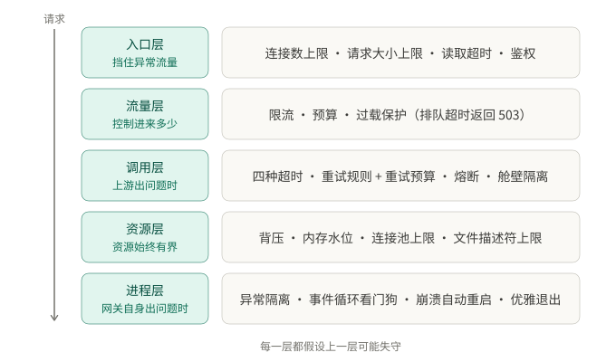

# 稳定性设计

> 本文是 [design.md](design.md) 的补充，系统地回答：**哪里可能出故障？出了故障怎么发现、怎么应对、怎么验证？**

## 1. 稳定性目标

先区分两类失败：
- **网关原因的失败**：网关自己的 bug、崩溃、过载、配置错误导致的失败
- **上游原因的失败**：所有上游都不可用时，网关只能如实返回错误

| 指标（SLO） | 目标 |
|---|---|
| 网关原因导致的请求失败率 | < 0.1%（可用性 99.9%） |
| 至少一个上游可用时的请求成功率 | ≥ 99.5% |
| 网关额外延迟 | P99 < 1 ms |
| 资源占用 | 在任何负载下都有上限，不会无限增长 |
| 发生故障后的恢复 | 上游恢复后 5 分钟内自动恢复使用；网关崩溃后 5 秒内自动重启 |

## 2. 设计原则

1. **所有资源都有上限**：连接数、内存、队列长度、等待时间、重试次数，没有一样是“无限”的
2. **快速失败**：确定不会成功的事情，立即返回错误，不要占着资源干等
3. **隔离**：一个上游、一个请求、一个插件出了问题，不能扩散到其他上游、请求和插件
4. **降级优于宕机**：非关键的功能出问题时，关掉这个功能、继续服务，而不是整个网关停掉
5. **纵深防护**：每一层都假设上一层可能失守，自己再做一次保护
6. **看得见才能稳**：每一种保护机制被触发时，都要有指标和日志

## 3. 故障模式分析

列出所有能想到的故障，逐一确定：怎么发现、怎么应对、靠哪个机制。**每一行都要有对应的自动化测试**（见第 7 节）。

### 3.1 上游的故障

| 故障 | 怎么发现 | 应对 | 机制 |
|---|---|---|---|
| 上游宕机，连接被拒绝 | 连接失败 | 立即切换到下一个目标；连续失败后熔断 | 重试规则、熔断 |
| 网络不通，数据包被丢弃 | 连接超时 | 同上；熔断后不再等待超时 | 连接超时、熔断 |
| 上游变得很慢 | 首字节超时、空闲超时 | 超时后按重试规则处理；限制这个上游的并发数，避免它占满资源 | 超时、**舱壁隔离** |
| 上游限流（429） | HTTP 429 | 切换到下一个目标；按 `Retry-After` 暂时跳过它 | 重试规则、熔断 |
| 上游返回 5xx | HTTP 状态码 | 502、503 切换；500、504 默认不切换（避免重复扣费） | 重试规则 |
| 错误码放在响应体里 | 解析响应体 | 映射成 HTTP 状态码后，再走重试规则 | `error_mapping` |
| 输出到一半断开 | 读取失败 | 不切换（已经计费），在流末尾追加错误事件 | ADR-003 |
| 网关的上游 key 失效、余额不足 | 401、403、余额不足的错误码 | 切换到下一个目标，并记录告警指标 | 重试规则、告警 |
| 所有上游同时故障 | 所有目标都失败 | 返回 502；**重试预算**防止重试把流量放大好几倍 | 重试预算 |
| DNS 解析失败 | 解析出错 | 继续使用上一次成功的解析结果（在一定时间内） | DNS 缓存 |

### 3.2 客户端的问题

| 故障 | 怎么发现 | 应对 | 机制 |
|---|---|---|---|
| 客户端读得很慢 | 写入阻塞 | 暂停读取上游，内存不会增长 | 背压 |
| 客户端中途断开 | 写入失败 | 立即取消上游请求，按已经产生的用量记账 | 取消信号 |
| 流量突然暴增 | 连接数、并发数 | 超出部分快速返回 503 和 `Retry-After` | 过载保护 |
| 某个 key 疯狂调用 | 限流计数 | 返回 429 | 限流 |
| 超大请求体 | 请求大小 | 返回 413 | 请求大小上限 |
| 慢速攻击（极慢地发送请求头） | 读取请求超时 | 关闭连接 | 读取超时 |
| 畸形的 HTTP 或 JSON | 解析失败 | 返回 400；解析器经过模糊测试 | 输入校验、fuzz |

### 3.3 网关自身的问题

| 故障 | 怎么发现 | 应对 | 机制 |
|---|---|---|---|
| 某个请求处理时抛出异常 | Session 边界的异常捕获 | 只结束这一个请求（返回 500），进程继续运行；记录指标 | 异常隔离 |
| 有代码阻塞了事件循环 | 事件循环延迟超过阈值 | 记录指标和日志，帮助定位；严重时 `/ready` 返回 503 | 看门狗 |
| 内存持续增长 | 内存水位 | 超过高水位后拒绝新请求；24 小时长稳测试提前发现泄漏 | 内存水位、长稳测试 |
| 文件描述符耗尽 | fd 数量 | 启动时检查并调高上限；接近上限时拒绝新连接 | fd 上限 |
| 进程崩溃 | 进程退出 | systemd 或容器自动重启；预算数据定期持久化，重启后恢复 | 自动重启、持久化 |
| 配置写错 | 校验失败 | 启动时直接报错退出；热加载时保留旧配置 | 配置校验 |
| 预算数据写入磁盘失败 | 写入出错 | **继续服务**，用内存中的数据，记录告警 | 降级 |
| 指标导出出错 | — | 不影响请求处理 | 降级 |
| 系统时钟跳变 | — | 超时计算只用单调时钟（`steady_clock`），系统时间只用于日志和预算的日期边界 | 时钟规范 |

## 4. 防护体系

### 4.1 入口层：挡住异常流量

| 机制 | 默认值 | 说明 |
|---|---|---|
| 最大连接数 | 10000 | 超过后新连接直接返回 503 |
| 请求体上限 | 32 MB | 超过返回 413 |
| 读取请求超时 | 10 秒 | 防止慢速攻击 |
| 鉴权 | — | 在所有耗费资源的操作之前完成 |

### 4.2 流量层：控制进来多少

| 机制 | 说明 |
|---|---|
| 限流 | 按 key 限制 RPM、TPM（[design.md 6.5](design.md#65-限流)） |
| 预算 | 先冻结后结算（[design.md 6.6](design.md#66-成本与预算)） |
| **并发上限 + 排队超时** | 正在处理的请求数超过上限时，新请求排队；排队超过 1 秒就返回 503，不让请求无限积压 |

### 4.3 调用层：上游出问题时

| 机制 | 说明 |
|---|---|
| 四种超时 | 连接、首字节、空闲、总时长（[design.md 6.3](design.md#63-超时与取消)） |
| 重试规则 | 只重试确定没有计费的失败（[design.md 6.1](design.md#61-重试与防重复扣费)） |
| **重试预算** | 每个 Worker 统计最近 10 秒的请求，**重试次数不能超过正常请求数的 20%**。超过以后不再切换，直接返回错误。目的是防止上游大面积故障时，每个请求都重试好几次，把流量放大好几倍，形成“重试风暴” |
| 熔断 | 连续失败的上游暂时跳过（[design.md 6.2](design.md#62-熔断)） |
| **舱壁隔离** | 每个上游有自己的并发上限（默认为该上游连接池上限）。一个上游变慢时，最多只能占满自己的额度，不会拖垮去往其他上游的请求 |

### 4.4 资源层：资源始终有界

| 资源 | 怎么保证有界 |
|---|---|
| 每条流的内存 | 背压：读一块、写一块（[concurrency-explained.md 第 7 节](concurrency-explained.md#7-背压)） |
| 正在处理的请求体总量 | 全局上限（默认 1 GB），超过后新请求返回 503 |
| 进程总内存 | 高水位（默认为容器内存上限的 80%）以上拒绝新请求，回落到低水位（70%）以下恢复 |
| 上游连接 | 连接池上限 |
| 文件描述符 | 启动时把上限调高到最大连接数的 2 倍以上；调不上去就启动失败并提示 |

### 4.5 进程层：网关自身出问题时

| 机制 | 说明 |
|---|---|
| **异常隔离** | 每个 Session 协程的最外层捕获所有异常：只结束这一个请求，其他请求不受影响 |
| **事件循环看门狗** | 每个 Worker 每 100 ms 投递一个定时任务，测量它实际被执行时的延迟。延迟超过 50 ms 说明有代码在阻塞线程，记录指标和日志（包括当时正在处理的请求） |
| 自动重启 | 提供 systemd 服务文件和容器的重启策略 |
| **优雅退出** | 收到 SIGTERM 后：`/ready` 立即返回 503 → 停止接收新连接 → 等待进行中的请求结束（最多 30 秒）→ 退出 |
| **零停机升级** | 借助 `SO_REUSEPORT`，新版本进程可以先启动、和旧进程同时监听同一个端口，旧进程再优雅退出，整个过程不会断开新的请求 |

## 5. 降级策略

“降级”是指非关键功能出问题时，关掉这个功能，保证核心的请求转发继续工作。

| 出问题的功能 | 降级方式 | 默认行为 |
|---|---|---|
| 预算持久化（写磁盘失败） | 继续使用内存中的数据 | 继续服务，并告警 |
| 预算账本本身出错 | `fail_open`：放行；`fail_closed`：拒绝 | **可配置**，默认 `fail_closed`（宁可不服务，也不让费用失控） |
| 指标、日志输出失败 | 丢弃这部分数据 | 继续服务 |
| 配置热加载失败 | 保留旧配置 | 继续服务，并告警 |
| DNS 解析失败 | 使用上一次的解析结果 | 最多沿用 10 分钟 |
| 某个插件的 `on_complete` 出错 | 记录错误，继续执行后面的插件 | 继续服务 |

## 6. 可观测与告警

**稳定性相关的指标**（在 [design.md 6.9](design.md#69-可观测性) 的基础上增加）：

| 指标 | 含义 |
|---|---|
| `llmgw_event_loop_lag_seconds{worker}` | 事件循环延迟（看门狗） |
| `llmgw_rejected_total{reason}` | 被拒绝的请求，按原因分类：过载、限流、预算、内存、请求过大 |
| `llmgw_retry_budget_exhausted_total` | 重试预算耗尽的次数 |
| `llmgw_bulkhead_rejected_total{provider}` | 因为舱壁隔离被拒绝的次数 |
| `llmgw_session_exceptions_total` | Session 中捕获到的异常数量（正常情况下应该是 0） |
| `llmgw_upstream_auth_errors_total{provider}` | 上游 key 失效或余额不足 |
| `llmgw_degraded{feature}` | 当前处于降级状态的功能 |

**建议的告警规则：**

| 告警 | 条件 | 级别 |
|---|---|---|
| 网关原因的失败率过高 | 5 分钟内超过 0.1% | 严重 |
| 所有上游都不可用 | 某个模型的所有目标都处于熔断状态 | 严重 |
| 上游 key 失效或余额不足 | `upstream_auth_errors_total` 增加 | 严重 |
| 事件循环被阻塞 | 延迟的 P99 超过 50 ms | 警告 |
| 内存接近高水位 | 超过 70% | 警告 |
| 出现异常 | `session_exceptions_total` 增加 | 警告 |
| 有功能处于降级状态 | `llmgw_degraded` 为 1 | 警告 |
| 首字延迟变慢 | TTFT 的 P95 比过去一周高出一倍 | 提示 |

## 7. 稳定性验证

**原则：第 3 节的每一种故障，都要有一个自动化测试来证明应对措施确实有效。**

| 测试 | 内容 | 何时运行 |
|---|---|---|
| 故障注入测试 | mock 上游可以模拟：拒绝连接、黑洞、慢速、限流、各种错误码、中途断流、响应体中的错误码。逐一验证第 3.1 节的每一行 | 每次提交 |
| 客户端异常测试 | 慢客户端、中途断开、超大请求、慢速攻击、畸形请求 | 每次提交 |
| 过载测试 | 把压力加到超出容量，验证：拒绝多余的请求、延迟不会无限增长、压力撤掉后能自动恢复 | 每个里程碑 |
| 长稳测试 | 以 70% 容量连续运行 24 小时，内存和 fd 不增长 | 发布前 |
| 混沌测试 | 运行中随机让某个上游宕机、变慢、恢复，验证熔断和恢复的过程 | 发布前 |
| 模糊测试 | HTTP 解析、SSE 解析、配置解析 | 每晚 |
| 升级测试 | 在持续的流量下做零停机升级和热加载，验证没有请求失败 | 发布前 |

## 8. 发布与变更

很多线上故障是由变更引起的，所以变更本身也要有保护：

- **配置变更**：先运行 `llmgw --check` 校验；热加载失败自动保留旧配置
- **版本升级**：零停机升级（见 4.5）；新版本启动后先检查 `/ready`，通过以后再让旧版本退出
- **回滚**：保留上一个版本的二进制和配置，出问题时可以一条命令回滚
- **运维手册**：v1.0 发布前写好常见问题的处理步骤，比如上游 key 失效、某个上游一直熔断、内存告警、事件循环告警

## 9. 落地计划

| 机制 | 里程碑 |
|---|---|
| 背压、四种超时、取消、异常隔离、连接上限、请求大小上限、读取超时 | M2 |
| 重试规则、重试预算、熔断、舱壁隔离、限流、预算、事件循环看门狗 | M3 |
| 内存水位、过载保护、降级、优雅退出、零停机升级、热加载回滚 | M4 |
| 故障注入测试 | 随每个机制一起完成 |
| 过载测试、长稳测试、混沌测试、升级测试、运维手册 | M5 |
