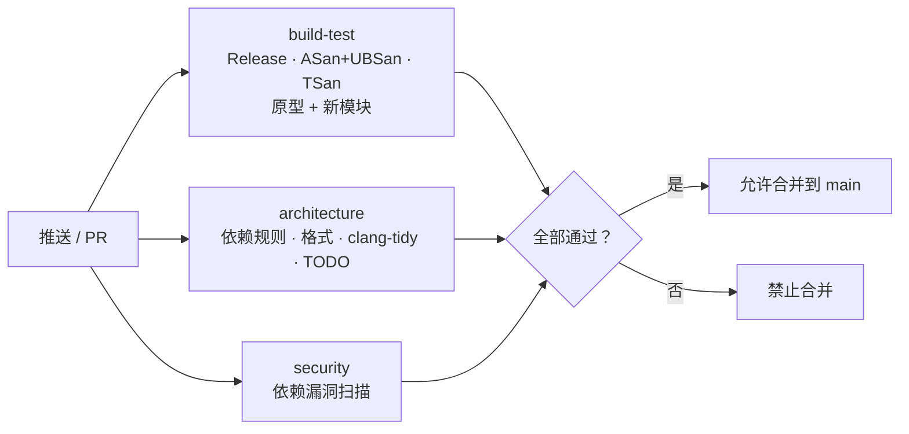

# 任务设计：0.1–0.3 工程骨架与自动守护

| 项目 | 内容 |
|---|---|
| Issue | [#1](https://github.com/bluesky-rgb/llmgw/issues/1)（原型迁移）、[#2](https://github.com/bluesky-rgb/llmgw/issues/2)（模块骨架）、[#3](https://github.com/bluesky-rgb/llmgw/issues/3)（CI 守护） |
| 阶段 | 阶段 0：地基与验证 |
| 工作量 | 计划 1.5 天；本设计比计划多了漏洞扫描和分支保护，预计 2 天 |
| 状态 | **验证中** |
| 实现的总体设计章节 | [code-architecture.md](../code-architecture.md) 第 2、5 节；[design.md](../design.md) 4.1、4.2、4.5 |

## 1. 目标与范围

**一句话：** 把单层结构的原型，变成“分模块、规则自动守护”的工程骨架。这个任务完成以后，后面写的每一行代码，都会自动受到依赖规则、格式、静态检查和漏洞扫描的约束。

**要做：**
- 0.1：原型整体移到 `prototype/`，保持 C++17，CI 继续编译、测试它
- 0.2：建立 12 个模块的目录、CMake 目标和模块 README；新代码切换到 C++20；接入 GoogleTest；`core` 提供一个最小的冒烟测试
- 0.3：CI 增加格式检查、静态检查、TODO 检查、依赖漏洞扫描；main 分支开启保护，CI 不通过不能合并

**不做：**
- 任何运行时功能：`core` 的公共类型和接口在 0.4 中设计，mock 上游在 0.5 中实现
- 新的可执行程序：在 1.9 之前，`llmgw` 可执行程序仍然来自原型
- 覆盖率门槛：在阶段 2 有足够的代码之后再启用（code-architecture.md 第 5 节中计划为 M3）

## 2. 在架构中的位置

- 涉及：整个工程结构、构建系统、CI；不涉及任何业务模块的实现
- 新增依赖：GoogleTest（仅测试使用）
- 与总体设计的偏离：
  1. **原型保持 C++17**，不切换到 C++20。原型只作为性能对照组，不再演进，没有必要冒升级的风险
  2. **漏洞扫描方案调整**：code-architecture.md 中写的是 OSV-Scanner，但它无法识别通过 CMake FetchContent 引入的 C++ 依赖。改为：用一份依赖清单记录每个依赖的仓库和版本，CI 中把版本解析成提交哈希，再按提交哈希查询 OSV 漏洞数据库（见 3.4）

## 3. 设计

### 3.1 完成后的目录结构

```
llmgw/
├── CMakeLists.txt              # 根：选项、依赖、src/、tests/、prototype/
├── cmake/
│   ├── LlmgwModule.cmake       # 已有：创建模块并校验依赖
│   ├── Dependencies.cmake      # 新增：读取依赖清单，用 FetchContent 拉取
│   └── dependencies.json       # 新增：依赖清单（名称、仓库、版本、用途）——唯一来源
├── src/
│   ├── CMakeLists.txt          # 按从下到上的层次 add_subdirectory
│   ├── core/
│   │   ├── README.md
│   │   ├── CMakeLists.txt
│   │   └── include/llmgw/core/version.h    # 唯一的实际代码：版本号
│   ├── config/  observability/  upstream/  stream/  accounting/
│   ├── router/  provider/  middleware/  executor/  server/  admin/
│   │   └── 每个都有 README.md、CMakeLists.txt、include/llmgw/<模块>/（暂时为空）
│   └── app/                    # 暂时只有 README，1.9 时才有 main.cpp
├── tests/
│   ├── CMakeLists.txt
│   └── unit/core/version_test.cpp
├── prototype/                  # v0.1 原型，原样迁入
│   ├── CMakeLists.txt          # 独立的目标，C++17，依赖 cpp-httplib
│   ├── src/  tests/  config.example.json
├── tools/
│   ├── module_deps.json  check_deps.py    # 已有
│   ├── check_todos.py                     # 新增
│   └── check_vulns.py                     # 新增
└── .github/
    ├── workflows/ci.yml                   # 重写
    └── dependabot.yml                     # 新增：只用于更新 GitHub Actions 的版本
```

### 3.2 构建结构

**根 `CMakeLists.txt` 的选项：**

| 选项 | 默认值 | 作用 |
|---|---|---|
| `LLMGW_BUILD_TESTS` | ON | 构建 `tests/` |
| `LLMGW_BUILD_PROTOTYPE` | ON | 构建 `prototype/`（发布 v1.0 时关闭） |
| `LLMGW_WARNINGS_AS_ERRORS` | ON | 新模块开启 `-Werror` |

**模块的写法**（以 `upstream` 为例，暂时没有源文件，所以是 INTERFACE 目标）：

```cmake
# src/upstream/CMakeLists.txt
llmgw_add_module(upstream DEPS core config observability)
```

这样做的意义：**依赖关系从第一天起就由 CMake 校验**。即使模块还是空的，有人在 CMakeLists 里写了不允许的依赖，配置阶段就会报错。

**依赖清单 `cmake/dependencies.json`：**

```json
{
  "googletest":    { "repo": "https://github.com/google/googletest.git", "tag": "v1.15.2", "used_by": "tests" },
  "nlohmann_json": { "repo": "https://github.com/nlohmann/json.git",     "tag": "v3.11.3", "used_by": "prototype" },
  "cpp_httplib":   { "repo": "https://github.com/yhirose/cpp-httplib.git", "tag": "v0.67.0", "used_by": "prototype" }
}
```

`Dependencies.cmake` 和 `check_vulns.py` 都只读这一个文件，版本只写在一个地方。具体版本号在实现时以各项目最新的稳定版为准。Asio、Beast、simdjson 等依赖在用到它们的任务（0.6、1.x）中加入。

### 3.3 CI 流水线



| 任务 | 内容 | 预计耗时 |
|---|---|---|
| `build-test`（3 种构建） | 编译原型和新模块，运行所有测试 | 每种 2–3 分钟 |
| `architecture` | `check_deps.py`；`clang-format --dry-run --Werror`（只检查 `src/` 和 `tests/unit/`）；`clang-tidy`（只检查 `src/`）；`check_todos.py` | 1–2 分钟 |
| `security` | `check_vulns.py` | 少于 1 分钟 |

- clang-format 和 clang-tidy **固定使用 18 版**（与本地开发环境一致），避免版本不同导致检查结果不同
- 用 `actions/cache` 缓存 FetchContent 下载的依赖，缩短构建时间
- 每周还会定时运行一次 `security`，即使没有提交也能发现新公布的漏洞

### 3.4 漏洞扫描

`tools/check_vulns.py` 的工作方式：
1. 读取 `cmake/dependencies.json`
2. 对每个依赖，用 `git ls-remote` 把版本标签解析成提交哈希
3. 用提交哈希查询 OSV 漏洞数据库（`api.osv.dev`）
4. 发现漏洞就让 CI 失败，并列出漏洞编号和链接

如果某个漏洞经评估不影响本项目，可以写进 `tools/vuln_allowlist.json`，**必须写明理由和失效日期**，到期后自动重新报警。

**局限：** OSV 对 C++ 库的收录不如 npm、PyPI 那样完整。所以在 production-readiness.md 中增加一项：每次发布前，人工检查一遍各依赖的安全公告。

### 3.5 TODO 检查

`tools/check_todos.py` 扫描 `src/` 和 `tests/`，所有 `TODO` 必须写成 `TODO(#Issue编号): 说明` 的格式。不符合格式的 TODO 会让 CI 失败。

### 3.6 分支保护与提交方式

从这个任务开始，改为 **PR 流程**：
- 每个任务在独立的分支上开发，通过 PR 合并到 main
- main 开启分支保护：`build-test`（3 种）、`architecture`、`security` 必须全部通过，才能合并
- 由于目前只有作者一个人，不要求他人审批；**合并前，作者在 PR 中确认已经看懂所有改动**
- 管理员保留紧急情况下绕过保护的权限，但需要在 PR 中说明原因

### 3.7 模块 README

12 个模块的 README 按 [模板](../templates/MODULE_README.md) 填写，内容来自 design.md 3.2、5.1 和 code-architecture.md 2.3。重点写清楚每个模块“**不负责什么**”。例如：
- `upstream` 不负责重试和切换（属于 `executor`），也不负责格式改写（属于 `provider`）
- `stream` 不负责网络读写（属于 `upstream`），只负责解析和提取

## 4. 数据与状态

本任务只涉及构建和 CI，不涉及运行时数据。

## 5. 失败与边界情况

| 情况 | 处理方式 | 对应的验证 |
|---|---|---|
| CI 中下载依赖失败（网络问题） | 缓存依赖；失败时自动重试一次 | V5 |
| 原型在新的构建结构下编译失败 | 原型保持 C++17，用独立的 CMakeLists，不受新模块的 `-Werror` 和 clang-tidy 影响 | V1 |
| clang-tidy 检查到第三方库的头文件 | 第三方库作为 SYSTEM 头文件引入；`HeaderFilterRegex` 只匹配 `src/` | V3 |
| 不同版本的 clang-format 结果不同 | CI 固定 18 版；文档中说明本地使用相同版本 | V3 |
| 漏洞数据库误报 | 写入允许清单，必须有理由和失效日期 | V4 |
| 分支保护阻止了文档的紧急修改 | 文档修改同样走 PR；紧急情况管理员可以绕过 | — |

## 6. 验证计划

| # | 验证项 | 方法 | 验收标准 |
|---|---|---|---|
| V1 | 原型迁移后功能不变 | CI 中编译并运行原型的 16 个测试；手动运行 `prototype` 的二进制，发一个流式请求 | 16 个测试全部通过；流式请求正常 |
| V2 | 模块骨架正确 | 本地和 CI 中配置、编译；`check_deps.py` 扫描到 12 个模块目录 | 配置成功；依赖检查通过 |
| V3 | **每一道守护都真的有效**（反向测试） | 在一个临时分支上逐项制造违规，确认 CI 拦下： ① 跨层 `#include` ② CMake 中声明不允许的依赖 ③ 引用其他模块的内部头文件 ④ 格式错误 ⑤ 命名不符合规范 ⑥ 协程使用引用参数 ⑦ 没有 Issue 编号的 TODO | 7 种违规全部被拦下；记录每次 CI 失败的链接和报错信息 |
| V4 | 漏洞扫描可用 | 运行 `check_vulns.py`；再临时把某个依赖改成一个已知有漏洞的旧版本 | 正常版本通过；旧版本被拦下并列出漏洞编号 |
| V5 | CI 总耗时可接受 | 记录完整流水线的耗时（有缓存和无缓存两种情况） | 有缓存时少于 10 分钟 |
| V6 | GoogleTest 接入正确 | `core` 的冒烟测试在 3 种构建下都能运行 | 全部通过 |
| V7 | 分支保护生效 | 尝试直接推送到 main；尝试合并一个 CI 失败的 PR | 都被拒绝 |

V3 最重要：**守护规则如果没有经过反向测试，就不能确定它真的在起作用。**

## 7. 风险与备选方案

| 风险 | 应对 |
|---|---|
| clang-tidy 太慢或误报太多 | 只检查 `src/`；误报的检查项在 `.clang-tidy` 中关闭，并记录原因 |
| OSV 对 C++ 依赖的覆盖不完整 | 发布前人工检查依赖的安全公告（见 3.4） |
| 分支保护让开发变慢 | CI 控制在 10 分钟以内；如果仍然影响效率，在周复盘中讨论 |

---

## 评审记录

| 日期 | 结论 | 意见 |
|---|---|---|
| 2026-11-20 | ✅ 设计通过 | 作者暂无其他意见 |

## 验证记录

（实现完成后填写）

## 收获与教训

（复盘时填写）
