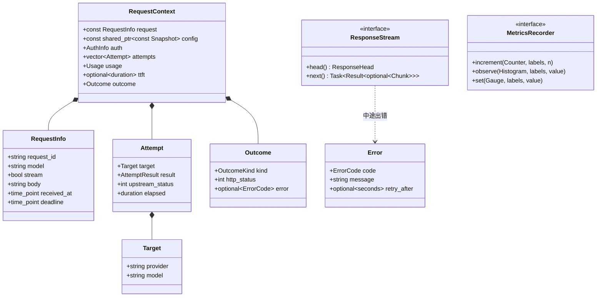

# 任务设计：0.4 core 公共类型与接口

| 项目 | 内容 |
|---|---|
| Issue | [#4](https://github.com/bluesky-rgb/llmgw/issues/4) |
| 阶段 | 阶段 0：地基与验证 |
| 工作量 | 1 天 |
| 状态 | 已完成 |
| 实现的总体设计章节 | [design.md](../design.md) 3.2“模块之间如何交互”“调用机制与数据流”；[code-architecture.md](../code-architecture.md) 3.5；[extensibility.md](../extensibility.md) 第 4 节；[observability.md](../observability.md) 3.2 |

## 1. 目标与范围

**一句话：** 定义所有模块共用的类型和接口。core 是依赖图的最底层，阶段 1 的每个模块都会引用它，所以这里的每个名字和语义都要经得起后面 10 个任务的使用。

**要做：**

| 头文件 | 内容 |
|---|---|
| `task.h` | `Task<T>`：异步函数的返回类型（Asio 协程的别名） |
| `error.h` | `ErrorCode`、`Error`；错误码对应的 HTTP 状态码、`code` 字符串、是否建议客户端重试 |
| `result.h` | `Result<T>`：可能失败的操作的返回类型；`fail()` 辅助函数 |
| `target.h` | `Target`：路由结果中的一个上游目标 |
| `response.h` | `ResponseHead`、`Chunk`、`ResponseStream`（Session 拉取数据的接口） |
| `request_context.h` | `RequestContext` 及其按写入者分组的字段；`Attempt`、`Usage`、`Outcome` |
| `metrics.h` | `MetricsRecorder` 接口、指标目录、`NullMetricsRecorder` |

每个公开类型都有文档注释；每个头文件都能单独编译；有单元测试。

**不做：**（以及在哪里做）
- `Decision`（中间件的放行/拒绝结果）→ 属于 middleware 模块，任务 2.x
- 配置快照的具体内容 → config 模块，任务 1.2
- 限流额度、预算冻结额等字段 → 对应的中间件任务（2.x）再加入 `RequestContext`
- 时钟抽象、请求 ID 生成 → 需要它们的任务（熔断 2.x、server 1.x）
- 错误的 JSON 序列化 → server 模块（任务 1.x）

**原则：只定义阶段 1 确定会用到的东西。** 不确定的字段以后加，比加了再删容易得多。

## 2. 在架构中的位置

- 涉及的模块：`core`
- 模块依赖：无（与 `tools/module_deps.json` 一致）
- **新增第三方依赖：**
  - **Boost.Asio**（只用 `awaitable`，集中在 `task.h`）
  - **tl::expected v1.3.1**（CC0 许可，单头文件）
- **与总体设计的偏离：** 见下面的决策 A–D

### 决策 A：用 tl::expected 代替 `std::expected`

设计文档写的是 `std::expected<T, Error>`，但实测：

| 编译器 | `std::expected` |
|---|---|
| GCC 13，C++20 | ❌ 需要 C++23 |
| GCC 13，C++23 | ✅ |
| **Clang 18 + libstdc++ 13，C++23** | ❌ libstdc++ 要求的 concepts 版本高于 Clang 18 的声明，`<expected>` 被禁用 |

CI 的 clang-tidy 使用 Clang 18（Ubuntu 24.04 默认），所以**即使升级到 C++23，`std::expected` 也不能用**。

| 方案 | 优点 | 缺点 |
|---|---|---|
| ① 升级到 C++23 + Clang 19 | 用标准库 | Ubuntu 24.04 默认工具链不能编译；用户从源码构建的门槛提高 |
| ② 自己写一个 `Result<T>` | 没有依赖 | 要维护约 200 行容易出错的模板代码（移动语义、`and_then` 等） |
| **③ tl::expected（采用）** | **接口与 `std::expected` 一致**；单头文件；CC0 许可；GCC 13 / Clang 18 的 C++20 下实测可用 | 多一个依赖 |

所有代码只使用别名 `llmgw::Result<T>` 和 `llmgw::fail()`，**不直接写 `tl::`**。以后工具链支持 `std::expected` 时，只需改 `result.h` 的一行别名。

### 决策 B：core 依赖 Boost.Asio，但只依赖 `awaitable` 一个类型

core 的 README 写着“不依赖第三方网络库”，但 G1 选定 Asio 后，所有异步接口（`ResponseStream::next()`、中间件的 `on_request()`）都必须返回 `asio::awaitable`。这个依赖绕不开。

做法：`task.h` 定义 `template <class T = void> using Task = boost::asio::awaitable<T>;`，**其他头文件只使用 `Task`，不出现 `boost::asio::` 的其他类型**。将来如果要换协程库，影响范围只有这一个别名。

代价：默认构建开始下载 Boost（约 100 MB）。CI 已经按依赖清单缓存 `.deps`，同一份清单只下载一次。

### 决策 C：`RequestContext` 通过前置声明持有配置快照

`RequestContext` 要持有配置快照，但快照的类型定义在 config 模块，而 config 依赖 core。

做法：core 中只写 `namespace llmgw::config { struct Snapshot; }` 并持有 `std::shared_ptr<const config::Snapshot>`。`shared_ptr` 支持不完整类型；core 自己从不访问快照的内容，需要读配置的模块（router、middleware 等）本来就依赖 config。

这是 core 中**唯一**一处引用上层模块的名字，写在 `request_context.h` 顶部并注明原因。

### 决策 D：`RequestContext` 中不放“取消信号”

设计文档的“信息共享”表写着 `RequestContext` 包含“取消信号”。0.6 的实践表明不需要：Session 对整个请求只做一次 `||` 竞速（ADR-006 结论 1），客户端断开或超时时，Asio 会自动取消正在等待的操作，取消沿着 `co_await` 链传递到下层。下层不需要检查任何标志。

`RequestContext` 只保留 `deadline`，供下层计算每次尝试的超时（比如“剩余时间不够再试一次了”）。design.md 的对应描述同步修改。

## 3. 接口设计

### 3.1 类图



### 3.2 `task.h` 与 `result.h`

```cpp
template <class T = void>
using Task = boost::asio::awaitable<T>;       // 所有异步函数的返回类型

template <class T>
using Result = tl::expected<T, Error>;        // 可能失败的操作的返回类型

tl::unexpected<Error> fail(ErrorCode code, std::string message);  // return fail(...);
```

### 3.3 `error.h`

错误码与 [client-guide.md 第 7 节](../client-guide.md#7-错误处理与重试) 的表格**一一对应**，单元测试逐行核对：

```cpp
enum class ErrorCode : std::uint8_t {
  kInvalidRequest,       // 400  invalid_request
  kInvalidApiKey,        // 401  invalid_api_key
  kBudgetExceeded,       // 402  budget_exceeded
  kModelNotFound,        // 404  model_not_found
  kPayloadTooLarge,      // 413  payload_too_large
  kRateLimited,          // 429  rate_limited        建议重试
  kInternal,             // 500  internal_error      （新增，见下）
  kUpstreamUnavailable,  // 502  upstream_unavailable 建议重试
  kOverloaded,           // 503  overloaded          建议重试
  kUpstreamTimeout,      // 504  upstream_timeout    不建议重试（可能已计费）
};

struct Error {
  ErrorCode code;
  std::string message;                         // 给人看的说明，不含敏感信息
  std::optional<std::chrono::seconds> retry_after;
};

constexpr int http_status(ErrorCode);
constexpr std::string_view code_name(ErrorCode);   // 响应体中的 "code"
constexpr bool should_retry(ErrorCode);            // 响应头 x-should-retry
```

- **`Error` 只表示网关自己产生的错误。** 上游返回的 4xx（比如参数错误）按 ADR-002 原样透传给客户端，走 `ResponseStream`，不转换成 `Error`
- **新增 `internal_error`（500）**：网关自身的 bug。`x-should-retry: false`，因为请求可能已经发到上游。client-guide.md 同步补充

### 3.4 `response.h`

```cpp
struct Header { std::string name; std::string value; };

struct ResponseHead {
  int status = 200;
  std::vector<Header> headers;
};

struct Chunk {
  std::string data;    // 原样写给客户端的字节（流式时是完整的 SSE 事件）
};

// Session 通过它拉取响应体。实现：stream 模块（流式 / 非流式），以后还有缓存插件等。
// 只在创建它的 Worker 线程上使用。
class ResponseStream {
 public:
  virtual ~ResponseStream() = default;
  virtual const ResponseHead& head() const = 0;   // 创建时已经拿到响应头
  // 拉取下一块：
  //   有值且非空 → 一块数据；有值但为空（nullopt）→ 正常结束；错误 → 中途出错
  // 调用方写完上一块才调用下一次（背压）；被取消时直接结束，不返回值。
  virtual Task<Result<std::optional<Chunk>>> next() = 0;
};
```

**为什么 `next()` 返回三种状态而不是抛异常：** 上游中途断开是常见情况，不是异常（code-architecture.md 3.5：热路径不抛异常）。Session 根据返回值决定发送错误事件、记录 `outcome`。

**为什么用虚函数：** 每块数据一次虚函数调用（约 1 ns），相对每块约 19 µs 的处理成本（benchmark.md B5）可以忽略；换来的是 stream 模块和插件可以提供不同的实现。

### 3.5 `request_context.h`

字段**按写入者分组**，每组的注释写明唯一的写入者（design.md“每个字段只有一个写入者”）。Session 创建时确定的部分是 `const` 成员，**编译器保证**之后没有人能修改：

```cpp
namespace llmgw::config { struct Snapshot; }   // 决策 C

struct RequestInfo {                 // 写入者：Session（创建时），之后只读
  std::string request_id;
  std::string model;                 // 客户端请求的模型名（路由前）
  bool stream = false;
  std::string body;                  // 原始请求体
  std::chrono::steady_clock::time_point received_at;
  std::chrono::steady_clock::time_point deadline;
};

struct AuthInfo {                    // 写入者：auth 中间件
  std::string key_id;                // 空表示还没有通过鉴权
};

enum class AttemptResult : std::uint8_t {
  kOk, kConnectError, kTimeout, kStatus429, kStatus4xx, kStatus5xx, kBreakerOpen, kCancelled,
};
constexpr std::string_view label(AttemptResult);  // 指标标签：ok / conn_error / timeout / 429 / ...

struct Attempt {                     // 写入者：executor（每尝试一次追加一条）
  Target target;
  AttemptResult result = AttemptResult::kOk;
  int upstream_status = 0;           // 0 表示没有收到响应头
  std::chrono::steady_clock::duration elapsed{};
};

struct Usage {                       // 写入者：stream
  std::int64_t prompt_tokens = 0;
  std::int64_t completion_tokens = 0;
  std::int64_t reasoning_tokens = 0;
  bool reported = false;             // 上游是否给出了 usage（false 时由预算模块估算）
};

enum class OutcomeKind : std::uint8_t {
  kPending,          // 还没结束
  kSuccess,          // 完整返回
  kRejected,         // 被中间件拒绝（401、429、402 …）
  kFailed,           // 网关或上游错误，没有返回完整结果
  kClientAborted,    // 客户端在完成前断开
  kTimeout,          // 总超时或空闲超时
};

struct Outcome {                     // 写入者：Session
  OutcomeKind kind = OutcomeKind::kPending;
  int http_status = 0;
  std::optional<ErrorCode> error;
};

struct RequestContext {
  RequestContext(RequestInfo info, std::shared_ptr<const config::Snapshot> config);

  const RequestInfo request;                                   // Session
  const std::shared_ptr<const config::Snapshot> config;        // Session
  AuthInfo auth;                                               // auth 中间件
  std::vector<Attempt> attempts;                               // executor
  Usage usage;                                                 // stream
  std::optional<std::chrono::steady_clock::duration> ttft;     // stream
  Outcome outcome;                                             // Session
};
```

`RequestContext` 不可复制（禁止复制构造和赋值），只能移动构造：一个请求只有一份上下文。

### 3.6 `metrics.h`

```cpp
// 指标目录：名字、说明、标签名都在 core 中统一登记（observability.md 3.2），
// 防止各模块各自起名、随意加标签（3.3 标签基数控制）。
// 只登记阶段 1 中由下层模块上报的指标；其余指标在实现它们的任务中加入（见下表）。
enum class Counter : std::uint8_t {
  kUpstreamAttempts,     // llmgw_upstream_attempts_total{provider, result}     executor（1.7）
  kUpstreamAuthErrors,   // llmgw_upstream_auth_errors_total{provider}          executor（1.7）
  kRejected,             // llmgw_rejected_total{reason}                        server（1.3）
};
enum class Histogram : std::uint8_t {
  kUpstreamDuration,     // llmgw_upstream_duration_seconds{provider}           executor（1.7）
};
enum class Gauge : std::uint8_t {
  kActiveConnections,    // llmgw_active_connections{}                          server（1.3）
  kActiveRequests,       // llmgw_active_requests{worker}                       server（1.3）
  kPoolConnections,      // llmgw_pool_connections{provider, state}             upstream（1.4）
};

struct MetricInfo {
  std::string_view name;                       // llmgw_upstream_attempts_total
  std::string_view help;
  std::span<const std::string_view> labels;    // {"provider", "result"}
};
const MetricInfo& info(Counter);               // 以及 Histogram、Gauge 的重载

// 依赖倒置：接口在 core，实现在 observability（每个 Worker 一个分片），Worker 启动时注入。
// 不要在每个数据块上调用：每次调用要查一次标签组合（每个请求、每次尝试级别的频率没有问题）。
//
// ⚠️ 实现时修改（见评审记录）：采用 NVI —— 公开非虚函数接受花括号列表并检查标签个数，
// 再转给私有虚函数。C++20 的 std::span 不能直接从 {a, b} 构造，否则调用方写起来很别扭。
class MetricsRecorder {
 public:
  void increment(Counter, std::initializer_list<std::string_view> labels, std::uint64_t n = 1);
  void observe(Histogram, std::initializer_list<std::string_view> labels, double value);
  void set(Gauge, std::initializer_list<std::string_view> labels, double value);
  // （以及接受 LabelValues = std::span<const std::string_view> 的重载）
  std::uint64_t dropped() const;   // 标签个数不一致而丢弃的次数
 private:
  virtual void do_increment(Counter, LabelValues, std::uint64_t) = 0;
  virtual void do_observe(Histogram, LabelValues, double) = 0;
  virtual void do_set(Gauge, LabelValues, double) = 0;
};
// 用法：rec.increment(Counter::kUpstreamAttempts, {provider, label(result)});

class NullMetricsRecorder final : public MetricsRecorder { /* 什么都不做：测试和默认值 */ };
```

**以后加入目录的指标：** `ttft_seconds`（2.8）、`event_loop_lag_seconds`（2.9）、`breaker_state`、`retry_budget_exhausted_total`、`bulkhead_rejected_total`（2.5）、`degraded`、`log_dropped_total` 等。加入时只需在枚举和目录表中各加一行。

**哪些指标不经过 `MetricsRecorder`：** 请求级的指标（`requests_total`、`request_duration`、`tokens_total`、`cost`）在请求结束时由 observability 根据 `RequestContext` 统一记录，下层模块不需要上报。`MetricsRecorder` 只用于下层模块才知道的事情：每次上游尝试、连接池、熔断状态、事件循环延迟等。

### 3.7 需要同步修改的文档

| 文档 | 修改 |
|---|---|
| `decisions.md` | 新增 ADR-007：决策 A（tl::expected）和决策 B（core 依赖 Asio 的 `awaitable`） |
| `design.md` | “信息共享”表中的“取消信号”改为“截止时间”，并说明取消方式（决策 D）；`std::expected` 改为 `Result` |
| `code-architecture.md` 3.5、`extensibility.md` 第 4 节 | `std::expected` 改为 `Result`；说明 `Task` |
| `client-guide.md` 第 7 节 | 补充 500 `internal_error` |
| `src/core/README.md` | 对外接口、依赖（Boost.Asio 的 `awaitable`、tl::expected） |
| `code-architecture.md` 3.4 | （实现时补充）新增规则：调用方保证存活的对象在协程参数中用指针传递 |
| `extensibility.md` 第 4 节、`design.md`、`diagrams.md` | （实现时补充）中间件、executor 的协程接口改为传 `RequestContext*`；`on_complete` 去掉重复的 `outcome` 参数；类图与 core 的实际定义对齐（去掉 `CancelToken`、早期的 `sink` 推模型） |
| `design.md` 6.3 | （实现时补充）“每个等待操作都和定时器竞速”改为“竞速放在请求和尝试的粒度上”（ADR-006） |
| `stability.md` | （实现时补充）客户端断开的检测与取消方式 |

## 4. 数据与状态

| 数据 | 所有者 | 线程归属 | 生命周期 |
|---|---|---|---|
| `RequestContext` | Session 协程 | 请求级 | 一个请求 |
| `ResponseStream` | Session（`unique_ptr`） | 请求级，只在创建它的 Worker 上使用 | 一个响应；析构时归还或关闭上游连接 |
| `MetricsRecorder` 实现 | Worker | Worker 级 | 进程 |
| 指标目录 | 静态常量 | 全局只读 | 进程 |

core 本身没有运行时状态。

## 5. 关键流程

Session 使用这些类型的方式（design.md 示意代码的具体化）：

```cpp
// 协程参数不用引用：ctx 用指针（调用方保证存活），resp 按值转移所有权
Task<> Session::relay(RequestContext* ctx, std::unique_ptr<ResponseStream> resp) {
  co_await write_head(resp->head());
  for (;;) {
    Result<std::optional<Chunk>> r = co_await resp->next();
    if (!r) { ctx->outcome = {OutcomeKind::kFailed, resp->head().status, r.error().code};
              co_await write_error_event(r.error()); co_return; }
    if (!*r) { ctx->outcome = {OutcomeKind::kSuccess, resp->head().status, {}}; co_return; }
    co_await write_chunk(**r);      // 写完才拉下一块：背压
  }
}
```

单元测试中用一个 `FakeResponseStream` 跑通这个循环（正常结束、中途出错两种情况），证明 `Task`、`Result`、`optional` 组合起来可用、可读。

## 6. 失败与边界情况

| 情况 | 处理 |
|---|---|
| 新增错误码时忘了更新 `http_status` 等映射 | `switch` 不写 `default`，`-Wswitch` + `-Werror` 让编译失败；测试遍历全部错误码 |
| 错误码表与 client-guide.md 不一致 | 单元测试逐行核对（表格写在测试中，修改任一处都要同步） |
| 指标标签个数与目录不一致 | 实现（observability）负责检查；core 的测试检查目录本身：名字唯一、以 `llmgw_` 开头、计数器以 `_total` 结尾 |
| 有人修改 `ctx.request` | `const` 成员，编译失败（`static_assert` 测试） |
| `ResponseStream` 被另一个 Worker 使用 | 接口注释约定；运行时由 TSan 在集成测试中发现 |

## 7. 验证计划

| # | 验证项 | 方法 | 验收标准 |
|---|---|---|---|
| C1 | 每个头文件能单独编译 | 为每个头文件生成一个只包含它的 `.cpp` 并编译（CMake 中自动生成） | 全部通过 |
| C2 | 错误码与 client-guide 一致 | 单元测试 | 10 个错误码的状态码、`code`、`x-should-retry` 全部一致 |
| C3 | `Result` / `fail` 的用法 | 单元测试：成功、失败、`and_then` 链 | 通过 |
| C4 | 拉取循环可用 | `FakeResponseStream` + `io_context` 跑第 5 节的循环 | 正常结束、中途出错两种情况结果正确 |
| C5 | 单一写入者的编译期保证 | `static_assert(!std::is_assignable_v<…request…>)`、`RequestContext` 不可复制 | 编译通过（即断言成立） |
| C6 | 指标目录 | 单元测试：名字唯一、以 `llmgw_` 开头、计数器以 `_total` 结尾、直方图以 `_seconds` 结尾 | 通过 |
| C7 | 规范 | clang-format、clang-tidy、`-Werror`、ASan/UBSan、TSan 构建 | CI 全绿 |
| C8 | 依赖检查 | `check_vulns.py` 覆盖新依赖 tl_expected | 通过 |

## 8. 风险

| 风险 | 应对 |
|---|---|
| 接口在阶段 1 中被证明不合适 | 只定义确定会用到的东西；阶段 1 的每个任务如果需要修改 core，在任务设计中说明，作为接口演进的记录 |
| Boost 头文件在 `-Werror` 下产生警告 | 第三方头文件以 SYSTEM 方式包含 |
| clang-tidy 检查到第三方头文件 | `HeaderFilterRegex` 只匹配 `src/` |

---

## 评审记录

| 日期 | 结论 | 意见 |
|---|---|---|
| 2026-11-21 | ✅ 设计自审通过（作者授权） | 按评审清单检查。修改：① 指标目录按“只定义阶段 1 确定会用到的”原则，从 observability.md 的 20 多个指标收窄到 7 个，并标明每个由哪个任务上报；② 补充需要同步修改的文档清单。确认：决策 A 有实测依据（Clang 18 + libstdc++ 无 `std::expected`），决策 C 是唯一的跨层名字引用且有注释，决策 D 与 ADR-006 结论 1 一致 |
| 2026-11-21 | ✅ 实现自审通过（PR #46） | CI 5 项全绿，并核对日志：clang-tidy 实际检查了 7 个头文件，漏洞检查覆盖 tl_expected。非阻塞：`RequestContext` 的移动构造对 const 成员实际是复制（`body` 会复制一次）；目前只在交给协程时移动一次，影响可以忽略，热路径上需要频繁移动时再改为 `unique_ptr<const RequestInfo>` |

## 验证记录

**环境：** GCC 13.3 与 Clang 18.1（Ubuntu 24.04），C++20，Boost 1.92.0，tl::expected v1.3.1。

| # | 验证项 | 结果 |
|---|---|---|
| C1 | 每个头文件能单独编译 | ✅ 7 个头文件各自生成一个 `.cpp`，GCC、Clang 下以 `-Werror` 编译通过 |
| C2 | 错误码与 client-guide 一致 | ✅ 10 个错误码逐行核对 |
| C3 | `Result` / `fail` | ✅ 成功、失败、`Retry-After`、`and_then` 短路、只能移动的值 |
| C4 | 拉取循环 | ✅ 正常结束（3 次 `next()`）与中途出错（2 次，出错后不再调用） |
| C5 | 单一写入者的编译期保证 | ✅ `request`、`config` 不可赋值；`RequestContext` 不可复制、可移动构造 |
| C6 | 指标目录 | ✅ 名字唯一、前缀与后缀、没有高基数标签；标签个数不一致的上报被丢弃并计数 |
| C7 | 规范与 sanitizer | ✅ clang-format；clang-tidy（见下面的问题 2）；GCC、Clang 构建；ASan+UBSan、TSan 下 22 个测试通过 |
| C8 | 漏洞检查覆盖新依赖 | 由 CI security 任务验证（本机无法访问 OSV） |

**守护的反向验证**（故意制造错误，确认构建会失败）：

| 故意制造的错误 | 结果 |
|---|---|
| 新增一个漏写 `#include <string>` 的头文件 | ❌ header_check 编译失败：`'string' in namespace 'std' does not name a type` |
| 指标目录中两项顺序与枚举不一致 | ❌ `static assertion failed: kGaugeCatalog 的顺序与枚举不一致` |
| 新增错误码但不写映射 | ❌ `enumeration value 'kNewThing' not handled in switch` |
| core 头文件中写一个不符合命名规则的函数 | ❌ clang-tidy：`invalid case style for function 'BadName'` |

### 实现中发现并解决的问题

1. **clang-tidy 从来没有检查过 core。** `run_clang_tidy.sh` 只检查 `src/` 下参与编译的 `.cpp`；core 只有头文件，于是脚本输出“没有源文件，跳过”并返回成功。**这个守护在 0.1–0.3 建立后一直是静默失效的**，只是之前 core 里还没有代码。修复：同时检查 header_check 生成的文件（每个只包含一个公开头文件）。修复后用上表最后一行反向验证
2. **Boost 头文件触发 `misc-header-include-cycle`。** Asio 的 `awaitable.hpp` 与 `impl/awaitable.ipp` 有意互相包含，而这项检查不受 `HeaderFilterRegex` 限制。用该检查的 `IgnoredFilesList` 只豁免 `boost/.*`，我们自己的头文件仍然检查
3. **设计中的 `MetricsRecorder` 调用写法不能编译。** C++20 的 `std::span` 不能从 `{a, b}` 构造。改为 NVI：公开函数接受花括号列表，统一检查标签个数后再转给私有虚函数
4. **设计文档中的协程接口违反了项目自己的协程规则。** 中间件的 `on_request(RequestContext& ctx)`、本任务第 5 节的示意代码都用了引用参数，会被 clang-tidy 拦下。确定统一做法：调用方保证存活的对象传指针，写入 code-architecture.md 3.4，并修正 extensibility.md、design.md、diagrams.md 中的接口

## 收获与教训

1. **“通过”的守护也要做反向验证。** clang-tidy 对 core 一直“通过”，实际上是根本没有运行。以后每新增或修改一个守护，都要故意制造一次违规，确认它会失败
2. **接口在写测试时才暴露问题。** `MetricsRecorder` 的调用写法和中间件接口的引用参数，在设计文档里看起来都没问题，写第一个调用方（测试）时才发现不能编译或违反规则。接口设计的评审要包含“写一个调用示例并编译”
3. **工具链的事实要实测。** `std::expected` 在 Clang 18 + libstdc++ 下不可用，查文档不容易发现，两行测试代码就能确认
