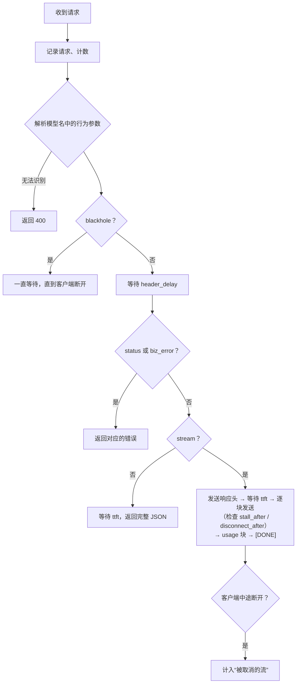

# 任务设计：0.5 可配置的 mock 上游

| 项目 | 内容 |
|---|---|
| Issue | [#5](https://github.com/bluesky-rgb/llmgw/issues/5) |
| 阶段 | 阶段 0：地基与验证 |
| 工作量 | 1 天 |
| 状态 | **已完成** |
| 实现的总体设计章节 | [stability.md](../stability.md) 第 3.1、7 节；[design.md](../design.md) 4.4、6.1；[providers.md](../providers.md) 第 2 节 |

## 1. 目标与范围

**一句话：** 一个能按需“制造各种上游故障”的假上游服务。之后所有的集成测试、故障注入测试和压测，都用它代替真实的 GPT、MiniMax、MiMo：不花钱、结果可重复、能模拟真实上游很难复现的故障。

**要做：**
- OpenAI 兼容的 `/v1/chat/completions`（流式和非流式）和 `/v1/models`
- 通过**模型名**控制每个请求的行为（比如 `mock:status=503`），覆盖 stability.md 3.1 中所有的上游故障
- 观测接口：统计收到了多少请求、有多少流被客户端中途取消、最近收到的请求内容。这样测试就能验证“网关有没有重复调用上游”“客户端断开后网关有没有及时停止读取”“请求改写是否正确”
- 足够的性能：作为压测的上游时，自身不能成为瓶颈

**不做：**
- 模拟 Anthropic 协议（v1.x）
- 模拟 TLS（测试中网关到 mock 使用 HTTP；TLS 的验证在 1.4 和 1.8 中用真实上游完成）
- 压测客户端（0.7 中实现）

## 2. 在架构中的位置

- 位置：`tools/mock-upstream/`，属于测试工具，**不是产品代码**，不在 `src/` 中，不受模块依赖规则约束
- 语言：**Go**，只使用标准库，不引入第三方依赖
- 选择 Go 的理由：

| 选项 | 优点 | 缺点 |
|---|---|---|
| Python | 写起来最快 | 难以支撑上万条并发流；压测时自身会成为瓶颈和噪声来源 |
| C++（Asio） | 与网关同一种语言 | Asio 是否采用要等 G1 才确定；用同一套技术写被测对象和测试工具，问题可能被同时掩盖 |
| **Go（采用）** | 标准库就能轻松支撑大量并发连接；独立于网关的技术选型；编译成单个文件 | 仓库里多了一种语言（仅限测试工具） |

- 对规范的补充：在 code-architecture.md 中写明“**产品代码只用 C++；测试和工具可以使用 Go 或 Python**”

## 3. 接口设计

### 3.1 命令行

```
mock-upstream [-listen 127.0.0.1:18081] [-seed 1]
              [-ttft 0] [-chunks 5] [-interval 0] [-error-rate 0]
```

| 参数 | 默认值 | 作用 |
|---|---|---|
| `-listen` | `127.0.0.1:18081` | 监听地址 |
| `-ttft` / `-chunks` / `-interval` | `0` / `5` / `0` | 默认的首字延迟、数据块数量、块间隔（模型名中没有指定时使用） |
| `-error-rate` | `0` | 随机返回 503 的比例，用于压测和混沌测试 |
| `-seed` | `1` | 随机数种子，保证结果可重复 |

### 3.2 用模型名控制行为

网关会把配置中的上游模型名原样发给上游，所以测试只需要在网关配置里把目标模型写成下面的形式：

```
mock                                       # 默认行为：正常返回
mock:status=503,retry_after=2              # 返回 503，带 Retry-After
mock:ttft=2s,chunks=20,interval=50ms       # 首字延迟 2 秒，20 个块，每块间隔 50 毫秒
```

| 参数 | 含义 | 模拟的故障（stability.md 3.1） |
|---|---|---|
| `status=<码>` | 直接返回这个 HTTP 状态码和 OpenAI 格式的错误 | 5xx、429、401、403 |
| `retry_after=<秒>` | 带上 `Retry-After` 响应头 | 上游限流 |
| `header_delay=<时长>` | 等待这么久才返回响应头 | 上游很慢 / 首字节超时 |
| `blackhole=true` | 接受连接，但永远不返回任何数据 | 网络黑洞 / 读取超时 |
| `ttft=<时长>` | 返回响应头后，等这么久才发第一个数据块 | 首字延迟 |
| `chunks=<数量>` / `interval=<时长>` | 流式输出的块数和间隔 | 正常流式输出；慢速输出 |
| `stall_after=<n>` | 发出 n 块后停住，不再发送，也不关闭连接 | 输出中途卡住 / 空闲超时 |
| `disconnect_after=<n>` | 发出 n 块后直接断开连接 | 输出到一半断开 |
| `biz_error=<码>` | HTTP 200，但响应体中带 MiniMax 风格的 `base_resp.status_code` | 错误码放在响应体里 |
| `reasoning=true` | 在输出中加入 `reasoning_content` | MiniMax、MiMo 的推理内容 |
| `usage=false` | 不返回 usage | 拿不到用量时的估算 |
| `quota_requests=<n>` / `quota_tokens=<n>` | 带上 `x-ratelimit-remaining-*` 响应头 | 配额感知 |
| `echo=true` | 把收到的请求体放进回答内容中 | 验证请求改写（`drop_fields` 等） |

时长的写法与 Go 的 `time.ParseDuration` 一致，比如 `500ms`、`2s`。无法识别的参数直接返回 400，避免测试因为拼写错误而“意外通过”。

### 3.3 观测接口（只供测试使用）

| 接口 | 返回 |
|---|---|
| `GET /_mock/stats` | 总请求数、按模型名统计的请求数、当前活跃的流、**被客户端中途取消的流**、已完成的流 |
| `GET /_mock/requests?limit=N` | 最近收到的 N 个请求（方法、路径、请求头、请求体），最多保留 200 个 |
| `POST /_mock/reset` | 清空统计和请求记录 |

## 4. 数据与状态

| 数据 | 所有者 | 并发保护 | 生命周期 |
|---|---|---|---|
| 统计计数 | 全局 | 原子操作 | 进程生命周期；`reset` 时清零 |
| 最近的请求记录 | 全局 | 互斥锁，环形缓冲区，最多 200 条 | 同上 |
| 每个请求的行为参数 | 请求级 | 不共享 | 请求结束即释放 |

## 5. 关键流程



每一次等待都同时监听客户端是否断开：客户端一断开，立即停止并计入“被取消”。这是后面验证网关“及时取消上游请求”的依据。

## 6. 失败与边界情况

| 情况 | 处理方式 | 对应的测试 |
|---|---|---|
| 模型名参数拼写错误 | 返回 400，并说明哪个参数无法识别 | 单元测试 |
| 请求体不是合法的 JSON | 返回 400 | 单元测试 |
| 客户端在等待期间断开 | 立即结束，计入取消数 | 单元测试 |
| 请求记录过多 | 环形缓冲区，只保留最近 200 条 | 单元测试 |
| 大量并发连接 | 依靠 Go 的运行时；压测中验证 | M4 |

## 7. 验证计划

| # | 验证项 | 方法 | 验收标准 |
|---|---|---|---|
| M1 | 每种行为都正确 | Go 单元测试（`httptest`），每个参数至少一个测试 | 全部通过；`go vet` 无告警 |
| M2 | 能模拟 stability.md 3.1 中的所有上游故障 | 对照 3.1 的每一行，列出对应的模型名写法，并逐个用 curl 验证 | 除了“DNS 失败”“连接被拒绝”（用不存在的地址和关闭的端口模拟，不需要 mock）之外全部覆盖 |
| M3 | 能被现有网关使用 | 用原型网关对接 mock：正常流式、503 切换、客户端中途断开后 mock 统计到“取消” | 行为与预期一致 |
| M4 | 性能不会成为压测瓶颈 | 用 Go 写的简易客户端同时打开 5000 条流（每条 20 块、间隔 50 毫秒） | 全部成功；mock 内存 < 500 MB；每块发送间隔的 P99 偏差 < 5 毫秒 |
| M5 | 纳入 CI | `architecture` 任务中加入 `gofmt` 检查、`go vet`、`go test` | CI 通过；格式错误会被拦下 |

## 8. 风险与备选方案

| 风险 | 应对 |
|---|---|
| 仓库多了一种语言，增加维护负担 | 只用于测试工具；代码量控制在 600 行以内；只用标准库 |
| 5000 条流时客户端本身成为瓶颈 | 客户端同样用 Go；如果数据异常，分别测量客户端和 mock 的资源占用 |

---

## 评审记录

| 日期 | 结论 | 意见 |
|---|---|---|
| 2026-11-20 | ✅ 设计自审通过（作者授权） | 按设计评审清单逐项检查；补充了“未识别参数返回 400”，避免测试因拼写错误意外通过 |
| 2026-11-20 | ✅ 代码自审通过（作者授权） | 并发安全：统计用原子操作，请求记录和随机数用互斥锁，`go test -race` 通过；所有等待都监听客户端断开，不会泄漏 goroutine（压测后 goroutine 数回落到 3）；请求体有 32 MB 上限 |

## 验证记录

| # | 结果 | 数据 / 证据 |
|---|---|---|
| M1 | ✅ 通过 | 20 个 Go 单元测试全部通过（`go test -race`，开启竞态检测）；`go vet` 无告警。每个行为参数至少一个测试，另有拼写错误、非法 JSON、环形缓冲区、重置、发送偏差统计等测试 |
| M2 | ✅ 通过 | 对照 stability.md 3.1 逐项用 curl 验证：503、429 + `Retry-After: 3`、首字节延迟 1.5 秒、黑洞（客户端 1 秒超时）、响应体错误码 1002、401、402、发出 2 块后断开、发出 1 块后卡住、配额响应头。“连接被拒绝”“DNS 失败”“代理故障”用不可达地址模拟，不需要 mock。对照表写在 [README](../../tools/mock-upstream/README.md) 中 |
| M3 | ✅ 通过 | 原型网关对接 mock：① 第一个目标 503 后切换到第二个，流式返回 22 个数据事件；mock 统计显示两个目标各收到 1 次请求 ② 客户端 0.5 秒后断开，mock 统计到 1 个**被取消的流**，没有完成的流 ③ 请求记录显示网关转发的模型名和 `X-Request-Id` 正确 |
| M4 | ✅ 通过（调整了测量方式） | 2 核机器、客户端与 mock 同机：5000 条并发流（每条 20 块，间隔 50 ms）**全部成功**；mock 内存峰值 115 MB（验收：< 500 MB）；**mock 服务端测得的发送偏差 P99 ≤ 5 ms**。详见下方说明 |
| M5 | ✅ 通过 | [PR #43](https://github.com/bluesky-rgb/llmgw/pull/43) 的 CI 中 `gofmt` 检查、`go vet`、`go test -race` 均通过；开发过程中 `gofmt -l` 确实拦下过一次格式不合规的测试文件 |

**M4 的过程与结论：**

1. 第一次测试时，客户端测得的偏差 P99 为 30 ms，不达标
2. 分析：偏差随并发数上升（500 条 1.7 ms → 2000 条 5.9 ms → 5000 条 36 ms）；3 秒内 mock 和客户端合计消耗 3.6 秒 CPU，2 核机器在峰值时已经饱和；其中 mock 消耗 2.1 秒，比客户端还多
3. 优化 mock：内容块不再每次构造通用的 map 再序列化，而是只构造一次固定部分，每块只编码内容字符串。mock 的 CPU 消耗下降 25%（212 → 159 ticks）
4. 客户端测得的偏差仍有 16–22 ms。把两个进程固定到不同的核上并没有改善，说明单个核也不够客户端使用，**客户端本身是瓶颈**
5. 于是在 mock 中加入**服务端**测量（每次发送时记录与上一块的实际间隔），结果 P99 ≤ 5 ms。由此确定：mock 能够按时发送，客户端测得的偏差主要来自同机的客户端

**与设计的差异：**
- 代码量：mock 本体 626 行，略超出“600 行以内”的预算，多出的部分是 M4 中增加的服务端发送偏差统计；压测客户端 `cmd/loadcheck` 另有 160 行，测试 349 行
- 观测接口增加了 `send_jitter_p50_us` / `send_jitter_p99_us`、`memory_rss_bytes`、`goroutines`，用于性能验证

**结论与约束：** 在 2 核机器上，mock 可以支撑 5000 条并发流。0.7 和之后的正式压测，**mock、网关和压测客户端要放在不同的 CPU 核或不同的机器上**，并以 mock 服务端的偏差作为“mock 是否成为瓶颈”的判断依据。

## 收获与教训

- **测量位置决定结论**：一开始在客户端测量，把客户端自己的延迟也算在了 mock 头上。性能问题要先确定“是谁慢”，再决定优化什么
- **先测再优化**：通过 CPU 统计发现 mock 比客户端更耗 CPU，才找到了“每块都构造 map 再序列化”这个热点。优化后 CPU 下降了 25%
- 这些经验会直接用于 0.7 的压测方法
