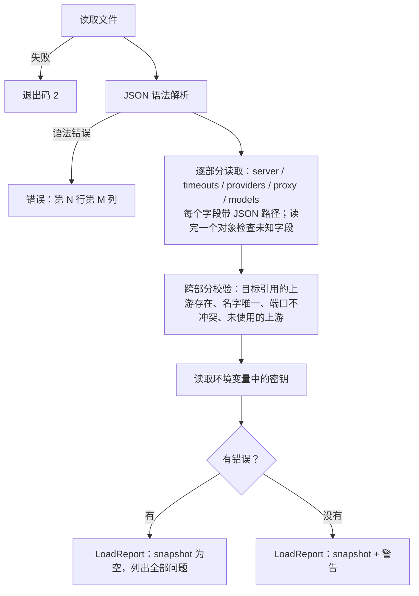

# 任务设计：1.1 config：配置格式的解析与校验

| 项目 | 内容 |
|---|---|
| Issue | [#8](https://github.com/bluesky-rgb/llmgw/issues/8) |
| 阶段 | 阶段 1：最小链路（v0.2 Alpha） |
| 工作量 | 1 天 |
| 状态 | 验证完成，待合并 |
| 实现的总体设计章节 | [design.md](../design.md) 第 7 节、6.3、6.7、6.12；[providers.md](../providers.md) 第 3、4 节 |

## 1. 目标与范围

**一句话：** 把配置文件读成一份不可变的 `config::Snapshot`；配置有问题时，**一次列出所有问题**，每个问题都指出准确的字段位置，并尽量告诉用户该怎么改。

配置错误是用户遇到的第一个问题。“启动失败：配置错误”这种提示会直接劝退新用户，所以这个任务的重点不是“能解析”，而是**错误提示的质量**。

**要做：**
- `config::Snapshot`：`server`、`timeouts`、`providers`、`proxy`、`models`（含目标级的 `drop_fields` / `rename_fields` / `set_fields` / `timeouts`）、厂商级的 `error_mapping`
- 解析与校验：类型、取值范围、引用关系（目标引用的上游必须存在）、URL 格式、字段路径语法、环境变量中的密钥
- 错误报告：JSON 路径（`models[0].targets[1].provider`）；语法错误给出行号和列号；拼错的字段名给出“是不是 xxx”的建议
- `llmgw check` 命令：校验配置文件，退出码表示结果
- `config/llmgw.example.json`：新格式的示例配置，CI 中校验它始终有效

**不做：**（以及在哪里做）
- `keys`、`pricing`、`accounting`、`retry`、`providers[].quota` 等部分 → 对应功能的任务（2.2、2.4、2.5、2.7）。**在那之前，配置中出现这些部分会报错**，原因见决策 A
- 配置热加载、`ConfigStore` → 4.x。1.3 的 server 直接持有启动时加载的快照
- `docs/configuration.md` 完整字段说明 → v1.0 前；本任务在示例配置中写注释性的字段（见 3.4）

## 2. 在架构中的位置

- 涉及的模块：`config`（新增实现）、`app`（新增 `llmgw` 可执行文件，目前只有 `check` 子命令）
- 模块依赖：`config → core`；`app → core, config`（都在 `module_deps.json` 允许范围内）
- 第三方：nlohmann/json（已在依赖清单中，原型在用），**只在 config 的 `.cpp` 中使用**，不出现在公开头文件中（code-architecture.md 3.7）
- 实现 core 中前置声明的 `llmgw::config::Snapshot`（任务 0.4 决策 C）

### 决策 A：未知字段和“尚未支持”的部分一律报错，而不是忽略

| 情况 | 处理 | 理由 |
|---|---|---|
| 拼错的字段（`timeout`、`base_ulr`） | **错误**，并给出建议 `是不是 "base_url"？` | 忽略的话，用户以为设置生效了，其实用的是默认值。这类问题最难排查 |
| 设计中有、但还没实现的部分（`keys`、`pricing` …） | **错误**：`"keys" 尚未支持，将在 v0.3 提供（任务 2.2）` | 尤其是 `keys`、`budget`：如果静默忽略，用户会以为已经开启了鉴权和预算，实际上网关完全开放、不限费用。**安全相关的配置不能静默失效** |

代价：用户照着 design.md 第 7 节的完整示例写配置，在 v0.2 中会遇到报错。报错信息会明确说明哪个版本支持，这比悄悄不生效好得多。

### 决策 B：密钥从环境变量读取，加载时解析

- 配置中只写 `api_key_env`（环境变量名），不写密钥本身
- **加载时**读取环境变量，存入快照；之后请求处理中不再访问环境变量（`getenv` 不是线程安全的）
- 环境变量不存在或为空 → 错误。`llmgw check --skip-env` 跳过这项检查，用于在没有密钥的环境（比如 CI）中校验配置文件
- 读取环境变量的函数可以注入，单元测试不依赖真实环境

### 决策 C：错误按 JSON 路径定位，语法错误按行列定位

- nlohmann/json 解析后不保留每个值的行号，要保留需要自己写整套 SAX 解析器
- JSON 路径（`models[0].targets[1].provider`）已经能准确定位到字段，并且与文件格式无关（以后支持 YAML 也能用）
- 只有**语法错误**（缺逗号、多了括号）才需要行列号，nlohmann/json 会给出出错的字节位置，换算成行列即可

## 3. 接口设计

### 3.1 公开头文件

```cpp
// llmgw/config/snapshot.h —— 配置快照：加载后不可变，通过 shared_ptr<const Snapshot> 共享
namespace llmgw::config {

using Seconds = std::chrono::seconds;

struct Endpoint { std::string host; std::uint16_t port; };     // "127.0.0.1:9090"

struct Url {                                                    // "https://api.openai.com/v1"
  std::string scheme;     // "http" / "https"
  std::string host;
  std::uint16_t port;     // 没写时：https 443，http 80
  std::string base_path;  // "/v1"，不带结尾的 "/"
};

struct ServerConfig {
  std::string host = "0.0.0.0";
  std::uint16_t port = 8080;
  Endpoint admin{"127.0.0.1", 9090};
  Endpoint observability{"0.0.0.0", 9100};
  unsigned workers = 0;                 // 0：等于 CPU 核数
  std::uint32_t max_connections = 10000;
};

struct Timeouts {                       // design.md 6.3
  Seconds connect{10};
  Seconds first_byte{60};               // 流式请求等待响应头
  Seconds first_byte_non_stream{300};   // 非流式请求要等整个回答生成完
  Seconds idle{60};
  Seconds total{600};
};

struct TimeoutOverrides {               // 目标级覆盖：没写的项沿用全局值
  std::optional<Seconds> connect, first_byte, first_byte_non_stream, idle;
  // 没有 total：总截止时间覆盖整个请求（包括切换到其他目标），按目标覆盖没有意义
};
Timeouts merge(const Timeouts& global, const TimeoutOverrides& o);

/// 字段路径："messages[].reasoning_content" → [{messages, each}, {reasoning_content}]
struct PathSegment { std::string name; bool each = false; };
using FieldPath = std::vector<PathSegment>;

struct ErrorMapping {                   // 厂商级：响应体中的业务错误码 → HTTP 状态码
  FieldPath field;                      // "base_resp.status_code"
  std::map<std::string, int> codes;     // "1002" → 429
};

struct Provider {
  std::string name;
  Url base_url;
  std::string api_key_env;
  std::string api_key;                  // 加载时从环境变量读取。⚠️ 不能写入日志或任何输出
  std::uint32_t max_connections = 256;
  std::optional<ErrorMapping> error_mapping;
};

struct ProxyConfig {
  std::optional<Url> https;             // 所有上游默认使用的代理；"env" 表示读取 HTTPS_PROXY
  std::map<std::string, Url> per_provider;
};

struct TargetConfig {
  std::string provider;                 // 引用 providers[].name
  std::string model;
  std::vector<FieldPath> drop_fields;
  std::vector<std::pair<FieldPath, FieldPath>> rename_fields;
  std::vector<std::pair<FieldPath, std::string>> set_fields;   // 值保存为 JSON 文本
  Timeouts timeouts;                    // 已与全局值合并
};

struct ModelConfig {
  std::string name;
  std::vector<TargetConfig> targets;    // 按顺序切换
};

struct Snapshot {
  ServerConfig server;
  Timeouts timeouts;
  std::vector<Provider> providers;
  ProxyConfig proxy;
  std::vector<ModelConfig> models;

  const Provider* find_provider(std::string_view name) const;   // 找不到返回 nullptr
  const ModelConfig* find_model(std::string_view name) const;
};

}  // namespace llmgw::config
```

- **`set_fields` 的值保存为 JSON 文本**：公开头文件中不能出现 nlohmann 的类型；provider 模块（任务 1.6）用自己的 JSON 库再解析
- **目标的超时在加载时就与全局值合并**：下层不需要关心“哪一级配置的”
- `Provider::api_key` 是快照中唯一的敏感字段，注释中标明

```cpp
// llmgw/config/loader.h —— 加载与校验
namespace llmgw::config {

enum class Severity : std::uint8_t { kError, kWarning };

struct Issue {
  Severity severity;
  std::string path;      // "models[0].targets[1].provider"；语法错误时为 "第 12 行第 5 列"
  std::string message;   // 说明，以及建议怎么改
};

struct LoadOptions {
  bool resolve_env = true;   // false：不读取环境变量（llmgw check --skip-env）
  std::function<std::optional<std::string>(const std::string&)> getenv;  // 默认读真实环境
};

struct LoadReport {
  std::shared_ptr<const Snapshot> snapshot;   // 有任何错误时为空
  std::vector<Issue> issues;                  // 所有错误和警告：按部分处理，跨部分的检查排在最后
  [[nodiscard]] bool ok() const { return snapshot != nullptr; }
  [[nodiscard]] std::size_t error_count() const;
};

LoadReport parse(std::string_view json_text, const LoadOptions& options = {});
LoadReport load_file(const std::string& path, const LoadOptions& options = {});

/// 解析字段路径；语法错误时返回错误说明。也给 provider 模块的测试使用。
Result<FieldPath> parse_field_path(std::string_view text);
/// 解析 http(s) URL。
Result<Url> parse_url(std::string_view text);

}  // namespace llmgw::config
```

**为什么不用 `Result<Snapshot>`：** `Result` 只能带一个 `Error`，而配置校验要一次列出所有问题，还要带警告。

> **实现时的调整**（与上面的草案不同之处）：
> - `TimeoutOverrides` 和 `merge()` 只在加载时使用，放到内部头文件 `sections.h`，不公开
> - `rename_fields` / `set_fields` 用具名结构 `FieldRename`、`FieldSet`，而不是 `std::pair`，读代码时不用猜 `first`/`second` 是什么
> - 增加 `parse_endpoint()`、`to_string(FieldPath)`、`LoadReport::warning_count()`
> - 问题的顺序：按部分处理（server、timeouts、providers、proxy、models），跨部分的检查排在最后；不是严格的“文件中出现的顺序”

### 3.2 校验规则

| 部分 | 规则 | 级别 |
|---|---|---|
| 任意位置 | 未知字段 → 列出该位置允许的字段，编辑距离 ≤ 2 时给出“是不是 xxx” | 错误 |
| 顶层 | `keys`、`pricing`、`accounting`、`retry` → 说明在哪个版本支持 | 错误 |
| 顶层 | `providers`、`models` 必须存在且不为空 | 错误 |
| 类型 | 每个字段的 JSON 类型；数字必须是整数的地方不能是小数或负数 | 错误 |
| `server` | 端口 1–65535；数据面、管理面、观测面三个端口不能相同；`workers` ≤ 1024；`max_connections` > 0 | 错误 |
| `server.admin_listen` | 不是回环地址时 | **警告**：管理接口暴露在网络上 |
| `timeouts` | 都必须 > 0；`connect`、`first_byte`、`idle` 不能大于 `total` | 错误 |
| `providers[]` | `name` 唯一、只能包含字母数字和 `-_`（会用作指标标签）；`base_url` 是 http(s) 且没有查询参数 | 错误 |
| `providers[].base_url` | 使用 http 且主机不是回环地址 | **警告**：密钥会明文传输 |
| `providers[].api_key_env` | 环境变量不存在或为空（`resolve_env` 为 true 时） | 错误 |
| `providers[].quota` | 说明在哪个版本支持 | 错误 |
| `providers[].error_mapping` | `field` 是合法的字段路径；`codes` 的值是 400–599 的状态码 | 错误 |
| `proxy.https` | `"env"`、空字符串或 http(s) URL | 错误 |
| `proxy.per_provider` | 键必须是已定义的上游 | 错误 |
| `models[]` | `name` 唯一、只能包含字母数字和 `._:/-`（会用作指标标签）；`targets` 不为空 | 错误 |
| `models[].targets[].timeouts` | 出现 `total` → 说明总超时只能全局设置 | 错误 |
| `models[].targets[]` | `provider` 必须已定义（拼错时给出建议）；字段路径语法正确；`rename_fields` 的目标不能与另一个字段的源重复 | 错误 |
| `models[].targets[]` | 同一个模型中出现两个完全相同的目标（上游 + 模型名） | **警告**：多半是复制粘贴的错误 |
| 某个上游没有被任何模型使用 | | **警告** |

### 3.3 `llmgw check`

```
$ llmgw check -c llmgw.json
llmgw.json：2 个错误，1 个警告
  错误  models[0].targets[1].provider：上游 "openia" 没有定义（是不是 "openai"？）
  错误  providers[0].base_ulr：未知字段，应该是必填字段 "base_url"？
  警告  providers[2]：上游 "mimo" 没有被任何模型使用

$ llmgw check -c llmgw.json --skip-env
llmgw.json：配置有效（3 个上游，2 个模型）
```

| 退出码 | 含义 |
|---|---|
| 0 | 配置有效（可能有警告） |
| 1 | 配置有错误 |
| 2 | 命令行参数错误、文件读不了 |

### 3.4 文件结构

```
src/config/
├── include/llmgw/config/
│   ├── snapshot.h        # 快照的类型
│   └── loader.h          # parse / load_file / parse_field_path / parse_url
├── loader.cpp            # 各部分的解析与跨部分校验（引用关系、重复）
├── json_reader.h/.cpp    # 内部：带路径的类型化读取、未知字段检测、“是不是”建议
└── syntax.cpp            # 字段路径、URL、监听地址的语法解析
src/app/
└── main.cpp              # llmgw 可执行文件：check 子命令
config/llmgw.example.json # 新格式示例（CI 中校验）
```

`json_reader` 是这个任务的核心：每读一个字段都带着它的 JSON 路径，读完一个对象后检查有没有未读过的字段（即未知字段）。这样“未知字段报错”和“错误带路径”不需要在每个解析函数里重复写。

## 4. 数据与状态

| 数据 | 所有者 | 线程归属 | 生命周期 |
|---|---|---|---|
| `Snapshot` | `shared_ptr<const Snapshot>`，由启动流程创建 | 全局只读，所有 Worker 共享 | 进程（热加载后由新快照替换，4.x） |
| 加载过程中的状态 | `parse()` 的局部变量 | 调用者线程 | 一次加载 |

加载只在启动时（以后还有热加载时）执行，不在热路径上，所以可以使用异常、动态分配等，不受热路径规则限制。

## 5. 关键流程



**一次列出所有问题**：读取某个字段失败时记录问题、继续读后面的字段，而不是遇到第一个错误就停。只有 JSON 语法错误会让后续步骤无法进行。

## 6. 失败与边界情况

| 情况 | 处理 |
|---|---|
| 文件不存在、没有权限 | `load_file` 返回一个错误，路径为文件名 |
| 文件为空、不是 JSON 对象 | 错误：配置文件必须是一个 JSON 对象 |
| UTF-8 BOM | 跳过 BOM（Windows 记事本保存的文件常带） |
| 数字超出范围（端口 70000、超时 -1、超时 1.5） | 错误，说明允许的范围；超时只接受正整数秒 |
| 很大的配置（几百个模型） | 无特殊处理；加载不在热路径上 |
| 同一个对象中重复的键 | nlohmann/json 保留最后一个；**不检测**（需要自写解析器，收益低），在已知限制中说明 |
| `proxy.https` 为 `"env"` | 加载时读取 `HTTPS_PROXY`（或 `https_proxy`）；为空表示不用代理。**暂不支持 `NO_PROXY`**，在已知限制中说明 |

## 7. 验证计划

| # | 验证项 | 方法 | 验收标准 |
|---|---|---|---|
| F1 | 完整配置能正确加载 | 单元测试：`config/llmgw.example.json` 和 providers.md 第 4 节的路由；逐字段核对快照 | 所有字段与预期一致；默认值正确 |
| F2 | 每条校验规则 | 单元测试：3.2 表中每一行至少一个用例 | 路径和说明准确 |
| F3 | 一次列出所有问题 | 一份有 5 处不同错误的配置 | 5 个错误全部报出 |
| F4 | 拼写建议 | `base_ulr`、`timout`、`openia` | 给出正确的建议 |
| F5 | 语法错误定位 | 缺逗号、多余逗号、未闭合的字符串 | 行号和列号正确 |
| F6 | 字段路径、URL 语法 | 单元测试：合法与非法输入各若干 | 通过 |
| F7 | `llmgw check` | CTest：示例配置返回 0；错误配置返回 1；文件不存在返回 2 | 通过 |
| F8 | 敏感信息 | 测试：`check` 的输出中不出现密钥的值 | 通过 |
| F9 | 规范 | clang-format、clang-tidy、`-Werror`、ASan/UBSan、TSan、行数上限 | CI 全绿 |

## 8. 风险

| 风险 | 应对 |
|---|---|
| 字段设计在 1.3–1.7 实现时发现不合适 | 快照只是数据结构，修改成本低；修改时在对应任务设计中说明 |
| `loader.cpp` 超过 600 行 | 按部分拆分（server/providers/models 各一个文件） |

---

## 评审记录

| 日期 | 结论 | 意见 |
|---|---|---|
| 2026-11-21 | ✅ 设计自审通过（作者授权） | 按评审清单检查。修改：① 目标级超时去掉 `total`（总截止时间跨越所有目标）；② 模型名也用作指标标签，增加字符限制；③ 补充 `NO_PROXY` 的已知限制。确认：决策 A（未知/未支持字段报错）的安全理由成立；公开头文件不出现 nlohmann 类型 |

## 验证记录

**环境：** GCC 13.3、Clang 18.1，nlohmann/json v3.12.0。

| # | 验证项 | 结果 |
|---|---|---|
| F1 | 完整配置能正确加载 | ✅ `config/llmgw.example.json`（三家上游、providers.md 的三个路由、`error_mapping`、三种改写、目标级超时）逐字段核对；没有任何警告。最小配置的默认值与 design.md 一致 |
| F2 | 每条校验规则 | ✅ 3.2 表中每一行至少一个用例（13 个测试） |
| F3 | 一次列出所有问题 | ✅ 5 处不同部分的错误全部报出 |
| F4 | 拼写建议 | ✅ `base_ulr`、`conect`、`modles`、`openia`、`opneai`；`timout` 与任何字段都不接近，**不乱猜** |
| F5 | 语法错误定位 | ✅ 缺逗号（第 4 行第 5 列）、多余的逗号、未闭合的字符串；UTF-8 BOM |
| F6 | 字段路径、URL、监听地址 | ✅ 合法与非法输入共 30 余个；URL 中带密码时，错误信息不回显密码 |
| F7 | `llmgw check` | ✅ CTest：有效 0、有错误 1、文件不存在 2、未知参数 2 |
| F8 | 敏感信息 | ✅ 单元测试 + CTest：设置了密钥且配置有错误时，`check` 的输出中不出现密钥 |
| F9 | 规范 | ✅ clang-format、clang-tidy（修复 5 处，见下）、`-Werror`、ASan+UBSan、TSan 下 59 个测试通过；最大的文件 352 行 |

### 实现中发现并解决的问题

1. **错误信息的质量要“读一遍”才知道好不好。** 第一版对一份有很多问题的配置报了 22 条，逐条读下来发现三类噪音：
   - 一个拼写错误报两条（“缺少 base_url” + “未知字段 base_ulr”）→ 未知字段恰好是某个缺少的必填字段的拼写错误时，合并成一条
   - 全局超时的错误在每个目标上重复报告 → 目标级只检查目标自己覆盖的项
   - “尚未支持”的提示中“在此之前”出现两次 → 重写措辞

   修改后同一份配置报 19 条，每条对应一个真实的错误
2. **CLI 测试“碰巧通过”。** `add_test` 会把 `-DARGS=check;-c;路径` 中的分号拆成多个参数，脚本只收到了 `check`，实际检查的是默认文件 `llmgw.json`。“文件不存在返回 2”这个测试因为默认文件恰好不存在而通过了，但它根本没有读指定的路径。修复：参数改用 `|` 分隔；每个 CLI 测试增加 `REQUIRE`，确认输出中出现了指定的文件名。并对测试脚本本身做了反向验证（REQUIRE 不满足、FORBID 命中、退出码不符时都会失败）
3. **设计中的示例写错了。** 设计写 `timout` 会提示“是不是 total”，实际编辑距离是 4，程序不给建议是正确的；示例改为 `base_ulr`
4. **clang-tidy 的 5 处问题**：函数嵌套超过 4 层（拆分为 `check_targets` 等三个函数）、循环中 `push_back` 前未预留容量、可以 `const` 的变量、`int` 乘法隐式扩宽、C 风格数组

## 收获与教训

1. **“错误提示的质量”需要专门验收。** 单元测试只能检查“有没有在正确的位置报错”，检查不了“用户读起来是不是清楚、有没有重复”。以后凡是面向用户的输出，验证计划里都要有一项：构造一个典型的错误场景，**完整读一遍输出**
2. **测试也会碰巧通过。** 这是连续第二个任务发现这类问题（0.4 是 clang-tidy 静默跳过）。对测试和守护都要做反向验证，并且断言“确实处理了指定的输入”，而不只是“结果符合预期”
3. **“报错而不是忽略”要说明理由。** 用户照着设计文档写 `keys` 会报错，这看起来不友好；但静默忽略 `keys` 意味着网关完全开放，这个代价更大。错误信息里直接说明“目前网关不做鉴权”，用户就能理解
