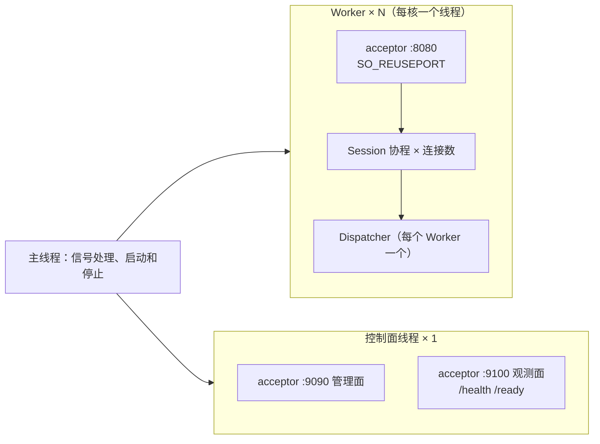
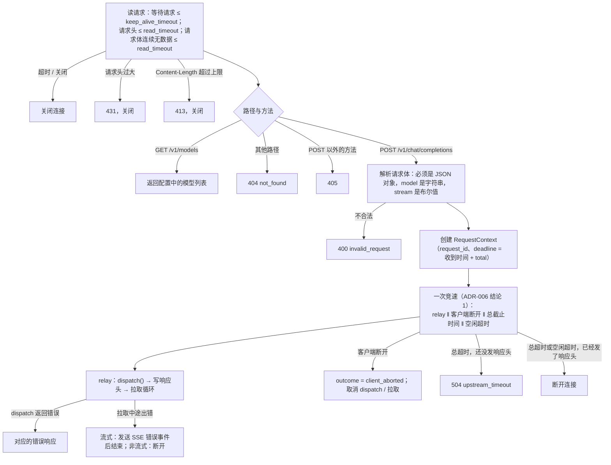

# 任务设计：1.3 server：接入层

| 项目 | 内容 |
|---|---|
| Issue | [#10](https://github.com/bluesky-rgb/llmgw/issues/10) |
| 阶段 | 阶段 1：最小链路（v0.2 Alpha） |
| 工作量 | 2 天 |
| 状态 | 已完成 |
| 实现的总体设计章节 | [design.md](../design.md) 第 5 节、3.2、3.6、6.3、6.8、6.11；[stability.md](../stability.md) 3.1；ADR-006；任务 0.6 的 demo |

## 1. 目标与范围

**一句话：** 0.6 demo 的正式版。接收客户端连接、解析 HTTP、按请求创建 `RequestContext`，交给下层得到 `ResponseStream`，再按拉取循环把响应写回客户端；同时守住入口：请求大小、读取超时、连接数上限、客户端断开与超时的取消。

**要做：**

| 部分 | 内容 |
|---|---|
| Worker | 每核一个线程 + 一个 `io_context` + 一个 `SO_REUSEPORT` 的 acceptor（ADR-006） |
| Session | Keep-Alive；读取请求时的大小上限和超时；路由到 `/v1/chat/completions`、`/v1/models`；错误响应；**每个请求一次竞速**的拉取循环 |
| 控制面线程 | 管理面（9090）和观测面（9100）跑在一个单独的线程上：`/health`、`/ready`；`/metrics` 和 `/admin/*` 先返回 404（任务 1.2、3.x） |
| `Dispatcher` 接口 | Session 把“拿到响应”这件事交给它。1.7 用 router + executor 实现；本任务用测试替身 |
| 启动 | 启动线程之前预扩容 fd 表（ADR-006 结论 4） |
| 配置 | `server` 增加 `max_body_bytes`、`read_timeout`、`keep_alive_timeout` |
| core | 增加 3 个错误码；增加 `error_type()`；修正 500 的重试建议在文档中的矛盾 |

**不做：**（以及在哪里做）
- 中间件链、鉴权、限流 → 2.1–2.3。Session 中留出调用位置
- 指标输出、访问日志 → 1.2。本任务通过 `MetricsRecorder` 上报，默认用 `NullMetricsRecorder`
- 优雅退出（等进行中的请求结束）、过载时的请求体总量上限 → 3.x。本任务只做“停止接收、`/ready` 返回 503、立即退出”
- `llmgw serve` 命令 → 1.9（那时才有真正的 `Dispatcher`；现在提供一个只能返回 503 的命令没有意义）
- gzip、`Expect: 100-continue`、HTTP/2 → production-readiness.md 6.2（M3）

## 2. 在架构中的位置

- 涉及的模块：`server`（新增实现）、`config`（新增 3 个字段）、`core`（新增错误码）
- 模块依赖：`server → core, config`（`module_deps.json` 允许 server 依赖 middleware、router、executor，本任务还用不到）
- 第三方：Boost.Beast（HTTP 解析与序列化）、**simdjson**（从请求体中取 `model` 和 `stream`；实现时由 nlohmann 改为 simdjson，见 S20）、nlohmann/json（构造错误响应和模型列表）

### 2.1 server 与下层的分界：`Dispatcher`

design.md 中 Session 依次调用中间件、router、executor。这些模块还不存在，server 又必须现在就能开发和测试，所以把“从请求得到响应”抽象成一个接口：

```cpp
// 每个 Worker 一个实例，只在该 Worker 的线程上调用
class Dispatcher {
 public:
  virtual ~Dispatcher() = default;
  // 成功：已经拿到响应头的 ResponseStream；失败：网关自己的错误（模型不存在、所有上游失败……）
  virtual Task<Result<std::unique_ptr<ResponseStream>>> dispatch(RequestContext* ctx) = 0;
};
```

- 1.7 中由 app 组装：`dispatch()` = `router.resolve()` + `executor.execute()`
- 2.1 的中间件链在 Session 中、`dispatch()` 之前调用，不放进 `Dispatcher`（Session 是唯一的编排者，design.md 交互规则 1）
- **每个 Worker 一个实例**（由工厂函数创建）：实现可以持有 Worker 级的资源（连接池、熔断器），不需要加锁

这样 server 的全部行为都能用一个测试替身（按脚本返回数据块、错误或一直等待）来测试，不需要任何网络上游。

### 2.2 线程



管理面和观测面放在单独的线程上：数据面再忙，健康检查和监控也不会被挤占（design.md 3.6“三个平面分开”）。

### 2.3 对 core 和 config 的修改

| 修改 | 内容 | 理由 |
|---|---|---|
| core：新增错误码 | `kNotFound`（404 `not_found`）、`kMethodNotAllowed`（405 `method_not_allowed`）、`kHeadersTooLarge`（431 `headers_too_large`）；都不建议重试 | 未知路径与“模型不存在”是两回事；请求头过大是标准的 431 |
| core：新增 `error_type()` | 响应体中的 `type`：`invalid_request_error` / `authentication_error` / `rate_limit_error` / `server_error` / `upstream_error` | 与原型一致；集中在 core，避免各处自己写字符串 |
| **文档：500 的重试建议** | design.md 3.6 的表写的是 `x-should-retry: true`，而 core（0.4）和 client-guide.md 是 `false`。**以 `false` 为准**，修正 design.md | 网关内部出错时，请求可能已经发到上游并开始计费；让 SDK 自动重试就可能重复扣费，违反产品的核心承诺 |
| config：`server` 新增字段 | `max_body_bytes`（默认 32 MB）、`read_timeout`（默认 10 秒）、`keep_alive_timeout`（默认 60 秒） | design.md 6.8、stability.md 3.2 |

## 3. 接口设计

```cpp
// llmgw/server/server.h
namespace llmgw::server {

struct WorkerInfo {
  unsigned index;                           // 0 … workers-1
  boost::asio::any_io_executor executor;    // 这个 Worker 的事件循环
};

using DispatcherFactory = std::function<std::unique_ptr<Dispatcher>(const WorkerInfo&)>;

struct ServerOptions {
  std::shared_ptr<const config::Snapshot> config;   // 监听地址、上限、超时都从这里读
  DispatcherFactory dispatcher_factory;
  std::function<std::unique_ptr<MetricsRecorder>(const WorkerInfo&)> metrics_factory;  // 可选
};

class Server {
 public:
  explicit Server(ServerOptions options);
  ~Server();                                   // 等同于 stop()

  /// 绑定端口、启动 Worker 和控制面线程。端口被占用等错误在这里返回。
  Result<void> start();
  /// 停止：/ready 立即返回 503，停止接收新连接，关闭所有连接，等线程退出。
  void stop();

  /// 实际监听的端口（配置中写 0 时由系统分配，测试使用）
  std::uint16_t data_port() const;
  std::uint16_t admin_port() const;
  std::uint16_t observability_port() const;
};

/// 把进程的 fd 表预扩容到 RLIMIT_NOFILE。必须在创建任何线程之前调用（ADR-006 结论 4）。
void pregrow_fd_table();

}  // namespace llmgw::server
```

- **`Server` 是 server 模块唯一的公开类**：Worker、Session、控制面都是内部实现
- `server.h` 中出现了 `boost::asio::any_io_executor`：server 是 I/O 模块，Dispatcher 的实现（连接池等）需要拿到 Worker 的事件循环，这是必要的暴露

## 4. Session 的处理流程



**几个细节：**

| 问题 | 做法 |
|---|---|
| 请求体过大 | Beast 解析器的 `body_limit`：读完请求头后，`Content-Length` 超过上限就立即返回 413，**不读取请求体**；分块上传的请求体在超过上限时停止 |
| 慢速攻击 | **请求头**：读完整个请求头的总时长不能超过 `read_timeout`（请求头很小，正常客户端远用不了这么久）。**请求体**：只要求“一直有进展”，连续 `read_timeout` 秒收不到任何数据才断开（惰性定时器，只竞速一次）。超时直接关闭连接，不回复（对方可能是攻击者）。**不限制请求体的总时长**：32 MB 的请求体在 10 Mbps 的上行带宽下要传 26 秒，是正常请求 |
| 空闲的长连接 | 两个请求之间与 `keep_alive_timeout` 竞速 |
| 客户端断开的检测 | 在连接上等待“可读”；可读时用 `MSG_PEEK` 看一个字节：0 表示对方关闭；有数据表示客户端提前发来了下一个请求（**HTTP 管线化**），这时不算断开，停止检测，数据留给下一次读取。**修复 0.6 demo 中“管线化被误判为断开”的已知限制** |
| 请求 ID | 客户端带了 `X-Request-Id`，并且长度 ≤ 64、只包含字母数字和 `._-`，就沿用；否则生成 16 位十六进制随机数。响应头中总是带上 |
| 从请求体中取 `model` 和 `stream` | ~~用 nlohmann/json 解析整个请求体~~ → **实测不可接受（S20），改用 simdjson 的 on-demand 模式，只读这两个字段**。见验证记录 |
| 响应体的传输 | 一律分块传输（`Transfer-Encoding: chunked`），边收边发 |
| HTTP/1.0 客户端 | **支持**：响应体不分块，写完后关闭连接（以连接关闭表示结束）。原因：nginx 反向代理默认用 HTTP/1.0 连接后端（`proxy_http_version` 默认 1.0），而数据面允许放在反向代理后面。（设计初稿写的是“返回 505”，实现前改正） |
| 连接数上限 | 进程级的原子计数（所有 Worker 共享一个计数器，这是唯一的跨线程写操作）。超过 `max_connections` 时返回 503 `overloaded` 并关闭 |
| 会话中的异常 | 每个会话的异常只影响它自己：记录日志，关闭连接；计数用 RAII 维护，异常时也会减少（**修复 0.6 自审中的非阻塞项**） |
| `Dispatcher` 抛出异常 | 视为网关内部错误：还没发响应头时返回 500 `internal_error` |

**错误响应的格式**（design.md 6.11、client-guide.md 第 7 节）：

```
HTTP/1.1 429 Too Many Requests
Content-Type: application/json
X-Request-Id: 3f9a…
x-should-retry: true
Retry-After: 2

{"error":{"message":"…","type":"rate_limit_error","code":"rate_limited"}}
```

## 5. 数据与状态

| 数据 | 所有者 | 线程归属 | 生命周期 |
|---|---|---|---|
| `Server` | app | 主线程 | 进程 |
| Worker（`io_context`、acceptor、Dispatcher、MetricsRecorder） | `Server` | Worker 线程 | 进程 |
| Session（socket、读缓冲区） | Session 协程 | Worker 线程 | 一条连接 |
| `RequestContext`、`ResponseStream` | Session 协程 | Worker 线程 | 一个请求 |
| 连接计数 | `Server` | 全局原子变量 | 进程 |
| “正在停止”标志 | `Server` | 全局原子变量（控制面读取） | 进程 |
| 配置快照 | `shared_ptr<const Snapshot>` | 全局只读 | 进程 |

## 6. 失败与边界情况

| 情况 | 处理 | 验证 |
|---|---|---|
| 端口被占用 | `start()` 返回错误，说明是哪个端口 | S19 |
| 请求头超过 64 KB | 431 并关闭 | S4 |
| 畸形的 HTTP | 400 并关闭 | S4 |
| 请求体不是 JSON、缺少 `model`、类型不对 | 400 `invalid_request`，说明具体原因 | S4 |
| `Dispatcher` 一直不返回 | 总超时 → 504 | S9 |
| 拉取到一半 `Dispatcher` 的流出错 | 流式：SSE 错误事件；非流式：断开 | S11 |
| 客户端读得很慢 | 写客户端时等待，不拉取下一块（背压） | S10 |
| 停止时还有连接 | 关闭所有连接（优雅退出在 3.x） | S14 |

## 7. 验证计划

所有测试都在进程内启动 `Server`（端口 0，由系统分配），用测试替身 `FakeDispatcher`，不需要网络上游。

| # | 验证项 | 验收标准 |
|---|---|---|
| S1 | 正常的流式请求 | 状态码、响应头（含 `X-Request-Id`）、数据块顺序都正确 |
| S2 | Keep-Alive | 一条连接上连续 3 个请求 |
| S3 | `/v1/models` | 返回配置中的全部模型，OpenAI 格式 |
| S4 | 请求错误 | 404、405、400（非 JSON、缺 model、类型不对）、413（不读请求体就返回）、431、畸形 HTTP，状态码、`code`、`type`、`x-should-retry` 都正确 |
| S5 | 慢速攻击 | 请求头每秒发 1 个字节：`read_timeout` 后连接被关闭；请求体发一半后停住：`read_timeout` 后关闭；**请求体慢慢但持续地发送，总时长超过 `read_timeout`：正常处理** |
| S6 | 空闲的长连接 | `keep_alive_timeout` 后被关闭 |
| S7 | **客户端在流式输出中断开** | `Dispatcher` 的流在 **100 毫秒内**被取消 |
| S8 | 客户端在 `dispatch()` 还没返回时断开 | `dispatch()` 在 100 毫秒内被取消 |
| S9 | 总超时 | 还没发响应头：504，`x-should-retry: false`；已经发了：连接断开 |
| S10 | 空闲超时与背压 | 数据块间隔超过 `idle`：断开；客户端不读时不再拉取 |
| S11 | 拉取中途出错 | 流式：收到 `data: {"error":…}` 后正常结束；非流式：连接断开 |
| S12 | `dispatch()` 返回错误 | 每种错误码的状态码、`code`、`type`、`x-should-retry`、`Retry-After` |
| S13 | 连接数上限 | 第 N+1 个连接收到 503 `overloaded` |
| S14 | 控制面 | `/health` 200；`/ready` 200，`stop()` 期间 503；管理面在监听 |
| S15 | 请求 ID | 合法的沿用，不合法的被替换 |
| S16a | HTTP/1.0 | 流式响应不分块、写完后关闭连接，内容完整 |
| S16 | **HTTP 管线化** | 两个请求一次发出：两个都得到正确的响应，**不被当作断开** |
| S17 | 多个 Worker | 连接分布到不同的 Worker |
| S18 | 异常隔离 | `dispatch()` 抛异常：该请求得到 500，其他连接不受影响，连接计数正确 |
| S19 | 端口被占用 | `start()` 返回错误，说明端口 |
| S20 | 解析请求体的开销 | 测量 10 KB 和 1 MB 请求体上取 `model`/`stream` 的耗时，写入验证记录 |
| S21 | 规范 | clang-format、clang-tidy、`-Werror`、ASan/UBSan、TSan、行数上限 |

## 8. 风险

| 风险 | 应对 |
|---|---|
| 测试中的超时让测试变慢、不稳定 | 测试配置中把超时设为 1 秒；断言使用宽松的上界（比如“2 秒内”），不断言精确时间 |
| 进程内测试在 TSan 下暴露 Asio 的误报 | 先看是不是真问题；确实是误报时用 suppression 文件，并写明原因 |
| Session 代码超过 600 行 | 按职责拆分：读请求、路由、错误响应、拉取循环 |

---

## 评审记录

| 日期 | 结论 | 意见 |
|---|---|---|
| 2026-11-21 | ✅ 设计自审通过（作者授权） | 按评审清单检查。修改：`read_timeout` 原本限制“读完整个请求”的总时长，会误伤带大图片的正常请求（32 MB 在 10 Mbps 下要 26 秒）→ 请求头限制总时长，请求体只要求持续有进展，并增加对应的验证用例。确认：`Dispatcher` 的分界不违反“Session 是唯一的编排者”；管线化检测在提前收到下一个请求时停止检测，退化为由写入失败发现断开，可以接受 |
| 2026-11-21 | ✅ 实现自审通过（PR #48） | CI 5 项全绿，并核对日志：集成测试在 release 和 TSan 下都执行并通过（含管线化、断开取消）；漏洞检查覆盖 simdjson；clang-tidy 检查了 server 的 8 个文件。修改：`rejected_total` 的 `reason` 新增 3 个取值，同步到 observability.md。非阻塞：① 只上报了 `rejected_total`，连接数、请求数的仪表在 1.2 实现分片汇总时再上报（多个 Worker 各自设置同一个全局仪表会互相覆盖）；② 每个 Worker 线程的 simdjson 解析器会保留解析过的最大请求体所需的内存（最多约几十 MB），不会释放；③ `stop()` 不等进行中的请求结束（3.x） |

## 验证记录

**环境：** 2 核，GCC 13.3 / Clang 18.1，Boost 1.92.0，simdjson v5.2.0。集成测试在进程内启动 `Server`（2 个 Worker），配置中 `read_timeout`、`keep_alive_timeout`、`idle` 为 1 秒，`total` 为 2 秒。

| # | 验证项 | 结果 |
|---|---|---|
| S1 | 正常的流式请求 | ✅ 状态码、上游响应头、`X-Request-Id`、数据块顺序 |
| S2 | Keep-Alive | ✅ 一条连接上 3 个请求 |
| S3 | `/v1/models` | ✅ OpenAI 格式，列出配置中的模型 |
| S4 | 请求错误 | ✅ 404、405、400（5 种请求体问题）、404 model_not_found、畸形 HTTP、431；**413 在读取请求体之前就返回**（声明 10 MB 只发请求头，网关立即回复，`dispatch()` 次数为 0） |
| S5 | 慢速攻击 | ✅ 请求头每 300 ms 一个字节：约 1 秒后断开；请求体停住：约 1 秒后断开；**请求体慢慢但持续发送 2.7 秒：正常处理** |
| S6 | 空闲的长连接 | ✅ 约 1 秒后关闭 |
| S7 | 客户端在流式输出中断开 | ✅ 流在 100 ms 内被取消 |
| S8 | 客户端在 `dispatch()` 中断开 | ✅ `dispatch()` 在 100 ms 内被取消 |
| S9 | 总超时 | ✅ 响应头之前：504、`x-should-retry: false`，`dispatch()` 被取消；响应头之后：断开 |
| S10 | 空闲超时、背压 | ✅ 卡住的流约 1 秒后断开（不是 2 秒的总超时）；客户端不读时，拉取停在 100 块以内并且不再增加 |
| S11 | 拉取中途出错 | ✅ 流式：`data: {"error":…}` 后正常结束，连接可以复用；非流式：断开 |
| S12 | `dispatch()` 返回错误 | ✅ 6 种错误码的状态码、`type`、`x-should-retry`、`Retry-After`、`retry-after-ms` |
| S13 | 连接数上限 | ✅ 第 4 个连接收到 503 `overloaded`；释放一个后新连接可以使用 |
| S14 | 控制面 | ✅ `/health`、`/ready` 200；管理面在监听；`stop()` 关闭所有连接 |
| S15 | 请求 ID | ✅ 合法的沿用，不合法的替换 |
| S16 | **HTTP 管线化** | ✅ 流式输出期间发来下一个请求，第一个流没有被取消 |
| S16a | HTTP/1.0 | ✅ 不分块、以关闭连接结束、内容完整 |
| S17 | 多个 Worker | ✅ 连接分布到两个 Worker |
| S18 | 异常隔离 | ✅ 抛异常的请求得到 500，同一条连接可以继续使用，旁边的流不受影响。⚠️ “连接计数正确”没有断言（还没有暴露连接计数的接口），在 1.2 的指标中补上 |
| S19 | 端口被占用 | ✅ 错误信息说明是观测面、哪个端口 |
| S20 | 解析请求体的开销 | ⚠️ nlohmann 不可接受 → 改用 simdjson，见下 |
| S21 | 规范 | ✅ clang-format；clang-tidy（修复 8 处）；ASan+UBSan、TSan 下各运行 3 次，92 个测试全部通过、0 个报告；集成测试连续运行 30 次 0 次失败 |

**反向验证**（故意破坏实现，确认测试会失败）：

| 破坏方式 | 结果 |
|---|---|
| 客户端断开检测改回 0.6 的写法（一旦可读就当作断开，不用 `MSG_PEEK`） | ❌ S16 失败：“第一个流被误判为客户端断开而取消了” |
| 请求体改为限制总时长（设计初稿的写法） | ❌ S5 失败：“持续发送的请求体被当作慢速攻击断开了” |

### S20：从请求体中取 `model` 和 `stream`

| 请求体 | nlohmann/json（整体解析） | simdjson on-demand（只读两个字段） |
|---|---|---|
| 10 KB | 66 µs | 1.4–1.9 µs |
| 1 MB | **7.5 ms** | 70–130 µs |
| 32 MB（上限） | **287 ms** | 7.7–9.0 ms |

这段解析在 Worker 线程上同步执行，期间这个 Worker 上的**所有**连接都会停住。128K token 的长上下文请求约 500 KB，用 nlohmann 会让同一线程上的几千条流卡顿几毫秒；32 MB 的带图请求会卡顿约 0.3 秒。这和 0.7 定位的“事件循环卡顿”是同一类问题，严重得多。

改用 simdjson（design.md 第 8 节本来就为热路径选了它）：只遍历顶层的键，值被跳过而不构建；表中 simdjson 的数字是**最坏情况**（`model` 排在巨大的 `messages` 之后）。测试中断言了 500 MB/s 的下限（只在优化构建中生效），换回 nlohmann 会失败。

### 实现中发现并解决的问题

1. **设计文档之间的矛盾**：design.md 3.6 写 500 时 `x-should-retry: true`，core 和 client-guide 是 `false`。以 `false` 为准（网关出错时请求可能已经发到上游并计费），修正 design.md
2. **设计中会误伤正常用户的规则**：`read_timeout` 原本限制读完整个请求的总时长，32 MB 的请求体在 10 Mbps 下要传 26 秒。改为请求头限总时长、请求体只要求持续有进展（设计评审时发现）
3. **设计中会让网关在 nginx 后面无法工作的规则**：初稿写“HTTP/1.0 返回 505”，但 nginx 反向代理默认用 HTTP/1.0 连接后端。改为支持 HTTP/1.0（实现前发现）
4. **被取消的协程还在继续执行**：总超时时 `dispatch()` 被取消后返回了错误，`relay` 不知道自己已被取消，继续去写错误响应，把 `headers_sent` 置为 true，导致 504 写不出去。修复：`dispatch()` 返回后先检查取消状态，已取消就立即退出，由赢得竞速的分支收尾（S9 发现）
5. **测试客户端的超时无效**：Asio 的同步读在 `EAGAIN` 后会无限期 `poll`，`SO_RCVTIMEO` 不起作用，服务端有 bug 时测试会永远卡住。改为异步操作 + `run_for`
6. **一个时序不稳定的测试**：客户端读完响应时，服务端可能还没销毁对应的流（两者在不同线程上）。改为等待流结束后再断言；连续 30 次运行确认稳定
7. **一个测不到目标的测试**：管线化测试最初一次发出两个请求，网关读第一个请求时就把第二个也读进了缓冲区，`MSG_PEEK` 的逻辑根本不会被执行。改为在第一个响应开始之后再发第二个请求，并用反向验证确认它能发现问题
8. **一次无效的反向验证**：第一次做请求体的反向验证时，替换脚本因为代码被 clang-format 重排而没有找到原文，修改没有生效，测试“通过”了。发现后按实际代码重做

## 收获与教训

1. **性能假设要在设计阶段就测量。** “先用 nlohmann，不行再换”看起来稳妥，但两行测量代码就显示它会让整个 Worker 卡顿 0.3 秒。热路径上的每个依赖，选型时都要有一个数字
2. **取消不是“立即停止”。** Asio 的取消只是让正在等待的操作以错误结束，协程会继续往下执行。被取消的分支在任何“产生副作用”的操作（写响应、改状态）之前都要检查取消状态
3. **反向验证本身也要验证。** 修改没有生效时，反向验证会“通过”，看起来和“测试有效”一模一样。每次破坏实现后，要确认修改确实生效（这次用断言“原文存在”和逐字节比较来保证）
4. **设计评审要从用户的真实环境出发。** 两条设计错误（大请求体被当作慢速攻击、HTTP/1.0 被拒绝）都不是逻辑错误，而是没有想到“慢速网络上传大图片”“放在 nginx 后面”这些真实的部署场景

## 补记：2026-11-21 排查

合并后对 0.1–1.3 做了一次排查（独立审查 + 自查 + 模糊测试），在本任务的代码中发现并修复了 15 个问题，包括 3 个严重问题：没有写超时（不读响应的客户端永远占着连接名额）、竞速中抛出的异常被吞掉（请求挂到总超时）、上游可以注入响应头。本任务的设计因此有以下变化：

- 新增 `server.write_timeout`；`timeouts.idle` 只管“等上游”，不再管“等客户端读”
- 请求体除了“持续有进展”，还要求宽限期后平均速度不低于 16 KB/s
- `Transfer-Encoding` 只接受单独的 `chunked`；上游响应头逐个校验
- 控制面最多 128 条连接

详见 [排查报告](../reviews/2026-11-21-foundation-audit.md)。
