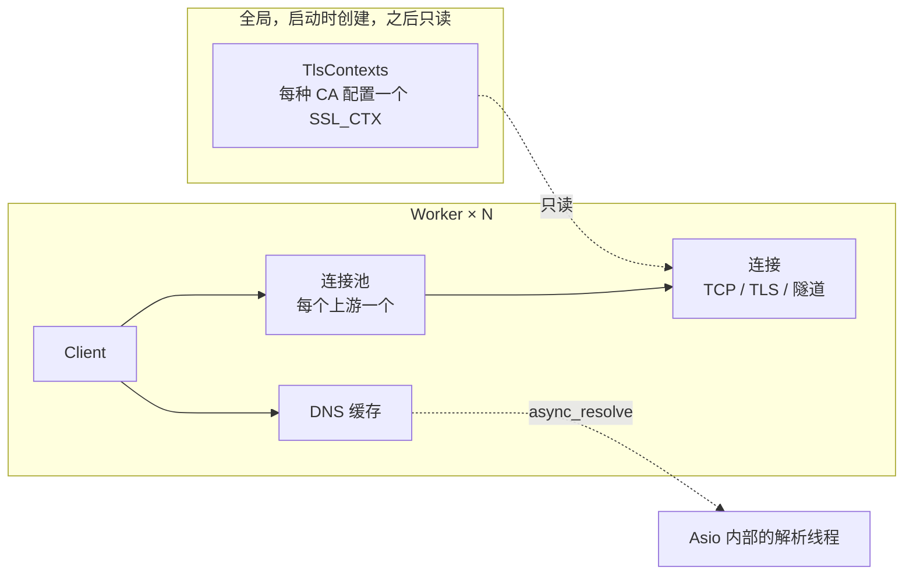
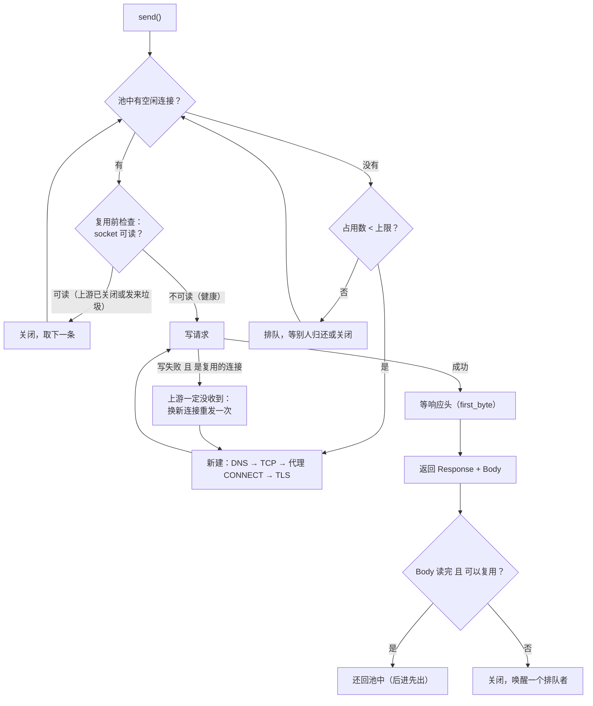

# 任务设计：1.4 upstream：到上游的 HTTP 客户端

| 项目 | 内容 |
|---|---|
| Issue | [#11](https://github.com/bluesky-rgb/llmgw/issues/11) |
| 阶段 | 阶段 1：最小链路（v0.2 Alpha） |
| 工作量 | 2 天 |
| 状态 | 已完成 |
| 实现的总体设计章节 | [design.md](../design.md) 5.1、5.3、5.4、5.5、6.1、6.3；[stability.md](../stability.md) 4.3 |

## 1. 目标与范围

**一句话：** 给 provider（1.6）和 executor（1.7）一个可靠的“发一个 HTTP 请求给某个上游，拿到响应头，再一段一段读响应体”的客户端。连接按 Worker 池化复用；支持 TLS、HTTP 代理（含认证）、DNS 缓存；**每一种失败都说清楚“上游是否可能已经收到请求”**，这是 executor 决定能否重试、会不会重复扣费的依据（design.md 6.1）。

**要做：**

| 部分 | 内容 |
|---|---|
| `Client` | 每个 Worker 一个。`send(provider, request, deadlines)` → 响应头 + 响应体读取器，或者带阶段信息的失败 |
| 连接池 | **每个上游（provider）一个池**；取、还、排队、空闲淘汰、复用前检查连接是否已被上游关闭；每个 Worker 的上限 = 总上限 ÷ Worker 数 |
| TLS | OpenSSL；默认校验证书和主机名、SNI、最低 TLS 1.2；可以为每个上游指定 CA 文件 |
| 出站代理 | HTTP 代理：HTTPS 上游用 `CONNECT` 隧道，HTTP 上游用绝对路径形式；`Proxy-Authorization: Basic`；`NO_PROXY`；单个上游可以设为 `direct`（不走代理） |
| DNS | 每个 Worker 一份缓存，固定 TTL 60 秒；重新解析失败时继续用旧结果 |
| 指标 | 连接复用 / 新建 / 排队超时的计数（复用率由此算出）、池中空闲 / 占用的连接数 |
| 配置 | `providers[].ca_file`；`upstream.idle_timeout`；代理 URL 中的用户名密码；`per_provider` 中的 `"direct"`；`providers[].max_connections` 的含义改为总数 |

**不做：**（以及在哪里做）
- 重试、切换目标、熔断、舱壁 → executor（1.7、2.x）。本任务只提供判断依据（失败阶段、是否可能已发送），**唯一的例外**是“复用的连接在发送阶段就失败”时自动换新连接重发一次（design.md 5.3，此时上游一定没有收到）
- 请求体改写、鉴权头 → provider（1.6）。本任务原样发送调用者给的方法、路径、请求头和请求体
- SSE 解析 → stream（1.5）。本任务只交出已经去掉分块编码的原始字节
- `/metrics` 输出 → 1.2。本任务通过 `MetricsRecorder` 上报
- 热加载时保留连接池 → 3.x
- HTTP/2、SOCKS 代理、TLS 会话复用、Happy Eyeballs（IPv4/IPv6 并行连接）→ 见第 8 节
- **通过真实代理访问 OpenAI**（路线图的验收项之一）需要真实网络和 key，放到 1.8 与用户一起验证；本任务用进程内的测试代理和测试 TLS 服务器验证同样的代码路径

## 2. 在架构中的位置

- 涉及的模块：`upstream`（新增实现）、`config`（新增字段）、`core`（新增一个指标）
- 模块依赖：`upstream → core, config`（`module_deps.json` 允许的 `observability` 暂时用不到：指标通过 core 的 `MetricsRecorder` 接口上报）
- 第三方：Boost.Asio / Beast（HTTP 客户端、`asio::ssl`）；**OpenSSL 3**（系统库，design.md 第 8 节已选定）。CI 已经安装 `libssl-dev`
- 调用方：provider（1.6）。executor 不直接调用 upstream（design.md 交互规则 2：执行链路是 executor → provider → upstream）

### 2.1 线程与共享



| 对象 | 数量 | 线程 | 理由 |
|---|---|---|---|
| `TlsContexts` | 全局 1 份 | 启动时在主线程创建，之后只读 | **实测加载系统 CA 证书库约 40 ms**。每个 Worker 一份的话，64 核 × 3 个上游启动要多花约 8 秒。OpenSSL 保证配置完成后的 `SSL_CTX` 可以在多个线程上同时创建连接 |
| `Client`、连接池、DNS 缓存 | 每个 Worker 1 份 | 只在自己的线程上使用，不加锁 | design.md 5.2 规则 2 |

**与总体设计的偏离：** design.md 写 DNS 解析在 `BlockingPool` 中执行。`BlockingPool` 还不存在，而 Asio 的 `async_resolve` 本身就在 Asio 内部的一个专用线程上调用 `getaddrinfo`，不会阻塞 Worker，效果相同。等 `BlockingPool` 出现时再评估是否统一。

### 2.2 对 config 和 core 的修改

| 修改 | 内容 | 理由 |
|---|---|---|
| `providers[].max_connections` 改为**总数** | 每个 Worker 的上限 = ⌈总数 ÷ Worker 数⌉。代码注释写的是“每个 Worker”，design.md 5.4 写的是“总数，按 Worker 平均分摊”，**以 design.md 为准** | 按每个 Worker 计算的话，64 核机器上的连接数会被放大 64 倍，远超上游的并发额度 |
| `providers[].ca_file`（可选） | 用这个 CA 文件校验该上游的证书，而不是系统证书库 | 内网自建的 vLLM / 企业代理（design.md 5.3） |
| `upstream.idle_timeout`（默认 60 秒） | 空闲连接的淘汰时间 | design.md 5.4 |
| 代理 URL 允许 `user:password@` | 百分号编码解码；只用于代理 URL，`base_url` 中出现仍然报错；任何错误信息、日志中都不出现 | 公司代理通常需要认证（1.1 排查时记录为“1.4 做”） |
| `per_provider` 的值可以是 `"direct"` | 该上游不走代理 | 全局配置了代理，但内网上游不能走代理 |
| `NO_PROXY` | `proxy.https` 为 `"env"` 时一起读取。支持 `*`、精确主机名、`.example.com` 和 `example.com`（都匹配子域名）；不支持 CIDR | 与 curl 的行为一致（1.1 排查时记录为“1.4 做”） |
| core：新增指标 `kUpstreamConnections` | 计数器，标签 `{provider, kind}`，`kind` 为 `reused` / `new` / `queue_timeout` | 路线图验收项：“连接复用率可以从指标看到” |

## 3. 接口设计

```cpp
// llmgw/upstream/client.h
namespace llmgw::upstream {

/// 发给上游的请求。Host、Content-Length、Accept-Encoding 由 Client 设置，调用者不要设置。
struct Request {
  http::verb method = http::verb::post;
  std::string target;               ///< 路径，已经拼好 base_path，比如 "/v1/chat/completions"
  std::vector<Header> headers;      ///< 比如 Authorization、Content-Type
  std::string body;
};

/// 一次尝试的时限（由 executor 按目标的 timeouts 计算）。
struct Deadlines {
  SteadyClock::duration connect;     ///< 排队 + DNS + TCP + 代理握手 + TLS 握手
  SteadyClock::duration first_byte;  ///< 发送请求 + 等待响应头
};

/// 失败发生在哪个阶段。
enum class Stage : std::uint8_t {
  kQueue,     ///< 连接池已满，排队超时
  kResolve,   ///< DNS
  kConnect,   ///< TCP
  kProxy,     ///< 代理握手（CONNECT 被拒绝、认证失败）
  kTls,       ///< TLS 握手、证书校验
  kSend,      ///< 写请求
  kResponse,  ///< 等待或解析响应头
  kBody,      ///< 读响应体
};

struct AttemptError {
  Stage stage;
  /// 上游是否可能已经收到请求（因而可能已经开始计费）。
  /// false：可以安全地换一个目标重试；true：不确定，默认不能重试（design.md 6.1）
  bool maybe_sent = false;
  bool timed_out = false;
  std::string detail;  ///< 给日志看；不包含密钥、代理密码
  /// 转换成返回给客户端的错误：kQueue → 503，没发出去 → 502，可能已发出 → 超时 504 / 其他 502
  [[nodiscard]] Error to_error() const;
};
template <typename T> using Outcome = tl::expected<T, AttemptError>;

/// 响应体读取器。读完（返回 false）且连接可以复用时，析构时把连接还回连接池；
/// 其他任何情况（没读完就析构、出错、被取消、上游要求关闭），析构时关闭连接。
class Body {
 public:
  /// 把下一段数据追加到 out（不清空 out，方便 SSE 解析器保留不完整的行）。
  /// true：读到了数据；false：响应体正常结束；AttemptError：中途出错（stage = kBody，maybe_sent = true）
  Task<Outcome<bool>> read(std::string* out);
};

struct Response {
  int status;
  std::vector<Header> headers;
  std::unique_ptr<Body> body;
};

class Client {
 public:
  Client(boost::asio::any_io_executor executor, std::shared_ptr<const config::Snapshot> config,
         std::shared_ptr<const TlsContexts> tls, unsigned worker_count, MetricsRecorder* metrics);
  /// 发送请求，等到响应头。被取消（客户端断开、总超时）时尽快返回，连接不会还回连接池。
  Task<Outcome<Response>> send(const config::Provider& provider, Request request, Deadlines deadlines);
};

/// 为配置中的每一种 CA 设置创建 SSL_CTX。启动时调用一次；CA 文件无法加载时返回错误。
Result<std::shared_ptr<const TlsContexts>> make_tls_contexts(const config::Snapshot& snapshot);

}  // namespace llmgw::upstream
```

**设计要点：**

1. **为什么 `Body` 不是 core 的 `ResponseStream`**：`ResponseStream` 的约定是“每一块都是完整的 SSE 事件”，而网络上到达的字节可能把一个事件切成两半。拼成完整事件是 stream（1.5）的职责，所以 upstream 只交出原始字节，接口用“追加到缓冲区”的形式，正好是 SSE 解析器需要的
2. **为什么失败不用 core 的 `Error`**：`Error` 是给客户端看的（状态码 + 说明），executor 需要的是“在哪个阶段失败、上游是否可能已经收到”。`to_error()` 负责最后的转换
3. **竞速的分支不抛异常**：`send()` 内部的竞速全部用 `as_tuple` 形式的异步操作，异常在分支内部捕获（ADR-006 补充规则 7）
4. **为什么超时由 `send()` 自己处理，而不是交给 executor 竞速**：连接和首字节超时只是 `send()` 内部两个阶段的时限，放在里面每次尝试只需要一个定时器；而且只有 `send()` 知道超时时处在哪个阶段（决定 `maybe_sent`）。**响应体的空闲超时不在这里**：Session 的看门狗已经按“等上游”计时（1.3 排查后的设计），不需要再加一个
5. **连接的归还在析构函数里**：唯一能保证“中途出错、被取消、调用者提前放弃”都不会把一条状态不明的连接还回池子的写法

## 4. 数据与状态

| 数据 | 所有者 | 线程归属 | 生命周期 |
|---|---|---|---|
| `TlsContexts`（`SSL_CTX`） | 全局，`shared_ptr` | 只读 | 进程（热加载时整体替换，3.x） |
| 连接池：每个上游的空闲连接（后进先出）、占用数、排队者 | `Client` | Worker | `Client` 的生命周期 |
| 连接：socket、可选的 TLS 流、读缓冲区、上次使用时间 | 空闲时在池中，使用时在 `Body` 中 | Worker | 直到被关闭 |
| DNS 缓存：主机名 → 地址列表 + 过期时间 | `Client` | Worker | 60 秒，失败时延长 |
| 池的键 | — | — | 上游名（provider）。一个上游的地址、代理、CA 都是固定的，所以经过代理和不经过代理的连接自然不会混用；上限也是按上游计算的，键与上限一致 |

- **空闲连接后进先出**：最近用过的连接最可能还活着，久不用的自然沉到底部被淘汰
- **`Body` 持有指向池内部状态的 `weak_ptr`**：`Client` 先于 `Body` 被销毁时（Worker 退出），析构只关闭连接，不访问已经不存在的池
- **淘汰**：每个 Worker 一个定时器，每 10 秒关闭空闲超过 `idle_timeout` 的连接（design.md 5.5）

## 5. 关键流程



**`connect` 时限覆盖排队、DNS、TCP、代理握手和 TLS 握手**：对调用者来说都是“还没拿到可用的连接”。一次 `send()` 有两次竞速（连接阶段、首字节阶段），符合“竞速放在尝试的粒度上”（ADR-006）。

**HTTP 上游经过代理**时不建隧道，而是把请求行写成绝对路径形式（`POST http://host:port/path`），这是 HTTP 代理的标准用法，也避免了很多代理默认只允许对 443 端口 `CONNECT` 的限制。

## 6. 失败与边界情况

**关键规则：上游只有收到完整的请求才可能处理它。** 写请求失败（不论新连接还是复用的连接）说明请求没有完整地交给本机内核，上游不可能收到完整的请求，所以 `maybe_sent = false`；**写成功之后的任何失败都是 `maybe_sent = true`**，因为字节已经在路上了。

| 情况 | 阶段 | `maybe_sent` | 处理 | 测试 |
|---|---|---|---|---|
| 池满，排队超过 `connect` 时限 | kQueue | false | 503 `overloaded` | U5 |
| DNS 失败（有旧结果时继续用旧结果） | kResolve | false | 502 | U9 |
| 连接被拒绝 / 超时（逐个尝试解析出的地址） | kConnect | false | 502 / 超时 | U6 |
| 代理拒绝 `CONNECT`（403、407 认证失败）；HTTP 上游经过代理时代理返回 407（实现时发现：初稿会把它当作上游的正常响应） | kProxy | false | 502；`detail` 说明代理返回的状态码；可以包含代理的主机和端口（只写进日志，方便排查），不包含用户名和密码 | U11 |
| 证书不可信、主机名不匹配、过期、TLS < 1.2 | kTls | false | 502；`detail` 写明原因（OpenSSL 的校验错误） | U12 |
| 复用的连接上写失败 | — | false | **自动换新连接重发一次**（多半是上游刚关闭了这条空闲连接）；新连接上再失败按 kSend 报告 | U4 |
| 新连接上写失败（包括写请求体时超过 `first_byte`） | kSend | false | 502；新连接都写不进去，换一个目标比在同一个上游上重试更有意义 | U4 |
| 上游先回了 `100 Continue` 等 1xx 响应 | — | — | 跳过，继续等最终响应（101 除外，按坏响应处理） | U8 |
| 发出请求后超过 `first_byte` | kResponse | true | 504 | U7 |
| 响应头不合法、超过 64 KB、连接被关闭 | kResponse | true | 502 | U8 |
| 上游返回 `Connection: close`、HTTP/1.0、没有长度的响应体 | — | — | 读完后关闭，不复用 | U3 |
| 响应体读到一半连接断开 / 分块编码错误 | kBody | true | 返回 AttemptError；连接关闭 | U8 |
| 调用者没读完就丢弃 `Body`（客户端断开） | — | — | 关闭连接，不还回池中 | U3 |
| 被取消（等待中的任何阶段） | — | — | 尽快返回；连接关闭；排队者从队列中移除 | U10 |
| 池中的连接已被上游关闭 | — | — | 复用前检查（非阻塞 `recv(MSG_PEEK)`：返回 0 或有数据都说明不能用；读缓冲区里有剩余字节、TLS 层有未读数据也不能用），丢弃后取下一条 | U4 |
| TLS 1.3 的服务器在握手后发送会话票据（NewSessionTicket） | — | — | 复用前检查会把它当作“有数据”而误判为不能用。票据在读第一个响应时就被 OpenSSL 消化，正常情况下不会剩下；**误判的后果只是多建一条连接，不会出错**。U2 用会发送票据的 OpenSSL 服务器验证复用率不受影响 | U2 |
| 上游是 IP 地址（内网 vLLM） | — | — | 不发送 SNI（RFC 6066 不允许 IP）；证书按 IP 校验（`X509_VERIFY_PARAM_set1_ip_asc`），主机名则用 `SSL_set1_host` | U12 |
| 响应体读完了，但调用者没有再调用一次 `read()` 拿到 false | — | — | 析构时按解析器的状态判断（`is_done()`），照样归还 | U2 |
| 上游响应头中的 CR/LF 等 | — | — | Beast 的解析器拒绝；Server 写出时再按 `safe_header` 过滤（1.3） | U8 |

**剩下的一个窗口**：复用前检查通过之后、请求到达上游之前，上游恰好关闭了这条空闲连接。此时写通常仍然成功（写进了本机内核），随后读到 EOF，按规则报告为 `maybe_sent = true`（不重试）。窗口小于一个 RTT，而且 `idle_timeout`（60 秒）应当小于上游的空闲超时；验证时测量实际发生的频率（U4）。

## 7. 验证计划

测试用进程内的测试服务器，不依赖外部网络：一个可编程的 HTTP/HTTPS 上游（按脚本返回状态码、分块或定长的响应体、慢速、中途断开、空闲时主动关闭连接），一个 HTTP 代理（`CONNECT` 和绝对路径形式，可以要求认证，统计建立了多少条隧道）。**测试证书在测试启动时用 OpenSSL 生成**（CA、正确的服务器证书、主机名不匹配的证书、过期证书），仓库里不保存任何私钥。

| # | 验证项 | 方法 | 验收标准 |
|---|---|---|---|
| U1 | 基本请求 | HTTP 和 HTTPS 上游，定长和分块响应 | 状态码、响应头、响应体字节完全一致 |
| U2 | 连接复用 | 同一个 Worker 上连续 100 个请求 | 上游只看到 1 条连接；指标 `reused` = 99、`new` = 1 |
| U3 | 不复用的情况 | `Connection: close`、HTTP/1.0、没读完就丢弃 `Body` | 每种情况下一个请求都用新连接；没有把状态不明的连接还回池中 |
| U4 | 失效连接 | 上游在空闲时关闭连接；上游在读到请求之前就 RST | 前者：复用前检查发现，用新连接，请求成功；后者：自动重发一次，上游只处理一次 |
| U5 | 上限与排队 | 上限 2，同时发 3 个慢请求 | 第 3 个排队，前一个结束后拿到连接；排队超时返回 kQueue；指标 `queue_timeout` |
| U6 | 连接失败 | 连接没有监听的端口；连接一个不回应的地址 | kConnect、`maybe_sent = false`；后者在 `connect` 时限内返回 |
| U7 | 首字节超时 | 上游收到请求后不回复 | kResponse、`maybe_sent = true`、`timed_out = true`；在时限内返回 |
| U8 | 上游的坏响应 | 非法状态行、超长响应头、响应体中途断开、分块编码错误 | 对应的阶段，不崩溃，连接被关闭 |
| U9 | DNS 缓存 | 计数解析次数（可注入解析函数） | 60 秒内只解析一次；解析失败时使用旧结果 |
| U10 | 取消 | 在排队、连接、等响应头、读响应体时取消 | 立即返回；连接被关闭；占用数和排队者正确减少（不泄漏名额） |
| U11 | 代理 | HTTPS 经 `CONNECT`、HTTP 经绝对路径；需要认证的代理；`direct`；`NO_PROXY` | 请求成功；认证头正确；密码错误时 kProxy 且错误信息中没有密码；`direct` 和 `NO_PROXY` 不经过代理；经过代理和不经过代理的连接不混用 |
| U12 | TLS 校验 | 不可信的 CA、主机名不匹配、过期证书、只支持 TLS 1.1 的服务器；`ca_file` | 前四种都是 kTls 失败；指定 `ca_file` 后可信 |
| U13 | 指标 | 记录型的 `MetricsRecorder` | 复用 / 新建 / 排队超时、空闲 / 占用连接数与实际一致 |
| U14 | 每个 Worker 的上限 | 总数 256，Worker 数 8、3、1000 | 分别是 32、86、1 |
| U15 | 性能 | 本机 HTTPS 上游，复用与不复用 | 记录每个请求的耗时，说明连接池节省了多少（数据写入验证记录） |
| U16 | 配置 | 代理认证、`direct`、`NO_PROXY`、`ca_file`、`idle_timeout` 的解析与报错 | 单元测试；错误信息中不出现密码 |
| U17 | 模糊测试 | 新增目标：响应头 / 响应体解析（喂给测试上游的任意字节） | 不崩溃，没有 sanitizer 报告 |
| U18 | 规范 | clang-format（按退出码）、clang-tidy、`-Werror`、ASan/UBSan、TSan 各 2 次、行数上限、模块依赖 | 全部通过 |
| U19 | 独立审查 | 没有参与实现的审查者，从“恶意或不正常的上游 / 代理”出发审查 | 发现的问题都修复或记录为接受的风险 |

**反向验证**：U2（去掉归还）、U3（没读完也归还）、U4（去掉复用前检查）、U10（取消时不释放名额）、U12（关闭证书校验）都要做：破坏实现，确认测试失败，再逐字节确认恢复。

## 8. 风险与备选方案

| 风险 | 应对 |
|---|---|
| HTTP/1.1 下一条连接同一时间只能跑一个流，并发流数 = 连接数；默认总上限 256 可能成为瓶颈 | 这是有意的舱壁（design.md 6.2），可以按上游调大；HTTP/2 在 v1.x |
| 只按顺序尝试解析出的地址：IPv6 地址“黑洞”（不回 RST）时，要等到连接时限才轮到 IPv4 | 记录；Happy Eyeballs 在出现真实问题时再做 |
| getaddrinfo 不提供 TTL，固定 60 秒 | 上游 IP 变化时最多 60 秒后生效；失败时用旧结果优先保证可用 |
| 复用前检查后的竞态窗口（第 6 节） | 测量发生频率；必要时把 `idle_timeout` 调小，或者在 1.7 中只对“复用的连接 + 读到 0 字节就 EOF”允许配置为重试 |
| 不做 TLS 会话复用：每条新连接都完整握手 | 连接池本身已经避免了大部分握手；有数据说明需要时再做 |
| 代理密码写在配置文件里 | 推荐用 `HTTPS_PROXY` 环境变量；任何输出都不回显 |
| 每个 Worker 的上限向上取整：Worker 数超过总上限时，实际连接数会超过总上限（1000 个 Worker、总数 256 → 最多 1000 条） | 至少给每个 Worker 1 条连接，否则这个 Worker 上的请求永远无法到达上游。Worker 数一般等于 CPU 核数，远小于上限，这种情况只在配置得很小的上游上出现（独立审查 #10） |
| 竞速的分支在超时之前抛出异常（只可能是内存不足）时，`||` 要等到时限才返回，并且报告为超时 | 分支内部已经捕获了全部可预见的错误；内存不足时进程本身已经处于危险状态（独立审查 #13） |
| NO_PROXY 的 `0.0.1` 能匹配 `10.0.0.1`（按后缀匹配） | 与 curl 的行为一致；不支持 CIDR |

---

## 评审记录

| 日期 | 结论 | 意见 |
|---|---|---|
| 2026-11-21 | 设计通过（自审） | 初稿中发现 6 处问题，已修改（见下）。实现完成后按 1.3 排查的教训做一次独立审查（U19） |

自审发现的问题：

1. **`maybe_sent` 的规则写错了**：初稿认为“新连接上写失败”可能已发送。实际上写失败说明请求没有完整交给内核，上游不可能收到完整的请求（请求体按 `Content-Length` 发送），所以不论新旧连接都是 false。错写成 true 会让 executor 把本来可以安全切换的失败当成“可能扣费”，白白返回 504
2. **按地址分组与按上游计算上限不一致**：两个上游名指向同一个地址时，共用一个池却各有上限，含义不清。改为每个上游一个池
3. **TLS 1.3 的会话票据会让复用前检查误判**：握手后服务器发来的票据让 socket 处于“可读”状态。分析后确认正常情况下读第一个响应时就已消化；误判只会多建连接、不会出错，用 U2 验证
4. **IP 地址的上游**：不能发送 SNI，证书要按 IP 校验，初稿只写了按主机名校验
5. **1xx 响应**：上游可能先回 `100 Continue`，Beast 会把它当作一个完整的响应，初稿没有处理
6. **调用者没有读到“结束”就析构**：非流式响应中调用者可能按长度读够就停，初稿只在 `read()` 返回 false 时归还，会白白关闭可复用的连接

## 验证记录

| # | 结果 | 数据 / 证据 |
|---|---|---|
| U1 | ✅ | HTTP 定长、分块，HTTPS（主机名和 IP 两种校验路径）；上游收到的 Host、Content-Length、Accept-Encoding 正确，调用者设置的保留请求头被忽略，含 CR/LF 的请求头被丢弃 |
| U2 | ✅ | 100 个请求只用 1 条连接，HTTP 和 HTTPS 都是（TLS 1.3 的会话票据没有让复用前检查误判）；指标 `new` = 1、`reused` = 99；按长度读够就丢弃 Body 也能归还 |
| U3 | ✅ | `Connection: close`、HTTP/1.0、以关闭表示结束、没读完就放弃：每次都是新连接，池中没有残留 |
| U4 | ✅ | 上游空闲时关闭连接：复用前检查发现，用新连接成功；复用的连接上写 16 MB 请求体时上游 RST：自动重发一次，上游只完整处理了 2 个请求；新连接上写失败：kSend、`maybe_sent = false`、不重试 |
| U5 | ✅ | 上限 2、3 个并发请求：只建 2 条连接，第 3 个等待约 200 ms；排队超时：kQueue、503、指标 `queue_timeout` = 1、名额和排队者都归零 |
| U6 | ✅ | 拒绝连接：kConnect、`maybe_sent = false`；SYN 无应答：300 ms 时限内返回；**DNS 卡住（不响应取消）：200 ms 时限内返回**（见下文问题 2） |
| U7 | ✅ | 上游收到请求后不回复：kResponse、`maybe_sent = true`、504，在时限内返回，连接没有还回池中 |
| U8 | ✅ | 非 HTTP、超过 64 KB 的响应头、响应头中的裸 CR、状态码 600、101、响应体比长度短、分块编码错误：各自的阶段，名额归还；100 和 103 被跳过；复用的连接上一个字节都没回就关闭：`reused_without_response = true` |
| U9 | ✅ | TTL 内只解析一次；过期后重新解析；解析失败时用旧结果 |
| U10 | ✅ | 在等响应头、读响应体、排队时取消：2 秒内结束，名额、排队者、空闲连接都归零；Body 比 Client 活得久：ASan 下无问题 |
| U11 | ✅ | HTTPS 经 CONNECT（带认证）：3 个请求只建 1 条隧道；HTTP 经绝对路径形式；密码错误：两种方式都是 kProxy、信息中有 407、没有密码、请求没有到达上游；`direct` 和 `NO_PROXY` 不经过代理 |
| U12 | ✅ | 主机名不匹配、过期、自签名、系统证书库不信任测试 CA、IP 不在证书中、只支持 TLS 1.1：全部 kTls，没有发出请求，失败原因准确（如 “certificate has expired”）；`ca_file` 无法加载时启动失败 |
| U13 | ✅ | 指标与实际一致（U2、U5 中断言） |
| U14 | ✅ | 256 ÷ 8 = 32，256 ÷ 3 = 86，256 ÷ 1000 = 1 |
| U15 | ✅ | 本机 HTTPS：复用连接 **82 µs**/请求，新建连接 **1.7 ms**/请求（约 21 倍）。这只是 CPU 开销；真实网络上新建连接还要多 2–3 个 RTT。客户端的 `TCP_NODELAY` 在本机测不出影响（每一轮都只写一次），保留它是为了防止请求被拆成多次写入 |
| U16 | ✅ | 代理认证与百分号解码、`direct`、`NO_PROXY`（大小写、子域名、`*`）、`ca_file`、`upstream.idle_timeout`；6 种带密码的地址（合法与不合法）在任何错误信息中都不出现密码 |
| U17 | ✅ | 新目标 `upstream_response`（响应头 + 响应体，检查名额一定归还）：本机约 108 万次无问题；`syntax` 加入代理地址（检查错误信息中不出现密码）：约 273 万次无问题 |
| U18 | ✅ | clang-format（按退出码）、clang-tidy（共修复 25 处）、`-Werror`、模块依赖、TODO、行数上限；Release 3 次、ASan+UBSan 2 次、TSan 2 次，全部通过，0 个 sanitizer 报告（167 个测试；sanitizer 构建不含原型的 1 个） |
| U19 | ✅ | 独立审查：2 个严重、6 个主要、若干次要问题，全部修复或记录为接受的风险（见下文） |
| 压力 | ✅ | 300 个请求、上限 5、上游随机正常 / 关闭 / RST / 乱码 / 截断、约 30% 随机取消：结束时名额和排队者归零，之后的请求正常（3 次） |
| 反向验证 | ✅ | 10 处：不归还连接、没读完也归还、去掉复用前检查、去掉写失败重发、取消时不归还名额、排队者不出队、关闭证书校验、DNS 直接等待解析、超时一律报告为未发送、代理的 407 当作正常响应。每一处破坏后对应的测试都失败，恢复后逐字节一致 |

### 实现中发现并解决的问题

1. **Asio 的 DNS 解析不能按操作取消**（实现前查源码确认）：直接放进竞速的话，连接超时要等 `getaddrinfo` 返回。改为在独立的协程中解析，等待方等一个可以取消的信号
2. **这个问题的测试一开始测不到它**：反向验证时发现，去掉上面的处理后测试仍然通过。原因是测试注入的“卡住的解析”本身是一个可以取消的定时器。改为不响应取消（绑定空的取消槽），才真正模拟了 `getaddrinfo`
3. **HTTP 上游经过代理时，代理的 407 会被当作上游的正常响应**（写测试时发现）：改为 kProxy 失败
4. **ODR 违规导致 `this = 0x2`**（ASan/UBSan 下 26 个测试失败）：`BOOST_ASIO_NO_DEPRECATED` 会改变 `basic_socket::close(ec)` 的返回类型（`void` 或 `error_code`），upstream 库定义了它而测试没有定义，同名的两个版本按不同的调用约定被调用。**1.3 的 server 也有同样的问题**，只是碰巧被内联掩盖了。改为在根 `CMakeLists.txt` 统一定义，并在 `core/task.h` 中用 `#error` 检查。排查过程中先后排除了两个错误的猜测（GCC 协程代码生成、宏不影响布局），最后用调试器对比 `range_connect_op` 中保存的 socket 地址和 `close()` 收到的 `this`，确认是同一段代码的两种定义
5. **测试服务器没有设置 `TCP_NODELAY`**：TLS 握手撞上 Nagle + 延迟 ACK，新建连接测出 43.7 ms（实际约 1.7 ms）
6. **模糊测试的性质写错了**：“错误信息中不包含输入”会被恰好是错误信息子串的输入触发（`以 http:// 开`）。改为检查“至少 6 位的字母数字密码不出现在错误信息中”，并做反向验证（让错误信息回显原文，确认立即触发）
7. **规范检查**：clang-tidy 发现协程的引用参数（`send(const Provider&)` 改为指针）、捕获变量的 lambda 协程、析构函数可能抛异常等 22 处；自查发现 upstream 直接使用了 `tl::`（违反 ADR-007），在 core 中增加 `Expected<T, E>` 和 `unexpected()`

### 独立审查（U19）

一个没有参与实现的审查者，从“恶意或不正常的上游、代理、随时断开的客户端”出发审查了全部代码，**发现 2 个严重问题、6 个主要问题**，都写了复现程序确认。每个问题都先移植成测试（`review_test.cpp`），确认修复前失败，修复后通过，再做反向验证（8 处，全部有效）。

| # | 问题 | 程度 | 修复 |
|---|---|---|---|
| R1 | **TLS 层残留的记录让连接被错误地复用**：上游在一个响应之后多发了一个 TLS 记录，它已经从套接字读进了 Asio 的 BIO 对，复用前检查只看套接字和 `SSL_pending`，看不到它。下一个请求（可能来自另一个用户）收到了不属于它的响应（20/20 复现） | 🔴 | 复用前检查增加 `SSL_has_pending` 和 `BIO_ctrl_pending(SSL_get_rbio)` |
| R2 | **已被交接名额的排队者在恢复之前被销毁**（Worker 退出时）：重复出队（use-after-free），名额泄漏 | 🔴 | 排队者的守卫检查 `granted`：已交接就把名额或连接还回去，而不是出队 |
| R12 | **带 zone id 的 IPv6 地址让证书身份校验被静默关闭**：`X509_VERIFY_PARAM_set1_ip_asc` 失败，返回值被忽略，任何受信任 CA 签发的证书都能通过 | 🟠 | 检查身份设置的返回值，失败时中止握手（`set_tls_identity`）；配置中拒绝 zone id |
| R4 | 请求方法和目标中的 CR/LF 可以注入请求行（请求走私）。以后的 provider 如果用客户端输入拼路径就会出现 | 🟠 | 方法必须是 token，目标必须以 `/` 开头、不含空白和控制字符；否则 kSend、`maybe_sent = false` |
| R11 | HTTP 上游经过代理时，**上游自己返回的 407 被当作代理的拒绝**（`maybe_sent = false`），可能重复扣费。这是我在实现中加的那条规则本身的漏洞 | 🟠 | 只有带 `Proxy-Authenticate` 的 407 才是代理的拒绝 |
| R9 | DNS 过期后，重新解析很慢时没有先用旧结果，每个新连接都等到连接超时 | 🟠 | 过期时立即返回旧结果，在后台刷新 |
| R10 | 同一个主机的并发解析没有合并；DNS 故障时被放弃的解析会在 Asio 唯一的解析线程上无限堆积 | 🟠 | 每个主机最多一个正在进行的解析；没有旧结果时的失败记住 1 秒 |
| R5 | HEAD 请求的响应按 `Content-Length` 一直等响应体（以后的调用者会遇到） | 🟠 | HEAD 时让解析器跳过响应体 |
| #9 | 指标对象必须比 `io_context` 活得久（不只是比 Client），测试环境的成员顺序掩盖了这一点 | 🟡 | 改正文档和测试环境 |
| #12 | NO_PROXY 中带端口、方括号、结尾的点的项永远不匹配 | 🟡 | 解析时去掉端口和方括号，匹配时忽略结尾的点 |
| #13 | `Body::read` 在等待时抛出异常（比如取消），调用者的缓冲区里留下 16 KB 的零；构造请求时抛出异常被报告为“可能已发送” | 🟡 | 捕获后恢复缓冲区再抛出；构造请求单独处理，报告为 kSend、`maybe_sent = false` |

审查者也逐项确认了没有问题的部分：两次竞速中 `maybe_sent` 的判断（`progress` 在被取消的分支结束后才读取）、复用连接只在写失败时重发一次、连接时限能打断卡住的 TLS 握手和 CONNECT、排队时被取消返回 kQueue、Body 比 Client 活得久时的安全性、复用规则（`keep_alive`、`need_eof`、`is_done`）、CONNECT 的处理、Proxy-Authorization 只发给代理、代理地址的解析不回显密码、TLS 的默认设置。

## 收获与教训

1. **独立审查又一次找到了自查和测试都没发现的严重问题**（R1 跨用户的响应错位、R2 退出时的 use-after-free），其中 R11 恰好是我在实现中自己加的那条规则（“绝对路径形式下 407 只可能来自代理”）的漏洞。修复一个问题时加的规则，也要用“对方能做什么”去检验
2. **“测试第一次就几乎全部通过”是需要警惕的信号。** 这次反向验证发现：DNS 取消的测试测不到目标（注入的“卡住的解析”本身可以被取消）；审查用例的文件根本没有被编译进测试（修改 CMakeLists 的命令没有生效，而我相信了“全部通过”）。现在新增测试后都确认测试列表里有它、并且修复前失败
3. **只在一种构建里通过不说明没有问题。** ODR 违规在 Release 下完全看不出来，Debug 和 -O2 的 sanitizer 构建各给出了不同的症状；它从 1.3 起就存在。排查时先后有两个猜测是错的（GCC 协程、宏不影响布局），最后是用调试器对比两个具体的地址才定位。猜测要尽快用证据证实或推翻，推翻的猜测留下的代码和注释要撤回
4. **模糊测试的性质本身也会错。** 两次触发都是性质写得不严谨（错误信息的子串、全由点组成的输入），而不是代码有问题。处理方法：先用小程序复现或穷举，确认是性质还是代码的问题；修改性质后做反向验证，确认它仍然能抓到真正的问题
5. **测量要排除测试设施本身的影响。** 新建连接最初测出 43.7 ms，其实是测试服务器没有设置 `TCP_NODELAY`
6. **第三方库的语义要查源码确认。** “Asio 的解析能不能被取消”在实现前查源码确认了，避免了一个超时失效的设计；审查者也是靠读 Asio 的 SSL 引擎源码找到了 R1

