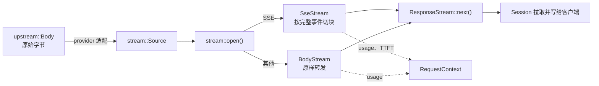
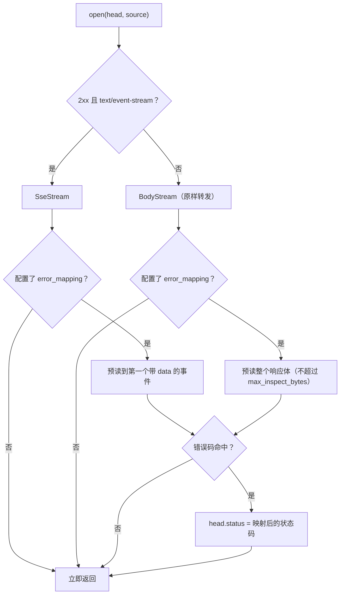

# 任务设计：1.5 stream：SSE 解析、usage 提取、ResponseStream

| 项目 | 内容 |
|---|---|
| Issue | [#12](https://github.com/bluesky-rgb/llmgw/issues/12) |
| 阶段 | 阶段 1：最小链路（v0.2 Alpha） |
| 工作量 | 1 天 |
| 状态 | 设计通过（自审，见评审记录） |
| 实现的总体设计章节 | [design.md](../design.md) 3.2（⑧⑨）、6.6（usage 的来源）、6.12；[providers.md](../providers.md) 3.4 |

## 1. 目标与范围

**一句话：** 把上游的响应体（upstream 交出的原始字节）包装成 core 的 `ResponseStream`，交给 Session 拉取。流式响应按 **完整的 SSE 事件** 切块转发（不会把一个事件切成两半），顺路提取 usage 和首字延迟，必要时检查响应体中的业务错误码。**路线图的验收标准：任意切块方式下解析结果都正确。**

**要做：**

| 部分 | 内容 |
|---|---|
| `SseParser` | 增量解析：喂入任意切块的字节，吐出完整的事件（原始字节 + 解析出的 `data`、`event`）。三种换行（`\n`、`\r\n`、`\r`）、注释行、字段规则按 WHATWG 的 SSE 规范；单个事件的大小有上限 |
| 旁路检查 | 每个事件：`[DONE]`；usage（`prompt_tokens`、`completion_tokens`、`completion_tokens_details.reasoning_tokens`，取最后一个非空的）；首字延迟（第一个带 `data` 的事件）；网关自己加上 `include_usage` 时，去掉客户端没有要求的“只有 usage 的块” |
| `open()` | 根据状态码和 `Content-Type` 决定按 SSE 解析还是原样转发；配置了业务错误码映射时，先读到能做判断为止（流式：第一个带 `data` 的事件；非流式：整个响应体），命中时把响应头的状态码改成映射后的状态码 |
| 非流式 | 响应体边读边转发；同时保留一份副本（有上限），结束时从中提取 usage |
| `Source` | stream 自己定义的字节来源接口：provider 把 upstream 的 `Body` 适配成它（stream 不依赖 upstream，见第 2 节） |

**不做：**（以及在哪里做）
- 在请求中加上 `stream_options.include_usage` → provider（1.6）。stream 只接收“是否需要去掉 usage 块”这个选项
- 拿不到 usage 时按字符数估算 → 预算模块（2.x）。stream 只标记 `usage.reported = false`
- 根据状态码决定重试 → executor（1.7）。业务错误码命中时，stream 只是把状态码改成映射后的值，之后与真实的 HTTP 错误走同样的重试规则
- 指标 → 1.2。usage 和首字延迟写入 `RequestContext`，由 `on_complete` 统一上报
- 协议转换（Anthropic 格式等）→ v1.x

## 2. 在架构中的位置

- 涉及的模块：`stream`（新增实现）
- 模块依赖：`stream → core`。**不依赖 `config` 和 `upstream`**（`module_deps.json` 只允许 `core` 和 `observability`）：
  - 字节来源用 stream 自己的 `Source` 接口，provider 把 `upstream::Body` 适配过来（一个十几行的适配器，在 1.6 中实现）。stream 因此可以用任意切块的假来源测试
  - 业务错误码的映射规则用 stream 自己的 `ErrorMapping`（字段路径 + 错误码表），provider 从 `config::ErrorMapping` 转换
- 第三方：simdjson（已有，1.3 中用于取 `model`）
- 调用方：provider（1.6）调用 `open()`，把结果交给 executor，再交给 Session



## 3. 接口设计

```cpp
// llmgw/stream/stream.h
namespace llmgw::stream {

/// 字节来源（provider 把 upstream::Body 适配成它）。
class Source {
 public:
  virtual ~Source() = default;
  /// 把下一段数据追加到 out。true：读到了数据；false：正常结束；错误：中途出错
  virtual Task<Result<bool>> read(std::string* out) = 0;
};

/// 业务错误码映射（providers.md 3.4）：响应体中 path 处的值 → HTTP 状态码。
struct ErrorMapping {
  std::vector<std::string> path;     ///< 比如 {"base_resp", "status_code"}
  std::map<std::string, int> codes;  ///< 值的文本形式 → 状态码，比如 "1002" → 429
};

struct Options {
  bool strip_usage_chunk = false;            ///< 网关替客户端加了 include_usage：不转发“只有 usage 的块”
  const ErrorMapping* error_mapping = nullptr;
  std::size_t max_event_bytes = 4 << 20;     ///< 单个 SSE 事件的上限
  std::size_t max_inspect_bytes = 32 << 20;  ///< 非流式：为提取 usage、检查错误码保留的副本的上限
};

/// 包装上游的响应。head 是上游的状态码和响应头（原样交给 Session，Session 会去掉逐跳的头）。
/// 配置了 error_mapping 时会先读一部分响应体（见第 5 节）；读的过程中出错时返回错误。
/// ctx 必须比返回的 ResponseStream 活得久（Session 持有两者，满足）。
Task<Result<std::unique_ptr<ResponseStream>>> open(ResponseHead head, std::unique_ptr<Source> source,
                                                   RequestContext* ctx, Options options);

/// 增量 SSE 解析器（单独公开：供测试、模糊测试，以及以后的协议转换使用）。
class SseParser { ... };  // 见第 4 节

}  // namespace llmgw::stream
```

**设计要点：**

1. **业务错误码命中时改状态码，而不是返回错误**：executor 的重试规则按状态码决定（design.md 6.1）。把 MiniMax 的“HTTP 200 + `base_resp.status_code = 1002`”变成“429”之后，它和真实的 429 走完全一样的路径；不重试时，客户端收到的是 429 和上游原来的响应体
2. **按 SSE 解析的条件是“2xx 且 `Content-Type` 是 `text/event-stream`”，而不是“请求是流式的”**：流式请求出错时，上游返回的通常是 JSON 错误体（没有 SSE 的空行分隔），按 SSE 解析会一直等不到事件结束，直到响应体结束才发现格式不对。只看请求是否流式会让所有流式请求的错误信息丢失
3. **原样转发事件的字节**：不重新序列化，`reasoning_content` 等非标准字段、注释、`id`/`retry` 字段都原样保留（design.md 6.12“原样透传”）
4. **一次 `next()` 返回读到的所有完整事件**：减少写客户端的次数；但只要有一个完整事件就立即返回，不为了攒批而等待

## 4. 数据与状态

**`SseParser`**（纯计算，没有 I/O）：

| 状态 | 说明 |
|---|---|
| `buffer_` | 已收到、还不构成完整事件的字节 |
| `scan_` | 已经扫描过的位置（不重复扫描，否则一个大事件分成很多小块到达时是 O(n²)） |
| 当前事件的 `data`、`event` | 按行解析的结果 |
| `searched_` | `[scan_, searched_)` 中确定没有换行：一行很长、分很多次到达时，不从行首重新搜索（否则是 O(n²)） |

**`\r` 被切在两块里**（最典型的切块 bug）：缓冲区的最后一个字节是 `\r` 时先不判定，等下一个字节（或者响应体结束）再决定它是单独的换行还是 `\r\n` 的前一半。这样每个事件的原始字节与切块方式无关。初稿用的是“记住上一段以 `\r` 结尾、跳过下一段开头的 `\n`”，实现时发现那样 `\n` 会落到下一个事件的原始字节里，事件的边界随切块方式变化。代价：只用 `\r` 换行的流，一个事件要等下一个字节才交出（LLM 的接口都用 `\n` 或 `\r\n`）

输出的事件：`raw`（原始字节，包括结尾的空行）、`data`（多个 `data:` 行用 `\n` 连接）、`event`、`has_data`（是否有 `data` 字段；只有注释的“心跳”事件没有）。

**`SseStream` / `BodyStream`**（每个请求一个，只在 Worker 线程上使用）：持有 `Source`、解析器、是否已经看到 `[DONE]`、非流式的副本。写入 `ctx->usage`、`ctx->ttft`。

## 5. 关键流程

**`open()`：**



- **只有配置了 `error_mapping` 才预读**：预读意味着客户端要等到第一个事件才收到响应头。只对需要的上游（MiniMax）付出这个代价
- 预读读到的数据缓存在流中，之后的 `next()` 先返回它们，不会丢失也不会重复
- 预读期间的超时：由调用者的竞速控制（executor 在 1.7 中按 `first_byte` 计时）。stream 自己不创建定时器

**`SseStream::next()`：** 循环：解析器中有完整事件 → 逐个检查（`[DONE]`、usage、首字延迟、是否去掉）→ 把要转发的事件的原始字节拼成一块返回；没有 → 从 `Source` 读一段，喂给解析器。`Source` 正常结束时按第 6 节处理剩下的半个事件。

## 6. 失败与边界情况

| 情况 | 处理 | 测试 |
|---|---|---|
| 任意切块（包括逐字节、`\r` 和 `\n` 被切在两块里） | 结果与一次性喂入完全相同 | S1 |
| 三种换行混用 | 都按换行处理；转发的原始字节不改动 | S2 |
| 注释行（`: ping`）、只有注释的事件 | 原样转发；不算首字；不检查 usage | S2 |
| 字段规则：`data:x` 与 `data: x`（冒号后的一个空格被去掉）、没有冒号的行、多个 `data` 行、未知字段 | 按 WHATWG 规范 | S2 |
| 开头的 UTF-8 BOM | 解析时跳过，转发时保留 | S2 |
| 单个事件超过 `max_event_bytes`（上游一直不发空行） | 先交出之前已经完整的事件，再返回错误（502），而不是无限增长内存；不论这个事件一次到达还是分块到达 | S5 |
| 预读时上游只发注释和空行、迟迟不发 `data` | 预读的总量（每个事件按原始字节数 + 128 字节计算）超过 `max_event_bytes` 时放弃检查，照常转发 | 审查 #1 |
| 预读时读取出错 | `open()` 返回错误：此时还没有向客户端发送任何东西，executor 可以安全地换一个上游 | S6 |
| 响应体结束时，最后一个事件少了结尾的空行（`data: [DONE]\n`） | **补上空行后转发**（有的上游这样结束）；补上后超过上限 → 错误（不能静默丢掉最后一个事件） | S4 |
| 最后一行本身不完整（在行中间断开） | 是 `data: [DONE]` → 补全后转发；在 `[DONE]` 之后、或者是注释 → 丢弃（与 WHATWG 规范相同），正常结束；整个响应体里没有任何事件 → 不是 SSE，原样转发；其他 → 错误：转发半个事件会让客户端解析出错 | S4 |
| 200 + `text/event-stream`，但响应体是一个 JSON（MiniMax 出错时可能这样，1.8 中验证） | 原样转发；配置了 `error_mapping` 时按整个响应体检查错误码 | 审查 #9 |
| `Source` 中途出错 | 返回错误（Session 发送 SSE 错误事件后结束） | S4 |
| 上游一直没有发 `[DONE]` 就正常结束 | 正常结束（MiniMax、MiMo 是否发送 `[DONE]` 在 1.8 中验证）。是否看到过 `[DONE]` 用于判断结尾的半行能否丢弃 | S4 |
| `[DONE]` 之后还有事件 | 原样转发（透传，不做猜测） | S4 |
| usage：每一块都有 `"usage": null`，最后一块才有数字 | 取最后一个非空的 usage | S3 |
| usage 中缺少某个字段、字段为 `null`、字段类型不对、数字为负 | 缺少的和 `null` 按 0；类型不对（包括 `completion_tokens_details` 既不是对象也不是 `null`）或为负时忽略这个 usage（不写入半个结果） | S3 |
| 非流式响应被映射成错误状态码 | 不提前写入 usage：usage 在响应体被读完时才写入（executor 会丢弃这次尝试） | 审查 #4 |
| `Content-Type` | 媒体类型必须恰好是 `text/event-stream`（`text/event-stream-foo` 不算）；有多个 `Content-Type` 时，全部都是才按 SSE 解析 | 审查 #5 |
| 去掉“只有 usage 的块”：`choices` 为空数组且 `usage` 非空 | 只在 `strip_usage_chunk` 时去掉；usage 照常提取 | S3 |
| 一次读到的事件全部被去掉 | 继续读，不返回空块（空块对 Session 来说是“结束”） | S3 |
| 错误码映射：值是数字或字符串（`1002` 与 `"1002"`）；路径不存在；值不在表中 | 都按文本比较；不存在、不在表中 → 不改状态码 | S6 |
| 非流式响应体超过 `max_inspect_bytes` | 照常转发；不再保留副本，`usage.reported = false`；有 `error_mapping` 时不做检查（记日志） | S7 |
| 流式请求，上游返回 200 + `application/json`（忽略了 `stream: true`） | 按非流式原样转发，从响应体提取 usage | S7 |
| 流式请求，上游返回 4xx/5xx（JSON 错误体） | 原样转发，状态码不变 | S7 |
| 被取消（客户端断开） | `Source` 的读取以错误结束，直接返回；不写入半个 usage | S8 |

## 7. 验证计划

| # | 验证项 | 方法 | 验收标准 |
|---|---|---|---|
| S1 | **任意切块**（路线图验收项） | 一组有代表性的 SSE 文本（三家厂商的真实格式、各种换行、注释、多行 data、BOM）：在每一个位置切成两块、随机切成多块（10 万次）、逐字节喂入 | 解析出的事件序列、每个事件的原始字节、转发的字节与一次性喂入完全相同 |
| S2 | SSE 规范 | 逐条覆盖第 6 节中的字段规则 | 与规范一致 |
| S3 | usage 与去掉 usage 块 | OpenAI、MiniMax 风格的最后一块；字段缺失、类型不对 | `ctx->usage` 正确；`strip_usage_chunk` 时客户端收不到 usage 块，否则原样收到 |
| S4 | 结束与中途出错 | 少了结尾空行、在行中间断开、`Source` 出错、没有 `[DONE]` | 按第 6 节 |
| S5 | 上限 | 一直不发空行的上游 | 内存不超过上限，返回错误 |
| S6 | 业务错误码 | MiniMax 风格的错误体（流式的第一个事件、非流式的整个响应体） | 状态码改成映射值；响应体原样保留；没命中时不改 |
| S7 | 非 SSE 响应 | 流式请求得到 JSON、4xx JSON、超大非流式响应体 | 原样转发；usage 能提取的都提取 |
| S8 | TTFT 与取消 | 假的 `Source` 控制每一块的到达时间；在读取中途取消 | `ctx->ttft` = 第一个带 `data` 的事件被交出的时间 − `received_at`；取消时立即返回 |
| S9 | 性能 | 典型的 OpenAI 流（每个事件 200–300 字节） | 记录每个事件的处理时间（预期 < 1 µs，加上 usage 检查约 0.1 µs）；大事件分成 1 字节的小块到达时没有 O(n²) |
| S10 | 模糊测试 | 新目标 `sse`：任意字节按任意方式切块喂入 | 不崩溃；切块方式不影响结果（同一个输入，一次性喂入与随机切块的结果相同） |
| S11 | 规范 | clang-format（按退出码）、clang-tidy、ASan/UBSan、TSan 各 2 次、行数、模块依赖 | 全部通过 |
| S12 | 独立审查 | 从“恶意或不正常的上游”出发 | 发现的问题都修复或记录为接受的风险 |

**反向验证**：S1（末尾的 `\r` 立即当作换行）、S3（不取“最后一个非空的” usage）、S4（结束时不补空行）、S5（去掉上限）、S9（每次从头扫描）都要做。

## 8. 风险与备选方案

| 风险 | 应对 |
|---|---|
| 配置了 `error_mapping` 的上游，客户端要等到第一个事件才收到响应头（推理模型可能是几秒） | 只对配置了的上游预读；MiniMax 出错时的状态码如果本身就正确（1.8 中验证），可以去掉这个配置 |
| 非流式响应保留副本：并发的大响应体占双倍内存 | 上限 32 MB；超过时放弃副本（只是拿不到 usage） |
| 每个带 `usage` 的事件解析一次 JSON（OpenAI 开启 include_usage 后每一块都带 `"usage": null`） | 实测约 78 ns / 事件（simdjson on-demand），相比网络延迟可以忽略；先用 memmem 筛掉不含 `"usage"` 的事件 |
| 只用 `\r` 换行的流：一个事件要等下一个字节才交出（第 4 节） | 主流的 LLM 接口都不这样；有需要时可以在流的开头探测换行方式 |
| 厂商的 SSE 细节（是否发 `[DONE]`、usage 的字段名）与 OpenAI 不同 | 解析按规范、检查按 OpenAI 格式；1.8 中用真实的 key 逐家验证（providers.md 第 4 节的清单） |

---

## 评审记录

| 日期 | 结论 | 意见 |
|---|---|---|
| 2026-11-21 | 设计通过（自审） | 初稿中发现 4 处问题，已修改（见下）。实现完成后做一次独立审查（S12） |

自审发现的问题：

1. **初稿按“请求是否流式”决定是否按 SSE 解析**：流式请求出错时上游返回 JSON 错误体，按 SSE 解析会一直等空行，最后错误信息全部丢失。改为按“2xx 且 `text/event-stream`”判断
2. **初稿让 stream 依赖 `config`（错误码映射的类型）和 `upstream`（`Body`）**：违反 `module_deps.json`。改为 stream 自己定义 `Source` 和 `ErrorMapping`，provider 负责适配，同时让 stream 可以用任意切块的假来源测试
3. **初稿对所有上游都预读第一个事件**：会让所有流式请求的首字延迟多出一个事件的等待。改为只在配置了 `error_mapping` 时预读
4. **初稿没有处理“一次读到的事件全部被去掉”**：此时返回空块，Session 会当作响应结束。改为继续读

## 验证记录

| # | 结果 | 数据 / 证据 |
|---|---|---|
| S1 | ✅ | 8 段代表性的 SSE 文本（OpenAI、CRLF + 推理内容 + 心跳、只用 CR、混合换行与字段、BOM、少了最后的空行、以 `\r` 结尾、空 data）：每一个两段切分位置、逐字节、10 万次随机切块，事件序列、每个事件的原始字节、转发的字节都与一次性喂入完全相同；转发的字节就是输入（唯一的例外是结束时补上的空行） |
| S2 | ✅ | 字段规则（冒号后只去掉一个空格、没有冒号的行、多个 data、event、id/retry/未知字段）、三种换行、BOM、空 data |
| S3 | ✅ | 取最后一个非空的 usage（每一块都带累计 usage 时也正确）；字段缺失按 0；类型不对、负数、小数、JSON 不完整时忽略；`strip_usage_chunk` 时客户端收不到 usage 块，否则原样收到；去掉事件后不返回空块 |
| S4 | ✅ | 少了最后的空行：补上；在行中间断开：错误，已完整的事件照常转发；`Source` 出错：原样返回；以 `\r` 结尾：结束时确定 |
| S5 | ✅ | 一直不发空行：超过上限后报错、不再增长；超大事件不论一次到达还是逐字节到达都被拒绝（模糊测试发现的问题，见下）；10 万个事件之后缓冲区为空 |
| S6 | ✅ | 流式的第一个事件、非流式的整个响应体（分两块到达）：状态码改成映射值，响应体与预读的心跳都原样保留；数字与字符串；路径中的 `/` 和 `~` 转义；成功（0）与非 2xx 不改；预读时出错返回错误 |
| S7 | ✅ | 流式请求得到 JSON（200/400/429/500）：原样转发，200 时提取 usage；`text/event-stream` 但状态码 502：原样转发；超过 `max_inspect_bytes` 的响应体：原样转发，不提取 usage |
| S8 | ✅ | 心跳之后 120 ms 才到第一个 data：TTFT ≥ 110 ms；读取中途取消：50 ms 内返回，不写入 usage |
| S9 | ✅ | 每个事件约 **600 ns**（约 220 字节，含 usage 检查），每块平均 76 个事件；1 MB 的事件逐字节到达：**9 ms**（修复前超过 30 秒，见下） |
| S10 | ✅ | 新目标 `sse`：同一个输入一次性喂入与随机切块喂入的结果相同；转发的字节是输入的前缀，正常结束时就是输入本身（或加上补上的空行）；对每个事件的 data 做 usage 提取和错误码检查。上限由输入决定（16–79 字节），反向验证确认能抓到审查 #2。最终本机 90 秒约 182 万次无问题 |
| S11 | ✅ | clang-format（按退出码）、clang-tidy、`-Werror`、模块依赖、TODO、行数；Release、ASan+UBSan 2 次、TSan 2 次全部通过，0 个 sanitizer 报告（216 个测试；sanitizer 构建不含原型的 1 个） |
| S12 | ✅ | 独立审查：2 个主要问题、5 个次要问题、2 个风险、若干测试和文档的问题，全部修复（见下文） |
| 反向验证 | ✅ | 共 21 处（修复审查问题后全部重跑）。最初的 11 处：末尾的 `\r` 立即当作换行、取第一个 usage、不管选项都去掉 usage 块、去掉事件后返回空块、结束时不补空行、去掉上限、交出时不检查大小、每次从行首重新搜索、非 2xx 也按 SSE 解析、预读的事件丢失、心跳也算首字。每一处破坏后对应的测试都失败，恢复后逐字节一致 |

### 实现中发现并解决的问题

1. **`\r` 被切在两块里时事件的边界随切块方式变化**（写代码前推演发现）：初稿的 `pending_cr_` 方案会让 `\n` 落到下一个事件里。改为“缓冲区最后一个字节是 `\r` 时等下一个字节”（第 4 节）
2. **一行很长时是 O(n²)**：S9 的测试 30 秒都没有跑完——设计中写了“不重复扫描”，实现时只在找到完整的一行之后才前进。增加 `searched_`，修复后 9 ms
3. **超大事件一次到达时被放行**（模糊测试发现）：上限只在每次喂入之后检查，事件的结尾和空行在同一次喂入中到达时，事件已经被交出。改为交出时也检查。为了拿到触发问题的输入，给本机的模糊测试驱动加上了“崩溃时保存输入”（与 libFuzzer 的 `crash-*` 文件相同用途）
4. **`finish()` 可能产生两个事件**（自查发现）：以 `data: a\r\r` 结束时，末尾的 `\r` 构成空行结束一个事件，之后没有剩下的字节。初稿的接口只能返回一个，改为统一通过 `next()` 取出
5. **“取最后一个 usage”的测试测不出来**（反向验证发现）：测试数据只有一个非空的 usage。增加“每一块都带累计 usage”的用例
6. GCC 13 在 `co_await` 表达式中直接使用花括号初始化时出现编译器内部错误（ICE），测试中先构造好参数

### 独立审查（S12）

一个没有参与实现的审查者，对照自己写的 WHATWG 参考解析器做了 20 万个随机输入的比对（0 个不一致），在约 80 个等待点上做了取消（656 次，ASan/UBSan 无报告），并找到了以下问题。每个问题都先写成测试（`tests/unit/stream/review_test.cpp`），确认修复前失败，再修复：

| # | 问题 | 程度 | 修复 |
|---|---|---|---|
| 1 | **预读时没有内存上限**：配置了 `error_mapping` 的上游只发空行，8 MB 的输入让内存增长 880 MB（每个空行都是一个 `SseEvent` 对象），64 MB 时进程被 OOM 杀掉 | 🟠（上游不可信时 🔴） | 预读总量超过 `max_event_bytes` 时放弃检查 |
| 2 | **结束时补上空行让最后一个事件超过上限：事件被静默丢弃，却报告成功**。客户端丢失最后一个事件（通常是 `[DONE]` 或 usage） | 🟠 | 补上空行后超过上限时返回失败；模糊测试增加“正常结束时一个字节都不能少” |
| 3 | 超过上限时，之前已经完整的事件是否转发取决于切块方式（影响客户端收到的内容和计费） | 🟡 | 出错时先交出已经完整的事件 |
| 4 | 被映射成错误状态码的非流式响应在预读时就写入了 usage | 🟡 | 读完时才写入 |
| 5 | `Content-Type` 只按前缀匹配；只看第一个 | 🟡 | 精确匹配媒体类型；全部一致才按 SSE 解析 |
| 6 | usage 中 `null` 的计数让整个 usage 丢失；类型不对的 `completion_tokens_details` 被接受 | 🟡 | `null` 按 0；类型不对时拒绝 |
| 7 | 线程局部的解析器和缓冲区不会收缩：处理一个 31 MB 的响应体后，每个 Worker 线程多占 60–90 MB | 🟡 | 处理超过 1 MB 的输入后释放（没有自动化测试） |
| 8 | 以没有换行的 `data: [DONE]` 结束时报错，Session 会在完整的内容后面追加一个错误事件，比直连上游的结果更差 | 风险 | 补全 `[DONE]`；`[DONE]` 之后和注释中的半行丢弃 |
| 9 | 200 + `text/event-stream` 的 JSON 错误体：没有换行时被当作错误（错误信息丢失），有换行时不检查错误码 | 风险 | 没有任何事件的响应体原样转发，并按整个响应体检查错误码 |
| 10 | 文档与实现不一致：超大响应体放弃检查时说“记日志”但没有；`saw_done` 没有被使用；验证计划中提到不存在的 `pending_cr_` | 🟡 | 补上日志；更正文档 |
| 11 | 测不出问题的测试：取消测试中的 usage 断言没有意义；ResponseStream 层面的切块不变性只测了一种切法；超大响应体的测试没有断言状态码；模糊测试没有覆盖 usage 提取和错误码检查 | 🟡 | 全部补上（ResponseStream 层面：4 种选项组合 × 300 种随机切法） |

另外，对审查问题的修复做反向验证时，又发现 3 个测不出问题的测试：“只看第一个 Content-Type”（测试中的顺序恰好不受影响）、“预读时读取出错应让 `open()` 失败”（测试只检查最终有错误，分不出错误是 `open()` 返回的还是 `next()` 返回的——前者可以安全重试，后者客户端已经收到了 200）、“非 2xx 不按 SSE 解析”（修复 #9 之后，没有事件的响应体也会原样转发，掩盖了它）。都已改正。

审查者确认没有问题的部分：WHATWG 规范的各条规则、各种切法下的结果一致、预读的数据不丢失不重复、usage 取最后一个非空的、只在要求时去掉 usage 块、去掉事件后不返回空块、取消时不写入半个 usage、`next()` 本身不抛异常、线性的扫描与均摊的压缩。

## 收获与教训

1. **“验收标准是一个性质”时，把它直接写进测试和模糊测试。** “任意切块方式下结果都正确”被写成了三层检查：解析器（每一个两段切分、逐字节、10 万次随机切法）、ResponseStream（4 种选项组合 × 300 种切法）、模糊测试（同一个输入一次性喂入与随机切块对比）。模糊测试因此发现了一个只在“超大事件一次到达”时出现的不一致
2. **为性能写的测试要在实现之前就写好。** “不重复扫描”写在了设计里，实现时却漏了；是 S9（1 MB 的事件逐字节到达）把它抓出来的（30 秒以上 → 9 ms）
3. **独立审查第三次找到了严重的资源问题**：预读时没有上限（880 MB）。我在设计中给“单个事件”和“非流式副本”都设了上限，却没有想到“很多很小的事件”。上限要按“对方能控制什么”来设，而不是按“我设想的数据长什么样”
4. **修复会改变别的测试的含义。** 修复 #9（没有事件的响应体原样转发）之后，两个原有的测试失去了区分能力，仍然通过，却不再能抓到它们本来要抓的问题——是反向验证发现的。每次修复之后，反向验证要全部重跑，而不只是新加的那几项
5. **错误在哪一层被报告，决定了能不能安全重试。** `open()` 失败时还没有向客户端发送任何东西；`open()` 成功、`next()` 才失败时，客户端已经收到了 200。重写代码时差点把前者变成后者，测试也分不出来
6. **模糊测试的性质也要做反向验证。** 加强后的“正常结束时一个字节都不能少”，最初在 60 秒内一次都没有触发审查 #2——上限固定为 4096 字节，随机输入几乎走不到“补上空行恰好超过上限”的边界。改为由输入决定上限后立即触发。另外，第一次做这个反向验证时，程序因为相对路径找不到而返回 127，差点被当成“触发了”：要看清楚失败的原因
7. **用两阶段工具修改，不要用普通的字符串替换**：一次普通的 `str.replace` 因为 clang-format 改了换行而没有生效，测试失败时才发现。本机的模糊测试驱动也增加了“崩溃时保存输入”，不再靠猜测找触发问题的输入

