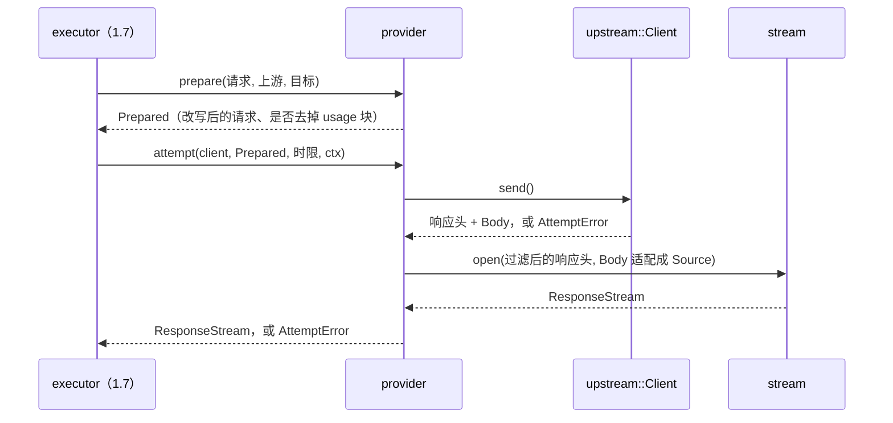

# 任务设计：1.6 provider：OpenAI 兼容适配与请求改写

| 项目 | 内容 |
|---|---|
| Issue | [#13](https://github.com/bluesky-rgb/llmgw/issues/13) |
| 阶段 | 阶段 1：最小链路（v0.2 Alpha） |
| 工作量 | 1 天 |
| 状态 | 已完成（实现、验证、独立审查） |
| 实现的总体设计章节 | [design.md](../design.md) 3.2（⑥⑦⑧）、6.12；[providers.md](../providers.md) 第 2、3 节 |

## 1. 目标与范围

**一句话：** 把“客户端的请求 + 选中的一个目标”变成“发给这个上游的请求”，发出去，再把上游的响应包装成 `ResponseStream`。这是执行链路 executor → **provider** → upstream → stream 中连接两头的一层：1.4 的 upstream 和 1.5 的 stream 在这里第一次串起来。**路线图的验收标准：单元测试覆盖三种改写（`drop_fields`、`rename_fields`、`set_fields`）。**

**要做：**

| 部分 | 内容 |
|---|---|
| `prepare()` | 纯计算：改写请求体（内置改写 + 三种配置的改写）、请求头（`Authorization: Bearer`、`Content-Type`）、路径（`base_path` + `/chat/completions`） |
| 改写器 | **基于字节位置**：用 simdjson 找到要改的字段在原文中的位置，只重建被改动的对象，其余字节原样复制（第 3 节说明为什么不用 DOM） |
| 内置改写 | `model` 换成目标的模型名；流式请求加上 `stream_options.include_usage = true`（客户端没有要求时，告诉 stream 去掉 usage 块） |
| `attempt()` | 一次尝试：upstream 发送 → 响应头过滤（白名单）→ `stream::open()`。返回 `ResponseStream` 或者 upstream 的 `AttemptError`（阶段 + `maybe_sent`），供 executor 判断能否重试 |
| 适配 | `upstream::Body` → `stream::Source`；`config::ErrorMapping` → `stream::ErrorMapping` |
| 配置校验（补充 1.1） | `rename_fields` 的来源和目标必须在同一个父对象中；不允许改写 `model` 和 `stream`（由网关管理）；`error_mapping.field` 不能带 `[]` |

**不做：**（以及在哪里做）
- 选择目标、重试、切换、超时的计算 → executor（1.7）。provider 只做一次尝试，时限由调用者给出
- `X-LLMGW-Provider`、`X-LLMGW-Attempts` 等响应头 → executor（1.7，只有它知道尝试了几次）
- 每次尝试之前重置 `ctx->usage`、`ctx->ttft` → executor（1.7，记入其设计的输入）
- 透传客户端的 `traceparent`、记录幂等键 → 观测（3.x）。`RequestInfo` 中还没有客户端的请求头
- Anthropic 等其他协议 → v1.x

## 2. 在架构中的位置

- 涉及的模块：`provider`（新增实现）、`config`（补充三条校验）
- 模块依赖：`provider → core, config, upstream, stream`（与 `module_deps.json` 一致）
- 第三方：simdjson（改写器）
- 调用方：executor（1.7）



**为什么 `prepare()` 和 `attempt()` 分开**：`prepare()` 的失败（请求体不是 JSON 对象）是客户端的错误（400），换哪个上游都一样，不能重试；`attempt()` 的失败才按阶段和 `maybe_sent` 判断。分开之后，executor 不需要从一个错误里猜它属于哪一类。

## 3. 关键决定：改写器不用 DOM

**实测**（本机 -O2，典型的聊天请求体：多条消息，每条带 `reasoning_content`；操作：改 `model`、加 `stream_options`、删每条消息的 `reasoning_content`）：

| 请求体 | nlohmann（解析 + 修改 + 序列化） | simdjson（定位 + 复制原文） | 倍数 |
|---|---|---|---|
| 3 KB | 0.042 ms | 0.001 ms | 70× |
| 93 KB | 0.97 ms | 0.011 ms | 88× |
| 934 KB | 9.6 ms | 0.18 ms | 54× |
| 9.3 MB | 106 ms | 2.8 ms | 38× |

（这是设计时的原型，只做定位和复制。最终实现还要收集每个键值对、按规则树逐层重建，Release 实测：3 KB 0.004 ms、93 KB 0.06 ms、934 KB 0.6 ms，见验证记录 P9。仍是 DOM 方案的约 1/15。）

改写在 Worker 线程上进行，期间这个 Worker 上的所有连接都要等。Agent 类应用的请求带着很长的上下文，几百 KB 到 1 MB 很常见；每次尝试（包括重试）都要改写一次。DOM 方案在 1 MB 时阻塞约 10 ms，**不能接受**。

基于字节位置的改写还有一个好处：**没有改动的部分逐字节保留**。DOM 往返会改变数字的写法（超过 64 位的整数会丢失精度）、字符串的转义方式和键的顺序（design.md 6.12“非标准字段原样透传”）。

**做法**：对一个对象，先用 simdjson on-demand 收集它的每个键值对在原文中的位置（键的原始字节、值的原始字节），再按规则决定每一项是删除、改名、替换还是向下深入，最后把各项重新拼成 `{...}`。只有改写路径经过的对象被重建（顶层一定会，因为要改 `model`）；向下深入时，对子对象（或者数组中的每个对象元素）递归同样的过程，子树的原文在同一块带填充的缓冲区中，不需要复制。没有被路径经过的值原样复制。

## 4. 接口设计

```cpp
// llmgw/provider/provider.h
namespace llmgw::provider {

/// 一个目标的请求（prepare() 的结果）。
struct Prepared {
  upstream::Request request;
  bool stream = false;             ///< 客户端的请求是否流式（决定 first_byte 用哪个超时）
  bool strip_usage_chunk = false;  ///< 网关替客户端加了 include_usage：stream 不转发 usage 块
};

/// 为一个目标准备请求。纯计算，不做 I/O。
/// 错误：请求体不是 JSON 对象（400）。换目标也没有用，不重试
Result<Prepared> prepare(const RequestInfo& request, const config::Provider& provider,
                         const config::TargetConfig& target);

/// 一次尝试。成功时返回的 ResponseStream 的状态码可能是 4xx/5xx（由 executor 按状态码决定是否重试）；
/// 失败时返回 upstream 的 AttemptError（阶段、maybe_sent）。不抛异常。
/// ctx 必须比返回的 ResponseStream 活得久。
Task<Expected<std::unique_ptr<ResponseStream>, upstream::AttemptError>> attempt(
    upstream::Client* client, const config::Provider* provider, Prepared prepared,
    upstream::Deadlines deadlines, RequestContext* ctx);

}  // namespace llmgw::provider
```

**改写的顺序与语义**（对每个对象逐层进行。实现时按独立审查的意见修订，见评审记录）：

1. **内置改写**：顶层 `model` = 目标的模型名；流式请求时 `stream_options.include_usage` = `true`（`stream_options` 不存在时创建，不是对象时替换）
2. **`drop_fields`**：删除；路径不存在时什么也不做
3. **`rename_fields`**：改名；目标名已经存在时，原来的那一项被删除（改名的结果覆盖它）
4. **`set_fields`**：替换为配置中的值；不存在时创建（中间的对象也一起创建）；路径经过的值不是对象时替换为对象

**内置改写让给配置**：配置的任何一条规则的路径与内置改写的路径在同一条线上（一条是另一条的前缀）时，这条内置改写不做，由配置决定（比如某个上游不支持 `stream_options`，就用 `drop_fields` 删掉它）。以 `model`、`stream` 开头的路径不允许出现在配置的改写中（配置校验，第 2 节）。

**规则之间不能有歧义**（配置校验）：规则的路径不能经过被改名的字段（来源或目标）或者被设置的字段。比如“改名 `thinking` → `reasoning`”加上“删除 `thinking.budget`”：按原名还是新名匹配、删除作用于原值还是设置的值，都说不清，加载时报错，要求写成一条规则（比如直接设置整个对象）。两条改名指向同一个目标、改名链（`a → b`、`b → c`）同样报错。同一个字段上的删除 + 设置（先删后设）没有歧义，允许。

**`strip_usage_chunk`**：发给上游的请求要求了 usage（`stream_options.include_usage == true`），而客户端的请求没有要求时为 `true`，stream 去掉 usage 块。“客户端要求了”按解码后的键名判断；重复的键中任意一项为 `true` 即为要求了（保守：宁可多转发一个 usage 块，也不吞掉客户端要的）。内置改写让给配置时，检查改写后的请求体（配置自己设置了 `include_usage = true` 同样要去掉）。

**带 `[]` 的路径**（`messages[].reasoning_content`）：对数组中的每个对象元素生效；不是数组、元素不是对象时跳过。

**改名只在同一个父对象中进行**（`messages[].a` → `messages[].b`）；跨层的“改名”实际上是移动，含义不清楚，配置时就报错。

**响应头白名单**：上游的响应头中只保留 `Content-Type`、`Cache-Control`、`Retry-After`、`retry-after-ms`；上游的请求 ID（`x-request-id`、`request-id`）改名为 `X-LLMGW-Upstream-Request-Id` 后保留（排障时与厂商对账）。其他一律丢弃：`openai-organization`、`openai-project` 会泄露网关账号的信息；上游的 `x-ratelimit-*` 是**网关账号**在上游的额度，与网关自己返回给客户端的 `x-ratelimit-*`（每个网关 key 的额度，design.md 3.3）含义不同、会冲突；`set-cookie` 等与客户端无关。

## 5. 数据与状态

`prepare()` 和改写器是纯函数，没有状态。`attempt()` 返回的 `ResponseStream` 是一个包装：持有转换后的 `stream::ErrorMapping`（stream 的选项中只保存指针，包装保证它的生命周期）和 stream 返回的流。每个请求一个，只在 Worker 线程上使用。

## 6. 失败与边界情况

| 情况 | 处理 | 测试 |
|---|---|---|
| 请求体不是 JSON 对象（数组、字符串、语法错误） | `prepare()` 返回 400 | P5 |
| 改写路径经过的值类型不符（`messages` 不是数组、元素不是对象） | 跳过这一部分（删除、改名不报错；设置时替换为对象） | P2 |
| 重复的键（`server` 已经拒绝重复的 `model`、`stream`，其他键可能重复） | 删除、改名、替换对每一个同名的项都生效；创建只在一项都没有时进行 | P2 |
| 键中有转义（`"\u006dodel"`） | 按解码后的名字匹配；没有改动的键原样输出。判断客户端是否要求了 usage 时同样解码（独立审查 #1） | P2、P3 |
| 客户端的深层嵌套（10 万层） | 递归只沿着规则树，客户端的嵌套深度不影响栈；超过 simdjson 的深度上限（1024）且在改写路径上时 400 | P2 |
| 改名的目标名已经存在 | 原来的那一项被删除 | P1 |
| `set_fields` 的值 | 配置加载时已经是合法的 JSON 文本（`dump()` 的结果），原样插入 | P1 |
| 客户端自己设置了 `stream_options.include_usage: true` | 不去掉 usage 块（客户端要求了它） | P3 |
| 客户端设置了 `include_usage: false` 或者 `stream_options` 的其他字段 | 改为 `true`，保留其他字段；去掉 usage 块 | P3 |
| 非流式请求 | 不加 `stream_options`；客户端自己带的原样保留 | P3 |
| 上游的 `send()` 失败 | 原样返回 `AttemptError` | P6 |
| `stream::open()` 失败（配置了 `error_mapping`，预读时出错） | 原样返回 upstream 的 `AttemptError`（阶段、`timed_out`、`detail`），`maybe_sent = true`：请求已经发出 | P6 |
| 读响应体时出错 | 由 stream 返回错误（`AttemptError::to_error()`，可能已发出时是 504） | P6 |
| 改写后的请求体不是合法的 JSON | 不应发生：模糊测试检查“只要 `prepare()` 成功，输出就是合法的 JSON 对象，且满足每一条规则” | P8 |

## 7. 验证计划

| # | 验证项 | 方法 | 验收标准 |
|---|---|---|---|
| P1 | **三种改写**（路线图验收项） | 单元测试：顶层与 `[]` 路径的删除、改名（包括目标已存在）、设置（包括创建中间对象、替换非对象） | 输出用 nlohmann 解析后与期望的 JSON 相等 |
| P2 | 改写器的边界 | 路径不存在、类型不符、重复键、转义的键、空对象、深层嵌套、Unicode、超过 64 位的整数 | 按第 6 节；**没有改动的值逐字节保留** |
| P3 | 内置改写 | 流式 / 非流式；`stream_options` 不存在、是 null、是对象（各种 `include_usage` 取值） | `model` 一定是目标的；`include_usage` 与 `strip_usage_chunk` 符合第 6 节 |
| P4 | 请求头与路径 | 不同的 `base_path` | `Authorization: Bearer <key>`、`Content-Type`、路径正确；密钥不出现在任何错误信息中 |
| P5 | 不合法的请求体 | 数组、字符串、截断的 JSON | 400 |
| P6 | `attempt()` 串联 | 集成测试：1.4 的测试上游 + 真实的 `upstream::Client` + `stream::open()`：流式（usage、去掉 usage 块）、非流式、业务错误码映射、上游失败、读到一半断开 | 结果、`AttemptError`、`ctx->usage` 都正确；上游收到的请求体是改写后的 |
| P7 | 响应头白名单 | 上游返回 `openai-organization`、`x-ratelimit-*`、`set-cookie`、`x-request-id` | 只有白名单中的头被保留；请求 ID 改名 |
| P8 | 模糊测试 | 新目标 `rewrite`：任意请求体 + 一组固定的改写规则 | `prepare()` 成功时，输出是合法的 JSON 对象（simdjson DOM 校验），`model` 等于目标的、被删除的路径不存在、被设置的路径等于配置的值 |
| P9 | 性能 | 第 3 节的四种大小 | 记录改写耗时；1 MB 的请求体 < 1 ms |
| P10 | 配置校验 | 跨层改名、改写 `model`/`stream`、`error_mapping.field` 带 `[]` | 加载时报错，信息指出是哪一项 |
| P11 | 规范 | clang-format（按退出码）、clang-tidy、ASan/UBSan、TSan 各 2 次、行数、模块依赖 | 全部通过 |
| P12 | 独立审查 | 从“恶意的客户端请求体、恶意的上游”出发 | 发现的问题都修复或记录为接受的风险 |

**反向验证**：P1（去掉三种改写各一）、P2（没有改动的值重新序列化）、P3（客户端已有 `include_usage: true` 时仍然去掉 usage 块）、P7（不过滤响应头）、P8（模糊测试的性质能抓到故意引入的错误）都要做。

## 8. 风险与备选方案

| 风险 | 应对 |
|---|---|
| 基于字节位置的改写器比 DOM 方案复杂，容易出错（逗号、转义、嵌套） | 模糊测试的性质直接检查结果的合法性和每一条规则；单元测试用 nlohmann 解析输出后比较 |
| 被重建的对象中，键值对之间的空白被去掉 | 不影响语义；没有被路径经过的值逐字节保留 |
| 不校验整个请求体：路径没有经过的部分如果有语法错误，原样发给上游 | 上游会返回 400，网关原样转发（不重试）。1.3 排查时记录的“嵌套的值不做完整校验”就此定为：**由上游校验**，网关只保证自己改动的部分合法。理由：完整校验每 MB 约 1 ms（simdjson DOM），收益是少一次上游往返 |
| 每次尝试都改写一次（重试、切换时） | 1 MB 约 0.6 ms；不同的目标改写规则不同，不能共用 |
| 改名 `stream_options`（接受的风险，独立审查 #5b） | 内置改写让给配置，上游不会返回 usage，这个目标的流式请求拿不到用量（由预算模块估算）。这样配置的上游本来就不认识 `stream_options`；如果有反例再加规则 |
| 没有被改写路径经过的部分括号不配对（`[1}`）时原样转发（独立审查 #9） | 与上一行相同：由上游校验。审查没有构造出“合法 JSON 下网关漏改顶层 `model`”的输入（`{"model":"m","x":[1},"model":"evil"]}` 被拒绝） |

---

## 评审记录

| 日期 | 结论 | 意见 |
|---|---|---|
| 2026-11-21 | 设计通过（自审） | 初稿中发现 5 处问题，已修改（见下）。实现完成后做一次独立审查（P12） |
| 2026-11-21 | 独立审查（P12） | 10 项：important 2、minor 5、nit 3；没有内存安全问题。处理见下 |

自审发现的问题：

1. **初稿用 nlohmann 的 DOM 改写请求体**：实测 1 MB 阻塞 Worker 约 10 ms，还会改变数字和转义的写法。改为基于字节位置的改写（第 3 节）
2. **初稿把上游的响应头原样转发**：`openai-organization` 会泄露网关账号的组织 ID；上游的 `x-ratelimit-*` 与网关自己的同名响应头冲突。改为白名单
3. **初稿只有一个 `attempt()` 接口**：请求体不合法（客户端的错误，不能重试）和上游失败（按阶段判断）混在一起，executor 无法区分。拆成 `prepare()` 和 `attempt()`
4. **配置没有限制改名的方向，也没有禁止改写 `model`、`stream`**：跨层改名的含义不清；改写 `model` 会让路由失效。补充配置校验
5. **初稿让 stream 的选项直接指向配置中的错误码映射**：两者的类型不同（stream 不依赖 config），转换后的对象必须有人持有。改为由 `attempt()` 返回的包装持有

独立审查（P12，从“恶意的客户端请求体、恶意的上游”出发，每一项都要求复现）发现的问题与处理。每一项先写复现的测试、确认失败，再修复，再反向验证：

| # | 级别 | 问题 | 处理 |
|---|---|---|---|
| 1 | important | 判断“客户端是否要求了 usage”用 `at_pointer`，按原文匹配键、重复键取第一个；改写器按解码后的名字匹配。`"include\u005fusage": true` 时网关把客户端要的 usage 块吞掉。用模糊测试的二进制复现了 | 改为逐项解码匹配，任意一项为 `true` 即为要求了。单元测试 3 个用例；语料补充转义的键、重复的键 |
| 2 | important | 规则的路径经过被改名的字段时按新名匹配，与第 4 节“逐层 drop → rename → set”不一致；设置的值还会被子规则修改 | 两种语义都说得通，说明配置本身有歧义：加载时拒绝（第 4 节“规则之间不能有歧义”） |
| 3 | minor | 只禁止一段的 `model` / `stream`，`model.x` 能通过，把 model 替换成对象 | 禁止以它们开头的所有路径 |
| 4 | minor | 两条改名指向同一个目标，输出重复的键 | 加载时拒绝 |
| 5 | minor | 内置改写让给配置的判断只看配置的路径是不是前缀；让给配置后 `strip_usage_chunk` 一律为 false（配置自己设置了 `include_usage = true` 时客户端会收到 usage 块） | 改为“在同一条线上”；让给配置时检查改写后的请求体。改名 `stream_options` 时拿不到 usage：记为接受的风险（第 8 节） |
| 6 | minor | 预读失败时重新构造 `AttemptError`，丢掉了 upstream 原来的 `timed_out` 和 `detail` | Source 记下原来的错误，原样返回；测试与直接用 upstream 得到的错误逐项比较 |
| 7 | minor | 测试缺口：深层嵌套、转义键、父字段改名 + 子规则、语料 | 都已补上（#2 改为配置校验的测试） |
| 8 | nit | 文档中的性能数字互相矛盾 | 统一为实测值（第 3 节注、第 8 节、README） |
| 9 | nit | 没有被改写路径经过的部分括号不配对时原样转发 | 已记录的设计（由上游校验），补充到第 8 节 |
| 10 | nit | 两个请求 ID 头都转发；`view()` 比较不同分配的指针 | 只转发第一个；改用 `std::less` |

## 验证记录

| # | 结果 | 数据 / 证据 |
|---|---|---|
| P1 | 通过 | `Rewrite.P1_*` 5 个：顶层与 `[]` 的删除、改名（目标已存在）、设置（创建中间对象、替换非对象、数组的每个元素）、顺序 |
| P2 | 通过 | 逐字节比较：超过 64 位的整数、指数、`\u` 转义（值和键）、中文、空白都不变；类型不符跳过；重复键、转义键；10 万层嵌套不耗尽栈 |
| P3 | 通过 | 5 种 `stream_options` 的取值 × `injected_include_usage`；转义键、重复键；配置覆盖内置改写的 6 种情况；非流式不加 |
| P4 | 通过 | 路径、四个请求头、请求体中的 model；错误信息中没有密钥 |
| P5 | 通过 | 12 种不合法的请求体（包括对象之后还有合法的 JSON）都是 400 |
| P6 | 通过 | 7 个集成测试（真实的 Client + 测试上游）：流式去掉 usage 块、客户端要求时保留、非流式、业务错误码 1008 → 402、连接失败、预读失败（与 upstream 的错误逐项相同）、读到一半断开 |
| P7 | 通过 | `Set-Cookie`、`Transfer-Encoding`、`Connection`、`Content-Length`、`openai-organization` 被丢弃；请求 ID 改名，两个都有时只转发第一个 |
| P8 | 通过 | 新目标 `rewrite`，11 个种子；本机 standalone 驱动 60 秒约 112 万次，没有发现问题 |
| P9 | 通过 | Release，5 批取最快：3 KB 0.004 ms、93 KB 0.06 ms、934 KB 0.6 ms（< 1 ms） |
| P10 | 通过 | `Rewrites.*` 8 个：跨层改名、以 model/stream 开头、最后一段带 []、error_mapping 带 []、重复的改名目标、经过被改名或者被设置的字段、路径超过 32 段（改写器的递归深度由此有上界） |
| P11 | 通过 | clang-format（按退出码）、clang-tidy、check_deps、check_todos；ASan/UBSan、TSan 各 2 次全部通过（249 个测试；sanitizer 构建不含 prototype_tests，普通构建 250 个）。CI 第一次运行时 clang-tidy 报了 8 处，见教训 6 |
| P12 | 通过 | 上表 10 项全部处理 |
| CI | 通过 | ad24c3d：release、asan-ubsan、tsan（250 个测试，日志中有 `ProviderAttempt.*`、`Rewrite.*`）、architecture（clang-tidy 日志中处理了 `provider.cpp`、`rewrite.cpp`）、security、fuzz（libFuzzer，`rewrite` 61 秒 84 万次，其余 5 个目标同样通过） |
| 反向验证 | 通过 | 单元 / 集成测试 24 处故意引入的错误全部被发现（三种改写各一、原样的键重新序列化、类型不符时不跳过、不转义反斜杠、忽略客户端的 include_usage、按原文匹配键、内置改写不让给配置、不检查对象之后的内容、不过滤响应头、不去掉 usage 块、预读失败按未发送、不传错误码映射、审查 #2–#6、#10 的修复各一）；模糊测试 5 处全部触发崩溃。恢复后逐字节比较 |

## 收获与教训

1. **编辑工具会把源码中的 `\u` 转义还原成字符**：测试里写的 `"a\u0041"` 落到文件里变成了 `"aA"`，“转义的键”的测试其实没有测试转义。是反向验证（“原样的键重新序列化”仍然通过）暴露的。现在用运行时拼接（`u_escape("0041")`）并断言拼接结果；以后凡是测试特殊字节的用例，都检查文件中的实际字节
2. **首次就全部通过的测试要特别怀疑**：P1–P5 第一次运行就全部通过，反向验证发现 2 处测试无效（上面的转义；“对象之后还有内容”只用了不合法的尾巴，被别的检查挡住了，换成合法的 JSON 才测到 `at_end`）。模糊测试最初也抓不到“改名不覆盖已有的项”：没有检查这条性质，语料里也没有同时带两个键的样本
3. **两处用不同的方式解析同一个输入，就会有差异**：判断 usage 用 `at_pointer`（原文匹配、取第一个），改写用解码后的键（每一项）。审查 #1 和 1.3 排查时的“解析器差异”是同一类问题；同一个请求体中的同一个字段，全网关应该只有一种解读
4. **语义有歧义时，拒绝配置比选一种解释更好**：审查 #2 的两种语义都能自圆其说，选哪一种都会让一部分用户意外。加载时拒绝，错误信息告诉用户怎么写成一条规则
5. **clang-format 之后再改代码，先重新读一遍原文**：两次修改因为格式化改变了换行而没有匹配上（两阶段修改工具保证了一处都没有改）；反向验证的脚本也因此要更新原文
6. **本机的 clang-tidy 悄悄跳过了新文件**：`build-tidy` 的 `compile_commands.json` 是新文件加入之前配置的，provider 的两个源文件根本不在其中，本机“通过”，CI 报了 8 处（包括 `object()` 的认知复杂度 51）。`run_clang_tidy.sh` 现在检查 `src/` 下的每个 `.cpp` 都在编译数据库中，否则报错；用过期的数据库验证过这条检查
