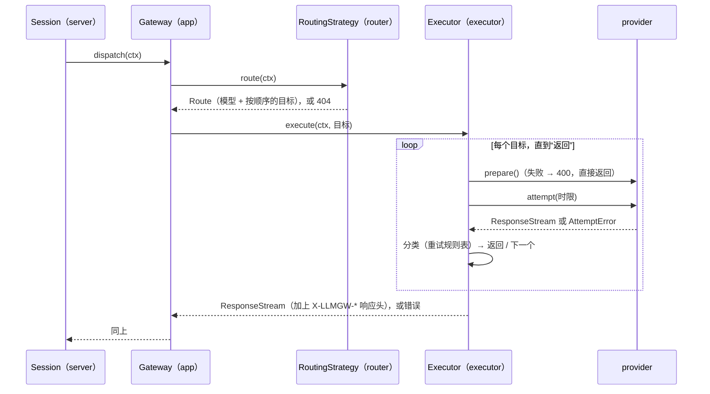

# 任务设计：1.7 router + executor：顺序切换、重试规则表、四种超时、取消

| 项目 | 内容 |
|---|---|
| Issue | [#14](https://github.com/bluesky-rgb/llmgw/issues/14) |
| 阶段 | 阶段 1：最小链路（v0.2 Alpha） |
| 工作量 | 1.5 天 |
| 状态 | 已完成（实现、验证、独立审查） |
| 实现的总体设计章节 | [design.md](../design.md) 6.1、6.3、6.11；[diagrams.md](../diagrams.md) 第 7 节；[extensibility.md](../extensibility.md) 第 3 节（`RoutingStrategy`） |

## 1. 目标与范围

**一句话：** 把一个请求按目标列表依次尝试，按 design.md 6.1 的规则决定“换下一个目标”还是“把结果交给客户端”，并且保证**请求可能已经被上游计费时不重试**。做完之后网关第一次可以真正跑起来：`llmgw serve`，1.8 用它接真实的上游。**路线图的验收标准：design.md 6.1 的每一行都有测试。**

**要做：**

| 部分 | 内容 |
|---|---|
| router | `RoutingStrategy` 扩展点 + 内置的顺序切换（按配置的顺序）；模型不存在时 404 |
| executor | 依次尝试：`prepare()` → 计算本次的时限 → `attempt()` → 分类 → 返回或者换下一个。记录每次尝试（`ctx->attempts`）、指标；每次尝试之前重置 `ctx->usage`、`ctx->ttft`；响应加上 `X-LLMGW-Provider`、`X-LLMGW-Attempts` |
| 重试规则表 | 纯函数：`AttemptError` 或状态码 → （结果分类，返回 / 换下一个）。6.1 的每一行对应一个用例 |
| 超时 | 连接、首字节按**目标**的配置、并且不超过剩余的总时间；空闲超时按**选中的目标**的配置（Session 的看门狗读取）；总超时仍由 Session 负责 |
| 取消 | 客户端断开、总超时：正在进行的尝试被取消，不再尝试下一个目标，不把被取消的尝试记为上游的失败 |
| 配置（补充 1.1） | `retry.retry_on_ambiguous`（默认 `false`，名字沿用 design.md 第 7 节的配置示例）：是否允许重试“结果不确定”的失败（diagrams.md 第 7 节“配置中允许不确定重试？”） |
| 组装与命令行 | app 中的 `Gateway`（`server::Dispatcher` 的实现 = router + executor）；`llmgw serve`：加载配置、启动 Server、收到 SIGINT / SIGTERM 时停止 |

**不做：**（以及在哪里做）
- 熔断器、重试预算（最近正常请求数的 20%）、舱壁隔离 → 2.5。本任务的循环中留出“跳过这个目标”的位置
- `x-should-retry` 响应头、官方 SDK 的兼容性测试 → 2.6
- 中间件（鉴权、限流、预算）→ 2.1–2.4。Session 已经是唯一的编排者，`Gateway` 只做路由 + 执行
- 上游配额感知 → 2.7；Prometheus 输出 → 2.8（这里只通过 `MetricsRecorder` 上报，app 暂时不接收集器）
- 优雅退出（先 503、等进行中的请求）→ 3.3。`serve` 收到信号时直接 `Server::stop()`
- 加权、最低延迟等路由策略 → v1.x（扩展点在本任务定下）

## 2. 在架构中的位置



- 涉及的模块：`router`、`executor`（新增实现）；`app`（`Gateway`、`serve`）；`server`（两处小改动，见下）；`core`（`RequestContext` 加一个字段）；`config`（`retry` 一节）
- **新增的模块依赖：`executor → upstream`**。executor 的决策依据是 `upstream::AttemptError`（阶段、`maybe_sent`、`timed_out`），也要持有 `upstream::Client` 的指针传给 `attempt()`。只经由 provider 的头文件间接使用这些类型，等于把依赖藏起来。修改 `module_deps.json`，补充 ADR-008。层次不变（upstream 在 executor 下面两层）
- 检查取消状态的 `is_cancelled()` 从 server 的 relay.cpp 移到 core 的 `task.h`，server 和 executor 共用
- `Gateway` 放在 app 中，编译成静态库 `llmgw_app_lib`（可执行文件和测试都链接它）
- executor **不**依赖 router：`execute()` 接收目标列表（`std::span<const config::TargetConfig* const>`），由 app 把两者接起来。这样 executor 的测试不需要路由
- server 的两处改动：
  1. `WorkerInfo` 增加 `worker_count`（每个 Worker 的连接池上限 = 总上限 ÷ Worker 数，`upstream::ClientOptions` 需要它）
  2. 看门狗的空闲超时改为 `ctx->upstream_idle`（选中的目标的 `timeouts.idle`），没有时用全局值。现在每个目标的 `timeouts.idle` 能配置、但没有人读取
- 与总体设计的偏离（理由见第 4 节，评审通过后同步修改 design.md 和 diagrams.md）：
  1. **最后一个目标返回 429 / 502 / 503 时，保留它的含义**：429 → 网关的 429 `rate_limited`，502 / 503 → 502，都带上上游的 `Retry-After`。这样客户端知道“过多久再来”，429 的含义也是对的。**不转发上游的响应体**（独立审查 #6：上游的 429 中有组织 ID，代理生成的 502 页面中有内部主机名）
  2. 前面的尝试中有“可能已发出”的失败（`retry_on_ambiguous = true` 时被重试了），最后全部失败时返回 504 而不是 502：请求可能已经被处理，不应该让客户端重试。这一条优先于上一条
  3. 除 502、503 以外的 5xx（501、505、Cloudflare 的 52x …）按“结果不确定”处理，与 500、504 相同。6.1 只列了 500、504
  4. 3xx 按“上游不可用”处理（换下一个目标）。API 返回重定向通常是 `base_url` 写错了，转发给客户端没有意义（`Location` 也不在响应头白名单中）

## 3. 接口设计

```cpp
// include/llmgw/router/router.h
namespace llmgw::router {

/// 一次路由的结果。指针指向 ctx->config 中的快照，与请求同生命周期。
struct Route {
  const config::ModelConfig* model = nullptr;
  std::vector<const config::TargetConfig*> targets;  ///< 尝试的顺序；不为空
};

/// 路由策略扩展点（extensibility.md 第 3 节）。每个 Worker 一个实例，只在该 Worker 的线程上调用，
/// 有状态的策略（轮询、按延迟）不需要加锁。
class RoutingStrategy {
 public:
  virtual ~RoutingStrategy() = default;
  /// 模型不存在 → 404 model_not_found
  [[nodiscard]] virtual Result<Route> route(const RequestContext& ctx) = 0;
};

/// 内置：按配置中的顺序。
std::unique_ptr<RoutingStrategy> make_failover();

}  // namespace llmgw::router
```

```cpp
// include/llmgw/executor/executor.h
namespace llmgw::executor {

struct Options {
  upstream::Client* client = nullptr;     ///< 这个 Worker 的；必须比 Executor 活得久
  MetricsRecorder* metrics = nullptr;      ///< 可以为空
};

/// 每个 Worker 一个实例（2.5 的熔断器、重试预算也放在这里，所以不是纯函数）。
class Executor {
 public:
  explicit Executor(Options options);
  /// 依次尝试 targets（指向 ctx->config 中的快照）。
  /// - 成功：ResponseStream（2xx，或者原样转发的上游响应），响应头中加上 X-LLMGW-Provider、X-LLMGW-Attempts
  /// - 失败：网关自己的错误（400、502、503、504）
  /// 被取消时返回一个错误，调用方先检查取消状态再处理（与 Dispatcher 的约定相同）。不抛异常。
  [[nodiscard]] Task<Result<std::unique_ptr<ResponseStream>>> execute(
      RequestContext* ctx, std::span<const config::TargetConfig* const> targets);
};

namespace detail {  // 重试规则表：纯函数，单元测试逐行覆盖 design.md 6.1
enum class Next : std::uint8_t { kReturn, kTryNext };
struct Verdict {
  AttemptResult result;  ///< ctx->attempts 和指标中的分类
  Next next;
  bool ambiguous;        ///< 上游可能已经处理（计费）了这个请求
};
Verdict classify(const upstream::AttemptError& e, bool retry_on_ambiguous);
Verdict classify(int status, bool retry_on_ambiguous);
}  // namespace detail

}  // namespace llmgw::executor
```

```cpp
// core/request_context.h：新增一个字段
/// 选中的目标的空闲超时。写入者：executor（返回响应之前）；读取者：Session 的看门狗。
std::optional<SteadyClock::duration> upstream_idle;

// config/snapshot.h：新增
struct RetryConfig {
  bool retry_on_ambiguous = false;  /// 允许重试结果不确定的失败（已发出请求后超时 / 断开、500、504 …）
};
// Snapshot::retry

// server/server.h：WorkerInfo 新增
unsigned worker_count = 1;
```

`llmgw serve [-c 配置文件]`：退出码 0（收到信号后正常停止）、1（配置错误、端口被占用）、2（参数错误）。启动后在标准错误输出监听的地址。

## 4. 重试规则表（design.md 6.1）

`classify` 的完整定义。**“不确定”**表示上游可能已经收到并处理了请求（可能已经计费）。

| design.md 6.1 的行 | 输入 | 分类（`AttemptResult`） | 默认 | `retry_on_ambiguous = true` |
|---|---|---|---|---|
| DNS、连接、TLS 失败 | `AttemptError`，`maybe_sent = false`，阶段 resolve / connect / proxy / tls | `kConnectError`（超时：`kTimeout`） | 换下一个 | 同左 |
| （补充）连接池已满，排队超时 | `maybe_sent = false`，阶段 queue | `kTimeout` | 换下一个 | 同左 |
| 复用的连接在发送阶段失败 | upstream 内部已经换新连接重发一次（1.4 U4）；新连接上再失败：`kSend`，`maybe_sent = false` | `kConnectError` | 换下一个 | 同左 |
| 429、502、503 | 状态码 | `kStatus429` / `kStatus5xx` | 换下一个 | 同左 |
| 401、403、余额不足 | 状态码 401 / 403 / 402（业务错误码经 `error_mapping` 映射到 402 也算） | `kStatus4xx`；401、403 计入 `llmgw_upstream_auth_errors_total` | 换下一个 | 同左 |
| 读取超时、连接被重置（已发出请求，未收到响应头） | `maybe_sent = true`（包括配置了 `error_mapping` 时预读响应体超时、出错） | `kTimeout` / `kConnectError`，不确定 | **返回 504** | 换下一个 |
| （补充）复用的连接上写成功、一个字节的响应都没有就断开 | `maybe_sent = true` + `reused_without_response`（1.4 留给本任务决定） | `kConnectError`，不确定 | **返回 504** | 换下一个 |
| 500、504 | 状态码（以及其他 5xx，偏离 3） | `kStatus5xx`，不确定 | **原样返回** | 换下一个 |
| 其他 4xx | 状态码 | `kStatus4xx` | 原样返回 | 同左 |
| （补充）3xx | 状态码 | `kStatus5xx` | 换下一个（偏离 4） | 同左 |
| 流式输出开始以后中断 | 不经过 executor：`attempt()` 已经返回，错误由 `next()` 交给 Session，Session 在流末尾追加 `error` 事件（ADR-003） | — | 不切换 | 同左 |
| 被取消（客户端断开、总超时） | 尝试返回后检查 `cancellation_state` | `kCancelled` | 停止，不记为上游的失败 | 同左 |

**复用的连接上“写成功、没有任何响应就断开”**：最常见的原因是上游恰好在复用之前关闭了空闲连接（1.4 第 6 节的竞态窗口），这时上游没有处理请求；但也可能是上游收到请求后崩溃。分不出来，按“不确定”处理（504）。`upstream.idle_timeout`（60 秒）小于各家上游的空闲超时时，这个窗口很小；1.8 用真实上游测量实际频率，频繁出现再考虑（独立审查 #5）。

**尝试完所有目标仍然没有可以返回的结果时**（按顺序判断。实现时按独立审查调整了顺序和第 2 条，见评审记录）：

1. 有任何一次尝试是“不确定”的（只有 `retry_on_ambiguous = true` 时才会继续尝试）→ **504** `upstream_timeout`，提示不要自动重试（偏离 2）。即使最后一次是 429 也一样：429 会让客户端过一会儿重来，可能重复计费
2. 最后一次尝试拿到了 429、502、503 的响应 → 429 → **429** `rate_limited`；502 / 503 → **502**；都带上上游的 `Retry-After` / `retry-after-ms`（取整到秒，超过 24 小时或不是数字的不转告）。**不转发响应体**（偏离 1）。401 / 403 / 402 / 3xx 不算：前者说明网关自己的上游密钥有问题，后者没有意义
3. 否则 → **502** `upstream_unavailable`（包括总时间用完、没有不确定的尝试时）

错误信息**只有每次失败的分类**，例如 `所有上游都失败了（尝试了 2 次：连接失败，503）`，不包含上游名、`AttemptError::detail`（主机名、IP）。design.md 6.10：返回给客户端的错误不包含上游的名称和地址；需要排查时从 `ctx->attempts`（以后写进日志）查。成功的响应中 `X-LLMGW-Provider` 是客户端契约的一部分（design.md 第 5 节），不受这条限制。

**为什么偏离 1**：所有上游都在限流时，429 + `Retry-After` 告诉客户端“过多久再来”，官方 SDK 会照做；网关自己的 502 没有这个信息，SDK 只会按自己的退避立即重试，加重限流。503 同理。

**限制**：总尝试次数不超过目标的个数（每个目标最多一次）；所有尝试共享 `ctx->request.deadline`。

## 5. 超时与取消

| 超时 | 谁负责 | 取值 |
|---|---|---|
| 连接（包括在连接池排队） | `upstream::Client::send()`（`Deadlines::connect`） | `min(目标的 timeouts.connect, 剩余的总时间)` |
| 首字节 | 同上（`Deadlines::first_byte`） | 流式：`timeouts.first_byte`；非流式：`timeouts.first_byte_non_stream`；都不超过剩余的总时间 |
| 空闲：预读（配置了 `error_mapping`，返回响应之前） | `provider::attempt()`：预读中的每次读取与定时器竞速（独立审查 #2：原来预读不受任何超时限制，上游发完响应头就不动时要等总超时） | `min(目标的 timeouts.idle, 剩余的总时间)`；超时按 `{kBody, maybe_sent, timed_out}`，即 504 |
| 空闲：返回响应之后 | Session 的看门狗（1.3） | `ctx->upstream_idle`（executor 写入选中的目标的 `timeouts.idle`），没有时用全局值。不在每个数据块上竞速（ADR-006） |
| 总 | Session（`relay ‖ 客户端断开 ‖ 总截止时间`） | 全局 `timeouts.total`（目标不能覆盖，1.1 已校验） |

- 剩余的总时间 ≤ 0 时不再开始新的尝试，返回 504（之前有不确定的尝试）或 502
- 取消：Session 的竞速取消 `dispatch()` 协程，取消沿 `co_await` 链传到 `send()` / `open()`，它们很快返回一个错误（1.4 U10、1.5 已验证）。**每次尝试返回之后、记录和分类之前，先检查取消状态**（task.h 的规则）：被取消了就记一条 `kCancelled`，不更新指标中的失败计数，直接返回
- Session 的总超时比 executor 的“剩余时间”更早生效：executor 的上限只是为了不让单次尝试的定时器设得比请求还长。各阶段依次进行，每个阶段的上限都按尝试开始时的剩余时间计算，加起来仍可能超过剩余时间；总时间只由 Session 保证（独立审查 #7）

## 6. 数据与状态

| 数据 | 所有者 | 线程归属 | 生命周期 |
|---|---|---|---|
| `RoutingStrategy`、`Executor`、`upstream::Client` | `Gateway` | Worker 级 | Worker 的生命周期；`Client` 先于 `Executor` 创建、后于它销毁。**Worker 先销毁 Dispatcher、再销毁 io_context**：`Client` 的定时器、空闲连接析构时要用 io_context 的服务（独立审查 #1，原来的顺序在停止时 heap-use-after-free）；未完成的协程通过 `shared_ptr` 持有连接池的状态，不依赖 `Client` 对象（1.4 U10） |
| `Route`（指向快照的指针） | `Gateway::dispatch()` 的栈帧 | 请求级 | 一次 dispatch；快照由 `ctx->config` 保持 |
| 每次尝试的 `ResponseStream`（失败的） | `execute()` 的栈帧 | 请求级 | 分类为“换下一个”时立即销毁（连接关闭，不还回池中：响应体没有读完） |
| `TlsContexts` | `serve` | 全局（只读） | 进程 |

## 7. 失败与边界情况

| 情况 | 处理 | 验证 |
|---|---|---|
| `prepare()` 失败（请求体不是 JSON 对象） | 400，直接返回，不尝试其他目标（换哪个目标都一样），`ctx->attempts` 为空 | X12 |
| 目标引用的上游在快照中找不到 | 配置加载时已校验，不会发生；防御：记为 `kConnectError`，换下一个 | 代码审查 |
| 第二个目标的改写规则与第一个不同 | 每次尝试都用原始请求体重新 `prepare()` | X13 |
| 第一次尝试的预读中提取到了 usage，然后换到第二个目标 | 每次尝试之前重置 `ctx->usage`、`ctx->ttft` | X14 |
| 被丢弃的响应 | 析构即关闭连接；不读完响应体（可能很大、很慢） | X3 |
| 原样转发的上游响应（4xx、最后的 429） | 同样加 `X-LLMGW-*` 响应头 | X7 |
| 上游名中的特殊字符 | 上游名只允许字母、数字和 `._-`（1.1 已校验），可以直接放进响应头 | — |
| 所有目标都在超时之前失败 | 循环结束，按第 4 节的三条规则返回 | X9 |
| 被取消发生在尝试之间（两个 `co_await` 之间） | 开始下一次尝试之前也检查取消状态 | X11 |

## 8. 验证计划

“X” 是本任务的编号。X1–X10 对应 design.md 6.1 的每一行（路线图的验收标准）。每一行都有两层测试：`classify` 的单元测试（全部输入组合 × `retry.retry_on_ambiguous`），和用真实的 `upstream::Client` + 两个测试上游的集成测试（检查第二个上游**有没有收到请求**，这是“是否重试”唯一可信的证据）。

| # | 场景 | 方法 | 通过标准 |
|---|---|---|---|
| X1 | DNS、连接、TLS 失败 | 关闭的端口、解析失败的 resolver、主机名不匹配的证书 | 第二个上游收到 1 个请求并成功；`ctx->attempts` = [conn_error, ok] |
| X2 | 排队超时 | 第一个上游 `max_connections = 1`，先占住 | 换下一个 |
| X3 | 429、502、503 | 第一个上游返回这些状态码 | 第二个上游收到请求；第一个只收到 1 个 |
| X4 | 401、403、402（含 `error_mapping` 映射成 402） | 同上 | 换下一个；401/403 的 auth 指标 +1；最后一个目标返回 401 时客户端得到 502，响应体中没有上游的内容 |
| X5 | 已发出后超时 / 断开 | 第一个上游收到请求后不响应（首字节超时 1 秒）/ 收到后关闭连接 | 默认：504，第二个上游收到 **0** 个请求；`retry_on_ambiguous = true`：换下一个 |
| X6 | 500、504、501 | 同 X3 | 默认：原样返回，第二个上游收到 0 个；`retry_on_ambiguous = true`：换下一个 |
| X7 | 其他 4xx（400、404、422） | 同 X3 | 原样返回（状态码、响应体），带 `X-LLMGW-*`；第二个收到 0 个 |
| X8 | 流式输出开始以后中断 | 第一个上游发出两个事件后断开 | `execute()` 成功返回；`next()` 报错；第二个上游收到 0 个 |
| X9 | 全部失败 | 连接失败 × 2；503 + 429（带 `Retry-After`）；429 + 503（`retry-after-ms`）；不合理的 `Retry-After`；`retry_on_ambiguous = true` 时超时 + 连接失败 / 超时 + 429 | 502（信息中只有分类，没有上游名、地址）；429 + `Retry-After`，不转发响应体；502 + 取整的 `Retry-After`；不转告；两种都是 504 |
| X10 | 共享截止时间 | 总时间剩 1 秒，目标的首字节超时 60 秒，上游不响应 | 约 1 秒结束；截止时间已过时不发出请求 |
| X11 | 取消 | 第一个尝试等响应头时取消 `execute()` | 100 ms 内返回；第二个上游收到 0 个；attempts 最后一条是 `kCancelled`；失败指标不增加 |
| X12 | 请求体不合法 | 非 JSON 对象 | 400，没有发出任何请求 |
| X13 | 每个目标的改写 | 两个目标不同的 `set_fields` | 每个上游收到的请求体按自己的规则改写 |
| X14 | 重置 usage、ttft | 第一次尝试中预读得到 usage、ttft，然后换下一个 | 最终的值只来自第二个上游 |
| X15 | 每个目标的超时 | 目标 A 的首字节 1 秒（`retry_on_ambiguous = true`），目标 B 正常；目标 B 的 `timeouts.idle` 为 1 秒 | A 约 1 秒后换到 B；`ctx->upstream_idle` = 1 秒；Session 按它判断空闲超时（server 的测试） |
| X16 | 指标、attempts | 记录型的 `MetricsRecorder` | 每次尝试一条 `llmgw_upstream_attempts_total{provider, result}`、一个耗时；被取消的不计为失败 |
| X17 | 路由 | 未配置的模型；目标的顺序 | 404 `model_not_found`；顺序与配置一致 |
| X18 | 端到端 | 进程内的 Server + Gateway + 测试上游，HTTP 客户端发请求 | 流式、非流式、切换后成功，客户端看到 `X-LLMGW-Provider` |
| X19 | `llmgw serve` | CLI 测试：启动真实进程，`/health`，发一个请求（上游不可用 → 502），SIGTERM | 退出码 0，5 秒内退出；配置错误时退出码 1 |
| X20 | 密钥不泄漏 | 上游返回 401、连接失败等所有错误路径 | 返回给客户端的内容中没有 API 密钥、代理密码 |
| X21 | 工程规范 | clang-format、clang-tidy（先确认新文件在编译数据库中）、check_deps、ASan/UBSan、TSan 各 2 次 | 全部通过 |
| X22 | 独立审查 | 审查者只看代码和本文档，从“会不会重复计费”“会不会该切换不切换”“取消”出发 | 发现的问题全部处理 |

反向验证：重试规则表的每一行改成相反的决定，对应的测试必须失败；取消检查、usage 重置、截止时间的上限各去掉一次。

## 9. 风险与备选方案

| 风险 | 应对 |
|---|---|
| 偏离 1（转发最后的 429）让客户端看到的是某一个上游的限流信息，而不是“网关整体”的 | 这正是客户端需要的：所有上游都在限流；`X-LLMGW-Attempts` 说明尝试过几个 |
| 被丢弃的响应不还回连接池：上游大面积返回 503 时，每次切换都要新建连接 | 503 的响应体一般很小；2.5 可以加“读完不超过 64 KB 的响应体再丢弃”的优化，先测量 |
| `serve` 收到信号就停：进行中的请求被中断 | 3.3 做优雅退出；文档中说明 |
| **客户端这一层的重复计费**：原样返回的 500 / 504 和网关的 504，OpenAI 官方 SDK 默认都会自动重试 2 次（design.md 第 5 节）。网关错误信息里的“请不要自动重试”程序读不懂 | 2.6 加 `x-should-retry: false`；在此之前，用户文档提醒把 SDK 的 `max_retries` 设为 0（独立审查的备注） |
| 热加载（3.1）之后，`upstream::Client` 的配置与 `ctx->config` 可能不是同一个快照：`send()` 要求上游的指针来自 Client 自己的配置 | 3.1 的设计输入：Client 随快照重建，或者按名字查找上游 |
| OpenAI 的额度用完返回的是 **429**（`insufficient_quota`），不是 402：会切换（正确），但最后一个目标额度用完时客户端看到 429，会一直重试 | 只看状态码分不出来。providers.md 的验证清单（1.8）记录各家的实际响应；需要时用 `error_mapping` 把它映射成 402，或者在 2.7 的配额感知中处理 |
| 每个 Worker 一个 `Client`：连接池按 Worker 切分，Worker 多时每个池很小 | 1.4 的设计（`per_worker_limit`），不变 |

## 评审记录

| 日期 | 结论 | 说明 |
|---|---|---|
| 2026-11-22 | 设计通过（自审） | 发现 2 处，已修改：① OpenAI 的额度用完是 429 而不是 402，补充到第 9 节的风险；② 检查取消状态的辅助函数只在 server 的 relay.cpp 中，executor 也需要：移到 core 的 task.h（`llmgw::is_cancelled()`），两处共用。实现完成后做独立审查（X22） |

| 2026-11-22 | 独立审查（X22） | 7 项：critical 1、important 1、minor 4、nit 若干；默认配置下没有找到会重复计费的路径。处理见下 |

独立审查（X22，从“会不会重复计费”“会不会该切换不切换”“取消”出发，每一项都要求复现）发现的问题与处理。每一项都先写复现的测试、确认失败，再修复，再反向验证：

| # | 级别 | 问题 | 处理 |
|---|---|---|---|
| 1 | critical | 停止时 Worker 先销毁 io_context、后销毁 Gateway：`Client` 的定时器、空闲连接析构时访问已释放的 reactor、timer service（valgrind 复现；1.7 之前的测试替身不持有 I/O 对象，所以没暴露） | Worker 改为先销毁 Dispatcher、再销毁 io_context（第 6 节）。补上缺失的 X18（进程内 Server + Gateway），ASan 下先复现 heap-use-after-free，修复后通过 |
| 2 | important | 配置了 `error_mapping` 时，返回响应之前的预读不受任何逐目标的超时限制：上游发完响应头就不动，只能等总超时（600 秒） | 预读中的每次读取与 `min(目标的 idle, 剩余时间)` 竞速，超时按“不确定”（504）；`open()` 返回后关闭，不在每个数据块上竞速。测试：流式、非流式各一 |
| 3 | minor | 总时间用完时一律 504（“可能已经计费”），与第 5 节不符；X10 把偏离写成了预期 | 没有不确定的尝试时 502；X10 改正 |
| 4 | minor | 测试缺口：连接时限的上限没有测试（去掉也全部通过）；X18 缺失；6.1 第 2 行只有单元测试；X11 不完整、时间余量太紧 | 都已补上：排队时的连接时限、复用连接写失败 / 新连接写失败、被取消时不记耗时、余量放宽到 1 秒 |
| 5 | minor | 复用连接上“写成功、没有任何响应就断开”按 504 处理，设计没有记录这个决定 | 写进第 4 节（保持 504，1.8 测量频率） |
| 6 | minor | 原样转发最后的 502 / 503：代理、CDN 生成的错误页可能带内部主机名；错误信息列出上游名，与 design.md 6.10 矛盾 | 最后的 429 / 502 / 503 改为网关自己的错误：保留状态码的含义和 `Retry-After`，不转发响应体；错误信息只有失败的分类。同时把“有不确定的尝试 → 504”提到最前面（否则 429 会让客户端重来） |
| 7 | nit | 各阶段时限加起来可能超过剩余时间；防御分支不计入 Attempts；热加载后 Client 与 ctx 的快照可能不同；`retry.budget` 报“未知字段”；SIGPIPE 没有忽略 | 文档说明；计入；记为 3.1 的设计输入；保持（报错中列出了允许的字段）；`serve` 忽略 SIGPIPE |
| 备注 | — | 官方 SDK 默认会自动重试 500 / 504：客户端这一层的重复计费在 2.6 之前仍然存在 | 写进第 9 节的风险 |

## 验证记录

| # | 结果 | 数据 / 证据 |
|---|---|---|
| X1–X10 | 通过 | design.md 6.1 的每一行：`Classify.*` 10 个单元测试（全部输入 × `retry_on_ambiguous`）+ `Executor.X1`–`X10` 集成测试，用真实的 `upstream::Client` 和测试上游，断言后面的上游**有没有收到请求**。包括 DNS / 连接 / TLS 失败、排队超时、复用连接写失败、429/502/503、401/403/402（含业务错误码映射）、已发出后超时 / RST、500/504/501、其他 4xx、流式中途断开、全部失败的 6 种组合、连接与首字节时限的上限 |
| X11 | 通过 | 等响应头时取消：约 200 ms 返回；第二个上游 0 个请求；attempts 为 `[cancelled]`；不计失败、不记耗时 |
| X12–X16 | 通过 | 400 不发请求；每个目标按自己的规则改写、用自己的密钥；重置 usage 和 ttft；目标自己的首字节、空闲超时，预读受空闲超时限制（流式、非流式）；指标与 attempts |
| X17 | 通过 | `Router.*` 3 个：顺序、404、不回显任意的模型名 |
| X18 | 通过 | `GatewayE2E.*`：进程内 Server + Gateway，切换后成功（非流式、流式、404）；停止时连接池中有空闲连接、有挂起的请求，ASan 下都没有问题（修复之前复现了 heap-use-after-free） |
| X19 | 通过 | `cli.serve_smoke`：真实进程 + Python 写的假上游，切换、密钥来自环境变量、流式不转发 usage 块、404、SIGTERM 立即退出（退出码 0）、配置错误退出码 1、输出中没有密钥 |
| X20 | 通过 | 所有错误路径的错误信息中没有密钥、上游名、内部地址（X4、X9 断言） |
| X21 | 通过 | clang-format、clang-tidy（确认新文件都在编译数据库中，报告的 4 处已修改）、check_deps、check_todos；ASan/UBSan、TSan 各 2 次全部通过（289 个测试；普通构建 290 个） |
| X22 | 通过 | 上表 7 项全部处理 |
| 反向验证 | 通过 | 32 处故意引入的错误全部被发现：重试表每一行改成相反的决定、最后一个目标的处理、全部失败时的三条规则和它们的顺序、Retry-After 的解析、三种时限的上限、截止时间、取消检查、取消时不记耗时、400、每个目标的改写、usage/ttft 重置、空闲超时、预读超时、auth 指标、三个响应头、Session 用目标的空闲超时、路由回显、Worker 数。恢复后逐字节比较 |

## 收获与教训

1. **检查“是否被取消”的函数本身不能是协程**：被取消之后，`co_await` 另一个协程就会抛出 `operation_aborted`，所以 server 原来的 `co_await is_cancelled()` 永远返回不了 true，四处检查都是靠抛异常、被 `||` 吞掉而“碰巧”正确的。executor 第一次真正依赖它的返回值（要记录 `cancelled`），X11 立即暴露了问题。task.h 早就写着“下一次 co_await 才会抛出异常”，写这个辅助函数时却没想到它自己就是一次 co_await。现在有一个单元测试固定住这个行为
2. **测试替身会掩盖生命周期问题**：1.3 的 `FakeDispatcher` 不持有任何 I/O 对象，所以“io_context 先于 Dispatcher 销毁”的顺序一直没出问题；1.7 换成持有连接池的 Gateway，停止时就是释放后使用。设计中写了 X18（进程内的真实组装），实现时漏掉了，审查者正是从“没有测试链接 `llmgw_app_lib`”找到的。组装起来的真实对象至少要有一个在 ASan 下跑过停止流程的测试
3. **跨阶段的超时要逐段检查“谁在计时”**：`send()` 管到响应头，Session 的看门狗从 dispatch 返回才开始，中间的预读谁也不管。画时间线（第 5 节的表）时没有把“预读”单独列一行
4. **“原样转发”要问一句：转发的是谁写的内容**：最后的 429 / 502 原样转发能保留 `Retry-After`，但响应体可能是代理、CDN 生成的，带着内部信息。保留含义（状态码、`Retry-After`），丢掉内容
5. **构建失败时测试结果是旧的**：两次因为 ninja 在一个不存在的目标上停下、或者编译出错，跑的还是旧的二进制，看到的结果和刚改的代码无关。以后先确认构建成功，再看测试结果
