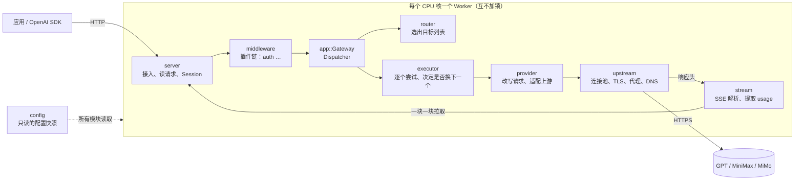

# 项目导览：llmgw 现在是什么样子

> 写给项目的主人看的：读完之后，你应该能用自己的话讲清楚这个项目做了什么、怎么做的、为什么这样做、还缺什么。
> 文中的每个文件名、函数名都对照代码核实过（2026-11-23，`main` 的提交 `8dae7b9`）。
> 更详细的内容在各个设计文档中，这里只给出主线和指路。

## 1. 一句话

**llmgw 是一个放在应用和大模型服务商之间的网关**：应用只需要会调用 OpenAI 的接口，网关负责把请求转给 GPT、MiniMax、MiMo 等上游，一家出问题时自动换下一家，并且保证**可能已经被上游计费的请求不会被重发**（不重复扣钱）。用 C++20 协程写成，目标是一台机器支撑上万条同时进行的流式对话。

## 2. 现在能做什么、不能做什么

| 能做 | 不能做（还没实现） |
|---|---|
| OpenAI 兼容的 `/v1/chat/completions`（流式和非流式）、`/v1/models` | 监控指标 `/metrics`、访问日志（任务 1.2，**没做**；之前的进度表错标为已完成） |
| 按配置的顺序在多个上游之间自动切换；只在“请求肯定没被处理”时重试 | 按 key 限流、花费预算、价格表（2.3、2.4） |
| 连接、首字节、空闲、总时长四种超时；客户端断开时立刻停止读上游 | 熔断、上游配额感知（2.5、2.7） |
| 每个上游的请求改写（删字段、改名、强制设值） | 改配置不用重启（3.1）；重启不打断进行中的请求（3.3） |
| 客户端鉴权：网关 key，配置中只保存哈希；`llmgw keygen` | 管理命令 `status`、`reload` 等（3.4） |
| 中间件插件框架（鉴权是第一个插件） | 长时间稳定性测试、混沌测试（4.1） |
| `llmgw check` 校验配置，一次列出全部问题并给出修改建议 | |
| 压测：单核上约 9000 条同时进行的流，每条流约 24–28 KB 内存（[benchmark.md](benchmark.md)） | |

## 3. 整体结构



**两个最重要的结构特点：**

1. **每个 CPU 核一个 Worker**（`src/server/worker.cpp`）：每个 Worker 有自己的事件循环、自己的上游连接池、自己的插件实例；内核用 `SO_REUSEPORT` 把新连接分给各个 Worker。Worker 之间不共享可变数据，所以热路径上**没有锁**
2. **Session 是唯一的编排者**：中间件、路由、执行、上游这些模块互不调用，都由 Session 按顺序串起来。模块之间只通过 `include/llmgw/<模块>/` 下的公开头文件交互，依赖方向由 `tools/check_deps.py` 在 CI 中检查（规则在 `tools/module_deps.json`）

## 4. 模块一览

| 模块 | 行数 | 做什么 | 从哪里开始读 |
|---|---|---|---|
| `core` | 700 | 所有模块共用的类型：`RequestContext`（一个请求的全部状态）、`Error`、`ResponseStream`（一块一块拉取的响应）、`Task<T>`（协程） | `request_context.h`、`task.h` |
| `config` | 1831 | 读取、校验配置文件，生成只读的快照；`llmgw check` 的全部逻辑 | `loader.cpp` 的 `parse()` |
| `server` | 1904 | 监听端口、接受连接、读 HTTP 请求、各种超时和大小限制、把响应写回客户端 | `session.cpp`、`relay.cpp` |
| `middleware` | 819 | 插件接口、插件链、`auth` 插件 | `middleware.h`、`chain.cpp`、`auth.cpp` |
| `router` | 81 | 按模型名找到目标列表（目前只有“按顺序切换”一种策略） | `failover.cpp` |
| `executor` | 384 | 按目标列表逐个尝试，按重试规则表决定换下一个还是返回 | `executor.cpp` 的 `try_target()`、`classify.cpp` |
| `provider` | 660 | 把请求改写成某个上游需要的样子，发出去，把响应交给 stream | `provider.cpp` 的 `prepare()`、`attempt()` |
| `upstream` | 1528 | 到上游的 HTTP 客户端：连接池、TLS、出站代理、DNS 缓存 | `client.cpp` 的 `Client::send()` |
| `stream` | 820 | 解析上游的 SSE 流、提取 token 用量、错误映射 | `sse_parser.cpp`、`stream.cpp` 的 `open()` |
| `app` | 471 | 程序入口和组装：命令行、`serve`、`keygen`、把各模块接起来 | `main.cpp`、`serve.cpp`、`gateway.cpp` |
| `observability`、`accounting`、`admin` | 0 | **只有目录和说明，还没有代码**（指标、计费、管理面） | — |

源代码共约 9200 行，测试约 10400 行，文档约 7700 行。

## 5. 一个请求走过的路

以客户端发一个流式请求 `POST /v1/chat/completions`、`"model": "smart"` 为例：

| # | 发生什么 | 代码 |
|---|---|---|
| 1 | 某个 Worker 的 `accept_loop` 接受连接，为它启动一个 Session 协程 | `worker.cpp` `Worker::accept_loop()` |
| 2 | 读请求头和请求体，限制大小和速度（防慢速攻击）；按路径分发 | `session.cpp` `read_request()`、`handle()` |
| 3 | 只解析出 `model` 和 `stream` 两个字段（simdjson，不构建整个 JSON），建立 `RequestContext`，取出 Bearer token 和客户端地址 | `relay.cpp` `handle_chat()`、`session.cpp` `make_info()` |
| 4 | **三方竞速**：处理请求 ‖ 客户端断开 ‖ 总超时。谁先结束，其余两个被取消 | `relay.cpp` `handle_chat()` 中的 `relay(&ex) \|\| client_closed(...) \|\| timer_fired(...)` |
| 5 | 插件链的 `on_request`：`auth` 校验网关 key，不通过直接返回 401，不会到达上游 | `chain.cpp` `Chain::on_request()`、`auth.cpp` |
| 6 | 找到 `smart` 的目标列表（比如先 GPT、再 MiniMax） | `gateway.cpp` `dispatch()` → `failover.cpp` |
| 7 | 逐个尝试目标：改写请求 → 从连接池取连接 → 发送 → 等响应头 | `executor.cpp` `try_target()` → `provider.cpp` `attempt()` → `client.cpp` `Client::send()` |
| 8 | 按结果分类决定：换下一个，还是把结果交给客户端（见第 6 节第 3 点） | `classify.cpp` |
| 9 | 拿到响应头：写给客户端（加上 `X-LLMGW-Provider` 等头） | `relay.cpp` `respond()`、`write_head()` |
| 10 | **拉取循环**：从上游拉一块、写给客户端一块、写完再拉下一块。客户端读得慢，网关就读得慢（背压），不会在内存里堆积 | `relay.cpp` `pump()`、`pull()`、`write_chunk()` |
| 11 | 同时有一个看门狗：上游太久没有数据（空闲超时）、客户端不再读数据，都会结束请求 | `relay.cpp` `watchdog()` |
| 12 | 竞速结束之后：插件链的 `on_complete`（以后的限流、计费在这里结算），然后连接可以复用 | `relay.cpp` `finish_chain()` |

## 6. 五个值得讲的设计决定

面试时这些是最有内容的部分，每一条都有记录在案的理由（`docs/decisions.md` 中的 ADR）。

1. **C++20 协程 + Asio，每核一线程**（ADR-006）：每条连接是一个协程，代码写起来像同步的，实际上是异步的；一个线程可以同时处理几千条流。先做了一个 demo（任务 0.6、0.7）测过数据才决定的
2. **拉取模型和背压**：响应是“一块一块拉”的，不是上游推多少就收多少。好处：内存有上限；客户端断开时可以立刻停止读上游（ADR-005），不白白消耗上游的 token
3. **可能已经计费的请求不重试**（ADR-003、ADR-004，`docs/design.md` 6.1）：这是这个项目和很多网关不一样的地方。规则是“请求完整发出之后的任何失败都当作上游可能已经处理了”（`upstream` 中的 `maybe_sent`）：这时换下一家可能让用户付两次钱，所以默认不重试，返回 504 并告诉 SDK 不要自动重试（`x-should-retry: false`）。流式输出开始之后出错，也不再切换，而是在流末尾附加一个错误事件
4. **取消沿着协程链传播**：客户端断开 → 竞速取消处理请求的协程 → 取消一路传到正在等上游的那一步 → 连接被关闭、上游请求结束。这件事在协程里很容易写错，项目的规则写在 `core/task.h`（比如“被取消之后再 co_await 会抛异常”）
5. **插件“一定会收尾”**（任务 2.1）：只要插件的 `on_request` 被调用过，它的 `on_complete` 就一定会被调用一次，不论请求怎样结束。以后的预算插件依赖这一点：先冻结一笔额度、结束时按实际用量结算，不会漏结

## 7. 质量是怎样保证的

- **测试**：377 个（`ctest`），包括单元测试、启动真实网关和假上游的集成测试、命令行测试、模糊测试；原型的端到端测试在新架构上全部通过（任务 1.9）
- **CI 每次都跑**（`.github/workflows/ci.yml`）：普通构建、AddressSanitizer + UBSan（内存错误）、ThreadSanitizer（线程竞争）、格式和静态检查（clang-format、clang-tidy）、模块依赖规则、模糊测试、Docker 镜像构建、依赖漏洞扫描
- **流程**：每个任务先写设计（`docs/tasks/`），处理网络输入的改动由独立的审查者检查；修问题时先写一个会失败的测试，再修
- **诚实的局限**：上面这些检查都是 AI 在做、AI 在把关。它们能防住“代码写坏了”，防不住“做了不该做的事”或“汇报错了”——比如任务 1.2 被错标为已完成，就没有任何检查发现。所以从现在起改为：每个任务开工前由你批准，进度以 Issue 和合并的 PR 为准，由脚本核对

## 8. 在你自己的电脑上跑起来

需要 Linux（或 WSL2），以及 GCC 13 或 Clang 17 以上、CMake、Ninja、OpenSSL 3：

```bash
sudo apt-get install -y build-essential cmake ninja-build libssl-dev git
git clone https://github.com/bluesky-rgb/llmgw && cd llmgw
cmake -S . -B build -G Ninja -DCMAKE_BUILD_TYPE=Release -DLLMGW_BUILD_TESTS=OFF
cmake --build build                      # 第一次会下载依赖，几分钟

cp config/llmgw.example.json llmgw.json
sed -i 's/"host": "0.0.0.0"/"host": "127.0.0.1"/' llmgw.json
export OPENAI_API_KEY=你的key            # 用哪家就设哪家的
./build/src/app/llmgw check -c llmgw.json
./build/src/app/llmgw serve -c llmgw.json
```

另开一个终端：

```bash
curl http://127.0.0.1:8080/v1/chat/completions -H "Content-Type: application/json" \
  -d '{"model": "smart", "stream": true, "messages": [{"role": "user", "content": "你好"}]}'
```

配置里的模型名和上游以 `config/llmgw.example.json` 为准，详细说明见 [usage.md](usage.md)。

## 9. 建议的阅读顺序

1. 本文
2. [product.md](product.md)：为什么要做、给谁用
3. [design.md](design.md) 的第 3 节（请求的生命周期）和 6.1（重试规则表）
4. [decisions.md](decisions.md)：10 个 ADR，每个都是“当时有哪些选择、为什么选这个”
5. 代码：`relay.cpp` 的 `handle_chat()` → `executor.cpp` 的 `try_target()` → `classify.cpp`。这三处是整个项目的核心逻辑，合起来不到 600 行
